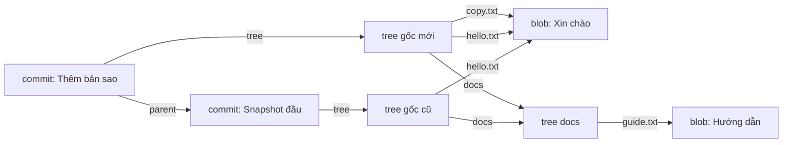

## Bạn sẽ học được gì

- Biết ba loại object chính Git lưu cho mỗi snapshot: blob, tree, commit.
- Hiểu vì sao object ID phụ thuộc vào nội dung và hệ quả của điều đó.
- Tự mở từng object bằng `git cat-file` để thấy chúng liên kết với nhau thế nào.
- Giải thích được vì sao hai tệp giống hệt nhau chỉ tốn một object.

## Khái niệm

Bên dưới các lệnh quen thuộc, Git là một **kho object định danh theo nội dung**. Mỗi thứ Git lưu đều được nén và đặt tên bằng một mã băm (hash) tính từ chính nội dung đó. Mặc định là SHA-1, 40 ký tự hex. Cùng nội dung thì cùng ID, khác một byte thì ID khác hoàn toàn.

Một snapshot được xây từ ba loại object:

**Blob** chứa đúng các byte của một tệp. Blob không biết tên tệp, không biết quyền, không biết nó nằm trong thư mục nào. Chỉ có nội dung. Vì vậy hai tệp `hello.txt` và `copy.txt` có nội dung giống nhau sẽ dùng chung một blob.

**Tree** là một thư mục. Mỗi dòng của tree gồm mode (loại tệp và quyền), loại object, ID, và tên. Dòng có thể trỏ tới blob (tệp) hoặc tree khác (thư mục con). Tên tệp và quyền nằm ở đây chứ không nằm trong blob.

**Commit** gắn một tree gốc với ngữ cảnh: tác giả, người commit, thời gian, thông điệp, và một hoặc nhiều **parent** (commit cha). Commit đầu tiên không có parent; merge commit có từ hai parent. Chuỗi parent chính là lịch sử.

Ngoài ra còn loại thứ tư là **annotated tag**, sẽ gặp ở track phát hành.

Hệ quả của việc định danh theo nội dung:

- Không sửa được object đã có. "Sửa" một commit (amend, rebase) thực chất là tạo commit mới với ID mới.
- Snapshot không chép lại tệp không đổi. Commit mới chỉ tạo blob cho tệp đã đổi; tree mới tái sử dụng ID của blob và tree con cũ.
- Toàn vẹn dữ liệu: nếu một byte bị hỏng, ID tính lại sẽ không khớp và Git phát hiện được.

## Hình dung bằng sơ đồ



## Lệnh cần biết

```bash
git cat-file -t <object>    # loại object: blob, tree, commit, tag
git cat-file -p <object>    # in nội dung object dễ đọc
git cat-file -s <object>    # kích thước nội dung (byte)
git ls-tree HEAD            # liệt kê tree gốc của HEAD
git rev-parse HEAD^{tree}   # ID tree gốc của commit
git hash-object <tệp>       # tính ID blob của tệp mà không lưu
git count-objects -v        # thống kê object trong kho
```

| Cú pháp | Trỏ tới |
| --- | --- |
| `HEAD` | Commit hiện tại |
| `HEAD^{tree}` | Tree gốc của commit đó |
| `HEAD:docs` | Tree của thư mục `docs` trong commit |
| `HEAD:hello.txt` | Blob của tệp trong commit |

## Ví dụ từng bước

Repository có `hello.txt` và `docs/guide.txt`, một commit. Mở commit:

```bash
git cat-file -t HEAD
git cat-file -p HEAD
```

```text
commit
tree 5ce63369541ce89a5c3dc1a4914d4c17e9aea30c
author Duy Van <duy@example.invalid> 1792029600 +0700
committer Duy Van <duy@example.invalid> 1792029600 +0700

Snapshot đầu
```

Commit đầu tiên không có dòng `parent`. Đi tiếp vào tree:

```bash
git cat-file -p 5ce63369541ce89a5c3dc1a4914d4c17e9aea30c
git cat-file -p HEAD:docs
```

```text
040000 tree 247f08eb56f7d411f10d001eddf468beedeb5095	docs
100644 blob 66bef6f22c397f27b9bcecfee90b7a31865dedc8	hello.txt
100644 blob 4b77fd271d2ce02df2be521f056509218a8eb67c	guide.txt
```

Và đến blob, nơi thực sự chứa byte:

```bash
git cat-file -t HEAD:hello.txt
git cat-file -p HEAD:hello.txt
echo "Xin chào" | git hash-object --stdin
```

```text
blob
Xin chào
66bef6f22c397f27b9bcecfee90b7a31865dedc8
```

`hash-object` tính ra đúng ID blob trong tree: ID chỉ phụ thuộc nội dung. Giờ chép tệp thành `copy.txt` và commit:

```bash
git ls-tree HEAD
git count-objects -v
```

```text
100644 blob 66bef6f22c397f27b9bcecfee90b7a31865dedc8	copy.txt
040000 tree 247f08eb56f7d411f10d001eddf468beedeb5095	docs
100644 blob 66bef6f22c397f27b9bcecfee90b7a31865dedc8	hello.txt
count: 7
...
```

Hai tên, một blob. Tree `docs` cũng được dùng lại. Tổng chỉ bảy object: hai blob, tree `docs`, hai tree gốc, hai commit. ID trên máy bạn cho blob và tree sẽ giống hệt (vì cùng nội dung), còn ID commit sẽ khác do tác giả và thời gian khác.

## Lỗi thường gặp

**Nghĩ blob lưu tên tệp.** Đổi tên tệp không tạo blob mới; chỉ tree thay đổi. Đây là lý do Git phát hiện đổi tên bằng cách so nội dung.

**Nghĩ commit lưu diff.** Commit trỏ tới một snapshot đầy đủ. Diff được tính lúc bạn xem, bằng cách so hai tree.

> **Lưu ý** Về lưu trữ vật lý, Git có thể nén nhiều object vào packfile và lưu theo dạng delta. Đó là tối ưu ở tầng lưu trữ, không đổi mô hình snapshot mà bạn làm việc.

**Dùng `cat-file -p` trên ID không đầy đủ quá ngắn.** Nếu ID rút gọn trùng nhiều object, Git báo mơ hồ. Dùng ít nhất 7 ký tự hoặc cú pháp `HEAD:đường-dẫn`.

**Sửa tay tệp trong `.git/objects`.** Object bị nén zlib và được kiểm tra bằng hash; sửa tay chỉ làm hỏng kho. Luôn dùng lệnh Git.

## Áp dụng trong công việc

Bộ test của bạn có hàng trăm tệp dữ liệu JSON mẫu, nhiều tệp giống hệt nhau giữa các thư mục kịch bản. Hiểu mô hình blob, bạn yên tâm rằng repository không phình to vì những bản sao này: Git chỉ lưu mỗi nội dung một lần. Khi review, bạn cũng biết đổi tên thư mục dữ liệu không làm lịch sử nặng thêm.

> **Mẹo** `git cat-file -p HEAD` là cách nhanh nhất để xem một commit thô có những trường gì, hữu ích khi gỡ lỗi tool đọc metadata commit.

## Chuẩn bị làm bài

Câu hỏi của bài hỏi loại object nào chứa trực tiếp nội dung byte của tệp. Hãy dùng `git cat-file -t` và `-p` trong repository bài tập, đi từ `HEAD` xuống tree rồi xuống từng mục, và để ý loại object nào in ra đúng nội dung tệp mà không có tên hay quyền đi kèm.

## Tóm tắt

- Git lưu blob (nội dung), tree (thư mục, tên, mode) và commit (tree gốc, parent, metadata).
- Object ID là hash của nội dung; cùng nội dung thì cùng ID.
- Object không sửa được; "sửa" lịch sử là tạo object mới.
- Snapshot tái sử dụng blob và tree không đổi nên rất tiết kiệm.
- `git cat-file -t/-p` và `git ls-tree` cho phép bạn tự đi qua đồ thị object.
