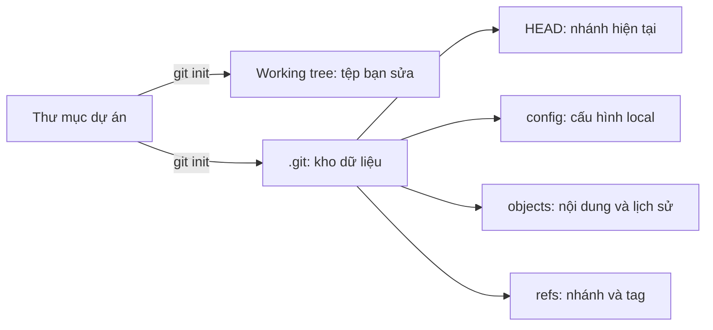
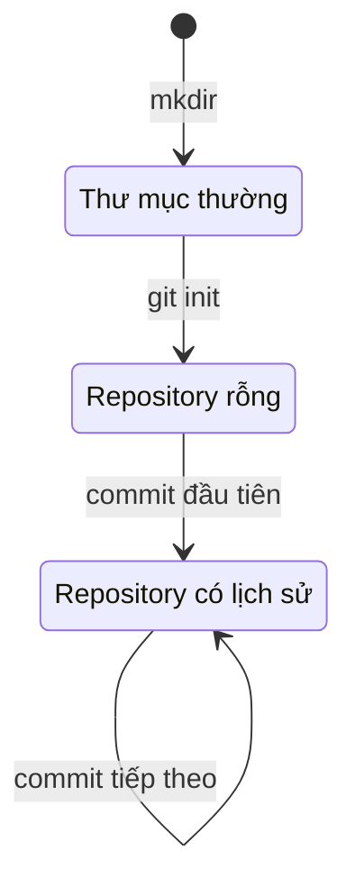

## Bạn sẽ học được gì

- Hiểu repository Git thực chất là gì và thư mục `.git` giữ những thứ nào.
- Phân biệt thư mục làm việc (working tree) với phần dữ liệu Git cất bên trong `.git`.
- Biết cách khởi tạo repository và chọn tên nhánh đầu tiên ngay từ lúc tạo.
- Kiểm tra được mình đang đứng trong repository nào, nhánh nào, trước khi gõ lệnh khác.

## Khái niệm

Khi bạn chạy `git init` trong một thư mục, Git không chép hay di chuyển tệp nào của bạn cả. Nó chỉ tạo thêm một thư mục ẩn tên `.git` ngay tại đó. Từ giây phút ấy, thư mục cha trở thành **working tree**: nơi bạn sửa tệp như bình thường bằng editor, IDE hay script test. Còn `.git` là "kho" thật sự, chứa toàn bộ lịch sử, cấu hình riêng của repository, danh sách nhánh và vùng staging.

Mình hay nói với người mới: hãy coi `.git` như hộp đen của máy bay. Bạn làm việc ở ngoài, còn mọi bằng chứng về những gì đã xảy ra được ghi vào hộp. Nếu bạn xóa `.git`, các tệp hiện tại vẫn còn nguyên trên đĩa, nhưng toàn bộ lịch sử commit, nhánh và cấu hình local biến mất. Ngược lại, nếu bạn copy cả thư mục (gồm `.git`) sang máy khác, bạn mang theo toàn bộ lịch sử.

Bên trong `.git` có vài thành phần đáng nhớ ngay từ bài đầu:

- `HEAD`: một tệp nhỏ cho biết bạn đang đứng ở nhánh nào.
- `config`: cấu hình chỉ áp dụng cho repository này.
- `objects/`: nơi Git cất nội dung tệp, cây thư mục và commit dưới dạng object.
- `refs/`: nơi lưu tên nhánh và tag, mỗi tên trỏ tới một commit.
- `hooks/`: các script mẫu chạy tự động ở một số thời điểm (chưa bật).

Một repository mới tinh chưa có commit nào. Tuy vậy, `HEAD` đã ghi sẵn tên nhánh đầu tiên. Nhánh ấy chỉ thực sự "tồn tại" như một ref khi bạn tạo commit đầu tiên. Đây là lý do `git status` trong repository mới hiện dòng "No commits yet".

Tên nhánh đầu tiên phụ thuộc vào cấu hình. Git 2.47 nếu không được cấu hình gì sẽ dùng `master` và in một đoạn hint dài gợi ý bạn chọn tên khác. Nhiều nhóm, nhiều dịch vụ hosting và cả bài tập trong khóa này dùng một tên khác phổ biến hơn hiện nay. Bạn có hai cách chọn: truyền tùy chọn `-b` (dạng dài `--initial-branch`) cho riêng lần init đó, hoặc đặt `init.defaultBranch` trong cấu hình global để mọi repository mới đều dùng tên bạn muốn.

Điểm cuối cùng cần nắm: Git tìm repository bằng cách đi ngược lên các thư mục cha cho đến khi gặp `.git`. Vì vậy nếu bạn lỡ chạy `git init` ở thư mục home, mọi thư mục con đều bị coi là nằm trong repository đó. Luôn kiểm tra vị trí trước khi init.

## Hình dung bằng sơ đồ





## Lệnh cần biết

```bash
git init                      # tạo .git trong thư mục hiện tại
git init -b <tên-nhánh>       # đặt luôn tên nhánh đầu tiên
git init <thư-mục>            # tạo thư mục (nếu chưa có) rồi khởi tạo trong đó
git config --global init.defaultBranch <tên>   # đặt tên mặc định cho mọi lần init sau
git rev-parse --show-toplevel # in gốc repository mà bạn đang đứng trong đó
git symbolic-ref --short HEAD # in tên nhánh HEAD đang trỏ tới
git branch -m <tên-mới>       # đổi tên nhánh hiện tại nếu lỡ init sai tên
```

| Tùy chọn | Ý nghĩa |
| --- | --- |
| `-b`, `--initial-branch` | Tên nhánh đầu tiên cho repository mới |
| `--bare` | Tạo repository không có working tree, dùng làm remote |
| `-q`, `--quiet` | Không in thông báo |

## Ví dụ từng bước

Giả sử bạn bắt đầu bộ test tự động cho một dự án mới. Trước tiên, kiểm tra xem thư mục đã là repository chưa:

```bash
mkdir f1 && cd f1
git status
```

```text
fatal: not a git repository (or any of the parent directories): .git
```

Thông báo này là tín hiệu tốt: không có `.git` nào ở đây hay ở thư mục cha. Giờ khởi tạo và đặt tên nhánh:

```bash
git init -b main
ls -A
ls .git
```

```text
Initialized empty Git repository in /tmp/gt/f1/.git/
.git
HEAD
branches
config
description
hooks
info
objects
refs
```

Xem trạng thái và nội dung tệp `HEAD`:

```bash
git status
cat .git/HEAD
git symbolic-ref --short HEAD
```

```text
On branch main

No commits yet

nothing to commit (create/copy files and use "git add" to track)
ref: refs/heads/main
main
```

Nếu không cấu hình gì và chạy `git init` trơn, Git 2.47 in một đoạn `hint:` dài rồi dùng `master`. Khi đó bạn sửa ngay bằng `git branch -m main`, chưa có commit nào nên việc đổi tên không ảnh hưởng gì.

Cuối cùng, xác nhận gốc repository:

```bash
git rev-parse --show-toplevel
```

```text
/tmp/gt/f1
```

Đường dẫn trên máy bạn sẽ khác, quan trọng là nó trùng với thư mục bạn định khởi tạo.

## Lỗi thường gặp

**Init nhầm thư mục cha.** Bạn chạy `git init` ở home hay ở thư mục chứa nhiều dự án, sau đó mọi thư mục con đều bị Git nhận là một phần của repository lớn. Cách xử lý: tìm đúng gốc bằng `git rev-parse --show-toplevel`, và nếu repository đó chưa có gì quan trọng thì xóa thư mục `.git` thừa.

**Init lại để đổi tên nhánh.** Chạy `git init -b main` lần hai trong repository đã có sẵn chỉ in cảnh báo `warning: re-init: ignored --initial-branch=main` và không đổi gì. Muốn đổi tên nhánh, dùng `git branch -m`.

> **Cẩn thận** Xóa `.git` là xóa toàn bộ lịch sử local. Chỉ làm khi bạn chắc repository đó vừa được tạo nhầm và chưa có commit cần giữ.

**Repository lồng nhau.** Init một repository bên trong repository khác mà không chủ đích dùng submodule sẽ khiến repository ngoài thấy thư mục con như một thứ lạ, khó theo dõi. Nếu cần ghép hai dự án, hãy học submodule ở track nâng cao.

**Tưởng nhánh đã tồn tại.** Ngay sau init, `git branch` chưa liệt kê gì vì nhánh chưa có commit. Đó là bình thường, không phải lỗi.

## Áp dụng trong công việc

Nhóm QA của bạn muốn tách bộ test API cho hệ thống chuyển khoản thành repository riêng. Bạn tạo thư mục, chạy init với tên nhánh mà nhóm đã thống nhất, kiểm tra lại bằng `git status` và `git rev-parse --show-toplevel`, rồi mới thêm README và cấu hình CI. Làm đúng từ đầu giúp pipeline và quy tắc bảo vệ nhánh trên server dùng cùng một tên, tránh phải đổi tên sau khi cả nhóm đã clone.

> **Mẹo** Đặt `init.defaultBranch` một lần trong cấu hình global, bạn sẽ không phải nhớ truyền `-b` mỗi lần tạo repository mới.

## Chuẩn bị làm bài

Bài thực hành đưa bạn một thư mục trống. Nhiệm vụ là biến chính thư mục đó (không phải thư mục cha hay thư mục con) thành repository, với tên nhánh đầu tiên đúng như đề yêu cầu, rồi trả lời một câu hỏi ngắn về tên nhánh mặc định ấy. Trước khi làm, hãy:

- Chạy `git status` để chắc thư mục chưa nằm trong repository nào khác.
- Ôn lại tùy chọn đặt tên nhánh khi init và cách kiểm tra tên nhánh bằng `git symbolic-ref --short HEAD`.
- Sau khi làm, dùng `git rev-parse --show-toplevel` để xác nhận gốc repository trùng với thư mục bài tập.

> **Lưu ý** Bài này không cần commit nào. Trình kiểm tra chỉ xem vị trí `.git` và nhánh mà `HEAD` trỏ tới.

## Tóm tắt

- `git init` tạo thư mục `.git`; tệp của bạn vẫn ở working tree bên ngoài.
- `.git` chứa lịch sử (objects), tên nhánh và tag (refs), cấu hình local và `HEAD`.
- Tên nhánh đầu tiên chọn bằng `-b` hoặc cấu hình `init.defaultBranch`.
- Repository mới chưa có commit, nên nhánh chỉ thật sự xuất hiện sau commit đầu tiên.
- Luôn kiểm tra vị trí bằng `git status` và `git rev-parse --show-toplevel` trước và sau khi init.
