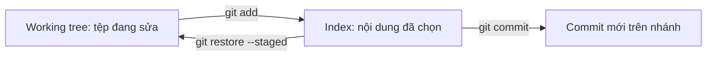
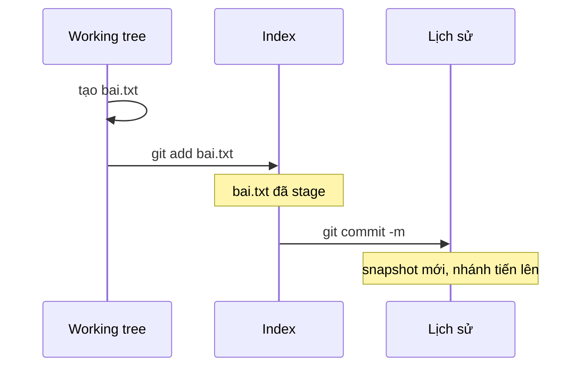

## Bạn sẽ học được gì

- Hiểu vì sao Git cần một bước trung gian (staging, hay index) trước khi commit.
- Biết cách chọn chính xác tệp hoặc phần thay đổi sẽ đi vào commit kế tiếp.
- Tạo commit với thông điệp rõ ràng và kiểm tra lại kết quả ngay sau đó.
- Đọc được các ký hiệu ngắn của `git status --short` như `??`, `A`, `M`.

## Khái niệm

Commit trong Git là một **snapshot**: ảnh chụp toàn bộ dự án tại một thời điểm, kèm tên người viết, thời gian, thông điệp và liên kết đến commit trước đó. Nhưng Git không chụp thẳng thư mục làm việc của bạn. Nó chụp **index**, còn gọi là staging area.

Hãy hình dung index như một khay chuẩn bị hàng trước khi đóng thùng. Bạn sửa năm tệp, nhưng chỉ ba tệp liên quan đến một lỗi cụ thể. Bạn đặt ba tệp đó lên khay bằng `git add`, xem lại khay, rồi mới đóng thùng bằng `git commit`. Hai tệp còn lại vẫn nằm trên bàn, chưa bị đưa vào đâu cả. Nhờ đó mỗi commit gọn, đúng một mục đích, dễ review và dễ đảo ngược khi cần.

Một vài điều quan trọng về `git add`:

- Nó chép **nội dung tại thời điểm chạy lệnh** vào index. Nếu bạn sửa tiếp tệp sau khi add, phần sửa mới chưa được stage. `git status` sẽ hiện tệp đó ở cả hai mục "Changes to be committed" và "Changes not staged for commit".
- Nó dùng được cho tệp mới (untracked), tệp đã sửa, và cả việc ghi nhận tệp đã xóa.
- Với `-p`, bạn có thể chọn từng đoạn thay đổi (hunk) trong một tệp, thay vì cả tệp.

Còn `git commit` lấy đúng những gì trong index, tạo snapshot mới, rồi dời nhánh hiện tại tới commit đó. Commit không đụng vào working tree. Sau commit, nếu mọi thay đổi đều đã được stage, `git status` báo "working tree clean".

Thông điệp commit nên trả lời câu hỏi "commit này làm gì". Dòng đầu (subject) ngắn gọn; có thể thêm đoạn thân để giải thích lý do. Bài sau về thông điệp commit sẽ đi sâu hơn.

## Hình dung bằng sơ đồ





## Lệnh cần biết

```bash
git status                 # trạng thái đầy đủ, có gợi ý lệnh
git status --short         # dạng gọn, mỗi tệp một dòng
git add <tệp>              # stage một tệp
git add .                  # stage mọi thay đổi trong thư mục hiện tại trở xuống
git add -p <tệp>           # chọn từng hunk để stage
git diff --staged          # xem chính xác những gì sẽ vào commit
git commit -m "Thông điệp" # tạo commit từ index
git restore --staged <tệp> # bỏ tệp khỏi index, giữ thay đổi trong working tree
```

| Ký hiệu `status --short` | Ý nghĩa |
| --- | --- |
| `??` | Tệp chưa được theo dõi (untracked) |
| `A ` | Tệp mới đã stage |
| `M ` (cột trái) | Đã sửa và đã stage |
| ` M` (cột phải) | Đã sửa nhưng chưa stage |
| `MM` | Đã stage một phần, rồi sửa tiếp |

Cột trái mô tả index so với HEAD, cột phải mô tả working tree so với index.

## Ví dụ từng bước

Repository đã có commit "Khởi tạo". Bạn tạo tệp mới `bai.txt` rồi xem trạng thái:

```bash
git status
git status --short
```

```text
On branch main
Untracked files:
  (use "git add <file>..." to include in what will be committed)
	bai.txt

nothing added to commit but untracked files present (use "git add" to track)
?? bai.txt
```

Stage và xem lại khay trước khi đóng thùng:

```bash
git add bai.txt
git status --short
git diff --staged
```

```text
A  bai.txt
diff --git a/bai.txt b/bai.txt
new file mode 100644
index 0000000..5607ae0
--- /dev/null
+++ b/bai.txt
@@ -0,0 +1 @@
+Nội dung bài tập
```

Commit và kiểm tra:

```bash
git commit -m "Thêm bài tập"
git log --oneline
git status
```

```text
[main 6942fd1] Thêm bài tập
 1 file changed, 1 insertion(+)
 create mode 100644 bai.txt
6942fd1 Thêm bài tập
7f10498 Khởi tạo
On branch main
nothing to commit, working tree clean
```

Hash commit trên máy bạn sẽ khác, vì nó phụ thuộc vào tên, email và thời gian.

## Lỗi thường gặp

**Commit mà quên add.** `git commit` báo "no changes added to commit" hoặc tạo commit thiếu tệp. Hãy luôn nhìn `git status` trước khi commit. Nếu đã commit thiếu và chưa push, có thể bổ sung bằng amend (track hoàn tác có bài riêng).

**Sửa tiếp sau khi add.** Bạn add, rồi sửa thêm một dòng, rồi commit. Dòng mới không có trong commit. Dấu hiệu là `MM` trong `status --short`. Chạy lại `git add` cho tệp đó trước khi commit.

> **Mẹo** Tập thói quen chạy `git diff --staged` ngay trước `git commit`. Đó là lần cuối bạn nhìn thấy chính xác nội dung sắp được ghi vào lịch sử.

**`git add .` gom cả rác.** Tệp log, tệp cấu hình chứa mật khẩu demo, thư mục build bị stage theo. Gỡ ra bằng `git restore --staged <tệp>` và bổ sung `.gitignore` (bài sau).

**Thông điệp vô nghĩa.** "update", "fix", "abc" khiến người khác (và chính bạn sau ba tháng) không hiểu commit làm gì. Viết subject mô tả thay đổi cụ thể.

## Áp dụng trong công việc

Bạn vừa sửa một test case đăng nhập bị flaky, đồng thời tiện tay đổi cấu hình timeout trong tệp môi trường local để chạy thử. Chỉ phần sửa test nên vào commit. Bạn stage riêng tệp test, kiểm tra bằng `git diff --staged`, commit với thông điệp nêu rõ test nào được sửa. Tệp cấu hình local vẫn ở working tree, không lẫn vào lịch sử chung của nhóm.

## Chuẩn bị làm bài

Bài thực hành có sẵn một tệp mới chưa được theo dõi. Bạn cần đưa nó qua đủ hai bước để nó nằm trong một commit mới, và working tree phải sạch khi kiểm tra. Đi kèm là một câu hỏi về lệnh dùng ở bước trung gian. Hãy:

- Mở `git status` để xem tệp đang ở trạng thái nào.
- Nhớ thứ tự: chọn nội dung vào index, xem lại, rồi mới tạo commit.
- Sau khi xong, `git status` phải báo working tree sạch và `git log --oneline` có thêm một dòng.

> **Lưu ý** Trình kiểm tra đếm số commit, nên đừng tạo thêm commit thử nghiệm ngoài yêu cầu.

## Tóm tắt

- Commit là snapshot của index, không phải của working tree.
- `git add` chép nội dung hiện tại của tệp vào index; sửa tiếp thì phải add lại.
- `git diff --staged` cho biết chính xác những gì sắp được commit.
- `git status --short` dùng hai cột: trái là index, phải là working tree.
- Mỗi commit nên phục vụ một mục đích, với thông điệp nói rõ thay đổi.
