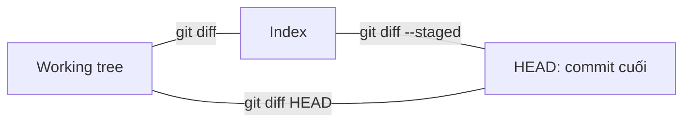
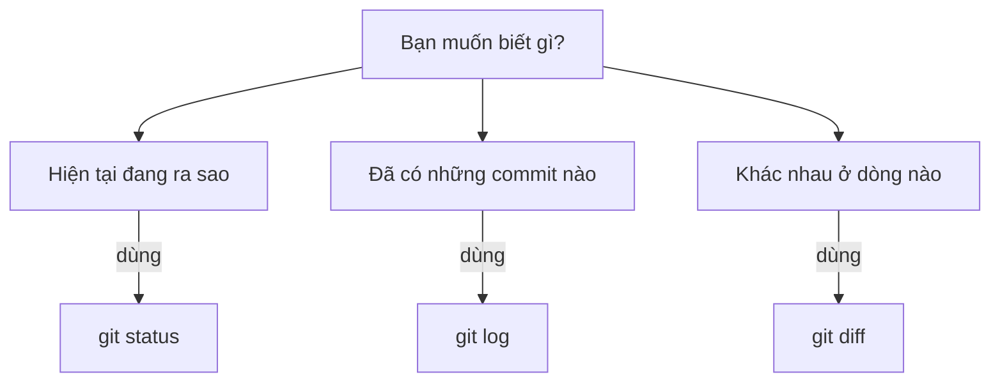

## Bạn sẽ học được gì

- Biết khi nào dùng `git status`, khi nào dùng `git log`, khi nào dùng `git diff`.
- Phân biệt ba kiểu so sánh của `git diff`: chưa stage, đã stage, và so với commit cuối.
- Đọc được một đoạn diff: header, hunk, dòng thêm, dòng bớt.
- Dùng vài định dạng log gọn để nhìn lịch sử nhanh.

## Khái niệm

Ba lệnh này là "đôi mắt" của bạn khi làm việc với Git. Chúng chỉ đọc, không thay đổi gì, nên bạn có thể chạy bao nhiêu lần tùy thích. Người dùng Git thành thạo gõ `git status` gần như sau mỗi thao tác.

**`git status`** trả lời câu hỏi "bây giờ đang ra sao": đang ở nhánh nào, tệp nào đã stage, tệp nào đã sửa mà chưa stage, tệp nào chưa được theo dõi. Nó còn gợi ý lệnh tiếp theo ngay trong output.

**`git log`** trả lời "trước đây đã xảy ra gì": danh sách commit từ mới đến cũ, mỗi commit có hash, tác giả, thời gian và thông điệp. Với `--oneline`, mỗi commit gói gọn trong một dòng. Với `--graph`, bạn thấy cả hình dạng nhánh và merge. Với `--stat`, bạn biết commit đụng đến tệp nào.

**`git diff`** trả lời "khác nhau cụ thể ở dòng nào". Điểm dễ nhầm nhất: `git diff` không có đối số **không** so working tree với commit cuối. Nó so working tree với **index**, tức là chỉ hiện phần bạn sửa mà chưa stage. Muốn xem phần đã stage (sẽ vào commit), dùng `git diff --staged` (đồng nghĩa `--cached`). Muốn xem tổng tất cả thay đổi so với commit cuối, dùng `git diff HEAD`.

Cách đọc một diff:

- Dòng `diff --git a/... b/...` cho biết tệp được so sánh. `a/` là phía cũ, `b/` là phía mới.
- Dòng `index 17d068e..309a719` là ID rút gọn của nội dung hai phía.
- Dòng `@@ -1,2 +1,3 @@` là header của hunk: ở phía cũ bắt đầu từ dòng 1, dài 2 dòng; ở phía mới bắt đầu dòng 1, dài 3 dòng.
- Dòng bắt đầu bằng `+` là thêm, `-` là bớt, dấu cách là ngữ cảnh không đổi.

## Hình dung bằng sơ đồ





## Lệnh cần biết

```bash
git status                 # trạng thái đầy đủ
git status -s              # dạng gọn
git log --oneline          # mỗi commit một dòng
git log --oneline --graph --decorate   # thêm đồ thị và tên nhánh
git log --stat -1          # commit cuối kèm danh sách tệp đổi
git log -1 --format="%h %an %s"        # định dạng tùy ý
git diff                   # working tree so với index
git diff --staged          # index so với HEAD
git diff HEAD              # working tree so với HEAD
git diff --stat HEAD       # chỉ tóm tắt số dòng
```

| Placeholder `--format` | Ý nghĩa |
| --- | --- |
| `%h` / `%H` | Hash rút gọn / đầy đủ |
| `%an` | Tên tác giả |
| `%ad` | Ngày tác giả |
| `%s` | Subject |

## Ví dụ từng bước

Tệp `bai.txt` đã có hai dòng trong commit cuối. Mình thêm dòng 3, stage nó, rồi thêm tiếp dòng 4 nhưng không stage. Trạng thái lúc này:

```bash
git status
```

```text
On branch main
Changes to be committed:
  (use "git restore --staged <file>..." to unstage)
	modified:   bai.txt

Changes not staged for commit:
  (use "git add <file>..." to update what will be committed)
  (use "git restore <file>..." to discard changes in working directory)
	modified:   bai.txt
```

Cùng một tệp xuất hiện ở hai mục. Giờ so sánh ba kiểu:

```bash
git diff
```

```text
diff --git a/bai.txt b/bai.txt
index 309a719..27e9af3 100644
--- a/bai.txt
+++ b/bai.txt
@@ -1,3 +1,4 @@
 Nội dung bài tập
 dòng 2
 dòng 3
+dòng 4
```

```bash
git diff --staged
```

```text
@@ -1,2 +1,3 @@
 Nội dung bài tập
 dòng 2
+dòng 3
```

```bash
git diff HEAD
```

```text
@@ -1,2 +1,4 @@
 Nội dung bài tập
 dòng 2
+dòng 3
+dòng 4
```

Hai output sau đã được lược phần header cho gọn. Cuối cùng nhìn lịch sử:

```bash
git log --oneline --graph --decorate
git log -1 --format="%h %an %s"
```

```text
* 15705fb (HEAD -> main) Bổ sung dòng 2
* 6942fd1 Thêm bài tập
* 7f10498 Khởi tạo
15705fb Duy Van Bổ sung dòng 2
```

## Lỗi thường gặp

**Tưởng `git diff` trống nghĩa là không có thay đổi.** Nếu bạn đã stage hết, `git diff` trống trơn nhưng commit kế tiếp vẫn có nội dung. Kiểm tra thêm `git diff --staged`.

**Kẹt trong pager.** Log hay diff dài mở trong `less`; nhiều người tưởng terminal treo. Nhấn `q` để thoát, hoặc dùng `git --no-pager log` khi muốn in thẳng.

> **Mẹo** `git log --oneline -5` đủ cho phần lớn tình huống hằng ngày; chỉ mở log đầy đủ khi cần đọc thông điệp dài.

**Đọc ngược hướng diff.** `git diff A B` hiện thay đổi để đi từ A sang B. Đảo thứ tự đối số thì dấu `+` và `-` cũng đảo theo.

**Bỏ qua tệp untracked.** `git diff` không hiện tệp mới chưa add. Chỉ `git status` mới cho bạn thấy chúng.

## Áp dụng trong công việc

Trước khi đẩy bản sửa test hồi quy cho module thanh toán, bạn chạy `git status` để chắc không sót tệp, `git diff --staged` để đọc lại từng dòng sẽ commit, và `git log --oneline -3` để xem commit của mình nằm đúng chỗ. Ba lệnh mất chưa tới một phút nhưng chặn được phần lớn lỗi "commit nhầm tệp".

## Chuẩn bị làm bài

Bài này chỉ có câu hỏi, không yêu cầu thay đổi repository. Câu hỏi xoay quanh việc lệnh nào so sánh vùng nào với vùng nào. Hãy tự tạo tình huống trong repository bài tập: sửa một tệp, stage một phần, sửa thêm, rồi lần lượt chạy các biến thể `git diff` ở trên và quan sát output khác nhau thế nào. Khi tự thấy được, bạn sẽ trả lời chắc chắn.

> **Lưu ý** Repository bài tập có thể tạo lại bằng `git-training open <mã-bài>`, nên bạn cứ thoải mái thử nghiệm.

## Tóm tắt

- `status` cho biết hiện trạng, `log` cho biết lịch sử, `diff` cho biết nội dung khác biệt.
- `git diff` so working tree với index; `--staged` so index với HEAD; `HEAD` so working tree với commit cuối.
- Header hunk `@@ -a,b +c,d @@` cho biết vị trí và độ dài đoạn ở hai phía.
- `--oneline`, `--graph`, `--stat`, `--format` giúp log gọn và dễ đọc.
- Cả ba lệnh đều chỉ đọc, chạy thường xuyên là thói quen tốt.
