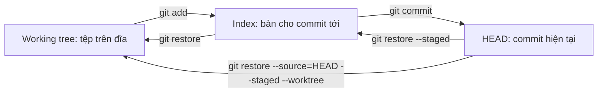
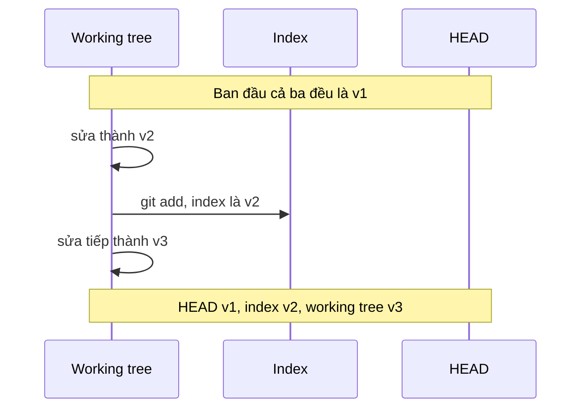

## Bạn sẽ học được gì

- Nắm mô hình "ba cây" của Git: working tree, index và HEAD.
- Đọc được một tệp đang có bao nhiêu phiên bản khác nhau và nằm ở đâu.
- Biết lệnh nào di chuyển nội dung giữa ba vùng theo hướng nào.
- Dùng mô hình này để đoán trước kết quả của `add`, `commit`, `restore`, `reset`.

## Khái niệm

Phần lớn sự bối rối với Git biến mất khi bạn hiểu rằng tại mọi thời điểm, mỗi tệp có thể tồn tại ở **ba phiên bản** khác nhau:

1. **HEAD**: bản trong commit mà nhánh hiện tại đang trỏ tới. Đây là lịch sử đã ghi, không đổi trừ khi bạn tạo commit mới hoặc dời nhánh.
2. **Index** (staging area): bản bạn đã chọn cho commit tiếp theo. Index thực ra là một danh sách đầy đủ mọi tệp của snapshot kế tiếp, không chỉ những tệp vừa add. Ngay sau commit, index giống hệt HEAD.
3. **Working tree**: tệp thật trên đĩa mà editor của bạn mở. Đây là nơi duy nhất bạn sửa trực tiếp.

Git gọi chúng là "ba cây" vì cả ba đều mô tả một cây thư mục đầy đủ. Mọi lệnh hằng ngày đều là việc chép nội dung giữa các cây:

- `git add` chép từ working tree vào index.
- `git commit` biến index thành commit mới, rồi HEAD (qua nhánh) trỏ sang commit đó.
- `git restore <tệp>` chép từ index ra working tree (bỏ sửa đổi chưa stage).
- `git restore --staged <tệp>` chép từ HEAD vào index (bỏ stage, giữ working tree).
- `git reset` dời nhánh và tùy chế độ có thể chép vào index, working tree (track hoàn tác).

`git status` thực chất là hai phép so sánh: HEAD với index (mục "Changes to be committed") và index với working tree (mục "Changes not staged"). Đó cũng là hai cột trong `git status --short`.

Khi cả ba cây giống nhau cho mọi tệp, Git báo "working tree clean". Khi bạn thấy `MM`, nghĩa là ba phiên bản đều khác nhau từng đôi một.

Một mẹo để "nhìn" index: cú pháp `:<đường-dẫn>` trong `git show` lấy nội dung tệp từ index, còn `HEAD:<đường-dẫn>` lấy từ commit. Lệnh `git ls-files --stage` liệt kê mọi mục trong index cùng mode và ID nội dung.

## Hình dung bằng sơ đồ





## Lệnh cần biết

```bash
git show HEAD:<tệp>         # nội dung tệp trong commit hiện tại
git show :<tệp>             # nội dung tệp trong index
git ls-files --stage        # mọi mục trong index: mode, object ID, stage, đường dẫn
git status -s               # cột trái HEAD so index, cột phải index so working tree
git restore <tệp>           # index ra working tree
git restore --staged <tệp>  # HEAD vào index
git restore --source=HEAD --staged --worktree <tệp>   # đưa cả hai về HEAD
```

| Lệnh | Đọc từ | Ghi vào |
| --- | --- | --- |
| `git add` | Working tree | Index |
| `git commit` | Index | Lịch sử, nhánh |
| `git restore` | Index | Working tree |
| `git restore --staged` | HEAD | Index |

## Ví dụ từng bước

Tệp `app.txt` trong commit là `v1`. Mình sửa thành `v2`, add, rồi sửa tiếp thành `v3`. Hỏi từng vùng:

```bash
git show HEAD:app.txt
git show :app.txt
cat app.txt
git status -s
```

```text
v1
v2
v3
MM app.txt
```

Ba vùng, ba phiên bản, đúng như sơ đồ. Bỏ stage:

```bash
git restore --staged app.txt
git status -s
git show :app.txt
cat app.txt
```

```text
 M app.txt
v1
v3
```

Index quay về `v1` (giống HEAD) nên cột trái trống. Working tree vẫn giữ `v3`, chưa mất gì. Giờ add lại và đưa cả hai vùng về HEAD:

```bash
git add app.txt
git restore --source=HEAD --staged --worktree app.txt
git status -s
cat app.txt
```

```text
v1
```

`git status -s` không in gì nghĩa là ba vùng đã trùng nhau.

## Lỗi thường gặp

**Nghĩ index chỉ chứa tệp vừa add.** Index chứa toàn bộ snapshot kế tiếp. Tệp bạn không đụng tới vẫn nằm trong index, giống HEAD.

> **Cẩn thận** `git restore <tệp>` (không có `--staged`) ghi đè working tree bằng bản trong index. Phần sửa chưa stage sẽ mất và không có trong reflog. Hãy chắc trước khi chạy.

**Nhầm hướng của `restore --staged`.** Nó không xóa tệp trên đĩa, chỉ làm index giống HEAD. Đây là cách an toàn để "hủy add".

**Commit xong tưởng mất phần sửa sau add.** Phần đó vẫn nằm trong working tree, chỉ là chưa vào commit. `git status` sẽ cho thấy.

**Đọc sai `status -s`.** Một khoảng trắng ở cột trái nghĩa là index giống HEAD, không phải "không có gì". Hãy đọc hai cột riêng biệt.

## Áp dụng trong công việc

Bạn đang viết bộ test mới cho màn hình chuyển tiền và đã stage phần test hoàn chỉnh. Đột nhiên được nhờ thử nhanh một giá trị timeout. Bạn sửa thẳng tệp, chạy thử, rồi dùng `git restore` để đưa working tree về đúng bản trong index. Phần test đã stage không bị ảnh hưởng, vì bạn biết rõ lệnh đó chỉ chép từ index ra working tree.

> **Mẹo** Khi phân vân một lệnh sẽ làm gì, hãy tự hỏi: nó đọc từ cây nào và ghi vào cây nào?

## Chuẩn bị làm bài

Bài này là câu hỏi lý thuyết: bạn cần gọi đúng tên vùng giữ nội dung đã chọn cho commit tiếp theo. Để trả lời chắc, hãy tự dựng tình huống ba phiên bản như ví dụ trên trong repository bài tập, rồi dùng `git show HEAD:<tệp>`, `git show :<tệp>` và `cat` để quan sát. Thử thêm `git ls-files --stage` để thấy vùng đó trông ra sao.

## Tóm tắt

- Mỗi tệp có thể có ba phiên bản: HEAD, index, working tree.
- Index là toàn bộ snapshot kế tiếp, không chỉ tệp vừa add.
- `add` chép working tree vào index; `commit` biến index thành lịch sử.
- `restore` chép ngược: index ra working tree, hoặc HEAD vào index với `--staged`.
- `git status` là hai phép so sánh HEAD với index và index với working tree.
