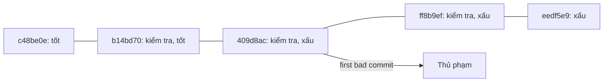
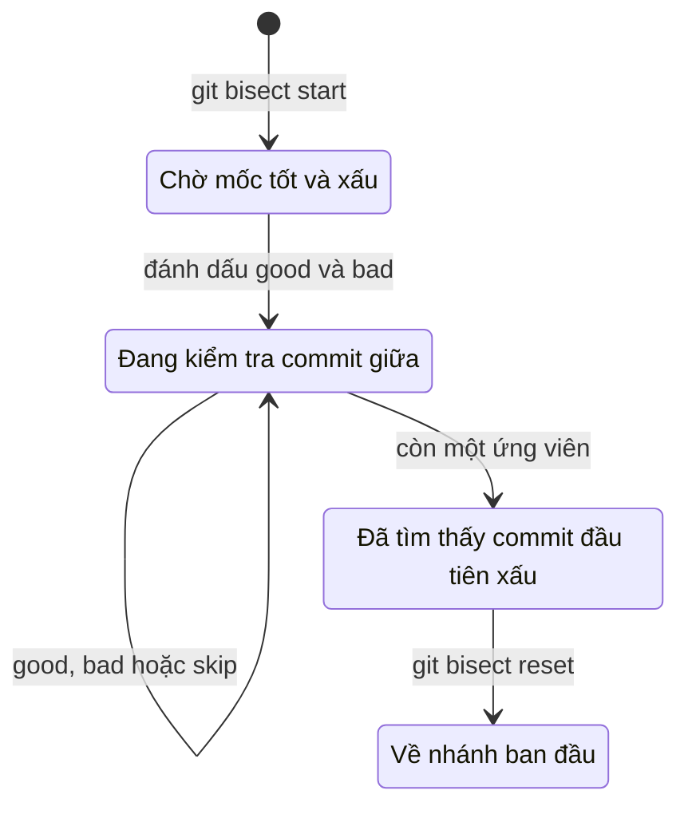

## Bạn sẽ học được gì

- Hiểu ý tưởng tìm kiếm nhị phân đằng sau `git bisect`.
- Chạy một phiên bisect thủ công: đánh dấu mốc tốt, mốc xấu, kiểm tra từng commit Git đề xuất.
- Tự động hóa bằng `git bisect run` với một script kiểm tra.
- Kết thúc phiên đúng cách và xử lý khi đánh dấu nhầm.

## Khái niệm

Bạn biết bản phát hành tuần trước chạy đúng, còn `main` hôm nay thì lỗi. Ở giữa có 200 commit. Kiểm tra lần lượt từng commit thì mệt. `git bisect` dùng **tìm kiếm nhị phân**: mỗi lần kiểm tra loại được khoảng một nửa số commit còn nghi vấn. Với 200 commit, chỉ cần chừng 8 lần kiểm tra là ra thủ phạm; với 1000 commit, khoảng 10 lần.

Quy trình:

1. `git bisect start`, rồi chỉ một commit **xấu** (thường là HEAD) và một commit **tốt** đã biết. Có thể viết gọn: `git bisect start <xấu> <tốt>`.
2. Git checkout commit nằm khoảng giữa (ở trạng thái detached HEAD) và báo còn bao nhiêu commit, khoảng bao nhiêu bước.
3. Bạn kiểm tra: chạy test, mở ứng dụng, đọc tệp... rồi báo kết quả bằng `git bisect good` hoặc `git bisect bad`.
4. Git thu hẹp khoảng và checkout commit giữa tiếp theo. Lặp lại.
5. Khi chỉ còn một ứng viên, Git in "`<hash>` is the first bad commit" kèm thông tin commit.
6. `git bisect reset` đưa bạn về nhánh ban đầu.

Nếu một commit không kiểm tra được (không build được, thiếu dữ liệu), dùng `git bisect skip` để Git chọn commit lân cận.

**Tự động hóa.** Nếu kiểm tra được bằng một lệnh, giao luôn cho Git: `git bisect run <script>`. Git chạy script ở mỗi bước và dựa vào mã thoát: `0` là tốt, từ `1` đến `127` (trừ `125`) là xấu, `125` nghĩa là bỏ qua commit đó. Track điều tra lịch sử sẽ đi sâu hơn vào bisect tự động.

Bisect giả định lỗi xuất hiện **một lần** rồi tồn tại liên tục: mọi commit trước thủ phạm đều tốt, mọi commit sau đều xấu. Nếu lỗi chập chờn (test flaky), kết quả có thể sai. Khi đó hãy làm phép kiểm tra ổn định hơn, ví dụ chạy test vài lần.

`git bisect log` in lại toàn bộ các bước đã đánh dấu. Rất có ích khi bạn nghi mình đã đánh dấu nhầm: lưu log ra tệp, sửa dòng sai, rồi `git bisect replay` để chạy lại.

## Hình dung bằng sơ đồ





## Lệnh cần biết

```bash
git bisect start                  # bắt đầu phiên
git bisect start <xấu> <tốt>      # bắt đầu và đánh dấu luôn hai mốc
git bisect bad [<commit>]         # đánh dấu xấu (mặc định commit hiện tại)
git bisect good [<commit>]        # đánh dấu tốt
git bisect skip                   # không kiểm tra được commit này
git bisect run <lệnh> [đối số]    # tự động, dựa vào mã thoát
git bisect log                    # các bước đã đánh dấu
git bisect replay <tệp-log>       # chạy lại từ log đã sửa
git bisect reset                  # kết thúc, về nhánh ban đầu
```

| Mã thoát script | Ý nghĩa với `bisect run` |
| --- | --- |
| `0` | Tốt |
| `1` đến `127`, trừ `125` | Xấu |
| `125` | Bỏ qua commit này |
| Lớn hơn `127` | Dừng bisect |

## Ví dụ từng bước

Repository mẫu: commit gốc có `timeout=30`, HEAD hiện có `timeout=5` và test hiệu năng thất bại. Script `check_timeout.sh` thoát 0 nếu timeout từ 10 trở lên. Bắt đầu với hai mốc:

```bash
git bisect start HEAD c48be0e
```

```text
Bisecting: 3 revisions left to test after this (roughly 2 steps)
[b14bd705ab74221677c4c870af89d428dc7d7c09] Đổi môi trường sang uat
```

Kiểm tra commit được đề xuất và báo kết quả:

```bash
/tmp/gt/check_timeout.sh && echo tốt || echo xấu
git bisect good
```

```text
tốt
Bisecting: 1 revision left to test after this (roughly 1 step)
[ff8b9efbdc863f231001eb89a93ebcb1541fd490] Cập nhật test đăng nhập
```

Lặp lại: commit này xấu, Git đề xuất `409d8ac`, cũng xấu:

```bash
git bisect bad
git bisect bad
```

```text
Bisecting: 0 revisions left to test after this (roughly 0 steps)
[409d8acfbf9153b336a1936a5de71e54fca85d61] Giảm timeout cho nhanh
409d8acfbf9153b336a1936a5de71e54fca85d61 is the first bad commit
commit 409d8acfbf9153b336a1936a5de71e54fca85d61
Author: Hoa <hoa@example.invalid>
Date:   Thu Oct 8 16:00:00 2026 +0700

    Giảm timeout cho nhanh

 config.txt | 2 +-
 1 file changed, 1 insertion(+), 1 deletion(-)
```

(Giữa hai lệnh `bad`, mình đã chạy lại script và thấy "xấu".) Ba lần kiểm tra cho tám commit. Kết thúc:

```bash
git bisect reset
```

```text
Previous HEAD position was 409d8ac Giảm timeout cho nhanh
Switched to branch 'main'
```

Cùng phiên đó, chạy tự động chỉ cần:

```bash
git bisect start HEAD c48be0e
git bisect run /tmp/gt/check_timeout.sh
```

```text
running '/tmp/gt/check_timeout.sh'
...
409d8acfbf9153b336a1936a5de71e54fca85d61 is the first bad commit
...
bisect found first bad commit
```

## Lỗi thường gặp

**Đánh dấu nhầm một bước.** Khi thử nghiệm, mình đã gõ `good` cho một commit vừa kiểm tra là xấu, và Git kết luận sai thủ phạm một cách rất tự tin. Dùng `git bisect log` để soát, sửa log rồi `git bisect replay`, hoặc `reset` và làm lại.

> **Cẩn thận** Git tin hoàn toàn vào những gì bạn báo. Một lần đánh dấu sai là đủ làm sai kết quả. Kiểm tra cẩn thận trước mỗi `good` hoặc `bad`.

**Quên `git bisect reset`.** Bạn ở lại detached HEAD trên một commit cũ, rồi commit tiếp nhầm chỗ. Luôn kết thúc phiên.

**Mốc "tốt" thực ra không tốt.** Nếu lỗi đã có từ trước mốc tốt, kết quả vô nghĩa. Xác nhận cả hai mốc trước khi bắt đầu.

**Script trả mã thoát sai.** Nếu script thất bại vì lý do không liên quan (thiếu phụ thuộc, build lỗi) và trả 1, Git coi commit đó là xấu. Git 2.47 có một lớp bảo vệ nhỏ: khi script trả 126 hoặc 127 (thường là không chạy được lệnh), Git chạy lại nó trên mốc tốt; nếu ở đó cũng nhận mã ấy, Git dừng với `error: bogus exit code 127 for good revision`. Dù vậy, hãy tự chạy thử script trên cả hai mốc trước khi `bisect run`, và trả 125 cho trường hợp "không kiểm tra được".

> **Mẹo** Có thể đổi từ khóa cho dễ hiểu, ví dụ `git bisect start --term-old=nhanh --term-new=cham`, khi bạn đang tìm commit làm đổi một hành vi chứ không hẳn là "lỗi".

## Áp dụng trong công việc

Bộ test API chuyển khoản pass ở tag `v3.1.0` nhưng fail trên `main` sau ba tuần với hơn 150 commit. Bạn viết script chạy riêng test đó, trả 0 khi pass, 1 khi fail, 125 khi không build được. `git bisect run` tìm ra commit thủ phạm sau khoảng 8 bước trong lúc bạn đi pha cà phê. Báo cáo lỗi của bạn có ngay hash, tác giả và diff liên quan.

## Chuẩn bị làm bài

Repository bài tập có `app.txt` với vài commit; ở một thời điểm, một dòng lỗi xuất hiện. Câu hỏi yêu cầu bạn nêu subject của commit bắt đầu thêm dòng đó. Hãy:

- Xác định mốc xấu và mốc tốt (commit gốc thường là mốc tốt).
- Với mỗi commit Git đề xuất, xem nội dung tệp (ví dụ `cat app.txt`) để đánh giá tốt hay xấu.
- Đọc kết quả "first bad commit", rồi nhớ chạy `git bisect reset`. Có thể đối chiếu bằng `git log -p`.

## Tóm tắt

- `git bisect` tìm commit đầu tiên gây lỗi bằng tìm kiếm nhị phân.
- Cần một mốc tốt, một mốc xấu, và một cách kiểm tra đáng tin cậy.
- `good`, `bad`, `skip` báo kết quả; `run` tự động hóa bằng mã thoát.
- `git bisect log` và `replay` giúp sửa khi đánh dấu nhầm.
- Luôn kết thúc bằng `git bisect reset`.
