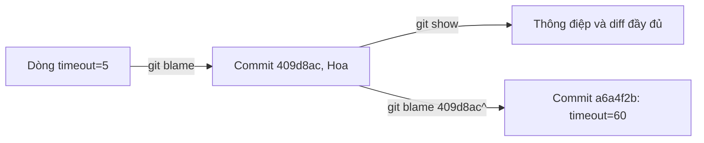
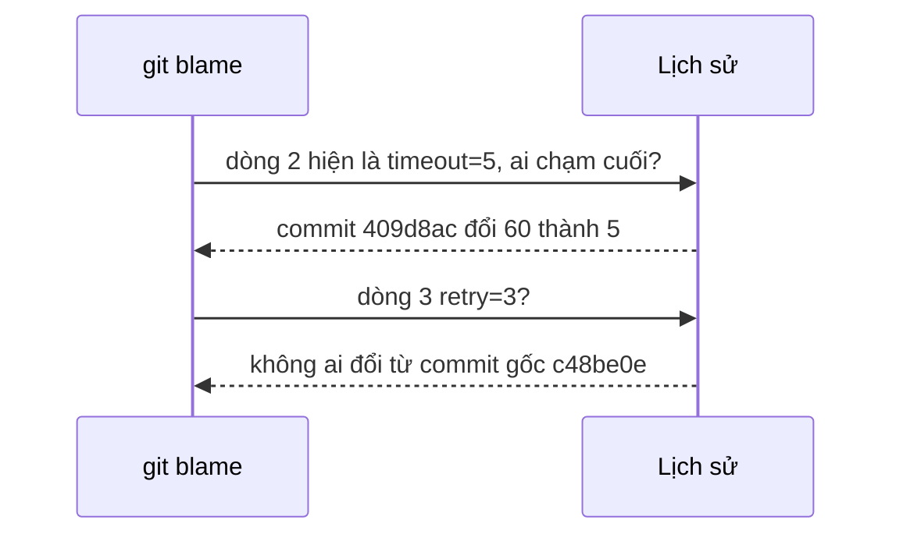

## Bạn sẽ học được gì

- Đọc output của `git blame`: mỗi dòng gắn với commit, tác giả, thời gian nào.
- Giới hạn blame vào một khoảng dòng và bỏ qua thay đổi khoảng trắng.
- Đi ngược thêm một bước khi commit được blame chỉ là bước trung gian.
- Hiểu giới hạn của blame và dùng nó để tìm bối cảnh, không phải để đổ lỗi.

## Khái niệm

Bạn mở tệp cấu hình, thấy dòng `timeout=5` và tự hỏi: ai đặt giá trị này, khi nào, vì sao? `git blame` trả lời hai câu đầu ngay lập tức, và dẫn bạn tới câu thứ ba qua commit.

Với mỗi dòng của tệp ở phiên bản hiện tại, blame tìm **commit gần nhất đã làm dòng đó có nội dung như bây giờ**. Nó đi ngược lịch sử, và khi gặp commit đã thêm hoặc sửa dòng ấy thì dừng lại cho dòng đó. Output mỗi dòng gồm:

- Hash rút gọn của commit. Dấu `^` ở đầu nghĩa là commit biên (boundary), thường là commit gốc hoặc giới hạn của dải bạn chỉ định.
- Tên tệp tại commit đó, nếu tệp từng mang tên khác (blame tự theo dấu đổi tên trong cùng tệp).
- Tác giả, thời gian, số dòng, và nội dung dòng.

Điều quan trọng là blame nói về **lần chạm cuối cùng**, không phải người "sinh ra" ý tưởng. Nếu ai đó chỉ định dạng lại tệp (đổi thụt lề, thêm khoảng trắng), blame sẽ gắn mọi dòng cho commit định dạng đó. Vì vậy:

- `-w` bỏ qua thay đổi chỉ về khoảng trắng.
- `-M` phát hiện dòng di chuyển trong cùng tệp; `-C` phát hiện dòng chép từ tệp khác.
- `--ignore-rev <commit>` (hoặc tệp danh sách qua `--ignore-revs-file`) bỏ qua các commit định dạng hàng loạt.

Khi commit blame được không phải câu trả lời bạn cần, hãy **blame tiếp từ cha của nó**: `git blame <commit>^ -- <tệp>`. Đó là cách đi ngược từng lớp lịch sử của một dòng.

Cuối cùng, blame chỉ cho bạn **đầu mối**. Bước tiếp theo luôn là `git show <commit>` để đọc thông điệp và toàn bộ thay đổi. Đọc blame cùng bối cảnh, và dùng nó để biết nên hỏi ai, đừng dùng để quy trách nhiệm.

## Hình dung bằng sơ đồ





## Lệnh cần biết

```bash
git blame <tệp>                    # blame cả tệp ở HEAD
git blame -L 10,20 <tệp>           # chỉ dòng 10 đến 20
git blame -L 2,2 <tệp>             # đúng một dòng
git blame -w <tệp>                 # bỏ qua thay đổi khoảng trắng
git blame -M -C <tệp>              # phát hiện dòng di chuyển, sao chép
git blame -e <tệp>                 # hiện email thay vì tên
git blame --date=short <tệp>       # ngày ngắn gọn
git blame <commit>^ -- <tệp>       # blame phiên bản trước commit đó
git blame --ignore-rev <commit> <tệp>  # bỏ qua một commit định dạng
git blame --porcelain <tệp>        # định dạng cho máy đọc
```

| Tùy chọn | Tác dụng |
| --- | --- |
| `-L a,b` | Giới hạn khoảng dòng |
| `-w` | Bỏ qua khoảng trắng |
| `-M`, `-C` | Theo dòng di chuyển, sao chép |
| `-e` | Email tác giả |
| `-s` | Ẩn tác giả và ngày |

## Ví dụ từng bước

Một repository mẫu có tệp `conf/app.conf` (trước đây tên `config.txt`). Blame cả tệp:

```bash
git blame conf/app.conf
```

```text
b14bd705 config.txt (Tuan 2026-10-06 09:30:00 +0700 1) env=uat
409d8acf config.txt (Hoa  2026-10-08 16:00:00 +0700 2) timeout=5
^c48be0e config.txt (Hoa  2026-10-01 09:00:00 +0700 3) retry=3
```

Cột tên tệp cho thấy các dòng có từ khi tệp còn tên cũ. Dòng 3 có dấu `^`: chưa ai đổi nó từ commit gốc. Tập trung vào dòng nghi vấn:

```bash
git blame --date=short -L 2,2 conf/app.conf
```

```text
409d8acf config.txt (Hoa 2026-10-08 2) timeout=5
```

Đọc commit đó:

```bash
git log -1 --format="%h %an %s" 409d8ac
```

```text
409d8ac Hoa Giảm timeout cho nhanh
```

Muốn biết trước đó giá trị là gì và ai đặt, blame từ cha của commit:

```bash
git blame 409d8ac^ -- config.txt
```

```text
b14bd705 (Tuan 2026-10-06 09:30:00 +0700 1) env=uat
a6a4f2b6 (Hoa  2026-10-05 14:00:00 +0700 2) timeout=60
^c48be0e (Hoa  2026-10-01 09:00:00 +0700 3) retry=3
b622b70c (Tuan 2026-10-03 11:00:00 +0700 4) API_KEY_DEMO=abc123
```

Ở phiên bản trước, dòng 2 là `timeout=60`, do commit `a6a4f2b` đặt. Ta đã đi ngược được hai lớp lịch sử của một dòng. Hash trên máy bạn sẽ khác nếu tự dựng lại.

## Lỗi thường gặp

**Kết luận chỉ từ blame.** Commit chạm cuối có thể chỉ là đổi định dạng, merge, hay di chuyển mã. Luôn `git show` commit đó trước khi kết luận.

> **Lưu ý** Tên tác giả trong blame là chữ do người commit tự cấu hình, Git không xác minh. Đừng coi đó là bằng chứng danh tính.

**Bị nhiễu bởi commit định dạng.** Dùng `-w`, hoặc nhóm thống nhất một tệp `.git-blame-ignore-revs` và cấu hình `blame.ignoreRevsFile`.

**Blame sai phiên bản.** `git blame <tệp>` xem HEAD cộng thay đổi chưa commit trong working tree (dòng chưa commit hiện "Not Committed Yet"). Muốn blame một commit cụ thể, truyền commit trước `--`.

> **Mẹo** Nhiều IDE có blame tích hợp, nhưng dòng lệnh với `-L` và `<commit>^` linh hoạt hơn khi cần đi ngược nhiều lớp.

**Đếm dòng nhầm.** `-L` đánh số từ 1 theo phiên bản bạn đang blame. Sau khi sửa tệp, số dòng có thể dịch đi.

## Áp dụng trong công việc

Test hồi quy thanh toán bắt đầu timeout trên môi trường UAT. Bạn blame tệp cấu hình test, thấy dòng timeout vừa bị đổi trong một commit tuần trước với thông điệp "Giảm timeout cho nhanh". `git show` cho thấy đó là thay đổi cố ý để tăng tốc pipeline. Bạn nhắn đúng người, giải thích tác động lên test thanh toán, và hai bên thống nhất một giá trị riêng cho bộ test chậm.

## Chuẩn bị làm bài

Bài này là câu hỏi điều tra: repository bài tập có tệp `app.txt` với vài commit từ nhiều người, và bạn cần tìm tác giả của một dòng cụ thể mà đề nêu. Hãy:

- Mở repository bài tập, chạy `git blame` cho tệp đó và tìm dòng chứa chuỗi đề yêu cầu.
- Dùng `-L` để chỉ xem dòng đó cho gọn.
- Xác nhận bằng `git show` trên commit tìm được, để chắc tác giả và thay đổi khớp.

## Tóm tắt

- `git blame` gắn mỗi dòng với commit gần nhất đã làm nó có nội dung hiện tại.
- `-L` giới hạn dòng, `-w` bỏ qua khoảng trắng, `-M`/`-C` theo dòng di chuyển.
- `git blame <commit>^ -- <tệp>` đi ngược thêm một lớp lịch sử.
- Blame là đầu mối; `git show` mới cho bối cảnh đầy đủ.
- Dùng blame để biết hỏi ai, không phải để đổ lỗi.
