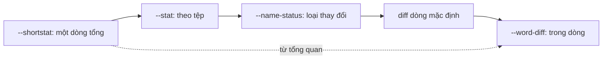

## Bạn sẽ học được gì

- Chọn mức chi tiết phù hợp: từ một dòng tóm tắt đến diff từng từ.
- Dùng `--stat`, `--shortstat`, `--numstat`, `--name-only` để nắm phạm vi thay đổi.
- Dùng `--word-diff` để thấy chính xác phần nào trong dòng đã đổi.
- Lọc nhiễu khoảng trắng và giảm ngữ cảnh khi cần.

## Khái niệm

Diff mặc định của Git là "unified diff" theo dòng: mỗi dòng đổi hiện thành một dòng `-` và một dòng `+`, kèm ba dòng ngữ cảnh. Định dạng này tốt cho mã nguồn ngắn, nhưng không phải lúc nào cũng là cách đọc hiệu quả nhất. Git cho bạn nhiều "ống kính" khác nhau trên cùng một thay đổi.

**Phạm vi trước, chi tiết sau.** Khi review một commit lớn hay so sánh hai bản release, câu hỏi đầu tiên là "đụng tới bao nhiêu thứ?". Các tùy chọn tóm tắt trả lời ngay:

- `--stat`: mỗi tệp một dòng với số dòng thay đổi và thanh `+`/`-` minh họa, cuối cùng là tổng.
- `--shortstat`: chỉ dòng tổng.
- `--numstat`: số dòng thêm và bớt dạng cột, dễ xử lý bằng script.
- `--name-only`, `--name-status`: chỉ tên tệp, hoặc kèm trạng thái.

**Chi tiết trong dòng.** Với tệp cấu hình, văn bản, dữ liệu test hay câu dài, đổi một từ cũng làm cả dòng hiện `-` và `+`, mắt phải tự dò chỗ khác. `--word-diff` hiển thị trên một dòng với phần bị xóa trong `[-...-]` và phần thêm trong `{+...+}`. Mặc định "từ" là chuỗi không chứa khoảng trắng; với `--word-diff-regex` bạn tự định nghĩa đơn vị so sánh, ví dụ tách theo dấu `=` để thấy riêng giá trị thay đổi. `--color-words` cho hiệu ứng tương tự bằng màu trên terminal. Dạng `--word-diff=porcelain` dành cho công cụ đọc.

**Giảm nhiễu.** `-w` bỏ qua mọi khác biệt khoảng trắng, hữu ích khi ai đó đổi thụt lề. `--check` thì ngược lại: chỉ ra khoảng trắng thừa cuối dòng và dấu xung đột còn sót. `-U<n>` đổi số dòng ngữ cảnh: `-U0` chỉ hiện dòng đổi, `-U10` hiện rộng hơn.

Mọi tùy chọn này dùng được với `git diff`, `git show` và `git log -p`.

## Hình dung bằng sơ đồ



## Lệnh cần biết

```bash
git diff --stat <a> <b>           # thống kê theo tệp
git diff --shortstat <a> <b>      # chỉ dòng tổng
git diff --numstat <a> <b>        # cột thêm, bớt, tên tệp
git diff --name-only <a> <b>      # chỉ tên tệp
git show --word-diff <commit>     # diff theo từ
git show --word-diff --word-diff-regex='[^=]+' <commit>   # tự định nghĩa từ
git diff --color-words            # tô màu theo từ
git diff -w                       # bỏ qua khoảng trắng
git diff --check                  # báo khoảng trắng thừa, dấu xung đột
git diff -U0 <a> <b>              # không có dòng ngữ cảnh
```

| Tùy chọn | Trả lời câu hỏi |
| --- | --- |
| `--shortstat` | Thay đổi lớn cỡ nào? |
| `--stat` | Tệp nào đổi nhiều nhất? |
| `--name-only` | Danh sách tệp để chạy lại test? |
| `--word-diff` | Chính xác từ nào đổi? |
| `-w` | Có thay đổi thật ngoài khoảng trắng không? |

## Ví dụ từng bước

So sánh năm commit gần nhất của repository mẫu ở ba mức:

```bash
git diff --shortstat HEAD~5 HEAD
git diff --stat HEAD~5 HEAD
git diff --numstat HEAD~5 HEAD
```

```text
 3 files changed, 4 insertions(+), 4 deletions(-)
 conf/app.conf  | 3 +++
 config.txt     | 4 ----
 login_test.txt | 1 +
 3 files changed, 4 insertions(+), 4 deletions(-)
3	0	conf/app.conf
0	4	config.txt
1	0	login_test.txt
```

Xem commit giảm timeout theo từ, mặc định rồi tự định nghĩa:

```bash
git show --format= --word-diff 409d8ac
```

```text
...
@@ -1,4 +1,4 @@
env=uat
[-timeout=60-]{+timeout=5+}
retry=3
API_KEY_DEMO=abc123
```

`timeout=60` không có khoảng trắng nên được coi là một từ. Tách theo dấu `=`:

```bash
git show --format= --word-diff --word-diff-regex='[^=]+' 409d8ac
```

```text
...
env=uat
timeout=[-60-]{+5+}
retry=3
API_KEY_DEMO=abc123
```

Giờ chỉ giá trị được đánh dấu. Thêm hai dấu cách thừa vào cuối một dòng trong `login_test.txt` rồi thử:

```bash
git diff -w; echo "(trống)"
git diff --check
```

```text
(trống)
login_test.txt:1: trailing whitespace.
+kiem tra dang nhap  
```

`-w` xác nhận không có thay đổi thật; `--check` chỉ đúng chỗ khoảng trắng thừa.

## Lỗi thường gặp

**Đọc diff đầy đủ của commit lớn ngay từ đầu.** Dễ lạc. Xem `--stat` trước, chọn tệp quan trọng, rồi `git show <commit> -- <tệp>`.

**Dùng `-w` khi review mã nhạy khoảng trắng.** Với YAML, Python hay Makefile, thụt lề có nghĩa. Bỏ qua nó có thể giấu lỗi thật.

> **Cẩn thận** `--word-diff` mặc định coi chuỗi không có khoảng trắng là một từ. Với dữ liệu dạng `key=value` hay JSON nén, hãy dùng `--word-diff-regex` để thấy thay đổi chính xác.

**Copy diff từ `--word-diff` để áp dụng như patch.** Định dạng này để đọc, không áp dụng được bằng `git apply`.

> **Mẹo** `git diff --name-only main...HEAD` cho danh sách tệp nhánh bạn đã đổi, rất tiện để chọn bộ test cần chạy lại.

## Áp dụng trong công việc

Trước khi chạy hồi quy cho bản release, bạn lấy `git diff --name-only v3.1.0 v3.2.0 -- src/` để biết module nào đổi, và chỉ chọn bộ test tương ứng cho lượt chạy đầu. Với tệp dữ liệu test dạng CSV bị đổi một giá trị, `--word-diff-regex='[^,]+'` cho thấy đúng ô nào thay đổi, không phải dò cả dòng dài.

## Chuẩn bị làm bài

Repository bài tập có `app.txt` với vài commit. Câu hỏi hỏi commit mới nhất thay đổi tệp nào. Hãy:

- Thử `git show --stat` và `git show --name-only` trên HEAD.
- So sánh với `git diff --stat HEAD~1 HEAD` để thấy hai cách cho cùng thông tin.
- Thử thêm `--word-diff` để luyện đọc thay đổi trong dòng.

## Tóm tắt

- Bắt đầu từ tổng quan (`--shortstat`, `--stat`) rồi mới đi vào chi tiết.
- `--numstat` và `--name-only` hợp cho script và chọn test.
- `--word-diff` cho thấy phần thay đổi trong dòng; `--word-diff-regex` tự định nghĩa từ.
- `-w` bỏ qua khoảng trắng, `--check` tìm khoảng trắng thừa và dấu xung đột.
- Các tùy chọn dùng chung cho `diff`, `show` và `log -p`.
