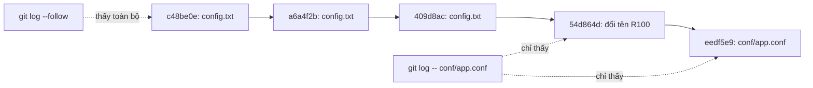

## Bạn sẽ học được gì

- Hiểu Git không lưu "sự kiện đổi tên" mà suy ra đổi tên bằng so sánh nội dung.
- Dùng `git log --follow` để xem lịch sử một tệp xuyên qua các lần đổi tên.
- Đọc chỉ số tương đồng như `R100`, `R056` trong output.
- Biết giới hạn của `--follow` và mẹo giúp Git nhận đổi tên chính xác hơn.

## Khái niệm

Bài mô hình object cho thấy blob không chứa tên tệp, còn tree chỉ ghi "tên này trỏ tới blob kia". Khi bạn đổi `config.txt` thành `conf/app.conf`, commit mới đơn giản là có một tree không còn tên cũ và có tên mới. Git **không ghi** một bản ghi "đã đổi tên" nào cả.

Vậy làm sao Git biết đó là đổi tên? Khi so sánh hai snapshot, nếu thấy một đường dẫn biến mất và một đường dẫn mới xuất hiện với nội dung **đủ giống**, Git kết luận đó là đổi tên. Mức giống được tính thành phần trăm: `R100` là giống hoàn toàn, `R056` là giống 56 phần trăm. Ngưỡng mặc định là 50 phần trăm. Đây gọi là **phát hiện đổi tên** (rename detection), bật mặc định cho `git diff`, `git log -p`, `git show` và `git status` trong Git hiện đại.

Vấn đề nằm ở lệnh `git log -- <đường-dẫn>`. Nó lọc commit theo **đường dẫn đó**. Với tên mới `conf/app.conf`, lịch sử chỉ bắt đầu từ commit đổi tên; mọi commit trước đó chạm vào `config.txt`, không phải `conf/app.conf`. Bạn mất nửa câu chuyện.

`git log --follow -- <tệp>` giải quyết đúng việc này: khi đi ngược lịch sử và gặp commit tạo ra tệp, nó kiểm tra xem đó có phải đổi tên từ tệp khác không, nếu có thì tiếp tục theo tên cũ. Kết hợp với `--name-status`, bạn thấy cả dòng `R100 config.txt conf/app.conf` đánh dấu chỗ đổi tên.

Giới hạn cần biết:

- `--follow` chỉ áp dụng cho **một tệp**, không cho thư mục hay nhiều đường dẫn.
- Nếu bạn vừa đổi tên vừa sửa nhiều nội dung trong cùng commit, độ tương đồng có thể dưới ngưỡng và Git coi là xóa tệp cũ, thêm tệp mới. Mẹo: đổi tên trong một commit riêng (như `git mv` rồi commit), sửa nội dung ở commit sau.
- `git blame` tự theo đổi tên trong lịch sử của chính tệp, nên bạn thấy cột tên cũ trong output.

## Hình dung bằng sơ đồ



## Lệnh cần biết

```bash
git log --oneline -- <tệp>                  # chỉ lịch sử dưới tên hiện tại
git log --oneline --follow -- <tệp>         # theo qua đổi tên
git log --follow --name-status --format="%h %s" -- <tệp>  # thấy dòng R
git diff --name-status <a> <b>              # phát hiện đổi tên giữa hai commit
git diff --no-renames --name-status <a> <b> # tắt phát hiện, thấy D và A
git diff -M30% --name-status <a> <b>        # hạ ngưỡng tương đồng xuống 30 phần trăm
git mv <cũ> <mới>                           # đổi tên và stage một lần
```

| Ký hiệu | Ý nghĩa |
| --- | --- |
| `R100` | Đổi tên, nội dung giống hoàn toàn |
| `R056` | Đổi tên, giống 56 phần trăm |
| `D` rồi `A` | Git coi là xóa và thêm, không nhận ra đổi tên |

## Ví dụ từng bước

Tệp cấu hình trong repository mẫu từng tên `config.txt`, sau đó được chuyển vào `conf/app.conf`. Hỏi lịch sử theo tên mới:

```bash
git log --oneline -- conf/app.conf
```

```text
eedf5e9 Xóa khóa demo
54d864d Chuyển cấu hình vào conf
```

Chỉ hai commit. Thêm `--follow`:

```bash
git log --oneline --follow -- conf/app.conf
```

```text
eedf5e9 Xóa khóa demo
54d864d Chuyển cấu hình vào conf
409d8ac Giảm timeout cho nhanh
b14bd70 Đổi môi trường sang uat
a6a4f2b Tăng timeout
b622b70 Thêm khóa demo
c48be0e Tạo cấu hình
```

Đủ bảy commit. Xem chỗ đổi tên:

```bash
git log --follow --name-status --format="%h %s" -- conf/app.conf
```

```text
eedf5e9 Xóa khóa demo

M	conf/app.conf
54d864d Chuyển cấu hình vào conf

R100	config.txt	conf/app.conf
409d8ac Giảm timeout cho nhanh

M	config.txt
...
```

Dòng `R100` cho biết tên cũ. So sánh qua nhiều commit, khi nội dung cũng đã đổi:

```bash
git diff --name-status HEAD~3 HEAD
git diff --no-renames --name-status HEAD~3 HEAD
```

```text
R056	config.txt	conf/app.conf
M	login_test.txt
A	conf/app.conf
D	config.txt
M	login_test.txt
```

Tắt phát hiện đổi tên, bạn thấy đúng bản chất mà Git lưu: một tên biến mất, một tên xuất hiện.

## Lỗi thường gặp

**Kết luận "tệp này mới được tạo tuần trước".** Thật ra chỉ là tên mới. Luôn thử `--follow` khi lịch sử ngắn bất thường.

**Đổi tên và sửa lớn trong cùng commit.** Git không nhận ra đổi tên, lịch sử bị cắt đôi. Tách thành hai commit.

> **Mẹo** Muốn `git log` luôn theo đổi tên khi bạn chỉ định một tệp, đặt `git config log.follow true`. Nó chỉ có tác dụng khi lệnh nhận đúng một đường dẫn.

**Dùng `--follow` cho thư mục.** Không được hỗ trợ; với thư mục, dùng `git log -- <thư-mục-cũ> <thư-mục-mới>`.

> **Lưu ý** Đổi tên bằng `mv` thường rồi `git add -A` cho cùng kết quả với `git mv`. Git không phân biệt hai cách, vì nó không lưu sự kiện đổi tên.

## Áp dụng trong công việc

Nhóm tái cấu trúc thư mục test, chuyển `tests/login_spec.js` vào `tests/e2e/auth/login.spec.js`. Ba tháng sau, bạn cần biết test này từng bị tắt vì lý do gì. `git log -- tests/e2e/auth/login.spec.js` chỉ có vài commit gần đây, nhưng `git log --follow` dẫn bạn về tận commit "tạm skip test login do môi trường SMS lỗi" ở tên cũ. Bối cảnh đầy đủ giúp bạn quyết định bật lại test một cách tự tin.

## Chuẩn bị làm bài

Repository bài tập có một tệp đã được đổi tên ở commit gần nhất. Câu hỏi hỏi tên trước khi đổi của tệp đó. Hãy:

- Dùng `git log --follow --name-status` trên tên hiện tại để thấy dòng đổi tên.
- Hoặc `git show --name-status` trên commit đổi tên.
- Đọc cột tên cũ trong dòng bắt đầu bằng `R`.

## Tóm tắt

- Git không lưu sự kiện đổi tên; nó suy ra bằng độ tương đồng nội dung.
- `git log -- <tệp>` chỉ theo tên hiện tại; `--follow` đi xuyên qua đổi tên.
- `R100`, `R056` cho biết mức giống; ngưỡng mặc định 50 phần trăm.
- Đổi tên trong commit riêng giúp Git nhận diện chính xác.
- `--follow` chỉ dùng cho một tệp.
