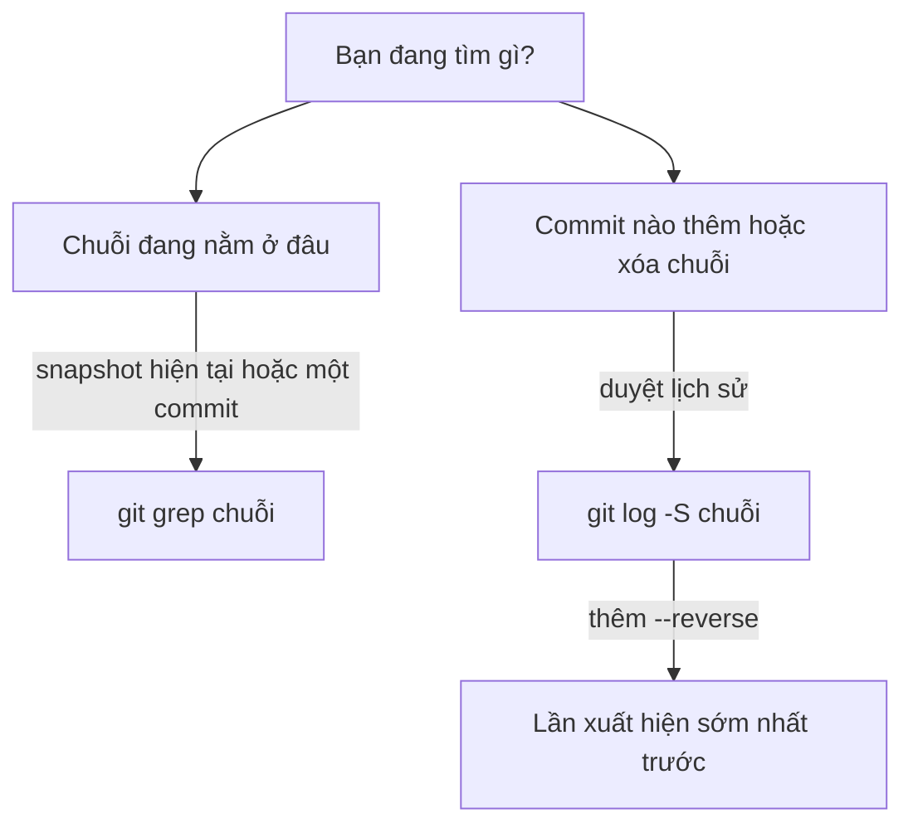

## Bạn sẽ học được gì

- Tìm nhanh một chuỗi trong các tệp đang được theo dõi bằng `git grep`.
- Tìm trong một commit hoặc một phiên bản cũ mà không cần checkout.
- Dùng pickaxe `git log -S` để tìm commit đã thêm hoặc xóa một chuỗi.
- Biết chọn công cụ nào cho câu hỏi "ở đâu bây giờ" và câu hỏi "từ khi nào".

## Khái niệm

Có hai câu hỏi tìm kiếm rất khác nhau, và Git có công cụ riêng cho từng câu.

**"Chuỗi này đang nằm ở đâu?"** Đây là việc của `git grep`. Nó giống `grep -r`, nhưng chỉ tìm trong tệp Git theo dõi (bỏ qua `node_modules`, thư mục build và mọi thứ bị ignore), nên nhanh và ít nhiễu. Điểm mạnh đặc biệt: bạn có thể truyền một commit, nhánh hay tag, và `git grep` tìm thẳng trong snapshot đó mà không đụng tới working tree. "Tuần trước, ở bản release, chuỗi này có không?" trả lời được trong một lệnh.

**"Chuỗi này xuất hiện (hoặc biến mất) từ commit nào?"** Đây là việc của **pickaxe**: `git log -S <chuỗi>`. Thay vì tìm trong nội dung tệp, nó đi qua từng commit và hỏi: commit này có làm **thay đổi số lần xuất hiện** của chuỗi không? Commit thêm chuỗi (số lần tăng) và commit xóa chuỗi (số lần giảm) đều khớp. Commit chỉ sửa dòng xung quanh mà giữ nguyên chuỗi thì không khớp.

`git log` liệt kê từ mới đến cũ. Nếu chuỗi từng được thêm, xóa, rồi thêm lại, bạn sẽ thấy nhiều commit. Muốn biết lần **đầu tiên**, thêm `--reverse` để đảo thứ tự, commit đầu danh sách là lần sớm nhất. Thêm `-p` để xem luôn diff của các commit tìm được.

Hai công cụ bổ sung cho nhau rất tự nhiên. Ví dụ, bạn nghi một khóa demo bị lộ: `git grep` cho biết HEAD còn chứa nó không; pickaxe cho biết commit nào đã đưa nó vào và commit nào đã xóa. Bài pickaxe chuyên sâu sau sẽ so sánh `-S` với biến thể `-G` dùng biểu thức chính quy.

## Hình dung bằng sơ đồ



## Lệnh cần biết

```bash
git grep <mẫu>                    # tìm trong tệp được theo dõi ở working tree
git grep -n <mẫu>                 # kèm số dòng
git grep -i <mẫu>                 # không phân biệt hoa thường
git grep -c <mẫu>                 # đếm số dòng khớp mỗi tệp
git grep <mẫu> <commit>           # tìm trong snapshot của commit
git grep <mẫu> -- '*.txt'         # giới hạn theo đường dẫn
git log -S <chuỗi> --oneline      # commit làm đổi số lần xuất hiện chuỗi
git log -S <chuỗi> --oneline --reverse   # cũ nhất trước
git log -S <chuỗi> -p             # kèm diff
git log -S <chuỗi> --all          # tìm trên mọi nhánh
```

| Câu hỏi | Công cụ |
| --- | --- |
| HEAD còn chứa chuỗi không? | `git grep` |
| Bản cũ có chứa không? | `git grep <mẫu> <commit>` |
| Ai thêm, khi nào? | `git log -S` rồi `git show` |
| Lần đầu tiên? | `git log -S --reverse` |

## Ví dụ từng bước

Repository mẫu từng có dòng `API_KEY_DEMO=abc123` trong cấu hình. Đầu tiên, HEAD còn không?

```bash
git grep -n API_KEY_DEMO; echo "exit=$?"
```

```text
exit=1
```

Không còn (mã thoát 1 nghĩa là không có kết quả). Ở một commit cũ thì sao?

```bash
git grep -n API_KEY_DEMO b14bd70
```

```text
b14bd70:config.txt:4:API_KEY_DEMO=abc123
```

Có, ở dòng 4 của tệp tên cũ. Giờ hỏi lịch sử: commit nào thêm, commit nào xóa?

```bash
git log -S API_KEY_DEMO --oneline
git log -S API_KEY_DEMO --oneline --reverse
```

```text
eedf5e9 Xóa khóa demo
b622b70 Thêm khóa demo
b622b70 Thêm khóa demo
eedf5e9 Xóa khóa demo
```

Với `--reverse`, commit đưa chuỗi vào lần đầu đứng trên cùng. Xem commit xóa kèm diff:

```bash
git log -S API_KEY_DEMO -p --oneline -1
```

```text
eedf5e9 Xóa khóa demo
diff --git a/conf/app.conf b/conf/app.conf
index 41a38b1..87c8b3b 100644
--- a/conf/app.conf
+++ b/conf/app.conf
@@ -1,4 +1,3 @@
 env=uat
 timeout=5
 retry=3
-API_KEY_DEMO=abc123
```

Lưu ý commit đổi tên tệp ở giữa không hiện ra: nó chỉ di chuyển tệp, số lần xuất hiện chuỗi không đổi.

## Lỗi thường gặp

**Dùng `git grep` để hỏi về lịch sử.** Không có kết quả ở HEAD không có nghĩa chuỗi chưa từng tồn tại. Hỏi lịch sử bằng `-S`.

**Quên `--reverse` khi tìm lần đầu.** Mặc định commit mới nhất đứng trước, nên bạn dễ đọc nhầm commit xóa thành commit thêm. Hoặc đọc diff bằng `-p` để thấy dấu `+` hay `-`.

> **Cẩn thận** Nếu chuỗi bạn tìm là bí mật thật (token, mật khẩu), việc nó đã bị xóa ở HEAD không có nghĩa là an toàn. Nó vẫn nằm trong commit cũ. Thu hồi bí mật trước, rồi mới bàn chuyện dọn lịch sử.

**Chuỗi có ký tự đặc biệt với shell.** Đặt trong ngoặc đơn: `git log -S 'a b$c'`.

**Chỉ tìm trên nhánh hiện tại.** Commit nằm ở nhánh khác không hiện ra. Thêm `--all` khi cần tìm khắp nơi.

> **Mẹo** `git grep` cũng nhận nhiều commit một lúc, ví dụ `git grep chuỗi $(git rev-list --all)`, nhưng với repository lớn cách này chậm; pickaxe thường hiệu quả hơn.

## Áp dụng trong công việc

Trong buổi review bảo mật, có người hỏi "mã khóa API demo của môi trường test có từng bị commit không?". Bạn chạy `git grep` trên `main` và trên các tag release để trả lời hiện trạng, rồi `git log -S ... --all --reverse` để chỉ ra commit đầu tiên đưa nó vào. Kết quả giúp nhóm biết từ phiên bản nào cần coi khóa là đã lộ.

## Chuẩn bị làm bài

Repository bài tập có tệp `app.txt` với vài commit. Câu hỏi yêu cầu bạn tìm subject của commit đầu tiên đã thêm một chuỗi mẫu cụ thể. Hãy:

- Thử `git grep` để biết chuỗi đó hiện có ở đâu.
- Dùng pickaxe để liệt kê commit làm thay đổi số lần xuất hiện của chuỗi, và chú ý thứ tự.
- Xác nhận bằng `git show` rằng commit tìm được thực sự thêm chuỗi (dòng có dấu `+`).

## Tóm tắt

- `git grep` tìm trong tệp được theo dõi, ở working tree hoặc ở một commit bất kỳ.
- `git log -S` tìm commit làm thay đổi số lần xuất hiện một chuỗi.
- `--reverse` đưa commit cũ nhất lên đầu, tiện khi tìm lần xuất hiện đầu tiên.
- `-p` kèm diff để phân biệt commit thêm với commit xóa.
- Không còn ở HEAD không có nghĩa là chưa từng có trong lịch sử.
