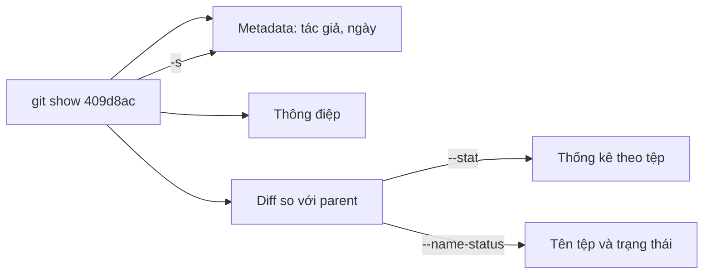

## Bạn sẽ học được gì

- Dùng `git show` để xem metadata và diff của một commit cụ thể.
- Thu gọn output về danh sách tệp, thống kê, hoặc chỉ metadata.
- Xem nội dung một tệp tại một commit mà không cần checkout.
- Biết các cách chỉ tới một commit: hash, nhánh, tag, cú pháp tương đối.

## Khái niệm

`git log` cho bạn danh sách; `git show` cho bạn **một** thứ, chi tiết đầy đủ. Với một commit, `git show` in:

1. Hash đầy đủ, tác giả, ngày tác giả.
2. Thông điệp commit (thụt lề).
3. Diff so với parent: tệp nào đổi, dòng nào thêm, bớt.

Với merge commit, `git show` mặc định in diff kết hợp (combined diff), chỉ hiện những chỗ kết quả merge khác cả hai parent, nên thường khá ngắn hoặc trống. Thêm `--first-parent` hoặc `-m` khi cần xem chi tiết hơn.

Bạn có thể chỉ commit bằng nhiều cách: hash rút gọn (`409d8ac`), tên nhánh (`main` là commit đầu nhánh), tag (`v1.0.0`), hoặc cú pháp tương đối (`HEAD~2` là ông của HEAD, `HEAD^` là cha). `git show` không chỉ xem commit: `git show <commit>:<đường-dẫn>` in nội dung tệp tại commit đó, `git show <tag>` in thông tin tag rồi đến commit.

Các tùy chọn định dạng hay dùng:

- `--stat`: thay diff bằng bảng thống kê số dòng mỗi tệp.
- `--name-only` / `--name-status`: chỉ tên tệp, hoặc tên kèm trạng thái `A` (thêm), `M` (sửa), `D` (xóa), `R` (đổi tên, kèm độ tương đồng).
- `-s` (`--no-patch`): bỏ diff, chỉ giữ metadata.
- `--format=<mẫu>`: tùy biến phần metadata, như ở `git log`. `--format=fuller` hiện thêm người commit và ngày commit.

Một thói quen tốt khi điều tra: đừng tin subject. Subject do người viết tự đặt và có thể không phản ánh hết những gì commit làm. Một commit tên "Sửa chính tả" vẫn có thể lỡ đổi một giá trị cấu hình. `git show --stat` mất một giây và cho bạn biết sự thật về phạm vi thay đổi, còn diff đầy đủ cho biết chi tiết.

Kết hợp hợp lý giúp bạn trả lời nhanh những câu như: "commit này đổi tệp nào?", "nó có đổi tên tệp không?", "ai commit, ai viết?".

## Hình dung bằng sơ đồ



## Lệnh cần biết

```bash
git show <commit>                       # metadata, thông điệp, diff
git show --stat <commit>                # thống kê thay vì diff
git show --name-only --format=%s <commit>   # subject và tên tệp
git show --name-status --oneline <commit>   # trạng thái A, M, D, R
git show -s --format=fuller <commit>    # chỉ metadata, có cả người commit
git show <commit>:<đường-dẫn>           # nội dung tệp tại commit
git show HEAD~2 --oneline --stat        # cú pháp tương đối
```

| Ký hiệu `--name-status` | Ý nghĩa |
| --- | --- |
| `A` | Thêm tệp |
| `M` | Sửa tệp |
| `D` | Xóa tệp |
| `R100` | Đổi tên, nội dung giống 100 phần trăm |

## Ví dụ từng bước

Xem đầy đủ commit nghi vấn trong repository mẫu:

```bash
git show 409d8ac
```

```text
commit 409d8acfbf9153b336a1936a5de71e54fca85d61
Author: Hoa <hoa@example.invalid>
Date:   Thu Oct 8 16:00:00 2026 +0700

    Giảm timeout cho nhanh

diff --git a/config.txt b/config.txt
index dca6fad..41a38b1 100644
--- a/config.txt
+++ b/config.txt
@@ -1,4 +1,4 @@
 env=uat
-timeout=60
+timeout=5
 retry=3
 API_KEY_DEMO=abc123
```

Chỉ cần biết commit đổi tệp nào:

```bash
git show --name-only --format=%s 409d8ac
```

```text
Giảm timeout cho nhanh

config.txt
```

Với commit đổi tên, `--name-status` cho thấy rõ:

```bash
git show --name-status --oneline 54d864d
```

```text
54d864d Chuyển cấu hình vào conf
R100	config.txt	conf/app.conf
```

Xem nội dung tệp tại commit đó, và metadata đầy đủ:

```bash
git show 409d8ac:config.txt
git show -s --format=fuller 409d8ac
```

```text
env=uat
timeout=5
retry=3
API_KEY_DEMO=abc123
commit 409d8acfbf9153b336a1936a5de71e54fca85d61
Author:     Hoa <hoa@example.invalid>
AuthorDate: Thu Oct 8 16:00:00 2026 +0700
Commit:     Hoa <hoa@example.invalid>
CommitDate: Thu Oct 8 16:00:00 2026 +0700

    Giảm timeout cho nhanh
```

## Lỗi thường gặp

**Dùng đường dẫn hiện tại cho commit cũ.** Ở commit `409d8ac`, tệp còn tên `config.txt`, nên lệnh `git show 409d8ac:conf/app.conf` thất bại:

```text
fatal: path 'conf/app.conf' exists on disk, but not in '409d8ac'
```

Kiểm tra tên tại commit đó bằng `git show --name-only` hoặc `git ls-tree -r <commit>`.

> **Lưu ý** Cú pháp `<commit>:<đường-dẫn>` tính đường dẫn từ gốc repository. Muốn tương đối so với thư mục hiện tại, viết `<commit>:./tệp`.

**Merge commit hiện diff trống.** Đó là diff kết hợp, chỉ hiện chỗ khác cả hai parent. Thêm `--first-parent` để xem merge mang gì vào nhánh chính.

**Hash rút gọn quá ngắn.** Trên repository lớn, 4 đến 5 ký tự có thể trùng. Git báo mơ hồ; dùng thêm ký tự.

> **Mẹo** `git show --stat` là cách nhanh để ước lượng kích thước một commit trước khi đọc diff chi tiết.

**Nhầm tác giả với người commit.** `Author` trong output mặc định là tác giả. Dùng `--format=fuller` để thấy cả hai.

## Áp dụng trong công việc

Trong ticket lỗi, developer chỉ ghi "đã sửa ở commit 7c1f9e2". Trước khi viết test xác nhận, bạn chạy `git show --stat 7c1f9e2` để biết phạm vi thay đổi, rồi `git show 7c1f9e2 -- src/payment/` để đọc riêng phần liên quan. Bạn thiết kế test bao đúng những nhánh logic vừa bị sửa, thay vì test lại toàn bộ module.

## Chuẩn bị làm bài

Repository bài tập có `app.txt` với vài commit. Câu hỏi đưa subject của một commit và hỏi commit đó sửa tệp nào. Hãy:

- Tìm hash của commit theo subject bằng `git log --oneline` hoặc `--grep`.
- Dùng `git show` với `--name-only` hoặc `--stat` trên commit đó.
- Trả lời bằng đúng tên tệp như Git in ra.

## Tóm tắt

- `git show <commit>` in metadata, thông điệp và diff so với parent.
- `--stat`, `--name-only`, `--name-status`, `-s` thu gọn output theo nhu cầu.
- `git show <commit>:<đường-dẫn>` xem tệp tại commit mà không checkout.
- Commit có thể chỉ bằng hash, nhánh, tag hoặc cú pháp tương đối.
- `--format=fuller` phân biệt tác giả và người commit.
