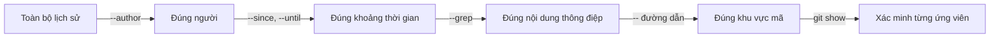

## Bạn sẽ học được gì

- Lọc `git log` theo tác giả, thông điệp, khoảng thời gian và đường dẫn.
- Hiểu cách các bộ lọc kết hợp với nhau: khi nào là "và", khi nào là "hoặc".
- Định dạng output gọn để đọc nhanh danh sách ứng viên.
- Tránh các bẫy về biên thời gian và phân biệt tác giả với người commit.

## Khái niệm

Lịch sử thật của một dự án có hàng nghìn commit. Đọc hết là không thể; bạn cần **thu hẹp** trước, rồi mới đọc kỹ vài ứng viên. `git log` có nhiều bộ lọc, mỗi bộ trả lời một khía cạnh:

- **Ai**: `--author=<mẫu>` khớp tên hoặc email tác giả (dạng biểu thức chính quy, khớp một phần). `--committer` tương tự cho người commit.
- **Nói gì**: `--grep=<mẫu>` khớp nội dung thông điệp commit. `-i` để không phân biệt hoa thường. `--invert-grep` lấy những commit **không** khớp.
- **Khi nào**: `--since`/`--after` và `--until`/`--before` nhận ngày tháng hoặc cách nói tương đối như `"2 weeks ago"`.
- **Ở đâu**: `-- <đường-dẫn>` ở cuối lệnh chỉ lấy commit có chạm vào đường dẫn đó.
- **Loại commit**: `--no-merges` bỏ merge commit, `--merges` chỉ lấy merge.

Quy tắc kết hợp cần nhớ:

- Các bộ lọc **khác loại** kết hợp theo kiểu "và": `--author=Hoa --grep=timeout` là commit của Hoa **và** có chữ timeout trong thông điệp.
- Nhiều lần **cùng loại** (nhiều `--author`, nhiều `--grep`) kết hợp theo kiểu "hoặc".
- Thêm `--all-match` để nhiều `--grep` phải khớp đồng thời.

Hai điểm tinh tế:

1. **Tác giả và người commit** có thể khác nhau: tác giả là người viết thay đổi, người commit là người tạo commit (ví dụ khi cherry-pick hay áp dụng patch). Lọc theo đúng trường bạn quan tâm.
2. **Biên thời gian**: các mốc như `--until=2026-10-08` được so với ngày commit (committer date). Trong thử nghiệm với Git 2.47, mốc chỉ có ngày không lấy commit lúc 16:00 cùng ngày đó; muốn chắc chắn, ghi rõ giờ như `"2026-10-08 23:59"`.

Sau khi lọc, dùng `--format` để in đúng các cột cần thiết, ví dụ hash, ngày, tác giả, subject. Cuối cùng, xác minh từng ứng viên bằng `git show`.

## Hình dung bằng sơ đồ



## Lệnh cần biết

```bash
git log --author=<mẫu> --oneline
git log --author=A --author=B --oneline      # A hoặc B
git log --grep=<mẫu> -i --oneline            # thông điệp chứa mẫu
git log --grep=A --grep=B --all-match        # phải chứa cả A và B
git log --invert-grep --grep=<mẫu>           # thông điệp không chứa mẫu
git log --since=2026-10-05 --until="2026-10-08 23:59" --oneline
git log --since="2 weeks ago" --oneline
git log --oneline -- <đường-dẫn>             # commit chạm đường dẫn
git log --no-merges --format="%h %ad %an %s" --date=short
```

| Bộ lọc | Lọc theo | Kết hợp nhiều lần |
| --- | --- | --- |
| `--author` | Tên hoặc email tác giả | Hoặc |
| `--committer` | Người commit | Hoặc |
| `--grep` | Thông điệp | Hoặc, `--all-match` thành và |
| `--since`, `--until` | Ngày commit | Tạo khoảng |
| `-- <path>` | Tệp, thư mục | Hoặc |

## Ví dụ từng bước

Repository mẫu có chín commit của Hoa và Tuan. Lọc theo tác giả:

```bash
git log --author=Hoa --oneline
```

```text
54d864d Chuyển cấu hình vào conf
409d8ac Giảm timeout cho nhanh
a6a4f2b Tăng timeout
c48be0e Tạo cấu hình
```

Kết hợp khác loại là "và":

```bash
git log --author=Tuan --since=2026-10-05 --oneline
git log --author=Hoa --grep=timeout --oneline
```

```text
eedf5e9 Xóa khóa demo
ff8b9ef Cập nhật test đăng nhập
b14bd70 Đổi môi trường sang uat
409d8ac Giảm timeout cho nhanh
a6a4f2b Tăng timeout
```

Nhiều `--grep` mặc định là "hoặc", thêm `--all-match` thành "và":

```bash
git log --author=Hoa --grep=cấu --grep=timeout --oneline
git log --author=Hoa --grep=cấu --grep=timeout --all-match --oneline
```

```text
54d864d Chuyển cấu hình vào conf
409d8ac Giảm timeout cho nhanh
a6a4f2b Tăng timeout
c48be0e Tạo cấu hình
```

Lệnh thứ hai không in gì: không thông điệp nào chứa cả hai từ. Bẫy biên thời gian:

```bash
git log --since=2026-10-05 --until=2026-10-08 --oneline
git log --since=2026-10-05 --until="2026-10-08 23:59" --oneline
```

```text
b14bd70 Đổi môi trường sang uat
a6a4f2b Tăng timeout
409d8ac Giảm timeout cho nhanh
b14bd70 Đổi môi trường sang uat
a6a4f2b Tăng timeout
```

Commit lúc 16:00 ngày 8 chỉ xuất hiện khi ghi rõ giờ. Cuối cùng, định dạng gọn:

```bash
git log --no-merges --format="%h %ad %an %s" --date=short -3
```

```text
eedf5e9 2026-10-11 Tuan Xóa khóa demo
54d864d 2026-10-10 Hoa Chuyển cấu hình vào conf
ff8b9ef 2026-10-09 Tuan Cập nhật test đăng nhập
```

## Lỗi thường gặp

**Đặt đường dẫn trước tùy chọn.** `-- <path>` phải ở cuối; mọi thứ sau `--` được hiểu là đường dẫn.

**Nghĩ `--author` khớp chính xác.** Nó là biểu thức chính quy khớp một phần: `--author=Hoa` khớp cả "Hoang". Thêm email hoặc neo mẫu khi cần chính xác.

> **Lưu ý** `--grep` chỉ tìm trong thông điệp commit, không tìm trong nội dung tệp. Muốn tìm nội dung thay đổi, dùng pickaxe `-S` hoặc `-G`.

**Quên rằng nhiều `--grep` là "hoặc".** Kết quả nhiều hơn mong đợi. Thêm `--all-match`.

> **Mẹo** Lưu những bộ lọc hay dùng thành alias, ví dụ một alias in log của chính bạn trong tuần qua để viết báo cáo nhanh.

**Lọc theo thời gian trên lịch sử đã rebase.** Ngày commit của commit đã rebase là thời điểm rebase, không phải lúc viết thay đổi. Dùng `--format=%ad` để xem ngày tác giả khi cần.

## Áp dụng trong công việc

Kiểm toán nội bộ hỏi: "Trong tháng 9, những thay đổi nào liên quan đến cấu hình hạn mức chuyển khoản, và ai thực hiện?". Bạn kết hợp `--since`, `--until` có giờ rõ ràng, đường dẫn thư mục cấu hình, và `--grep=han.muc -i`, xuất bằng `--format` thành bảng gọn. Sau đó `git show` từng ứng viên để xác nhận trước khi gửi danh sách.

## Chuẩn bị làm bài

Repository bài tập có `app.txt` với vài commit từ nhiều tác giả. Câu hỏi đưa một subject cụ thể và hỏi ai là tác giả của commit đó. Hãy:

- Dùng `--grep` với một phần subject để thu hẹp, kèm `--format` có trường tác giả.
- Nếu ra nhiều kết quả, kết hợp thêm bộ lọc khác hoặc đọc kỹ subject đầy đủ.
- Xác minh bằng `git show -s` trên commit tìm được.

## Tóm tắt

- `--author`, `--grep`, `--since`/`--until`, `-- <path>` lọc theo người, thông điệp, thời gian, khu vực.
- Bộ lọc khác loại kết hợp kiểu "và"; cùng loại kiểu "hoặc".
- `--all-match` buộc mọi `--grep` cùng khớp.
- Ghi rõ giờ cho mốc thời gian để tránh bẫy biên.
- Lọc để thu hẹp, rồi xác minh bằng `git show`.
