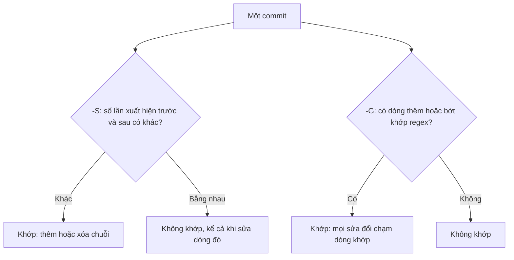

## Bạn sẽ học được gì

- Hiểu chính xác điều kiện khớp của `-S`: số lần xuất hiện thay đổi.
- Hiểu `-G`: có dòng thêm hoặc bớt trong diff khớp biểu thức chính quy.
- Thấy bằng ví dụ thật khi nào hai cách cho kết quả khác nhau.
- Biết tương tác giữa pickaxe, giới hạn đường dẫn và đổi tên tệp.

## Khái niệm

Bài trước đã dùng `git log -S` để tìm commit thêm hoặc xóa một chuỗi. Bài này mổ xẻ cách nó quyết định, vì hiểu sai một chi tiết nhỏ có thể khiến bạn bỏ sót đúng commit cần tìm.

**`-S <chuỗi>`** đếm số lần chuỗi xuất hiện trong tệp **trước** và **sau** commit. Commit chỉ khớp khi hai con số **khác nhau**. Hệ quả:

- Commit thêm chuỗi lần đầu: khớp (0 thành 1).
- Commit xóa chuỗi: khớp (1 thành 0).
- Commit sửa dòng chứa chuỗi nhưng chuỗi vẫn còn đúng một lần: **không khớp**. Ví dụ đổi `timeout=30` thành `timeout=60` không làm đổi số lần xuất hiện của chữ `timeout`.
- Commit chỉ di chuyển dòng chứa chuỗi sang chỗ khác trong tệp: không khớp.

Vì vậy `-S` cực hợp cho câu hỏi "chuỗi này **xuất hiện hay biến mất** khi nào", ví dụ một tên hàm, một khóa cấu hình, một token. Thêm `--pickaxe-regex` thì chuỗi được hiểu là biểu thức chính quy, nhưng nguyên tắc so sánh số lần vẫn giữ nguyên.

**`-G <regex>`** hỏi câu khác: diff của commit có **dòng thêm hoặc bớt nào khớp regex** không? Nó nhìn vào các dòng có dấu `+` hoặc `-` trong patch. Đổi `timeout=30` thành `timeout=60` tạo một dòng `-timeout=30` và một dòng `+timeout=60`, nên `-G timeout` khớp. Di chuyển một dòng cũng tạo dòng `+`/`-`, nên cũng khớp.

Tóm lại: `-S` quan tâm **số lượng**, `-G` quan tâm **dòng thay đổi**. `-G` thường cho nhiều kết quả hơn; `-S` cho ít kết quả hơn nhưng trúng đích hơn khi bạn tìm lúc một thứ được thêm vào hay bỏ đi.

**Kết hợp với đường dẫn.** Khi giới hạn `-- <tệp>`, pickaxe chỉ nhìn tệp đó. Nếu tệp được đổi tên, commit đổi tên trông như "tệp mới xuất hiện cùng toàn bộ nội dung", nên có thể bị liệt kê là đã "thêm" chuỗi. Đọc diff bằng `-p` hoặc dùng `--follow` để tránh hiểu nhầm.

## Hình dung bằng sơ đồ



## Lệnh cần biết

```bash
git log -S <chuỗi> --oneline                 # số lần xuất hiện thay đổi
git log -S <regex> --pickaxe-regex --oneline # như trên, chuỗi là regex
git log -G <regex> --oneline                 # dòng diff khớp regex
git log -S <chuỗi> -p                        # kèm diff để thấy + hay -
git log -S <chuỗi> --pickaxe-all -p          # hiện toàn bộ diff của commit khớp
git log -S <chuỗi> --oneline -- <tệp>        # giới hạn tệp
git log -G <regex> --reverse --oneline       # cũ nhất trước
```

| | `-S` | `-G` |
| --- | --- | --- |
| Đối tượng | Số lần xuất hiện trong tệp | Dòng thêm, bớt trong diff |
| Sửa dòng nhưng giữ chuỗi | Không khớp | Khớp |
| Di chuyển dòng | Không khớp | Khớp |
| Thêm, xóa chuỗi | Khớp | Khớp |
| Mặc định là | Chuỗi cố định | Regex |

## Ví dụ từng bước

Trong repository mẫu, dòng timeout được tạo với `30`, đổi thành `60`, rồi thành `5`. Hỏi bằng `-S`:

```bash
git log -S timeout --oneline
```

```text
c48be0e Tạo cấu hình
```

Chỉ một commit: chữ `timeout` xuất hiện từ 0 lần thành 1 lần đúng một lần duy nhất. Hai lần đổi giá trị không đổi số lần. Hỏi bằng `-G`:

```bash
git log -G timeout --oneline
```

```text
409d8ac Giảm timeout cho nhanh
a6a4f2b Tăng timeout
c48be0e Tạo cấu hình
```

Ba commit, vì cả ba đều có dòng `+` hoặc `-` chứa `timeout`. Regex chính xác hơn, chỉ bắt giá trị một chữ số:

```bash
git log -G "^timeout=[0-9]$" --oneline
```

```text
409d8ac Giảm timeout cho nhanh
```

Với chuỗi thật sự được thêm rồi xóa, hai cách cho cùng kết quả:

```bash
git log -S API_KEY_DEMO --oneline
git log -G API_KEY --oneline
```

```text
eedf5e9 Xóa khóa demo
b622b70 Thêm khóa demo
eedf5e9 Xóa khóa demo
b622b70 Thêm khóa demo
```

Bẫy đường dẫn khi tệp đã đổi tên:

```bash
git log -S API_KEY_DEMO --oneline -- conf/app.conf
```

```text
eedf5e9 Xóa khóa demo
54d864d Chuyển cấu hình vào conf
```

Commit đổi tên xuất hiện, vì chỉ nhìn `conf/app.conf` thì đó là lúc tệp (và chuỗi) "xuất hiện". Commit thêm thật sự nằm ở tên cũ.

## Lỗi thường gặp

**Dùng `-S` để tìm lần đổi giá trị.** Như ví dụ timeout, bạn sẽ không thấy commit đổi giá trị. Dùng `-G` hoặc tìm chính giá trị (`-S timeout=5`).

**Quên `-G` là regex.** Dấu chấm, dấu sao, ngoặc có nghĩa đặc biệt. Escape khi cần, và đặt mẫu trong ngoặc kép.

> **Cẩn thận** Pickaxe với giới hạn đường dẫn có thể chỉ vào commit đổi tên thay vì commit thực sự thêm chuỗi. Luôn xem diff bằng `-p` trước khi kết luận.

**`-G` quá rộng.** Mẫu ngắn như `id` khớp vô số dòng. Thu hẹp bằng neo `^`, `$`, hoặc giới hạn đường dẫn.

> **Mẹo** Với câu hỏi "lần đầu tiên chuỗi được thêm", kết hợp `-S`, `--reverse` và đọc dòng `+` trong `-p`.

## Áp dụng trong công việc

Test giao diện bắt đầu fail vì selector `data-test="btn-transfer"` không còn trên trang. `git log -S 'btn-transfer'` cho thấy commit đã xóa thuộc tính đó. Nhưng bạn còn muốn biết ai đã đổi giá trị của các thuộc tính `data-test` trong tháng: `git log -G 'data-test="[a-z-]+"' -- src/ui/` liệt kê mọi commit chạm vào những dòng đó, kể cả khi chỉ đổi tên selector.

## Chuẩn bị làm bài

Repository bài tập có `app.txt` với vài commit; một chuỗi mẫu được thêm vào ở một thời điểm. Câu hỏi yêu cầu subject của commit đã thêm chuỗi đó. Hãy:

- Thử cả `-S` và `-G` với chuỗi đề cho, so sánh hai danh sách.
- Dùng `-p` để xác nhận commit có dòng `+` chứa chuỗi.
- Nghĩ xem tình huống nào khiến hai cách cho kết quả khác nhau.

## Tóm tắt

- `-S` khớp khi số lần xuất hiện của chuỗi thay đổi.
- `-G` khớp khi có dòng thêm hoặc bớt trong diff khớp regex.
- Sửa dòng mà giữ chuỗi: `-S` bỏ qua, `-G` bắt được.
- Giới hạn đường dẫn và đổi tên có thể làm commit đổi tên hiện như commit thêm.
- Luôn xác nhận bằng diff trước khi kết luận.
