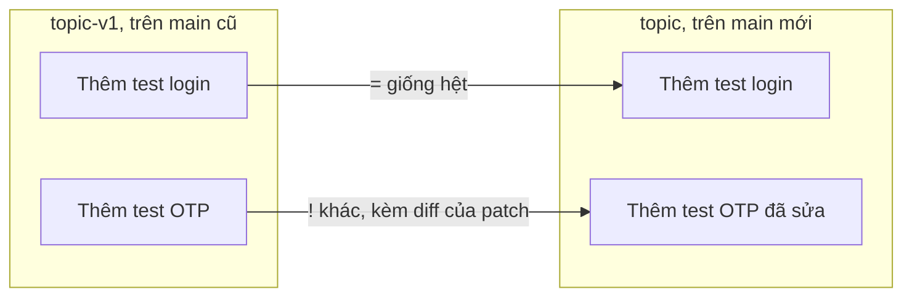

## Bạn sẽ học được gì

- Hiểu vấn đề mà `git range-diff` giải quyết: so sánh hai phiên bản của cùng một chuỗi commit.
- Đọc output: các ký hiệu `=`, `!`, `<`, `>` và phần diff lồng.
- Dùng ba cách viết dải: base chung, hai dải riêng, và ba chấm.
- Điều chỉnh độ nhạy ghép cặp bằng `--creation-factor`.

## Khái niệm

Bạn gửi nhánh `topic` gồm hai commit để review. Reviewer góp ý, bạn sửa một commit bằng amend hoặc rebase tương tác, đồng thời rebase cả nhánh lên `main` mới. Giờ reviewer hỏi: "Lần này bạn đã sửa gì so với lần trước?".

`git diff topic-v1 topic` không trả lời được câu đó. Nó so hai **snapshot**, nên kéo theo cả những thay đổi của `main` mà rebase mang vào, trộn lẫn với chỉnh sửa thật của bạn. Thứ reviewer cần là so sánh **từng commit** của phiên bản cũ với commit tương ứng của phiên bản mới. Đó chính là `git range-diff`.

Range-diff nhận hai dải commit. Với mỗi dải, nó tính patch của từng commit, rồi **ghép cặp** commit cũ với commit mới dựa trên độ giống nhau của patch (thông điệp cũng góp phần). Kết quả là một bảng:

- `=`: cặp commit có patch giống hệt. Commit chỉ bị rebase, không đổi nội dung.
- `!`: cặp commit được ghép nhưng patch khác. Ngay bên dưới là **diff của hai patch**: dòng bắt đầu `-` là thuộc patch cũ, `+` là thuộc patch mới. Vì patch tự nó đã có dấu `+`/`-`, bạn sẽ thấy hai cột dấu, như `-+nhap ma` và `++nhap ma 6 chu so`.
- `<`: commit chỉ có ở dải cũ (bị bỏ, hoặc không ghép được).
- `>`: commit chỉ có ở dải mới (mới thêm, hoặc không ghép được).

Ba cách chỉ dải:

1. `git range-diff <base> <cũ> <mới>`: tương đương `<base>..<cũ>` và `<base>..<mới>`.
2. `git range-diff <base1>..<cũ> <base2>..<mới>`: chỉ định hai dải rõ ràng.
3. `git range-diff <cũ>...<mới>`: tự tìm merge base; tiện nhưng có thể kéo cả commit của nhánh nền vào phía mới.

Khi commit chỉ nhỏ và bị sửa đáng kể, thuật toán có thể không nhận ra chúng là một cặp, và hiển thị một `<` và một `>` riêng. `--creation-factor=<phần-trăm>` (mặc định 60) nới lỏng điều kiện ghép; tăng lên để range-diff mạnh dạn ghép hơn.

## Hình dung bằng sơ đồ



## Lệnh cần biết

```bash
git range-diff <base> <cũ> <mới>              # hai dải chung base
git range-diff <base1>..<cũ> <base2>..<mới>   # hai dải tường minh
git range-diff <cũ>...<mới>                   # tự tìm merge base
git range-diff --creation-factor=95 <base> <cũ> <mới>   # ghép cặp dễ hơn
git branch <tên-cũ>                           # giữ lại phiên bản cũ trước khi rebase
git reflog <nhánh>                            # tìm đầu nhánh cũ nếu quên giữ
```

| Ký hiệu | Ý nghĩa |
| --- | --- |
| `=` | Cặp commit có patch giống hệt |
| `!` | Cặp commit có patch khác, diff lồng bên dưới |
| `<` | Chỉ có ở dải cũ |
| `>` | Chỉ có ở dải mới |

## Ví dụ từng bước

Trước khi sửa, mình giữ phiên bản cũ bằng `git branch topic-v1`. Sau đó rebase `topic` lên `main` mới và amend commit OTP. Hai phiên bản:

```bash
git log --oneline --graph --all
```

```text
* ec96bd9 Thêm test OTP
* 7777973 Thêm test login
* 236fd51 Main tiến thêm
| * 5c01a0b Thêm test OTP
| * 1b2cda1 Thêm test login
|/  
* 7e1e491 Khởi tạo
```

So sánh thẳng snapshot lẫn cả thay đổi của `main`:

```bash
git diff --stat topic-v1 topic
```

```text
 main.txt | 1 +
 otp.txt  | 2 +-
 2 files changed, 2 insertions(+), 1 deletion(-)
```

Range-diff với base là `main`:

```bash
git range-diff main topic-v1 topic
```

```text
1:  1b2cda1 = 1:  7777973 Thêm test login
2:  5c01a0b < -:  ------- Thêm test OTP
-:  ------- > 2:  ec96bd9 Thêm test OTP
```

Commit login giống hệt. Commit OTP nhỏ và bị sửa, nên không được ghép cặp. Nới điều kiện:

```bash
git range-diff --creation-factor=95 main topic-v1 topic
```

```text
1:  1b2cda1 = 1:  7777973 Thêm test login
2:  5c01a0b ! 2:  ec96bd9 Thêm test OTP
    @@ Commit message
      ## otp.txt (new) ##
     @@
     +test otp
    -+nhap ma
    ++nhap ma 6 chu so
     +kiem tra ket qua
     +thoat
```

Giờ reviewer thấy đúng một điều: dòng `nhap ma` thành `nhap ma 6 chu so`. Thay đổi `main.txt` của nhánh nền không làm nhiễu. Dạng ba chấm sẽ liệt kê thêm commit của `main` với dấu `>`:

```bash
git range-diff topic-v1...topic
```

```text
-:  ------- > 1:  236fd51 Main tiến thêm
1:  1b2cda1 = 2:  7777973 Thêm test login
...
```

## Lỗi thường gặp

**Dùng `git diff` giữa hai phiên bản nhánh sau rebase.** Thay đổi của nhánh nền trộn vào. Dùng range-diff.

**Không giữ phiên bản cũ.** Sau rebase, đầu nhánh cũ chỉ còn trong reflog. Tạo nhánh hoặc tag tạm trước khi viết lại lịch sử, hoặc tìm lại bằng `git reflog <nhánh>`.

> **Mẹo** Nhiều người đặt tên kiểu `topic-v1`, `topic-v2` cho mỗi vòng review; range-diff giữa hai tên liền kề là "changelog" cho reviewer.

**Đọc nhầm hai cột dấu.** Cột đầu là "patch cũ hay mới", cột sau là "dòng thêm hay bớt trong patch". `-+x` nghĩa là patch cũ có thêm dòng `x`; `++y` nghĩa là patch mới thêm dòng `y`.

> **Lưu ý** Ba chấm tiện nhưng thường đưa cả commit của nhánh nền vào với dấu `>`. Dạng có base tường minh cho kết quả sạch hơn.

## Áp dụng trong công việc

Bạn gửi nhánh bổ sung năm commit test cho luồng mở tài khoản trực tuyến. Reviewer góp ý hai chỗ; bạn sửa bằng rebase tương tác và đồng thời rebase lên `main` mới. Thay vì viết lại mô tả dài, bạn dán output `git range-diff main review-v1 review-v2` vào bình luận: ba commit `=`, hai commit `!` với đúng phần đã sửa. Reviewer duyệt lại trong vài phút.

## Chuẩn bị làm bài

Đây là bài câu hỏi khái niệm: bạn cần nêu lệnh so sánh hai dải commit thay vì hai snapshot. Hãy tự thử trong repository bài tập: tạo một nhánh có hai commit, giữ một bản sao tên khác, sửa một commit bằng amend, rồi so sánh hai phiên bản bằng `git diff` và bằng lệnh trong bài để cảm nhận sự khác biệt.

## Tóm tắt

- `git range-diff` so sánh từng commit của hai phiên bản cùng một chuỗi commit.
- `=` là giống hệt, `!` là khác (kèm diff của patch), `<` và `>` là chỉ có ở một bên.
- Dạng `<base> <cũ> <mới>` cho kết quả sạch nhất.
- `--creation-factor` nới hoặc siết điều kiện ghép cặp.
- Giữ lại phiên bản cũ trước khi rebase để so sánh dễ dàng.
