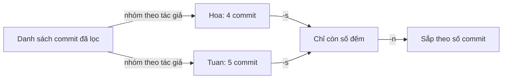

## Bạn sẽ học được gì

- Dùng `git shortlog` để nhóm commit theo tác giả.
- Đếm số commit, kèm email, giới hạn theo thời gian, dải commit hoặc đường dẫn.
- Hiểu vì sao cùng một người có thể bị tách thành nhiều dòng, và cách xử lý.
- Biết giới hạn: số commit không đo được chất lượng hay khối lượng công việc.

## Khái niệm

`git log` cho bạn từng commit một. Nhưng nhiều khi câu hỏi là tổng hợp: "Ai đã làm gì trong sprint này?", "Release này có những đóng góp của ai?", "Thư mục test này do ai chăm sóc?". `git shortlog` trả lời bằng cách gom commit theo tác giả, liệt kê subject dưới mỗi tên.

Mặc định mỗi nhóm có tên tác giả, số commit trong ngoặc, rồi danh sách subject (cũ trước). Hai tùy chọn hay dùng nhất:

- `-s` (summary): bỏ danh sách subject, chỉ giữ số đếm.
- `-n` (numbered): sắp xếp theo số commit giảm dần thay vì theo tên.

Kết hợp `-sn` cho bảng xếp hạng gọn; thêm `-e` để kèm email.

Vì shortlog dùng chung cú pháp chọn commit với `git log`, bạn giới hạn được theo dải (`v1.0..v1.1`, `HEAD~10..HEAD`), theo thời gian (`--since`, `--until`), và theo đường dẫn (`-- tests/`). `--group=committer` nhóm theo người commit thay vì tác giả, hữu ích khi có người áp dụng patch của người khác.

Một chi tiết dễ vấp: khi **không có terminal** (ví dụ chạy trong script, CI, hay qua pipe), `git shortlog` không tham số sẽ chờ đọc output của `git log` từ đầu vào chuẩn thay vì tự đọc HEAD, và trông như bị treo. Luôn truyền rõ một revision như `HEAD` trong script.

Nếu cùng một người commit bằng nhiều tên hoặc email (máy cá nhân, máy công ty), shortlog sẽ tách họ thành nhiều dòng. Tệp `.mailmap` ở gốc repository ánh xạ các danh tính đó về một tên chuẩn.

Cuối cùng, hãy nhớ: số commit chỉ là số commit. Một commit sửa lỗi bảo mật khó có thể quan trọng hơn hai mươi commit đổi chính tả. Shortlog để thấy bức tranh đóng góp và biết ai đã chạm vào khu vực nào, không phải để chấm điểm con người.

## Hình dung bằng sơ đồ



## Lệnh cần biết

```bash
git shortlog HEAD                  # nhóm theo tác giả, kèm subject
git shortlog -sn HEAD              # chỉ số đếm, sắp giảm dần
git shortlog -sne HEAD             # kèm email
git shortlog -sn v1.0..v1.1        # trong một dải
git shortlog -sn --since=2026-10-06 HEAD   # từ một ngày
git shortlog -sn HEAD -- tests/    # chỉ commit chạm đường dẫn
git shortlog -sn --group=committer HEAD    # nhóm theo người commit
git log -3 --format="%an %s"       # kiểm tra lại từng commit cụ thể
```

| Tùy chọn | Ý nghĩa |
| --- | --- |
| `-s` | Chỉ số đếm |
| `-n` | Sắp theo số commit |
| `-e` | Kèm email |
| `--group=committer` | Nhóm theo người commit |
| `--no-merges` | Bỏ merge commit |

## Ví dụ từng bước

Repository mẫu có hai người đóng góp. Xem tổng quan:

```bash
git shortlog HEAD
```

```text
Hoa (4):
      Tạo cấu hình
      Tăng timeout
      Giảm timeout cho nhanh
      Chuyển cấu hình vào conf

Tuan (5):
      Thêm test đăng nhập
      Thêm khóa demo
      Đổi môi trường sang uat
      Cập nhật test đăng nhập
      Xóa khóa demo
```

Dạng gọn, kèm email:

```bash
git shortlog -sn HEAD
git shortlog -sne HEAD
```

```text
     5	Tuan
     4	Hoa
     5	Tuan <tuan@example.invalid>
     4	Hoa <hoa@example.invalid>
```

Ai chăm sóc tệp test? Ai làm gì trong ba commit gần nhất?

```bash
git shortlog -sn HEAD -- login_test.txt
git shortlog -sn HEAD~3..HEAD
git log -3 --format="%an %s"
```

```text
     2	Tuan
     2	Tuan
     1	Hoa
Tuan Xóa khóa demo
Hoa Chuyển cấu hình vào conf
Tuan Cập nhật test đăng nhập
```

Shortlog cho con số, còn `git log --format` cho bạn thấy chính xác từng commit mới nhất thuộc về ai.

## Lỗi thường gặp

**Shortlog "treo" trong script.** Không có terminal và không truyền revision, nó chờ dữ liệu từ đầu vào chuẩn. Truyền `HEAD` hoặc một dải cụ thể.

> **Lưu ý** Trong terminal tương tác, `git shortlog` không tham số tự dùng HEAD, nên bạn sẽ không gặp vấn đề này khi gõ tay.

**Một người thành hai dòng.** Tên viết khác nhau hoặc email khác nhau. Thêm `.mailmap` để gộp, hoặc ít nhất kiểm tra bằng `-e`.

**Dùng số commit để đánh giá năng suất.** Số commit phụ thuộc thói quen chia commit của mỗi người. Đừng biến nó thành KPI.

> **Mẹo** Muốn ghi công trong release note, `git shortlog --no-merges v1.0..v1.1` cho danh sách gọn theo người, sẵn để dán vào tài liệu.

**Quên rằng merge commit cũng được đếm.** Người hay bấm merge trên giao diện có thể có số commit cao bất thường. Thêm `--no-merges` khi cần.

## Áp dụng trong công việc

Trước buổi retro, QA lead muốn biết ai đã đụng vào bộ test thanh toán trong sprint để mời đúng người thảo luận về test flaky. Bạn chạy `git shortlog -sn --since=<ngày-bắt-đầu-sprint> HEAD -- tests/payment/`, có ngay danh sách. Bạn gửi kèm lưu ý rằng đây là danh sách người đã chạm vào mã, không phải bảng đánh giá.

## Chuẩn bị làm bài

Repository bài tập có `app.txt` với vài commit từ nhiều tác giả. Câu hỏi hỏi ai là người tạo những commit mới nhất. Hãy:

- Chạy `git shortlog` với một revision hoặc dải phù hợp để thấy phân bố tác giả.
- Giới hạn vào vài commit gần nhất bằng dải `HEAD~N..HEAD`.
- Đối chiếu bằng `git log --format="%an %s"` để chắc chắn từng commit thuộc về ai.

## Tóm tắt

- `git shortlog` nhóm commit theo tác giả, kèm subject.
- `-sn` cho bảng đếm sắp giảm dần; `-e` thêm email.
- Dùng được dải commit, khoảng thời gian, đường dẫn như `git log`.
- Trong script, luôn truyền revision để tránh chờ đầu vào chuẩn.
- Số commit không đo chất lượng; dùng để thấy bức tranh đóng góp.
