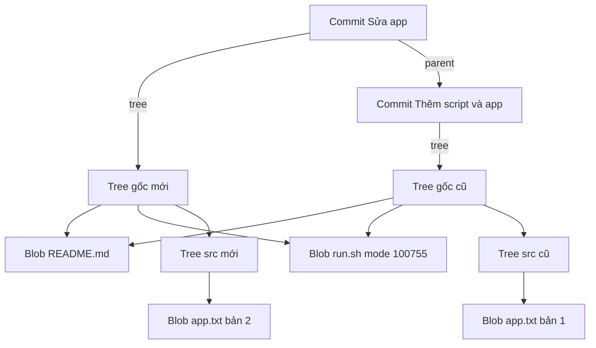

## Bạn sẽ học được gì

- Phân biệt ba loại object chính: blob, tree, commit, và vai trò của từng loại.
- Lần theo đồ thị từ commit xuống tree, tree con và blob bằng `git cat-file`.
- Hiểu vì sao snapshot mới chỉ tạo object cho phần thay đổi.
- Đọc được mode và kiểu trong mỗi dòng của tree.

## Khái niệm

Git lưu lịch sử bằng một đồ thị object. Mỗi loại object có một nhiệm vụ rõ ràng:

- **Blob** chứa đúng byte của một tệp. Không có tên tệp, không có quyền, không có thời gian. Chỉ nội dung.
- **Tree** mô tả một thư mục. Mỗi dòng trong tree gồm mode, kiểu, object ID và tên. Dòng có thể trỏ tới blob (một tệp) hoặc tới tree khác (một thư mục con). Nhờ vậy, tree gốc của một commit mô tả trọn vẹn cây thư mục của snapshot.
- **Commit** gắn một snapshot vào lịch sử. Nó chứa ID của tree gốc, ID của các commit cha (parent), tác giả, người commit, thời gian và message. Commit đầu tiên không có parent; merge commit có từ hai parent trở lên.

(Loại thứ tư là tag object, dùng cho annotated tag: nó trỏ tới một object khác, thường là commit, kèm tên, người tạo và message.)

Các mũi tên trong đồ thị luôn đi từ object "chứa" tới object "được chứa": commit trỏ xuống tree, tree trỏ xuống blob và tree con, commit trỏ ngược về parent. Vì ID của mỗi object được tính từ nội dung, mà nội dung có chứa ID của object con, nên ID của commit thực chất "niêm phong" toàn bộ snapshot và toàn bộ lịch sử phía trước nó. Đổi một byte ở một tệp sâu trong cây là đổi blob, kéo theo đổi tree chứa nó, đổi tree cha, đổi tree gốc, đổi commit.

Điều đó nghe tốn kém, nhưng thật ra rất tiết kiệm. Khi bạn sửa một tệp trong thư mục `src` và commit, Git chỉ tạo: một blob mới cho tệp đó, một tree mới cho `src`, một tree gốc mới, và một commit mới. Mọi tệp và thư mục không đổi được tái sử dụng nguyên ID cũ. Snapshot là đầy đủ về mặt logic, nhưng chia sẻ phần lớn object với snapshot trước.

Mode trong tree cho biết loại mục: `100644` là tệp thường, `100755` là tệp thực thi, `120000` là symlink, `040000` là thư mục (tree), `160000` là gitlink của submodule.

## Hình dung bằng sơ đồ



Để ý `README.md` và `run.sh` được cả hai tree gốc trỏ tới: không sao chép gì cả.

## Lệnh cần biết

```bash
# Nội dung thô của commit: tree, parent, tác giả, message
git cat-file -p HEAD

# Tree gốc của commit
git cat-file -p 'HEAD^{tree}'

# Tree của một thư mục con
git cat-file -p HEAD:src

# Liệt kê đệ quy mọi tệp trong snapshot, -t để thấy cả tree con
git ls-tree -r -t HEAD

# Mọi object truy cập được, kèm đường dẫn
git rev-list --objects --all
```

| Kiểu | Chứa gì | Trỏ tới |
| --- | --- | --- |
| blob | Byte của tệp | Không trỏ tới gì |
| tree | Danh sách mode, kiểu, ID, tên | Blob, tree con, gitlink |
| commit | Tree gốc, parent, người, thời gian, message | Một tree, các commit cha |
| tag | Đối tượng đích, tên, người tạo, message | Thường là một commit |

## Ví dụ từng bước

Repository có `README.md`, một script thực thi `run.sh` và `src/app.txt`. Đọc commit vừa tạo (ID trên máy bạn sẽ khác với commit, nhưng blob cùng nội dung sẽ giống):

```bash
git cat-file -p HEAD
```

```text
tree e87ce63364d64830cc7ff65f96b00b7f00e510ef
parent 4f3ce2367d6610bcaa86d32af4ed5d3a6834adba
author Duy <duy@example.invalid> 1792084154 +0700
committer Duy <duy@example.invalid> 1792084154 +0700

Thêm script và app
```

Đi xuống tree gốc và tree con:

```bash
git cat-file -p 'HEAD^{tree}'
git cat-file -p HEAD:src
```

```text
100644 blob 3f01b4f03f3a2193f92a57add2627ce240056f0f	README.md
100755 blob 4163036efa65bd4a469e752267498f01ea36a55c	run.sh
040000 tree 8e37aeb42fda047c1de512588a05f5849757d605	src
100644 blob b80f0bd60822d4fa4893de455958ef32f6c521bf	app.txt
```

`run.sh` có mode 100755 vì là tệp thực thi; `src` là một tree. Giờ sửa `src/app.txt` và commit "Sửa app". Đọc lại tree gốc:

```bash
git cat-file -p 'HEAD^{tree}'
git cat-file -p HEAD:src
```

```text
100644 blob 3f01b4f03f3a2193f92a57add2627ce240056f0f	README.md
100755 blob 4163036efa65bd4a469e752267498f01ea36a55c	run.sh
040000 tree 488921aa03076cfedfb96a3038c11b1f521d1f1e	src
100644 blob 8c1384d825dbbe41309b7dc18ee7991a9085c46e	app.txt
```

Blob của `README.md` và `run.sh` giữ nguyên ID. Chỉ blob `app.txt`, tree `src` và tree gốc là mới. Liệt kê toàn bộ object của repository:

```bash
git rev-list --objects --all
```

```text
8376563956961bf00d749ed82720529a32042eb8
723ff85afe71c6e65155367b0942cdbaa07e5f6d
4f3ce2367d6610bcaa86d32af4ed5d3a6834adba
f5d84d632d1726961717a43b27eda2f4cdf8069a 
3f01b4f03f3a2193f92a57add2627ce240056f0f README.md
4163036efa65bd4a469e752267498f01ea36a55c run.sh
488921aa03076cfedfb96a3038c11b1f521d1f1e src
8c1384d825dbbe41309b7dc18ee7991a9085c46e src/app.txt
e87ce63364d64830cc7ff65f96b00b7f00e510ef 
8e37aeb42fda047c1de512588a05f5849757d605 src
b80f0bd60822d4fa4893de455958ef32f6c521bf src/app.txt
c84aa38e60aec99583588637e9aeed74defb6508 
```

Ba dòng đầu là ba commit. Các dòng có ID nhưng không có tên phía sau là tree gốc. Mỗi object chỉ xuất hiện một lần dù được nhiều snapshot dùng chung.

> **Mẹo** Cú pháp `HEAD:src` và `HEAD^{tree}` dùng được với mọi lệnh nhận object: `git show`, `git ls-tree`, `git diff`. Đây là cách nhanh để đọc một thư mục ở commit cũ mà không cần checkout.

## Lỗi thường gặp

**Nghĩ commit lưu diff.** Commit lưu snapshot (qua tree). Diff được tính khi bạn yêu cầu, bằng cách so hai tree.

**Nghĩ mỗi commit sao chép toàn bộ tệp.** Không; object không đổi được dùng chung giữa các snapshot.

**Tìm tên tệp trong blob.** Tên nằm trong tree. Hai tệp khác tên cùng nội dung dùng chung một blob.

**Quên dấu nháy quanh `HEAD^{tree}` trên một số shell.** Dấu ngoặc nhọn có thể bị shell diễn giải. Bọc trong nháy cho chắc.

> **Lưu ý** Thư mục rỗng không có mặt trong Git, vì tree chỉ chứa mục trỏ tới tệp hoặc thư mục con có nội dung. Đây là lý do nhiều dự án đặt tệp giữ chỗ như `.gitkeep`.

## Áp dụng trong công việc

Bạn cần biết bộ dữ liệu test trong `fixtures/` của bản release 2.1 có giống bản 2.0 không, mà không muốn checkout. Bạn so `git rev-parse v2.0:fixtures` với `git rev-parse v2.1:fixtures`. Hai ID tree trùng nhau, nghĩa là toàn bộ thư mục giống hệt từng byte, không cần chạy lại phần test phụ thuộc dữ liệu đó.

## Chuẩn bị làm bài

Đây là bài trả lời câu hỏi. Câu hỏi hỏi loại object nào ghi lại cây thư mục của một snapshot. Hãy ôn bảng bốn loại object ở trên.

Bạn có thể tự khám phá trong repository bài tập: chạy `git cat-file -p HEAD`, rồi đi theo dòng `tree` xuống từng tầng.

## Tóm tắt

- Blob chứa byte tệp, tree mô tả thư mục, commit nối snapshot với lịch sử.
- Commit trỏ tới một tree gốc và các parent; tree trỏ tới blob và tree con.
- ID của commit niêm phong toàn bộ snapshot và lịch sử phía trước.
- Snapshot mới chỉ tạo object cho phần đã đổi; phần còn lại dùng chung.
- Mode trong tree cho biết tệp thường, thực thi, symlink, thư mục hay submodule.
