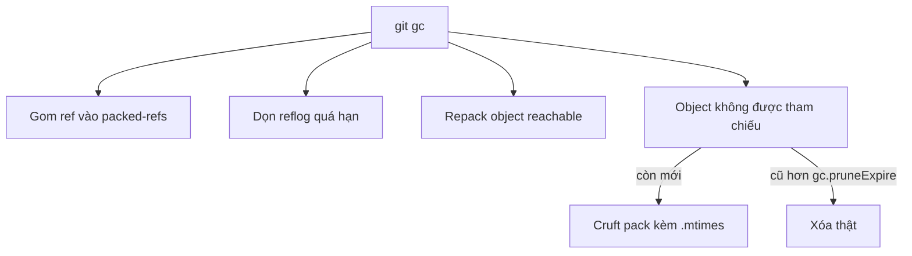
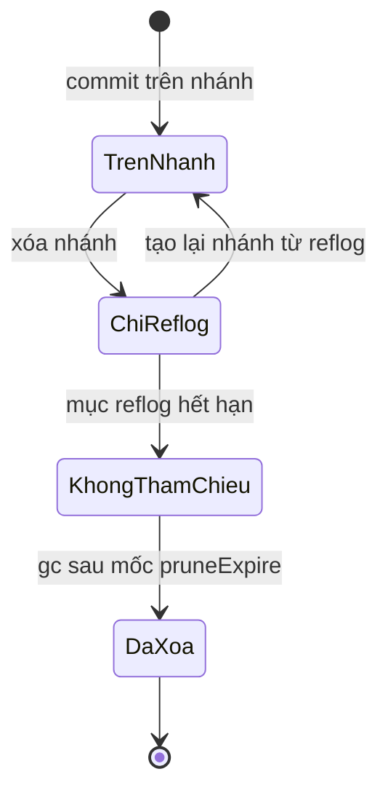

## Bạn sẽ học được gì

- Hiểu `git gc` làm những việc gì: gom pack, dọn reflog cũ, xóa object không còn được tham chiếu.
- Biết vì sao object vừa "mất" vẫn chưa bị xóa ngay: reflog và thời gian ân hạn.
- Nhận ra cruft pack và tệp `.mtimes`.
- Biết các mặc định quan trọng và khi nào nên, không nên chạy gc thủ công.

## Khái niệm

Git gần như không bao giờ xóa dữ liệu ngay lập tức. Khi bạn xóa nhánh, amend commit hay rebase, các commit cũ không bị xóa mà chỉ không còn được ref nào trỏ tới. Chúng vẫn nằm trong object database cho tới khi bộ dọn rác (garbage collection) quyết định xóa.

`git gc` là lệnh porcelain điều phối nhiều bước nhỏ:

1. Gom ref rời vào `packed-refs` (`git pack-refs`).
2. Dọn các mục reflog quá hạn (`git reflog expire`).
3. Gom object được tham chiếu vào packfile (`git repack`).
4. Xử lý object không được tham chiếu: chúng được đưa vào một **cruft pack** riêng, kèm tệp `.mtimes` ghi thời điểm của từng object. Khi một object đã đủ cũ so với ngưỡng `gc.pruneExpire`, lần gc sau sẽ xóa thật.
5. Cập nhật các tệp phụ trợ như commit-graph.

Ba mốc thời gian mặc định nên nhớ:

| Thiết lập | Mặc định | Ý nghĩa |
| --- | --- | --- |
| `gc.reflogExpire` | 90 ngày | Mục reflog của commit còn reachable |
| `gc.reflogExpireUnreachable` | 30 ngày | Mục reflog của commit không còn reachable từ ref hiện tại |
| `gc.pruneExpire` | 2 tuần | Object không còn được tham chiếu, cũ hơn mốc này mới bị xóa |

Như vậy, một commit "mất" sau khi bạn xóa nhánh vẫn được reflog giữ khoảng 30 ngày; sau khi mục reflog hết hạn, object còn có thêm khoảng 2 tuần ân hạn. Đây là lưới an toàn giúp bạn cứu lại công việc.

Bạn hiếm khi cần gọi gc bằng tay. Nhiều lệnh (commit, merge, fetch) tự gọi `git gc --auto`, lệnh này chỉ thật sự làm việc khi số loose object vượt `gc.auto` (mặc định 6700) hoặc số pack vượt `gc.autoPackLimit` (mặc định 50). Ngoài ra `git maintenance` có thể lên lịch dọn dẹp định kỳ.

## Hình dung bằng sơ đồ





## Lệnh cần biết

```bash
# Dọn dẹp thông thường
git gc

# Xóa ngay object không được tham chiếu (cẩn thận)
git gc --prune=now

# Chỉ chạy khi đủ ngưỡng
git gc --auto

# Liệt kê object không reachable (bỏ qua reflog để thấy rõ hơn)
git fsck --unreachable
git fsck --unreachable --no-reflogs

# Cho mục reflog hết hạn ngay (phá lưới an toàn)
git reflog expire --expire-unreachable=now --all

# Chạy tác vụ gc qua maintenance
git maintenance run --task=gc
```

## Ví dụ từng bước

Tạo nhánh `thu`, commit "Thử nghiệm", quay về main rồi xóa nhánh (ID trên máy bạn sẽ khác):

```bash
git branch -D thu
git cat-file -t fb3dead6ccfef6c862a5391d1b0eb5d140ebcf3c
git fsck --unreachable
git fsck --unreachable --no-reflogs
```

```text
Deleted branch thu (was fb3dead).
commit
unreachable tree 499c3600f8d127a5a79aa0a59f6c1627d95e82fd
unreachable blob 4d17ce38c5110199fd18d8a8d2f05fa60d17538c
unreachable commit fb3dead6ccfef6c862a5391d1b0eb5d140ebcf3c
```

Commit vẫn còn. `git fsck --unreachable` không in gì vì reflog của HEAD vẫn nhắc tới commit đó; khi bỏ qua reflog thì mới thấy commit, tree và blob của nó không còn ref nào trỏ tới. Chạy gc:

```bash
git gc
git cat-file -t fb3dead6ccfef6c862a5391d1b0eb5d140ebcf3c
git config --get gc.pruneExpire
```

```text
commit
```

Commit vẫn sống sót. `gc.pruneExpire` chưa được đặt, tức đang dùng mặc định 2 tuần. Giờ phá lưới an toàn một cách có chủ đích (chỉ làm trong repository thử nghiệm):

```bash
git reflog expire --expire-unreachable=now --all
git gc --prune=now
git cat-file -t fb3dead6ccfef6c862a5391d1b0eb5d140ebcf3c
```

```text
fatal: git cat-file: could not get object info
```

Lần này object đã thật sự biến mất.

Cruft pack: trong một repository khác, ghi một blob không ai tham chiếu bằng `git hash-object -w`, rồi chạy `git gc`:

```bash
git gc
ls .git/objects/pack/
git fsck --unreachable
```

```text
pack-5983188dff02f8f50dead909a2ea3860ec79d73e.idx
pack-5983188dff02f8f50dead909a2ea3860ec79d73e.pack
pack-5983188dff02f8f50dead909a2ea3860ec79d73e.rev
pack-723c23d15ce84f40a8e3ca7ff02667fb668d8b01.idx
pack-723c23d15ce84f40a8e3ca7ff02667fb668d8b01.mtimes
pack-723c23d15ce84f40a8e3ca7ff02667fb668d8b01.pack
pack-723c23d15ce84f40a8e3ca7ff02667fb668d8b01.rev
unreachable blob 2c4cde9ccf69c726e306a4a47ee2ce84961e33b2
```

Pack thứ hai có `.mtimes`: đó là cruft pack chứa blob không được tham chiếu, chờ đủ hạn để xóa.

> **Cẩn thận** `git gc --prune=now` kết hợp `git reflog expire --expire-unreachable=now` xóa vĩnh viễn những commit bạn có thể còn cần. Chỉ dùng khi chắc chắn, ví dụ sau khi đã viết lại lịch sử để loại dữ liệu nhạy cảm và đã có bản sao lưu.

## Lỗi thường gặp

**Nghĩ xóa nhánh là xóa commit.** Commit còn trong reflog và object database ít nhất vài tuần.

**Nghĩ `git gc` giải phóng ngay dung lượng của tệp lớn vừa gỡ khỏi lịch sử.** Reflog, cruft pack, và các bản clone khác vẫn giữ nó.

**Đặt `gc.auto=0` rồi quên.** Repository tích tụ loose object, chậm dần.

**Chạy gc song song với một lệnh Git khác trên cùng repository.** Git có khóa để tránh, nhưng tốt nhất là để việc dọn dẹp chạy khi rảnh.

> **Mẹo** Muốn cứu một commit vừa mất, đừng chạy gc. Tìm ID trong `git reflog` rồi tạo nhánh ngay: `git branch cuu-ho <ID>`.

## Áp dụng trong công việc

Máy chủ CI của nhóm kiểm thử giữ một clone lâu năm để chạy bộ test hồi quy, ổ đĩa đầy dần. Bạn kiểm tra bằng `git count-objects -v` và thấy hàng trăm pack nhỏ do fetch liên tục. Thay vì xóa thư mục `.git/objects` (rất nguy hiểm), bạn bật `git maintenance start` cho repository đó để việc gom pack chạy định kỳ.

## Chuẩn bị làm bài

Đây là bài trả lời câu hỏi. Câu hỏi hỏi lệnh nào chạy bảo trì gom object. Ôn lại phần lệnh cần biết và nhớ lệnh porcelain điều phối các bước dọn dẹp.

## Tóm tắt

- `git gc` gom ref và object, dọn reflog hết hạn, xử lý object không được tham chiếu.
- Object không được tham chiếu vào cruft pack có `.mtimes`, bị xóa khi cũ hơn `gc.pruneExpire` (mặc định 2 tuần).
- Reflog giữ commit "mất" khoảng 30 ngày, là lưới an toàn để cứu dữ liệu.
- `git gc --auto` và `git maintenance` thường đủ; ít khi cần gc thủ công.
- Xóa ngay bằng `--prune=now` là thao tác không thể hoàn tác.
