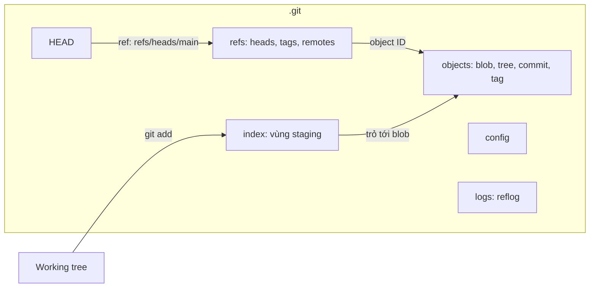
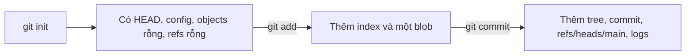

## Bạn sẽ học được gì

- Biết những thành phần chính trong thư mục `.git` và mỗi thành phần lưu gì.
- Quan sát `.git` thay đổi ra sao sau `git add` và `git commit`.
- Hỏi Git đường dẫn nội bộ bằng `git rev-parse --git-path` thay vì đoán.
- Hiểu vì sao không nên chỉnh tay `.git` khi đã có lệnh Git làm việc đó.

## Khái niệm

Thư mục làm việc của bạn chỉ là một bản xem của dự án. Toàn bộ thứ làm nên repository, gồm lịch sử, nhánh, cấu hình, vùng staging, nằm trong một thư mục ẩn tên `.git` ở gốc. Xóa `.git` là thư mục trở lại thành thư mục thường, mất hết lịch sử; copy `.git` sang chỗ khác là mang theo cả repository.

Những thành phần đáng biết:

- **`HEAD`**: tệp nhỏ cho biết bạn đang đứng ở đâu. Thường chứa `ref: refs/heads/main`, tức là đang ở nhánh main.
- **`config`**: cấu hình riêng của repository (phạm vi `--local`): remote, upstream của nhánh, alias local...
- **`objects/`**: kho object, nơi lưu mọi blob, tree, commit, tag. Đây là phần lớn nhất và quan trọng nhất.
- **`refs/`**: các tên trỏ tới object: `refs/heads/` cho nhánh, `refs/tags/` cho tag, `refs/remotes/` cho remote-tracking.
- **`index`**: tệp nhị phân chứa vùng staging, tức bản nháp của commit kế tiếp. Tệp này chỉ xuất hiện khi bạn đã add thứ gì đó.
- **`logs/`**: reflog, ghi lại mỗi lần HEAD và các nhánh di chuyển.
- **`hooks/`**: script hook, mặc định chỉ có tệp mẫu.
- **`info/`**: một số cấu hình phụ, ví dụ `info/exclude` là danh sách bỏ qua chỉ áp dụng cho bản clone này.
- **`packed-refs`**: xuất hiện khi Git gom nhiều ref vào một tệp để tiết kiệm.
- Các tệp trạng thái tạm như `ORIG_HEAD`, `MERGE_HEAD`, `COMMIT_EDITMSG` xuất hiện khi bạn reset, merge, commit.

Mặc dù hầu hết là tệp văn bản đọc được, bạn không nên sửa tay. Git có những quy tắc mà mắt thường không thấy: ref có thể nằm trong `packed-refs` thay vì tệp riêng, phiên bản Git mới có thể dùng backend lưu ref khác, index có checksum, các thao tác cần khóa để tránh hai lệnh ghi cùng lúc. Lệnh Git (cả porcelain lẫn plumbing) xử lý đúng mọi trường hợp. Đọc `.git` để học thì rất tốt; ghi vào nó bằng tay thì chỉ khi bạn thật sự không còn cách nào.

Một mẹo quan trọng: đừng tự ghép đường dẫn như `.git/hooks`. Trong worktree phụ hoặc khi có cấu hình `core.hooksPath`, đường dẫn thật có thể khác. `git rev-parse --git-path <tên>` trả về đường dẫn đúng.

## Hình dung bằng sơ đồ





## Lệnh cần biết

```bash
# Thư mục .git của repository hiện tại nằm ở đâu
git rev-parse --git-dir

# Đường dẫn đúng của một thành phần nội bộ
git rev-parse --git-path index
git rev-parse --git-path hooks

# Đọc nhánh đang checkout qua HEAD (cách chuẩn, không đọc tệp)
git symbolic-ref HEAD

# Xem cấu hình local
git config --local --list

# Xem reflog thay vì đọc .git/logs
git reflog
```

| Thành phần | Kiểu | Lệnh nên dùng để đọc |
| --- | --- | --- |
| `HEAD` | Văn bản | `git symbolic-ref HEAD`, `git rev-parse HEAD` |
| `config` | Văn bản | `git config --local --list` |
| `objects/` | Nén zlib | `git cat-file` |
| `refs/`, `packed-refs` | Văn bản | `git show-ref`, `git for-each-ref` |
| `index` | Nhị phân | `git ls-files --stage` |
| `logs/` | Văn bản | `git reflog` |

## Ví dụ từng bước

Repository vừa khởi tạo, chưa có commit:

```bash
git init -q r
cd r
ls -F .git
cat .git/HEAD
```

```text
HEAD
branches/
config
description
hooks/
info/
objects/
refs/
ref: refs/heads/main
```

Chưa có `index`. HEAD đã trỏ tới `refs/heads/main` dù nhánh này chưa tồn tại. Thêm một tệp vào staging:

```bash
echo "Bài tập Git" > README.md
git add README.md
ls -F .git
find .git/objects -type f
```

```text
HEAD
branches/
config
description
hooks/
index
info/
objects/
refs/
.git/objects/3f/01b4f03f3a2193f92a57add2627ce240056f0f
```

Tệp `index` xuất hiện, và kho object có một blob. Commit:

```bash
git commit -qm "Khởi tạo"
find .git/objects -type f
cat .git/refs/heads/main
```

```text
.git/objects/3f/01b4f03f3a2193f92a57add2627ce240056f0f
.git/objects/c8/4aa38e60aec99583588637e9aeed74defb6508
.git/objects/39/6f5cde5ccbf07db9559b319a28620813909306
396f5cde5ccbf07db9559b319a28620813909306
```

Thêm hai object (một tree, một commit), và nhánh main giờ là một tệp chứa object ID của commit. Hỏi Git đường dẫn nội bộ:

```bash
git rev-parse --git-path index
git rev-parse --git-path hooks
```

```text
.git/index
.git/hooks
```

Object ID trên máy bạn có thể khác vì commit chứa tên tác giả và thời gian; riêng blob của cùng nội dung sẽ giống hệt.

> **Cẩn thận** Đừng xóa hay sửa tệp trong `.git` của repository thật để "dọn dẹp". Một tệp ref hoặc index hỏng có thể khiến Git không mở được repository. Muốn thử nghiệm, hãy làm trong thư mục tạm.

## Lỗi thường gặp

**Sửa `.git/HEAD` hoặc tệp nhánh bằng tay.** Có thể chạy trong trường hợp đơn giản, nhưng bỏ qua reflog và khóa. Dùng `git switch`, `git update-ref`, `git symbolic-ref`.

**Tìm nhánh trong `.git/refs/heads` mà không thấy.** Nhánh có thể đã được gom vào `packed-refs`. Dùng `git show-ref` hoặc `git branch`.

**Commit nhầm thư mục `.git` lồng nhau.** Copy một repository vào trong repository khác tạo ra `.git` lồng, Git sẽ coi thư mục đó là repository con. Nếu không định dùng submodule, xóa `.git` bên trong.

**Ghép đường dẫn `.git/...` trong script.** Sai trong worktree phụ hoặc khi dùng `core.hooksPath`. Dùng `git rev-parse --git-path`.

> **Lưu ý** Danh sách tệp trong `.git` có thể khác đôi chút giữa các phiên bản Git. Đừng viết công cụ phụ thuộc vào việc tệp nào có mặt; hãy dựa vào lệnh Git.

## Áp dụng trong công việc

Một QA mới báo "repository bị hỏng" vì Git nói không tìm thấy nhánh `test/regression`. Bạn kiểm tra `.git/refs/heads` thấy không có tệp tương ứng, nhưng `git show-ref` vẫn liệt kê nhánh đó vì nó nằm trong `packed-refs` sau một lần `git gc`. Nguyên nhân thật là bạn ấy gõ sai hoa thường trên máy macOS. Đọc `.git` giúp bạn hiểu, còn lệnh Git cho câu trả lời chính xác.

## Chuẩn bị làm bài

Đây là bài trả lời câu hỏi. Câu hỏi hỏi tệp nào trong `.git` lưu vùng staging. Hãy ôn bảng thành phần ở trên.

Nếu muốn tự quan sát, mở repository bài tập, chạy `ls -F .git`, rồi thử `git rev-parse --git-path` với vài tên khác nhau. Chỉ đọc, đừng sửa gì.

## Tóm tắt

- `.git` chứa toàn bộ repository: object, ref, index, cấu hình, reflog, hook.
- `HEAD` cho biết bạn đang ở nhánh nào; `refs/` lưu tên nhánh và tag.
- `objects/` là kho nội dung, `index` là bản nháp commit kế tiếp.
- Đọc `.git` để học, nhưng ghi bằng lệnh Git.
- `git rev-parse --git-path` cho đường dẫn nội bộ chính xác.
