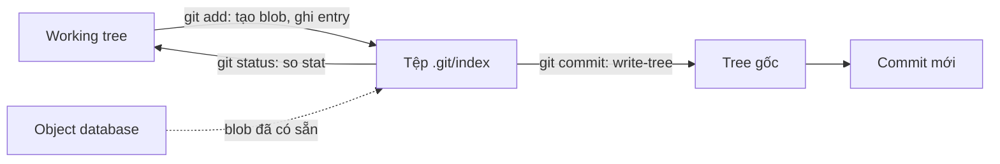
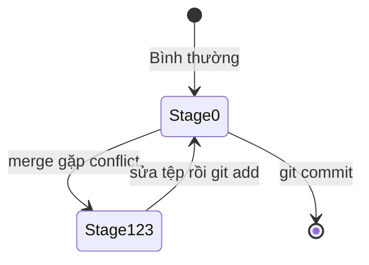

## Bạn sẽ học được gì

- Hiểu index (staging area) thực chất là một tệp nhị phân `.git/index` chứa danh sách entry.
- Đọc từng entry bằng `git ls-files --stage`: mode, object ID, stage number, đường dẫn.
- Biết index lưu thêm thông tin stat để `git status` chạy nhanh.
- Nhận ra stage 1, 2, 3 khi đang có conflict.

## Khái niệm

Bạn đã quen với câu "thêm vào staging area". Về mặt kỹ thuật, staging area là tệp `.git/index`. Đây là bản nháp của tree cho commit kế tiếp: một danh sách phẳng, sắp theo đường dẫn, mỗi dòng (entry) gồm:

- **Mode**: `100644`, `100755`, `120000` hoặc `160000`.
- **Object ID** của blob (hoặc commit với submodule). Blob này đã nằm sẵn trong object database từ lúc bạn `git add`.
- **Stage number**: 0 trong trạng thái bình thường; 1, 2, 3 khi có conflict.
- **Đường dẫn** đầy đủ, ví dụ `src/app.txt`. Index không lưu thư mục như tree; thư mục chỉ là phần đầu của đường dẫn.
- **Thông tin stat**: ctime, mtime, device, inode, uid, gid, kích thước tệp.

Thông tin stat là bí quyết tốc độ. Khi bạn chạy `git status`, Git không băm lại mọi tệp. Nó so stat của tệp trên đĩa với stat ghi trong index. Khớp thì coi như không đổi; lệch thì mới đọc nội dung và so sánh.

Tệp index bắt đầu bằng 12 byte header: chữ ký `DIRC` (viết tắt của "dircache", tên cũ của index), số phiên bản (2, 3 hoặc 4) và số entry. Sau đó là các entry, các phần mở rộng tùy chọn (ví dụ cache tree, thông tin resolve-undo) và cuối cùng là checksum của toàn tệp. Phiên bản 4 nén tiền tố đường dẫn nên tệp nhỏ hơn với repository nhiều tệp.

Khi merge gặp conflict ở một tệp, entry stage 0 của tệp đó biến mất và được thay bằng tối đa ba entry:

- Stage 1: phiên bản ở merge base (bản gốc chung).
- Stage 2: phiên bản "ours", tức nhánh hiện tại.
- Stage 3: phiên bản "theirs", tức nhánh đang được merge vào.

Khi bạn sửa tệp rồi `git add`, ba entry này bị gộp lại thành một entry stage 0. Đó là lý do `git add` chính là cách đánh dấu "đã giải quyết conflict".

`git commit` thực chất làm hai việc: biến index thành các tree (như `git write-tree`), rồi tạo commit trỏ tới tree gốc đó.

## Hình dung bằng sơ đồ





## Lệnh cần biết

```bash
# Mọi entry: mode, ID, stage, đường dẫn
git ls-files --stage

# Thông tin stat của một entry
git ls-files --debug README.md

# Chỉ các entry đang conflict
git ls-files -u

# Nội dung của một stage cụ thể
git show :1:f.txt
git show :2:f.txt
git show :3:f.txt

# Tự chọn cột hiển thị
git ls-files --format='%(objectmode) %(objectname) %(path)'

# Đổi phiên bản định dạng index
git update-index --index-version 4
```

| Stage | Ý nghĩa |
| --- | --- |
| 0 | Bình thường, sẵn sàng commit |
| 1 | Bản ở merge base |
| 2 | Bản ours, nhánh hiện tại |
| 3 | Bản theirs, nhánh được merge vào |

## Ví dụ từng bước

Repository có `README.md`, `run.sh` thực thi và `src/app.txt` (ID trên máy bạn có thể khác nếu nội dung khác):

```bash
git ls-files --stage
```

```text
100644 3f01b4f03f3a2193f92a57add2627ce240056f0f 0	README.md
100755 4163036efa65bd4a469e752267498f01ea36a55c 0	run.sh
100644 b80f0bd60822d4fa4893de455958ef32f6c521bf 0	src/app.txt
```

Nhìn 12 byte đầu của tệp index:

```bash
head -c 12 .git/index | od -A d -t x1
```

```text
0000000 44 49 52 43 00 00 00 02 00 00 00 03
0000012
```

`44 49 52 43` là chữ `DIRC`, tiếp theo là phiên bản 2 và 3 entry. Xem phần stat:

```bash
git ls-files --debug README.md
```

```text
README.md
  ctime: 1792084242:245667124
  mtime: 1792084242:245667124
  dev: 65040	ino: 1803601
  uid: 1000	gid: 1000
  size: 15	flags: 0
```

Sửa `README.md` rồi `git add`. Entry đổi sang blob mới; `git restore --staged` đưa entry về blob cũ, còn thay đổi vẫn ở working tree:

```bash
git add README.md
git ls-files --stage README.md
git restore --staged README.md
git ls-files --stage README.md
git status --short
```

```text
100644 5cc51ae23833d577dc57e7c7719271255762d644 0	README.md
100644 3f01b4f03f3a2193f92a57add2627ce240056f0f 0	README.md
 M README.md
```

Giờ tạo conflict ở `f.txt` (gốc "goc", main sửa thành "main", topic sửa thành "topic"):

```bash
git merge topic
git ls-files --stage
git show :1:f.txt
git show :2:f.txt
git show :3:f.txt
```

```text
CONFLICT (content): Merge conflict in f.txt
Automatic merge failed; fix conflicts and then commit the result.
100644 3f01b4f03f3a2193f92a57add2627ce240056f0f 0	README.md
100644 79db34f0bbce5feaa37b3cc006763afe7760d4a4 1	f.txt
100644 ba2906d0666cf726c7eaadd2cd3db615dedfdf3a 2	f.txt
100644 0f62d67e76ce1255a098942495a846df0f8a2c11 3	f.txt
goc
main
topic
```

Sửa `f.txt` thành nội dung mong muốn rồi `git add f.txt`; ba entry gộp lại:

```text
100644 c6a058ed171406dc733f0892888294ef9c1716ba 0	f.txt
```

> **Mẹo** Trong lúc conflict, `git checkout --theirs f.txt` hay `git checkout --ours f.txt` thực chất là lấy nội dung từ stage 3 hoặc stage 2 ghi ra working tree.

## Lỗi thường gặp

**Nghĩ index chỉ chứa tệp đã sửa.** Index chứa toàn bộ tệp sẽ có trong commit kế tiếp, kể cả tệp không đổi.

**Mở `.git/index` bằng trình soạn thảo.** Tệp nhị phân có checksum; sửa tay sẽ làm hỏng nó. Dùng `git ls-files`, `git update-index`.

**Commit khi vẫn còn entry stage 1-3.** Git từ chối commit khi còn path chưa merge. Kiểm tra bằng `git ls-files -u`.

**Ngạc nhiên vì `git status` báo đổi dù nội dung y nguyên.** Có thể quyền tệp (mode) đã đổi, hoặc kiểu xuống dòng bị chuyển đổi.

> **Lưu ý** Khi xóa tệp index (ví dụ trong lúc thử nghiệm), working tree và commit không mất gì, nhưng staging area mất. `git reset` sẽ dựng lại index từ HEAD.

## Áp dụng trong công việc

Một kỹ sư kiểm thử than rằng thư mục test có hàng chục nghìn tệp dữ liệu mẫu và `git status` trên máy ảo chạy chậm. Bạn xem `git ls-files --debug` và thấy mtime của tệp liên tục đổi do công cụ đồng bộ thư mục chạm vào tệp, khiến Git phải đọc lại nội dung. Tắt việc chạm mtime, `git status` nhanh trở lại.

## Chuẩn bị làm bài

Đây là bài trả lời câu hỏi. Câu hỏi hỏi lệnh plumbing nào liệt kê các entry trong index. Ôn lại phần lệnh cần biết, chú ý lệnh in ra cả mode, object ID và stage number.

## Tóm tắt

- Index là tệp nhị phân `.git/index`, header bắt đầu bằng `DIRC`, phiên bản và số entry.
- Mỗi entry gồm mode, object ID, stage number, đường dẫn và thông tin stat.
- Stat giúp `git status` nhanh mà không phải băm lại mọi tệp.
- Conflict tạo stage 1 (base), 2 (ours), 3 (theirs); `git add` gộp về stage 0.
- `git commit` biến index thành tree rồi tạo commit.
