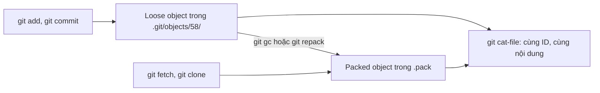

## Bạn sẽ học được gì

- Phân biệt loose object (mỗi object một tệp) và packed object (nằm trong packfile).
- Thấy tận mắt object chuyển từ dạng loose sang packed mà ID và nội dung không đổi.
- Biết khi nào Git tạo loose object và khi nào gom vào pack.
- Đo kích thước trên đĩa của một object bằng `git cat-file --batch-check`.

## Khái niệm

Một object trong Git có thể được lưu theo hai cách:

- **Loose object**: một tệp riêng ở `.git/objects/xx/yyyy...`, trong đó `xx` là hai ký tự đầu của object ID và `yyyy...` là 38 ký tự còn lại. Nội dung tệp là header `<kiểu> <kích thước>`, một byte null, rồi dữ liệu, tất cả được nén zlib.
- **Packed object**: nằm bên trong một tệp `.pack`, có thể lưu nguyên hoặc dạng delta dựa trên object khác, được tìm qua tệp `.idx`.

Điều quan trọng nhất: đây chỉ là hai cách cất giữ cùng một dữ liệu. Object ID được tính từ kiểu và nội dung, không phụ thuộc cách lưu. Mọi lệnh đọc object (`git cat-file`, `git show`, `git log`) hoạt động như nhau với cả hai.

Vòng đời thông thường:

1. `git add`, `git commit`, `git hash-object -w` tạo loose object: ghi nhanh, đơn giản.
2. Khi số loose object vượt ngưỡng `gc.auto`, hoặc khi bạn chạy `git gc`, `git repack`, hay maintenance chạy định kỳ, các object được gom vào pack và tệp loose bị xóa.
3. Khi fetch hoặc clone, dữ liệu đến dưới dạng pack và thường được giữ nguyên là pack. Khi fetch lượng nhỏ object, Git có thể bung chúng thành loose (ngưỡng `fetch.unpackLimit`).

So sánh nhanh:

| Đặc điểm | Loose | Packed |
| --- | --- | --- |
| Vị trí | `.git/objects/xx/` | `.git/objects/pack/*.pack` |
| Số tệp | Một tệp mỗi object | Một tệp cho nhiều object |
| Nén | zlib từng object | zlib và delta giữa các object |
| Tốc độ ghi | Nhanh, đơn giản | Cần tính toán khi gom |
| Phù hợp | Object mới tạo | Lưu trữ lâu dài, truyền qua mạng |

## Hình dung bằng sơ đồ



## Lệnh cần biết

```bash
# Đếm loose object (count, size) và pack (in-pack, packs)
git count-objects -v

# Liệt kê tệp trong thư mục object
find .git/objects -type f

# Kích thước gốc và kích thước trên đĩa
git cat-file --batch-check='%(objectname) %(objecttype) %(objectsize) %(objectsize:disk)'

# Gom loose object vào pack
git gc
git repack -d

# Xóa loose object đã có trong pack
git prune-packed
```

## Ví dụ từng bước

Repository mới với một commit "Khởi tạo" và một commit "Thêm x" (thêm `x.txt` chứa `x`). Blob của `x.txt` có ID `587be6b...`; vì ID tính từ nội dung, máy bạn cũng sẽ ra đúng ID này nếu nội dung giống hệt, còn ID commit thì khác:

```bash
find .git/objects -type f | sort
git count-objects -v
```

```text
.git/objects/3f/01b4f03f3a2193f92a57add2627ce240056f0f
.git/objects/57/9fb46504b4c00dd58b62100c6708d76140b565
.git/objects/58/7be6b4c3f93f93c489c0111bba5596147a26cb
.git/objects/73/42a4fd430ae6771c1357794c79f89d35a2b2c2
.git/objects/b4/932ed006f0d7c65b4736233607d907dffa032f
.git/objects/c8/4aa38e60aec99583588637e9aeed74defb6508
count: 6
size: 24
in-pack: 0
packs: 0
...
```

Sáu loose object: hai commit, hai tree, hai blob. Giải nén tệp loose bằng một dòng Python để thấy header:

```bash
python3 -c "import zlib;print(zlib.decompress(open('.git/objects/58/7be6b4c3f93f93c489c0111bba5596147a26cb','rb').read()))"
```

```text
b'blob 2\x00x\n'
```

Kích thước trên đĩa khi đang là loose:

```bash
git cat-file --batch-check='%(objectname) %(objecttype) %(objectsize) %(objectsize:disk)' <<< 587be6b4c3f93f93c489c0111bba5596147a26cb
```

```text
587be6b4c3f93f93c489c0111bba5596147a26cb blob 2 17
```

Gom vào pack:

```bash
git gc -q
find .git/objects -type f | sort
ls .git/objects/58/
```

```text
.git/objects/info/commit-graph
.git/objects/info/packs
.git/objects/pack/pack-eb195434496c025e50606ec9a3ca2560caa37638.idx
.git/objects/pack/pack-eb195434496c025e50606ec9a3ca2560caa37638.pack
.git/objects/pack/pack-eb195434496c025e50606ec9a3ca2560caa37638.rev
ls: cannot access '.git/objects/58/': No such file or directory
```

Thư mục `58` biến mất, nhưng object vẫn đọc được với cùng ID:

```bash
git cat-file -p 587be6b4c3f93f93c489c0111bba5596147a26cb
git rev-parse HEAD:x.txt
git cat-file --batch-check='%(objectname) %(objecttype) %(objectsize) %(objectsize:disk)' <<< 587be6b4c3f93f93c489c0111bba5596147a26cb
```

```text
x
587be6b4c3f93f93c489c0111bba5596147a26cb
587be6b4c3f93f93c489c0111bba5596147a26cb blob 2 11
```

Kích thước gốc vẫn là 2 byte; kích thước trên đĩa đổi từ 17 xuống 11 vì cách lưu khác.

> **Lưu ý** Cú pháp `<<<` (here-string) có trong bash và zsh. Với shell khác, dùng `echo <ID> | git cat-file --batch-check=...`.

## Lỗi thường gặp

**Tìm object bằng `ls .git/objects/xx/` rồi kết luận nó đã mất.** Object có thể nằm trong pack. Luôn kiểm tra bằng `git cat-file -t`.

**Nghĩ gom pack làm đổi ID.** ID chỉ phụ thuộc kiểu và nội dung.

**Tự tay xóa thư mục loose để "dọn".** Nếu object chưa vào pack, bạn mất dữ liệu. Dùng `git gc` hoặc `git prune-packed`.

**Lo lắng vì `count` trong `git count-objects` lớn.** Đó chỉ là dấu hiệu nên gom; `git gc --auto` sẽ xử lý.

> **Mẹo** Muốn biết một object đang loose hay packed, thử `git cat-file -t <ID>` (luôn chạy được) rồi xem có tệp `.git/objects/xx/yyyy...` hay không.

## Áp dụng trong công việc

Script kiểm tra tính toàn vẹn dữ liệu test của nhóm từng đọc trực tiếp `.git/objects/xx/...` để lấy nội dung tệp mẫu, và thỉnh thoảng báo "thiếu tệp". Nguyên nhân là sau khi gc chạy, object đã vào pack. Bạn đổi script sang dùng `git cat-file -p <commit>:<đường dẫn>`, chạy đúng bất kể object được lưu thế nào.

## Chuẩn bị làm bài

Đây là bài trả lời câu hỏi. Câu hỏi hỏi tên định dạng gom nhiều object vào một tệp. Ôn lại bảng so sánh ở phần Khái niệm.

## Tóm tắt

- Loose object là một tệp nén zlib riêng; packed object nằm trong `.pack`.
- Hai cách lưu chứa cùng dữ liệu, cùng object ID.
- Object mới thường là loose; gc, repack, maintenance gom chúng vào pack.
- Fetch và clone nhận dữ liệu ở dạng pack.
- Đọc object bằng lệnh Git, đừng dựa vào đường dẫn tệp trong `.git/objects`.
