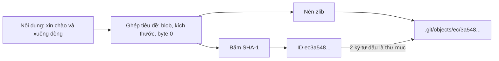
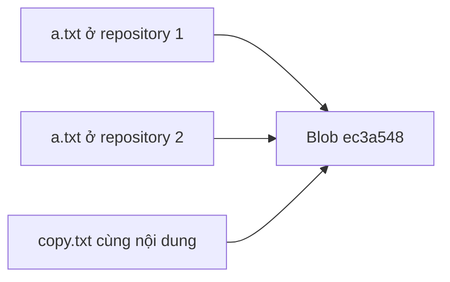

## Bạn sẽ học được gì

- Hiểu Git là kho lưu trữ theo nội dung: object ID được tính từ nội dung.
- Tính object ID bằng `git hash-object` và tự kiểm chứng công thức.
- Đọc kiểu, kích thước, nội dung của object bằng `git cat-file`.
- Biết object nằm ở đâu trên đĩa và vì sao cùng nội dung luôn cho cùng ID.

## Khái niệm

Bên dưới mọi lệnh Git là một cơ sở dữ liệu khóa và giá trị rất đơn giản. Giá trị là một object: một khối dữ liệu có kiểu (blob, tree, commit hoặc tag). Khóa là object ID, được tính bằng hàm băm trên chính nội dung object. Với repository mặc định, hàm băm là SHA-1, cho ID dài 40 ký tự hex (Git cũng hỗ trợ định dạng SHA-256 cho repository tạo mới với tùy chọn riêng).

Cụ thể, Git ghép một tiêu đề nhỏ gồm kiểu object, dấu cách, kích thước theo byte, một byte 0, rồi nối nội dung vào sau, và băm toàn bộ chuỗi đó. Hệ quả rất mạnh:

- **Cùng nội dung, cùng ID.** Hai tệp giống hệt nhau ở hai thư mục, hai commit, hay hai máy khác nhau đều cho cùng một blob. Git chỉ lưu một lần.
- **Đổi một byte, đổi ID.** Không thể sửa lén nội dung mà giữ nguyên ID. Đây là nền tảng cho tính toàn vẹn của lịch sử.
- **ID không phụ thuộc tên tệp.** Tên tệp nằm ở tree, không nằm trong blob.

Trên đĩa, object rời được lưu dưới `.git/objects/`, tên thư mục là hai ký tự đầu của ID, tên tệp là 38 ký tự còn lại. Nội dung tệp là chuỗi tiêu đề cộng nội dung, đã nén bằng zlib. Khi repository lớn dần, Git gom object vào packfile (bài sau), nhưng ID không đổi.

Vì ID là hàm của nội dung, object là bất biến: không có thao tác "sửa object". Khi bạn amend một commit, Git tạo commit mới với ID mới; commit cũ vẫn còn trong kho cho tới khi được dọn.

Để làm việc trực tiếp với kho object, Git có các lệnh plumbing: `git hash-object` tính ID (và với `-w`, ghi object vào kho), `git cat-file` đọc object theo ID.

## Hình dung bằng sơ đồ





## Lệnh cần biết

```bash
# Tính ID của nội dung (không ghi vào kho)
echo 'Bài tập Git' | git hash-object --stdin
git hash-object README.md

# Tính ID và ghi object vào kho
printf 'xin chào\n' | git hash-object -w --stdin

# Kiểu, kích thước, nội dung của object
git cat-file -t <id>
git cat-file -s <id>
git cat-file -p <id>

# ID của tệp trong một commit
git rev-parse HEAD:README.md

# Định dạng băm của repository
git rev-parse --show-object-format
```

| Lệnh | Tác dụng |
| --- | --- |
| `hash-object` | Tính ID, `-w` để ghi |
| `cat-file -t` | Kiểu object |
| `cat-file -s` | Kích thước nội dung |
| `cat-file -p` | In nội dung dễ đọc |
| `rev-parse <commit>:<đường dẫn>` | ID của blob hoặc tree tại đường dẫn |

## Ví dụ từng bước

Tệp `README.md` chứa dòng "Bài tập Git". Tính ID theo ba cách:

```bash
echo 'Bài tập Git' | git hash-object --stdin
git hash-object README.md
git rev-parse HEAD:README.md
```

```text
3f01b4f03f3a2193f92a57add2627ce240056f0f
3f01b4f03f3a2193f92a57add2627ce240056f0f
3f01b4f03f3a2193f92a57add2627ce240056f0f
```

Ba cách, một ID, vì nội dung giống nhau. Bạn chạy trên máy mình cũng sẽ ra đúng ID này. Ghi một object mới và đọc lại:

```bash
printf 'xin chào\n' | git hash-object -w --stdin
git cat-file -t ec3a548
git cat-file -s ec3a548
git cat-file -p ec3a548
ls .git/objects/ec
```

```text
ec3a548daee38db20fda5d6e6983755ee11e96af
blob
10
xin chào
3a548daee38db20fda5d6e6983755ee11e96af
```

Kích thước là 10 byte chứ không phải 9, vì chữ "à" chiếm hai byte trong UTF-8. Giờ tự kiểm chứng công thức bằng `sha1sum`, ghép tiêu đề thủ công:

```bash
printf 'blob 10\0xin chào\n' | sha1sum
```

```text
ec3a548daee38db20fda5d6e6983755ee11e96af  -
```

Khớp từng ký tự. Giải nén tệp object để thấy đúng chuỗi đã băm:

```bash
python3 -c "import zlib,sys;print(zlib.decompress(open('.git/objects/'+sys.argv[1][:2]+'/'+sys.argv[1][2:],'rb').read()))" ec3a548daee38db20fda5d6e6983755ee11e96af
```

```text
b'blob 10\x00xin ch\xc3\xa0o\n'
```

Ở một repository khác hoàn toàn, tệp `a.txt` cùng nội dung cũng cho đúng ID đó:

```bash
git hash-object a.txt
```

```text
ec3a548daee38db20fda5d6e6983755ee11e96af
```

> **Mẹo** Có thể dùng ID rút gọn (ví dụ 7 ký tự) miễn là không trùng với object khác trong repository. Trong script, dùng ID đầy đủ cho chắc.

## Lỗi thường gặp

**Nghĩ rằng đổi tên tệp tạo blob mới.** Không. Tên nằm trong tree; blob giữ nguyên nếu nội dung giữ nguyên.

**Ngạc nhiên vì ID khác nhau giữa hai máy cho "cùng" tệp.** Thường do khác ký tự xuống dòng (CRLF và LF) hoặc khoảng trắng cuối tệp. Một byte khác là một ID khác.

**Dùng `hash-object` mà quên `-w` rồi tìm không thấy object.** Không có `-w`, Git chỉ tính ID, không ghi.

**Sửa tay tệp trong `.git/objects`.** Nội dung không còn khớp ID, `git fsck` sẽ báo hỏng. Đừng làm điều này ngoài thư mục thử nghiệm.

> **Lưu ý** Commit có ID khác nhau giữa các máy dù cùng thay đổi, vì nội dung commit chứa tên, email và thời gian. Chỉ blob và tree mới thường trùng ID giữa các máy.

## Áp dụng trong công việc

Bộ test của bạn dùng một tệp dữ liệu mẫu `accounts.csv` dùng chung ở ba thư mục test khác nhau. Một đồng nghiệp lo rằng repository sẽ phình vì ba bản copy. Bạn chạy `git hash-object` trên ba tệp, thấy cùng một ID, và giải thích rằng Git chỉ lưu một blob. Khi một bản bị sửa lệch, ID khác đi, và bạn biết ngay thư mục nào đang dùng dữ liệu khác.

## Chuẩn bị làm bài

Đây là bài trả lời câu hỏi. Câu hỏi hỏi thư mục nào dưới `.git` chứa object. Hãy ôn lại phần nói về vị trí object trên đĩa.

Nếu muốn thử, chạy `git hash-object -w` với một chuỗi bất kỳ trong repository bài tập, rồi tìm tệp tương ứng theo quy tắc hai ký tự đầu.

## Tóm tắt

- Git là kho lưu trữ theo nội dung: ID là hàm băm của kiểu, kích thước và nội dung.
- Cùng nội dung luôn cho cùng ID; đổi một byte là đổi ID.
- Object rời nằm trong `.git/objects/` theo quy tắc hai ký tự đầu của ID, nén zlib.
- `git hash-object` tính và ghi object; `git cat-file` đọc object.
- Object bất biến; sửa đổi luôn tạo object mới.
