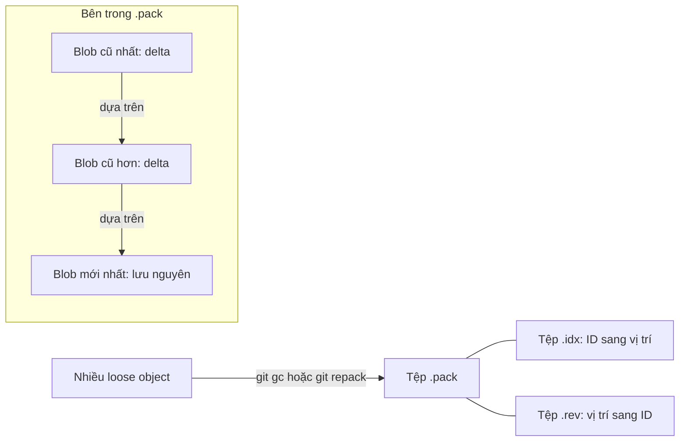

## Bạn sẽ học được gì

- Hiểu packfile là gì và vì sao Git gom object vào đó.
- Biết bộ tệp trong `.git/objects/pack/`: `.pack`, `.idx`, `.rev` và vai trò của từng tệp.
- Đọc nội dung pack bằng `git verify-pack -v`, nhận ra object lưu nguyên và object lưu dạng delta.
- Hiểu delta trong pack khác với diff của commit.

## Khái niệm

Mỗi lần commit, Git ghi mỗi object mới thành một tệp nén zlib riêng (loose object). Với tệp lớn, sửa một dòng là đã có thêm một blob đầy đủ. Về lâu dài, repository sẽ phình to và có hàng chục nghìn tệp nhỏ.

Packfile giải quyết hai việc cùng lúc. Thứ nhất, gom nhiều object vào một tệp `.pack` duy nhất. Thứ hai, nén delta: với những object giống nhau (thường là các phiên bản khác nhau của cùng một tệp), Git lưu một bản đầy đủ và lưu các bản còn lại dưới dạng "lấy object kia, chép đoạn này, chèn đoạn này". Delta có thể nối thành chuỗi (chain), có độ sâu giới hạn.

Một số điểm đáng nhớ:

- Delta trong pack chỉ là kỹ thuật lưu trữ. Về mặt logic, mỗi blob vẫn là nội dung đầy đủ, ID không đổi. Commit vẫn trỏ tới snapshot, không phải tới delta.
- Git chọn cặp delta dựa trên kiểu, tên tệp, kích thước, không dựa vào thứ tự commit. Thường thì phiên bản mới nhất được lưu nguyên để đọc nhanh, phiên bản cũ là delta.
- Delta có thể dựa trên object bất kỳ trong pack, không nhất thiết cùng tên tệp.

Bên cạnh `.pack` là các tệp phụ cùng tên:

- `.idx`: chỉ mục, cho biết object ID nào nằm ở vị trí byte nào trong `.pack`. Nhờ nó Git tìm một object trong pack mà không cần đọc tuần tự.
- `.rev`: chỉ mục ngược, từ vị trí sang object, giúp một số thao tác nhanh hơn.
- Có thể gặp `.promisor` (partial clone), `.mtimes` (cruft pack chứa object không còn được tham chiếu), `.keep` (pack không được gom lại).

Tệp `.pack` bắt đầu bằng chữ ký `PACK`, phiên bản (2), số object, sau đó là các object và checksum cuối tệp.

Packfile được tạo khi: chạy `git gc` hoặc `git repack`, khi `git maintenance` chạy định kỳ, khi `git gc --auto` tự kích hoạt vì có quá nhiều loose object, và khi fetch hoặc push (dữ liệu truyền qua mạng luôn ở dạng pack).

## Hình dung bằng sơ đồ



## Lệnh cần biết

```bash
# Đếm loose object và pack
git count-objects -v

# Gom object vào pack
git gc
git repack -a -d

# Xem từng object trong pack: kiểu, kích thước, delta
git verify-pack -v .git/objects/pack/*.idx

# Xem chỉ mục: vị trí và ID
git show-index < .git/objects/pack/pack-*.idx
```

Cột của `git verify-pack -v`: object ID, kiểu, kích thước gốc, kích thước trong pack, vị trí byte; với object delta có thêm độ sâu chain và ID của object gốc.

## Ví dụ từng bước

Tạo `report.txt` 2000 dòng (khoảng 50 KB), commit, rồi sửa một dòng ba lần, mỗi lần một commit. Trước khi gom (ID trên máy bạn sẽ khác):

```bash
git count-objects -v
git cat-file -s HEAD:report.txt
```

```text
count: 15
size: 76
in-pack: 0
packs: 0
size-pack: 0
prune-packable: 0
garbage: 0
size-garbage: 0
50917
```

15 loose object, tổng 76 KiB. Mỗi phiên bản `report.txt` là một blob nén riêng khoảng 5 KB. Gom lại:

```bash
git gc -q
git count-objects -v
ls -l .git/objects/pack/
```

```text
count: 0
size: 0
in-pack: 15
packs: 1
size-pack: 7
...
1492 pack-8cd2da012aef63eaacd833b4cc5cc80a076e06f4.idx
6293 pack-8cd2da012aef63eaacd833b4cc5cc80a076e06f4.pack
112 pack-8cd2da012aef63eaacd833b4cc5cc80a076e06f4.rev
```

(Phần `ls -l` đã được rút gọn còn cột kích thước và tên.) Từ 76 KiB xuống khoảng 7 KiB. Xem bên trong:

```bash
git verify-pack -v .git/objects/pack/*.idx
```

```text
1731126fb22d7094c42d3a55e3ce0066d5a61abf commit 212 159 12
...
7c637fc7285e9bbbf50034372518db55bb89ae10 blob   50917 4995 800
...
21f03d1d574ec069e134592698fdc2c6806e5637 blob   27 40 6008 1 7c637fc7285e9bbbf50034372518db55bb89ae10
e3bb5f450a9aefa01716f0d3c9ec989a0f8b705d blob   18 29 6048 2 21f03d1d574ec069e134592698fdc2c6806e5637
...
3c9f6fa2252afa591a8abfc92b7f39f5ef6986f7 blob   18 31 6242 1 7c637fc7285e9bbbf50034372518db55bb89ae10
non delta: 12 objects
chain length = 1: 2 objects
chain length = 2: 1 object
.git/objects/pack/pack-8cd2da012aef63eaacd833b4cc5cc80a076e06f4.pack: ok
```

Blob `7c637fc` (phiên bản mới nhất của `report.txt`) được lưu nguyên: 50917 byte gốc, 4995 byte sau nén. Ba phiên bản cũ chỉ còn delta vài chục byte. Một delta có chain dài 2: nó dựa trên một delta khác.

Nhìn header của tệp pack:

```bash
head -c 12 .git/objects/pack/*.pack | od -A d -c
```

```text
0000000   P   A   C   K  \0  \0  \0 002  \0  \0  \0 017
0000012
```

Chữ ký `PACK`, phiên bản 2, và 017 (hệ bát phân) là 15 object.

> **Mẹo** `git cat-file -p` đọc object như nhau dù nó loose hay nằm trong pack. Bạn không bao giờ cần tự giải nén delta.

## Lỗi thường gặp

**Nghĩ commit lưu delta.** Delta chỉ có trong pack và chỉ là cách nén. Commit vẫn trỏ tới snapshot đầy đủ.

**Commit tệp nhị phân lớn rồi mong pack nén tốt.** Ảnh, tệp nén, video hầu như không tạo được delta tốt. Repository vẫn phình.

**Xóa tay tệp `.idx` hoặc `.pack`.** Mất object, repository hỏng. Dùng `git gc` hoặc `git repack`.

**Chạy `git gc --aggressive` thường xuyên.** Tốn nhiều CPU, lợi ích nhỏ; chỉ dùng khi thật cần.

> **Cẩn thận** Repository dùng chung qua ổ mạng hay thư mục đồng bộ có thể làm hỏng pack khi hai tiến trình cùng ghi. Hãy làm việc với remote qua giao thức Git thay vì chia sẻ thư mục `.git`.

## Áp dụng trong công việc

Kho test tự động của nhóm lưu tệp log mẫu dạng văn bản, cập nhật hằng tuần. Đồng nghiệp lo kho sẽ phình gấp đôi mỗi tuần. Bạn chạy `git count-objects -v` trước và sau `git gc` để cho thấy các phiên bản log gần giống nhau được nén delta rất tốt. Ngược lại, thư mục ảnh chụp màn hình thì nên chuyển sang nơi lưu trữ khác.

## Chuẩn bị làm bài

Đây là bài trả lời câu hỏi. Câu hỏi hỏi phần mở rộng của tệp chứa dữ liệu pack (không phải tệp chỉ mục). Ôn lại danh sách tệp trong `.git/objects/pack/` và vai trò của từng tệp.

## Tóm tắt

- Packfile gom nhiều object vào một tệp và nén delta giữa các object giống nhau.
- `.pack` chứa dữ liệu, `.idx` là chỉ mục ID sang vị trí, `.rev` là chỉ mục ngược.
- Bản mới nhất thường lưu nguyên, bản cũ lưu dạng delta, có thể nối chuỗi.
- Delta chỉ là kỹ thuật lưu trữ; ID và nội dung logic không đổi.
- Pack được tạo bởi `git gc`, `git repack`, maintenance, fetch và push.
