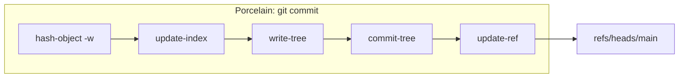
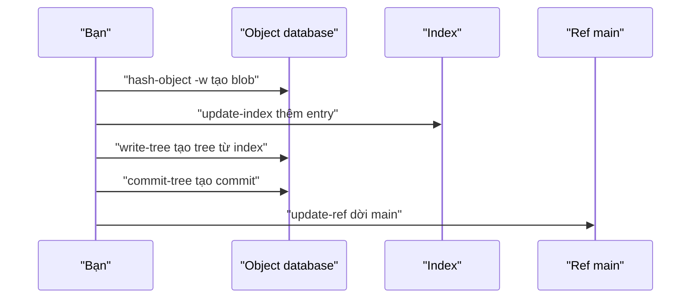

## Bạn sẽ học được gì

- Phân biệt lệnh plumbing (lớp thấp) và porcelain (lớp cao, hướng người dùng).
- Tạo một commit hoàn toàn bằng plumbing: `hash-object`, `update-index`, `write-tree`, `commit-tree`, `update-ref`.
- Hiểu vì sao script nên dùng plumbing hoặc định dạng output ổn định.
- Biết các lệnh porcelain có chế độ "máy đọc" như `--porcelain`.

## Khái niệm

Git được thiết kế như một hệ thống nhiều tầng. Ở dưới là những lệnh nhỏ, mỗi lệnh làm đúng một việc với object, index hoặc ref. Cộng đồng gọi tầng này là **plumbing** (đường ống). Ở trên là các lệnh bạn dùng hằng ngày, `git add`, `git commit`, `git switch`, `git merge`, gọi là **porcelain** (lớp sứ bọc ngoài bồn rửa).

Porcelain tiện cho con người: output có màu, có gợi ý, có thể đổi giữa các phiên bản để dễ đọc hơn. Plumbing ổn định cho máy: tham số và output được giữ tương thích lâu dài, nên script và công cụ khác dựa vào được.

Một số lệnh plumbing tiêu biểu:

| Plumbing | Việc làm | Porcelain tương ứng |
| --- | --- | --- |
| `git hash-object -w` | Ghi blob vào object database | Một phần của `git add` |
| `git update-index` | Sửa entry trong index | Một phần của `git add`, `git rm` |
| `git write-tree` | Biến index thành tree | Một phần của `git commit` |
| `git commit-tree` | Tạo commit từ tree và parent | Một phần của `git commit` |
| `git update-ref` | Dời ref tới ID mới | Một phần của `git commit`, `git reset` |
| `git cat-file` | Đọc kiểu, kích thước, nội dung object | `git show` |
| `git rev-parse` | Đổi tên thành object ID | Dùng ngầm ở khắp nơi |
| `git for-each-ref` | Liệt kê ref theo định dạng | `git branch`, `git tag` |
| `git ls-files`, `git ls-tree` | Liệt kê index, tree | `git status`, `git show` |

Ranh giới không phải lúc nào cũng tuyệt đối. Một số lệnh porcelain có tùy chọn cho output ổn định dành cho script, ví dụ `git status --porcelain` (cái tên dễ gây nhầm: ở đây nó nghĩa là "định dạng ổn định cho máy") hay `git log --format=...`.

Khi viết script, quy tắc chung: đọc bằng plumbing hoặc định dạng do bạn chỉ định; không parse output trang trí của porcelain, vì nó có thể đổi theo phiên bản, theo ngôn ngữ, hoặc theo cấu hình màu.

## Hình dung bằng sơ đồ





## Lệnh cần biết

```bash
echo 'Xin chào' | git hash-object -w --stdin
git update-index --add --cacheinfo 100644,<blob-id>,loi-chao.txt
git write-tree
echo 'Message' | git commit-tree <tree-id> -p HEAD
git update-ref refs/heads/main <commit-id>

# Đọc cho script
git cat-file -t <id>
git rev-parse --verify HEAD
git for-each-ref --format='%(refname) %(objectname:short)'
git status --porcelain=v1
```

## Ví dụ từng bước

Repository có commit "Khởi tạo". Mình sẽ tạo commit thứ hai mà không dùng `git add` hay `git commit`. ID của blob giống trên mọi máy nếu nội dung giống; ID tree và commit thì có thể khác.

Bước 1: ghi blob.

```bash
echo 'Xin chào' | git hash-object -w --stdin
git cat-file -t 66bef6f
```

```text
66bef6f22c397f27b9bcecfee90b7a31865dedc8
blob
```

Bước 2: thêm entry vào index, không cần tệp tồn tại trên đĩa.

```bash
git update-index --add --cacheinfo 100644,66bef6f22c397f27b9bcecfee90b7a31865dedc8,loi-chao.txt
git ls-files --stage
```

```text
100644 3f01b4f03f3a2193f92a57add2627ce240056f0f 0	README.md
100644 66bef6f22c397f27b9bcecfee90b7a31865dedc8 0	loi-chao.txt
```

Bước 3 và 4: tạo tree rồi commit.

```bash
git write-tree
echo 'Commit bằng plumbing' | git commit-tree b2c33d64cd67a063301407f0743f40eee1f0bacc -p HEAD
```

```text
b2c33d64cd67a063301407f0743f40eee1f0bacc
ad992ddca4116eddd1bd9d103cb6c70bf58fde65
```

Commit đã tồn tại nhưng chưa nhánh nào trỏ tới. Bước 5: dời ref.

```bash
git update-ref refs/heads/main ad992ddca4116eddd1bd9d103cb6c70bf58fde65
git log --oneline
git status --short
```

```text
ad992dd Commit bằng plumbing
35bc69c Khởi tạo
 D loi-chao.txt
```

`git status` báo tệp bị xóa vì working tree chưa bao giờ có `loi-chao.txt`; nó chỉ nằm trong index và commit. Lấy tệp ra:

```bash
git restore loi-chao.txt
cat loi-chao.txt
git status --short
```

```text
Xin chào
```

Working tree giờ sạch. Bạn vừa làm bằng tay những gì `git add` và `git commit` làm sau hậu trường.

> **Mẹo** Khi viết script, `git rev-parse --verify <tên>` vừa đổi tên ra ID vừa báo lỗi rõ ràng nếu tên không tồn tại. An toàn hơn nhiều so với đọc tệp trong `.git`.

## Lỗi thường gặp

**Parse output của `git status` thường trong script.** Output đổi theo ngôn ngữ và phiên bản. Dùng `git status --porcelain=v1` hoặc `-z`.

**Quên `-w` ở `hash-object`.** Không có `-w`, Git chỉ tính ID mà không ghi object; bước sau sẽ thiếu blob.

**Tạo commit bằng `commit-tree` mà quên `update-ref`.** Commit tồn tại nhưng không reachable, sẽ bị gc dọn sau này.

**Dùng plumbing để "sửa nhanh" repository thật.** Plumbing không có lưới an toàn như porcelain (không kiểm tra conflict, không cập nhật working tree). Thử trên repository nháp trước.

> **Cẩn thận** `git update-ref` ghi đè ref ngay lập tức, không hỏi lại. Khi script chạy song song, hãy truyền thêm giá trị cũ mong đợi (`git update-ref <ref> <mới> <cũ>`) để Git từ chối nếu ref đã bị ai khác dời.

## Áp dụng trong công việc

Nhóm QA có script thu thập thông tin build: nhánh, commit, danh sách tệp đổi. Script cũ parse output của `git branch` và `git log`, và bị vỡ khi máy chủ cài Git bản mới với output tiếng Việt. Bạn viết lại bằng `git rev-parse --abbrev-ref HEAD`, `git rev-parse HEAD` và `git diff --name-only`, output ổn định trên mọi máy.

## Chuẩn bị làm bài

Đây là bài trả lời câu hỏi. Câu hỏi hỏi `git cat-file` thuộc lớp lệnh nào. Ôn lại bảng ở phần Khái niệm và nghĩ xem lệnh đó thao tác trực tiếp với thành phần nội bộ nào.

## Tóm tắt

- Plumbing là lệnh lớp thấp, output ổn định, dành cho script và công cụ.
- Porcelain là lệnh hướng người dùng, xây trên plumbing.
- `git commit` tương đương chuỗi `hash-object`, `update-index`, `write-tree`, `commit-tree`, `update-ref`.
- Script nên đọc bằng plumbing hoặc định dạng chỉ định, như `--porcelain` hay `--format`.
- Plumbing ít lưới an toàn; thử trên repository nháp trước.
