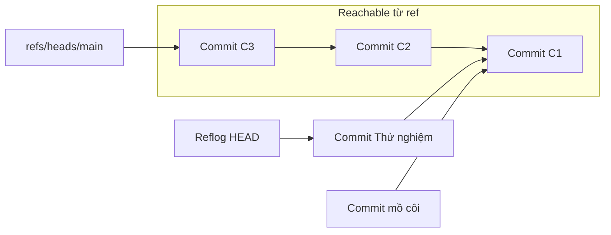

## Bạn sẽ học được gì

- Hiểu "reachable" nghĩa là gì: đi được từ một ref theo các mũi tên của đồ thị object.
- Biết những gì giữ object còn sống: nhánh, tag, remote-tracking ref, reflog, index, HEAD.
- Dùng `git fsck`, `git branch --contains`, `git merge-base --is-ancestor` để kiểm tra reachability.
- Cứu một commit không còn reachable bằng cách tạo ref mới trỏ tới nó.

## Khái niệm

Đồ thị object của Git có các mũi tên: commit trỏ tới parent và tree, tree trỏ tới blob và tree con, tag object trỏ tới object đích. Một object được gọi là **reachable** nếu bắt đầu từ một điểm xuất phát nào đó, đi theo các mũi tên, bạn tới được nó.

Điểm xuất phát (gọi là root) gồm:

- Mọi ref: `refs/heads/*`, `refs/tags/*`, `refs/remotes/*`, `refs/notes/*`, ref tùy chỉnh.
- `HEAD`, kể cả khi detached, và HEAD của các worktree khác.
- Các mục trong reflog.
- Index (blob đã `git add` nhưng chưa commit).

Mọi thứ không reachable từ các root đó là ứng viên cho bộ dọn rác. Đây là nguyên tắc nền tảng: Git không đánh dấu từng object là "giữ" hay "xóa"; nó tính ra tập reachable rồi xem phần còn lại.

Một số hệ quả thực tế:

- Commit nằm trên nhánh main thì mọi tổ tiên của nó đều reachable, dù không có ref nào trỏ thẳng vào.
- Xóa nhánh chưa merge làm các commit riêng của nhánh đó chỉ còn reachable qua reflog. Khi reflog hết hạn, chúng trở thành rác.
- Sau rebase hoặc amend, commit cũ cũng chỉ còn qua reflog và `ORIG_HEAD`.
- Push chỉ gửi object reachable từ ref được push. Commit không reachable trên máy bạn không bao giờ rời máy.

Câu hỏi liên quan thường gặp: "commit X có nằm trong nhánh Y không?" thực chất là "X có reachable từ Y không?", hay "X có phải tổ tiên của Y không?".

## Hình dung bằng sơ đồ



`Commit Thử nghiệm` chỉ còn reflog giữ. `Commit mồ côi` không có gì trỏ tới, nên là rác dù nó trỏ tới C1: mũi tên chỉ có tác dụng theo chiều từ root đi xuống.

## Lệnh cần biết

```bash
# Object không reachable (kể cả qua reflog)
git fsck --unreachable

# Không tính reflog là root
git fsck --unreachable --no-reflogs

# Nhánh nào chứa commit này
git branch --contains <commit>

# A có phải tổ tiên của B (mã thoát 0 là có)
git merge-base --is-ancestor A B

# Mọi commit reachable từ mọi ref
git rev-list --all

# Cứu commit bằng một ref mới
git branch cuu-ho <commit>
```

## Ví dụ từng bước

Tạo nhánh `thu` với commit "Thử nghiệm", quay về main và xóa nhánh (ID trên máy bạn sẽ khác):

```bash
git branch -D thu
git log --oneline --all
git fsck --unreachable --no-reflogs
```

```text
Deleted branch thu (was f021d40).
997444f Khởi tạo
unreachable tree 499c3600f8d127a5a79aa0a59f6c1627d95e82fd
unreachable blob 4d17ce38c5110199fd18d8a8d2f05fa60d17538c
unreachable commit f021d4086575a4ceb732c9c32d056a8b8d53965d
```

`git log --all` không còn thấy commit "Thử nghiệm" vì nó chỉ đi theo ref. Nếu không tính reflog, commit cùng tree và blob riêng của nó đều unreachable. Reflog vẫn nhớ:

```bash
git reflog | head -3
```

```text
997444f HEAD@{0}: checkout: moving from thu to main
f021d40 HEAD@{1}: commit: Thử nghiệm
997444f HEAD@{2}: checkout: moving from main to thu
```

Cứu bằng cách tạo ref mới:

```bash
git branch cuu-ho HEAD@{1}
git log --oneline --all
git fsck --unreachable --no-reflogs
```

```text
f021d40 Thử nghiệm
997444f Khởi tạo
```

`fsck` không còn báo gì: mọi object đã reachable trở lại. Kiểm tra quan hệ tổ tiên:

```bash
git merge-base --is-ancestor main cuu-ho; echo $?
git branch --contains main
```

```text
0
  cuu-ho
* main
```

> **Mẹo** `HEAD@{1}` chỉ đúng ngay lúc đó; sau vài thao tác nữa, số thứ tự trong reflog sẽ dịch đi. Khi cứu dữ liệu, hãy chép object ID thay vì dựa vào `HEAD@{n}`.

## Lỗi thường gặp

**Nghĩ `git log --all` thấy mọi commit.** Nó chỉ thấy commit reachable từ ref. Commit chỉ còn trong reflog phải tìm bằng `git reflog`.

**Nghĩ commit trỏ tới main thì được main giữ.** Mũi tên đi từ con xuống cha. Main không biết gì về commit con mồ côi.

**Tưởng xóa nhánh trên remote là commit biến mất khỏi máy mọi người.** Clone nào đã fetch vẫn còn object, ít nhất qua remote-tracking ref hoặc reflog.

**Dùng `HEAD@{n}` sau nhiều thao tác.** Số thứ tự đã đổi; dễ cứu nhầm commit.

> **Lưu ý** Stash cũng là ref (`refs/stash`) và có reflog riêng. Đó là lý do một stash bị `drop` vẫn có thể cứu lại một thời gian ngắn nếu bạn còn biết ID của nó.

## Áp dụng trong công việc

Một đồng nghiệp QA lỡ `git reset --hard` trên nhánh chứa bộ test case tự động mới viết trong ngày, chưa push. Bạn ngồi cùng, chạy `git reflog`, tìm dòng commit trước khi reset, tạo nhánh `cuu-ho` tại đó và kiểm tra bằng `git log --stat`. Công việc trở lại nguyên vẹn, vì commit vẫn reachable qua reflog.

## Chuẩn bị làm bài

Đây là bài trả lời câu hỏi. Câu hỏi hỏi tên gọi chung của thứ giữ cho một commit có thể truy cập qua nhánh. Hãy nghĩ tới khái niệm tổng quát hơn "nhánh" mà bạn đã gặp trong các bài internals trước.

## Tóm tắt

- Object reachable nếu đi được từ một root theo mũi tên của đồ thị.
- Root gồm ref, HEAD, reflog và index.
- Object không reachable là ứng viên cho gc, nhưng reflog và thời gian ân hạn bảo vệ thêm.
- `git fsck --unreachable`, `git branch --contains`, `git merge-base --is-ancestor` giúp kiểm tra.
- Cứu commit bằng cách tạo một ref mới trỏ tới object ID của nó.
