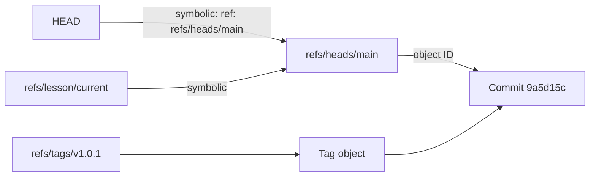
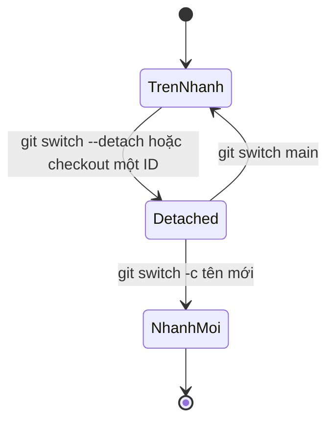

## Bạn sẽ học được gì

- Phân biệt ref thường (trỏ thẳng object ID) và symbolic ref (trỏ tới tên ref khác).
- Hiểu HEAD là symbolic ref và điều gì xảy ra khi HEAD bị detached.
- Đọc ref bằng `git show-ref`, `git symbolic-ref`, `git rev-parse`, và biết `packed-refs`.
- Tạo ref bằng `git update-ref` và symbolic ref bằng `git symbolic-ref`.

## Khái niệm

Object ID dài 40 ký tự, không ai nhớ nổi. Ref là tên dễ đọc gắn với ID. `refs/heads/main` là một ref: nội dung của nó là ID của commit đầu nhánh main. Khi bạn commit trên main, Git ghi ID mới vào ref đó. Tag `refs/tags/v1.0.0` cũng là ref, chỉ khác là thường không di chuyển.

Symbolic ref là một tầng gián tiếp nữa: thay vì chứa object ID, nó chứa tên một ref khác. Ví dụ quan trọng nhất là `HEAD`. Khi bạn đang ở nhánh main, `HEAD` chứa `ref: refs/heads/main`. Mọi lệnh cần biết "commit hiện tại" sẽ đi qua HEAD tới `refs/heads/main` rồi tới commit. Nhờ tầng gián tiếp này, khi bạn commit, Git biết phải dời ref nào: chính nhánh mà HEAD đang trỏ tới.

Khi bạn checkout một commit cụ thể (hoặc một tag, hoặc `origin/main`) thay vì một nhánh, HEAD không còn là symbolic ref nữa mà chứa thẳng object ID. Trạng thái này gọi là detached HEAD. Commit mới trong trạng thái này không làm dời nhánh nào, nên dễ thất lạc nếu bạn chuyển đi mà không tạo nhánh.

Ref được lưu ở hai nơi:

- Tệp rời trong `.git/refs/...`, mỗi ref một tệp.
- Tệp `.git/packed-refs`, gom nhiều ref vào một tệp văn bản (sau `git gc` hoặc `git pack-refs`). Với annotated tag, `packed-refs` còn ghi thêm dòng bắt đầu bằng dấu mũ cho biết commit mà tag "bóc vỏ" trỏ tới.

Vì vị trí lưu thay đổi được, hãy đọc và ghi ref bằng lệnh Git: `git show-ref`, `git for-each-ref`, `git rev-parse` để đọc; `git update-ref` để ghi ref thường; `git symbolic-ref` để đọc, ghi symbolic ref.

Ngoài HEAD, còn có các ref đặc biệt ở gốc `.git` như `ORIG_HEAD` (vị trí trước một thao tác nguy hiểm như reset, rebase), `MERGE_HEAD` (nhánh đang được merge), `FETCH_HEAD` (kết quả fetch gần nhất).

## Hình dung bằng sơ đồ





## Lệnh cần biết

```bash
# HEAD đang trỏ tới nhánh nào (lỗi nếu detached)
git symbolic-ref HEAD
git symbolic-ref --short HEAD

# Object ID mà một tên cuối cùng trỏ tới
git rev-parse HEAD

# Mọi ref và ID
git show-ref

# Tạo hoặc cập nhật ref thường
git update-ref refs/lesson/checkpoint HEAD

# Tạo symbolic ref trỏ tới ref khác
git symbolic-ref refs/lesson/current refs/heads/main

# Gom ref vào packed-refs
git pack-refs --all

# Bóc vỏ annotated tag tới commit
git rev-parse 'v1.0.1^{commit}'
```

| Tên | Loại | Nội dung |
| --- | --- | --- |
| `refs/heads/<nhánh>` | Ref thường | ID commit đầu nhánh |
| `refs/tags/<tag>` | Ref thường | ID commit hoặc ID tag object |
| `HEAD` | Thường là symbolic | `ref: refs/heads/...` hoặc ID khi detached |
| `ORIG_HEAD` | Ref thường | Vị trí trước reset, rebase, merge |
| `packed-refs` | Tệp gom | Nhiều ref, mỗi dòng ID và tên |

## Ví dụ từng bước

Repository có nhánh main, nhánh feature, tag nhẹ v1.0.0 và annotated tag v1.0.1 (ID trên máy bạn sẽ khác):

```bash
cat .git/HEAD
git symbolic-ref HEAD
git symbolic-ref --short HEAD
git show-ref
```

```text
ref: refs/heads/main
refs/heads/main
main
9a5d15c7d12df363c74468cec441175505bf4e23 refs/heads/feature
9a5d15c7d12df363c74468cec441175505bf4e23 refs/heads/main
9a5d15c7d12df363c74468cec441175505bf4e23 refs/tags/v1.0.0
4d3b3ced47099efc465dacf5efd5a3aa17b93b05 refs/tags/v1.0.1
```

Tag annotated có ID khác vì nó trỏ tới tag object. Gom ref lại:

```bash
git pack-refs --all
cat .git/packed-refs
ls .git/refs/heads .git/refs/tags
```

```text
# pack-refs with: peeled fully-peeled sorted 
9a5d15c7d12df363c74468cec441175505bf4e23 refs/heads/feature
9a5d15c7d12df363c74468cec441175505bf4e23 refs/heads/main
9a5d15c7d12df363c74468cec441175505bf4e23 refs/tags/v1.0.0
4d3b3ced47099efc465dacf5efd5a3aa17b93b05 refs/tags/v1.0.1
^9a5d15c7d12df363c74468cec441175505bf4e23
.git/refs/heads:

.git/refs/tags:
```

Thư mục `refs/heads` giờ trống, nhưng nhánh vẫn còn nguyên trong `packed-refs`. Thử detached HEAD:

```bash
git switch --detach HEAD
cat .git/HEAD
git symbolic-ref HEAD
```

```text
HEAD is now at 9a5d15c Khởi tạo
9a5d15c7d12df363c74468cec441175505bf4e23
fatal: ref HEAD is not a symbolic ref
```

Quay về main và tạo một symbolic ref của riêng mình:

```bash
git switch main
git symbolic-ref refs/lesson/current refs/heads/main
git symbolic-ref refs/lesson/current
cat .git/refs/lesson/current
```

```text
Switched to branch 'main'
refs/heads/main
ref: refs/heads/main
```

Sau khi commit thêm trên main, symbolic ref tự đi theo vì nó trỏ tới tên chứ không trỏ tới ID:

```bash
git rev-parse refs/lesson/current main
```

```text
2be414e5a8c1e1784e4376298ddd2dbcdcc9b9d1
2be414e5a8c1e1784e4376298ddd2dbcdcc9b9d1
```

> **Mẹo** Muốn biết bạn có đang detached không trong script, dùng `git symbolic-ref -q HEAD`: thoát mã 0 nếu HEAD trỏ tới nhánh, khác 0 nếu detached.

## Lỗi thường gặp

**Commit ở detached HEAD rồi chuyển nhánh.** Commit mất khỏi tầm nhìn. Tìm lại bằng `git reflog` và tạo nhánh tại đó.

**Đọc `.git/refs/heads/<nhánh>` trong script.** Không thấy nếu ref đã được gom vào `packed-refs`. Dùng `git rev-parse`.

**Nhầm ID tag với ID commit.** Annotated tag có ID riêng. Dùng `tag^{commit}` khi cần commit.

**Dùng `update-ref` để tạo symbolic ref.** `update-ref` ghi object ID. Muốn trỏ tới tên ref khác, dùng `symbolic-ref`.

> **Lưu ý** Remote-tracking ref như `refs/remotes/origin/main` cũng là ref thường; chỉ `git fetch` cập nhật chúng. Trong một clone, `refs/remotes/origin/HEAD` thường là symbolic ref trỏ tới nhánh mặc định của remote.

## Áp dụng trong công việc

Script CI của nhóm QA cần biết job đang chạy trên nhánh nào để đặt tên báo cáo. Trên một số hệ thống CI, repository được checkout ở detached HEAD, nên `git symbolic-ref --short HEAD` thất bại. Bạn sửa script: thử `git symbolic-ref -q --short HEAD`, nếu thất bại thì dùng biến môi trường tên nhánh mà hệ thống CI cung cấp, và ghi kèm `git rev-parse --short HEAD` vào tên báo cáo.

## Chuẩn bị làm bài

Bài thực hành yêu cầu tạo một ref tùy chỉnh dưới `refs/lesson/` trỏ tới cùng object ID với HEAD. Câu hỏi kiến thức hỏi symbolic ref nào cho biết nhánh đang được checkout.

Hãy chuẩn bị:

- Phân biệt lệnh ghi ref thường và lệnh ghi symbolic ref; bài thực hành cần loại nào?
- Ghi đúng tên ref đầy đủ.
- Kiểm tra bằng `git rev-parse` cho cả ref mới và HEAD.

## Tóm tắt

- Ref thường chứa object ID; symbolic ref chứa tên một ref khác.
- HEAD thường là symbolic ref trỏ tới nhánh hiện tại; detached HEAD chứa thẳng ID.
- Ref có thể là tệp rời hoặc nằm trong `packed-refs`.
- `update-ref` ghi ref thường, `symbolic-ref` đọc và ghi symbolic ref.
- Đọc ref bằng lệnh Git thay vì đọc tệp.
