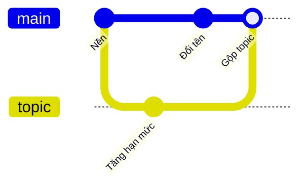
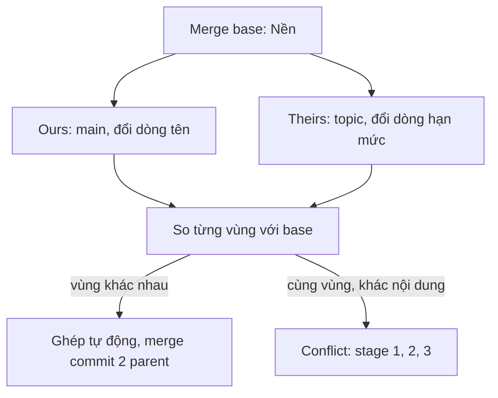

## Bạn sẽ học được gì

- Hiểu vì sao merge cần ba phiên bản: merge base, ours, theirs.
- Biết luật ghép từng vùng thay đổi và khi nào Git báo conflict.
- Đọc conflict marker kiểu `diff3`, thấy được cả phiên bản gốc.
- Thử merge mà không đụng working tree bằng `git merge-tree` và `git merge-file`.

## Khái niệm

Giả sử bạn chỉ có hai phiên bản của một tệp: một bên ghi "hạn mức: 150", bên kia ghi "hạn mức: 300". Không thể biết ai sửa, ai giữ nguyên. Merge hai phía luôn mơ hồ.

Git giải bằng phiên bản thứ ba: **merge base**, commit tổ tiên chung gần nhất của hai nhánh, tức trạng thái trước khi hai nhánh tách ra. Với ba phiên bản (base, ours là nhánh hiện tại, theirs là nhánh được merge vào), Git so từng vùng:

| Base so với ours | Base so với theirs | Kết quả |
| --- | --- | --- |
| Không đổi | Không đổi | Giữ nguyên |
| Đổi | Không đổi | Lấy ours |
| Không đổi | Đổi | Lấy theirs |
| Đổi giống nhau | Đổi giống nhau | Lấy bản đã đổi |
| Đổi khác nhau | Đổi khác nhau | Conflict |

Điều này áp dụng ở cả hai cấp. Ở cấp tree, Git xét từng đường dẫn: thêm, xóa, đổi tên, sửa. Ở cấp nội dung tệp, Git so từng hunk (khối dòng). Hai bên sửa hai vùng cách xa nhau trong cùng một tệp thì ghép được. Hai bên sửa cùng dòng, hoặc các dòng sát cạnh nhau, thì Git không tự quyết mà báo conflict.

Chiến lược merge mặc định hiện nay là `ort`. Khi có nhiều merge base (lịch sử có merge chéo), `ort` merge các base với nhau trước để tạo một base ảo, rồi mới merge ba phía.

Khi conflict, Git ghi ba phiên bản vào index (stage 1 base, 2 ours, 3 theirs) và viết marker vào tệp. Kiểu mặc định chỉ hiện ours và theirs. Đặt `merge.conflictStyle=diff3` (hoặc `zdiff3`) để thấy thêm phần base ở giữa, giúp bạn hiểu mỗi bên đã đổi gì so với gốc.

Kết quả merge thành công (không fast-forward) là một merge commit có hai parent: commit trước đó của nhánh hiện tại và đầu nhánh được merge vào.

## Hình dung bằng sơ đồ





## Lệnh cần biết

```bash
# Merge base của hai nhánh
git merge-base main topic

# Merge nhánh topic vào nhánh hiện tại
git merge topic

# Hiện cả phần base trong conflict marker
git -c merge.conflictStyle=diff3 merge topic
git config --global merge.conflictStyle zdiff3

# Thử merge mà không đụng working tree hay index
git merge-tree --write-tree --name-only main topic

# Merge ba phía cho ba tệp bất kỳ, in kết quả ra màn hình
git merge-file -p ours.txt base.txt theirs.txt

# Parent của merge commit
git log -1 --format=%P
```

## Ví dụ từng bước

`cfg.txt` có sáu dòng cấu hình một sản phẩm tiết kiệm mẫu. Nhánh topic đổi dòng cuối thành "hạn mức: 200"; main đổi dòng đầu thành "tên: Lan Nguyễn" (ID trên máy bạn sẽ khác):

```bash
git merge-base main topic
git log --oneline --all --graph
```

```text
9b7e455956cfc98a6fdbe7e734fd2369f54e34af
* c89b3db Đổi tên
| * 36c2ee4 Tăng hạn mức
|/  
* 9b7e455 Nền
```

Merge:

```bash
git merge topic -m "Gộp topic"
cat cfg.txt
git log -1 --format=%P
```

```text
Auto-merging cfg.txt
Merge made by the 'ort' strategy.
 cfg.txt | 2 +-
 1 file changed, 1 insertion(+), 1 deletion(-)
tên: Lan Nguyễn
loại: tiết kiệm
kỳ hạn: 6 tháng
lãi suất: 4.5
tiền tệ: VND
hạn mức: 200
c89b3dba2909d73230a22f2367fef8ae1dff8029 36c2ee41e58087411e5ff9348ae34535c5c3e426
```

Hai thay đổi ở hai vùng khác nhau nên được ghép, merge commit có hai parent. Giờ thử trường hợp conflict: quay lại trước merge, main đổi hạn mức thành 150, topic đổi thành 300:

```bash
git -c merge.conflictStyle=diff3 merge topic
tail -7 cfg.txt
git ls-files -u
```

```text
CONFLICT (content): Merge conflict in cfg.txt
Automatic merge failed; fix conflicts and then commit the result.
<<<<<<< HEAD
hạn mức: 150
||||||| 9b7e455
hạn mức: 100
=======
hạn mức: 300
>>>>>>> topic
100644 5e7d7a8cc0c7be6a9376a31c2486390a76f69944 1	cfg.txt
100644 e79874d79675a0c350f1ca3be28d7d21dbfaf75c 2	cfg.txt
100644 e8e8cf2828d97e21b00588ac7f7b31c5a017a4ee 3	cfg.txt
```

Phần giữa `|||||||` và `=======` là base: cả hai bên đều đổi từ 100, mỗi bên một giá trị. Đây là quyết định nghiệp vụ, không phải việc Git tự đoán. Sau khi `git merge --abort`, bạn có thể hỏi trước "merge này có conflict không" mà không đụng gì:

```bash
git merge-tree --write-tree --name-only main topic
```

```text
d03644421acbc2490d34c557cccfd6be1dfed710
cfg.txt

Auto-merging cfg.txt
CONFLICT (content): Merge conflict in cfg.txt
```

Mã thoát 1 nghĩa là có conflict. Dòng đầu là tree kết quả (có marker), tiếp theo là tệp bị conflict.

Cuối cùng, `git merge-file` cho thấy luật "vùng sát nhau". Ours đổi dòng 2, theirs đổi dòng 3:

```bash
git merge-file -p o2.txt b2.txt t2.txt
```

```text
1
<<<<<<< o2.txt
2-ours
3
=======
2
3-theirs
>>>>>>> t2.txt
4
5
6
```

(Đường dẫn trong marker đã được rút gọn.) Hai dòng liền kề bị coi là cùng một vùng nên vẫn conflict. Nếu ours đổi dòng 1 và theirs đổi dòng 6, kết quả ghép sạch.

> **Mẹo** Bật `merge.conflictStyle=zdiff3` một lần cho mọi repository. Thấy được phần base giúp bạn hiểu ý định của mỗi bên nhanh hơn rất nhiều.

## Lỗi thường gặp

**Nghĩ Git merge bằng cách so trực tiếp hai nhánh.** Git luôn so mỗi bên với merge base.

**Nghĩ khác tệp thì không bao giờ conflict.** Đổi tên và xóa cũng có thể xung đột ở cấp tree, ví dụ một bên sửa tệp mà bên kia xóa.

**Merge sạch nghĩa là code đúng.** Git chỉ ghép văn bản. Hai thay đổi hợp lệ riêng lẻ vẫn có thể phá nhau về logic; hãy chạy test sau merge.

**Xóa marker mà không đọc phần base.** Dễ chọn nhầm bên hoặc làm mất thay đổi của người khác.

> **Lưu ý** Merge fast-forward không tạo merge commit vì không có gì để ghép ba phía: nhánh hiện tại chỉ đơn giản được dời lên. Dùng `--no-ff` nếu nhóm muốn luôn có merge commit.

## Áp dụng trong công việc

Hai kỹ sư cùng chỉnh tệp cấu hình hạn mức giao dịch cho môi trường test: một người đổi đơn vị tiền tệ, người kia đổi hạn mức. Trước khi merge, bạn chạy `git merge-tree --write-tree` để biết trước có conflict không. Không có conflict, nhưng bạn vẫn chạy bộ test cấu hình sau merge vì hạn mức mới có thể không hợp lệ với đơn vị tiền tệ mới.

## Chuẩn bị làm bài

Bài thực hành yêu cầu bạn đứng trên main và merge một nhánh khác vào, sao cho kết quả là một merge commit có hai parent và không conflict. Câu hỏi kiến thức hỏi tên gọi phiên bản chung trước khi hai nhánh tách ra.

Hãy chuẩn bị:

- Kiểm tra bạn đang ở đúng nhánh trước khi merge.
- Xem đồ thị bằng `git log --oneline --graph --all` để biết có phải fast-forward không.
- Sau khi merge, kiểm tra số parent của commit mới.

## Tóm tắt

- Merge ba phía so ours và theirs với merge base, tổ tiên chung gần nhất.
- Chỉ một bên đổi thì lấy bên đó; cả hai đổi khác nhau cùng vùng thì conflict.
- `diff3` và `zdiff3` hiện thêm phần base trong conflict marker.
- `git merge-tree --write-tree` và `git merge-file` thử merge mà không đụng working tree.
- Merge không fast-forward tạo commit có hai parent; merge sạch vẫn cần chạy test.
