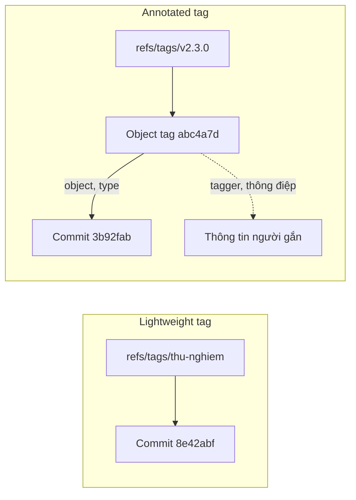
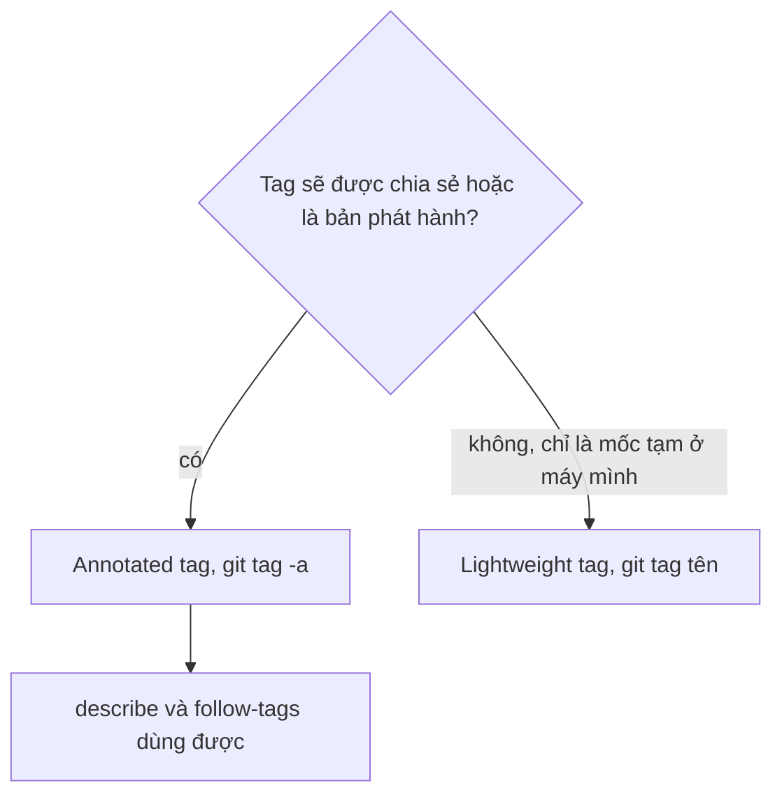

## Bạn sẽ học được gì

- Thấy tận mắt sự khác nhau về lưu trữ giữa annotated tag và lightweight tag.
- Kiểm tra một tag thuộc kiểu nào bằng `git cat-file` và `git for-each-ref`.
- Hiểu vì sao `git describe` và `git push --follow-tags` đối xử khác nhau với hai kiểu.
- Chọn đúng kiểu cho từng mục đích và chuyển một lightweight tag thành annotated.

## Khái niệm

Ở bài đánh dấu phiên bản, bạn đã biết tag là cái tên cố định cho một commit. Bài này nhìn vào bên trong để thấy hai kiểu tag được lưu khác nhau ra sao, vì sự khác nhau đó quyết định cách các lệnh khác dùng chúng.

**Lightweight tag** chỉ là một ref. Tệp (hoặc dòng trong `packed-refs`) `refs/tags/<tên>` chứa thẳng object ID của commit. Không có gì thêm: không ai ký tên, không có thời điểm gắn, không có lời giải thích. Về bản chất nó giống một branch không bao giờ di chuyển. Tạo bằng `git tag <tên>`.

**Annotated tag** là một **object** thật trong object database, loại `tag`, giống như commit, tree và blob là các loại object khác. Object tag chứa:

- `object`: ID của thứ được gắn tag (thường là commit),
- `type`: loại của thứ đó,
- `tag`: tên tag,
- `tagger`: tên, email và thời điểm của người gắn,
- một dòng trống rồi tới thông điệp (và chữ ký, nếu tag được ký).

Ref `refs/tags/<tên>` khi đó trỏ tới object tag, và object tag mới trỏ tới commit. Tạo bằng `git tag -a` (hoặc `-s` để ký, bài sau).

Vì có thêm một lớp, khi bạn cần commit thật sự đằng sau tag, Git phải "bóc" object tag. Cú pháp `<tag>^{}` hoặc `<tag>^{commit}` làm việc đó. Với lightweight tag, bóc hay không bóc đều ra cùng commit.

Sự khác nhau này ảnh hưởng tới vài lệnh quen thuộc:

- `git describe` mặc định chỉ dùng annotated tag. Lightweight tag bị bỏ qua trừ khi bạn thêm `--tags`.
- `git push --follow-tags` chỉ đẩy annotated tag trỏ tới commit đang được đẩy. Lightweight tag ở lại máy bạn.
- `git show <tag>` với annotated tag in phần đầu của object tag (người gắn, ngày, thông điệp) trước commit; với lightweight tag thì in thẳng commit.

Vậy dùng kiểu nào? Quy ước được Git khuyến nghị: annotated tag cho mọi thứ được công bố, đặc biệt là bản phát hành, vì nó lưu được ai gắn, khi nào, tại sao. Lightweight tag hợp với dấu mốc tạm thời, riêng tư: đánh dấu commit để thử bisect, ghi nhớ "chỗ này trước khi mình rebase", và những thứ bạn không định chia sẻ.

## Hình dung bằng sơ đồ





## Lệnh cần biết

```bash
git tag <tên>                        # lightweight tag
git tag -a <tên> -m "Thông điệp"     # annotated tag
git cat-file -t <tên>                # in loại object mà ref trỏ tới
git cat-file -p <tên>                # in nội dung object tag
git rev-parse <tên>^{}               # commit thật sự đằng sau tag
git for-each-ref refs/tags --format='%(refname:short) %(objecttype)'
git describe                         # chỉ dựa trên annotated tag
git describe --tags                  # dùng cả lightweight tag
git push --follow-tags               # đẩy kèm annotated tag liên quan
git tag -a -f <tên> -m "..." <tên>   # chuyển lightweight thành annotated
```

| Đặc điểm | Lightweight | Annotated |
| --- | --- | --- |
| Lưu ở đâu | Chỉ một ref | Ref và object tag riêng |
| `git cat-file -t` | `commit` | `tag` |
| Người gắn, thời điểm, thông điệp | Không | Có |
| Có thể ký | Không | Có (`-s`) |
| `git describe` mặc định | Bỏ qua | Dùng |
| `git push --follow-tags` | Không đẩy | Đẩy |

## Ví dụ từng bước

Repository có hai commit. Commit đầu được gắn annotated tag `v2.3.0`, commit sau gắn lightweight tag `thu-nghiem` (object ID ở máy bạn sẽ khác):

```bash
git cat-file -t thu-nghiem
git cat-file -t v2.3.0
git cat-file -p v2.3.0
```

```text
commit
tag
object 3b92fab092a854b02d9d0d99c82297787bb14bdf
type commit
tag v2.3.0
tagger Lan QA <lan@example.com> 1792085778 +0700

Bản phát hành 2.3.0
```

Con số sau email là thời điểm dạng Unix timestamp kèm múi giờ. Xem cả hai tag cùng lúc; cột cuối là commit sau khi bóc (chỉ annotated tag mới có giá trị):

```bash
git for-each-ref refs/tags --format='%(refname:short) %(objecttype) %(objectname:short) %(*objectname:short)'
```

```text
thu-nghiem commit 8e42abf
v2.3.0 tag abc4a7d 3b92fab
```

`git describe` chọn tag nào:

```bash
git describe
git describe --tags
```

```text
v2.3.0-1-g8e42abf
thu-nghiem
```

Mặc định Git bỏ qua `thu-nghiem` dù nó nằm ngay HEAD, và mô tả HEAD theo `v2.3.0`. Đẩy lên một remote cục bộ với `--follow-tags` rồi xem remote có gì:

```bash
git push -q origin main --follow-tags
git ls-remote --tags origin
```

```text
abc4a7d2ece2beb2d507abe5b1a3288a834f4ae4	refs/tags/v2.3.0
3b92fab092a854b02d9d0d99c82297787bb14bdf	refs/tags/v2.3.0^{}
```

Chỉ annotated tag đi theo. Dòng `^{}` là commit đã bóc mà remote quảng bá kèm. Nếu muốn mốc thử nghiệm trở thành tag chính thức, tạo lại nó dưới dạng annotated tại cùng commit:

```bash
git tag -a -f thu-nghiem -m "Bản thử cho QA" thu-nghiem
git tag -l --format='%(refname:short) %(objecttype) %(taggername) %(contents:subject)'
```

```text
Updated tag 'thu-nghiem' (was 8e42abf)
thu-nghiem tag Lan QA Bản thử cho QA
v2.3.0 tag Lan QA Bản phát hành 2.3.0
```

## Lỗi thường gặp

**Phát hành bằng lightweight tag.** `git describe` trong script build không thấy tag, số phiên bản in ra sai hoặc lệnh báo không tìm thấy tag. Kiểm tra bằng `git cat-file -t` và tạo lại dạng annotated khi tag chưa được chia sẻ.

**So sánh ID của tag với ID của commit.** Với annotated tag, `git rev-parse v2.3.0` ra ID của object tag, không phải commit. Script kiểm tra "tag có trỏ vào HEAD không" phải so `v2.3.0^{}` với HEAD.

> **Lưu ý** `git push --follow-tags` bỏ qua lightweight tag là có chủ đích: Git coi lightweight tag là mốc riêng tư. Muốn đẩy một tag cụ thể bất kể kiểu nào, đẩy nó theo tên.

**Dùng `-f` với tag đã chia sẻ.** Chuyển kiểu hay dời tag bằng `-f` chỉ an toàn khi tag mới ở máy bạn. Người đã fetch tag cũ sẽ không tự nhận bản mới.

**Thông điệp tag rỗng hoặc vô nghĩa.** Annotated tag có giá trị nhờ thông điệp. "v2" hay "release" không giúp ai. Ghi phạm vi phát hành, môi trường, hoặc đường dẫn tới ghi chú phát hành.

> **Mẹo** Đặt `git config --global push.followTags true` để `git push` thường luôn mang theo annotated tag của các commit được đẩy.

## Áp dụng trong công việc

Khi chạy `git bisect` để tìm commit làm hỏng test thanh toán, bạn rải vài lightweight tag như `bisect-tot` và `bisect-hong` để nhớ mốc. Chúng không bao giờ rời máy bạn và không làm bẩn danh sách tag của nhóm. Còn khi bàn giao build cho UAT, bạn dùng annotated tag với thông điệp ghi phạm vi test, để pipeline đọc số phiên bản qua `git describe` và để ai cũng biết người nào gắn tag lúc nào.

## Chuẩn bị làm bài

Bài thực hành dùng lại kịch bản gắn tag: bạn cần tạo đúng tag phiên bản mà đề nêu tại HEAD, và trình kiểm tra yêu cầu ref đó trỏ tới một object tag, không phải trỏ thẳng vào commit. Câu hỏi kiến thức hỏi kiểu tag nào lưu thông điệp và thông tin người gắn. Hãy:

- Tự kiểm tra kiểu tag bằng `git cat-file -t` sau khi tạo.
- Xem nội dung object bằng `git cat-file -p` để thấy dòng `tagger`.
- So `git rev-parse <tag>^{}` với `git rev-parse HEAD`.

## Tóm tắt

- Lightweight tag chỉ là ref trỏ vào commit; annotated tag là object riêng.
- Object tag lưu commit đích, tên tag, người gắn, thời điểm và thông điệp.
- `git cat-file -t` cho biết kiểu: `commit` là lightweight, `tag` là annotated.
- `git describe` và `--follow-tags` mặc định chỉ làm việc với annotated tag.
- Dùng annotated cho bản phát hành, lightweight cho mốc tạm riêng tư.
