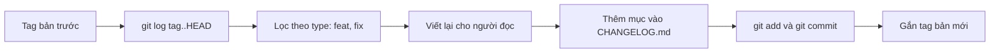
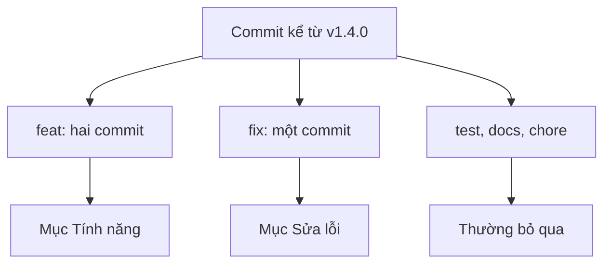

## Bạn sẽ học được gì

- Hiểu vai trò của tệp changelog và khác biệt giữa changelog với `git log`.
- Lấy danh sách thay đổi giữa hai bản phát hành bằng các lệnh Git có sẵn.
- Nhóm thay đổi theo loại nhờ commit message có cấu trúc.
- Viết và commit một mục changelog gọn, có ích cho người đọc.

## Khái niệm

`git log` ghi lại **mọi** commit: sửa chính tả, đổi tên biến, commit "thử lại CI". Lịch sử đó quý cho lập trình viên, nhưng người dùng sản phẩm, đội QA hay bộ phận vận hành chỉ cần biết: bản mới **khác gì** bản cũ, có gì phải lưu ý khi nâng cấp. Đó là việc của changelog.

Theo quy ước rộng rãi, changelog là một tệp Markdown tên `CHANGELOG.md` đặt ở gốc repository. Tệp được sắp theo phiên bản, mới nhất ở trên cùng. Mỗi phiên bản có một tiêu đề gồm số phiên bản và ngày phát hành, bên dưới là các mục thay đổi chia theo nhóm, ví dụ "Tính năng", "Sửa lỗi", "Thay đổi phá tương thích", "Gỡ bỏ". Nhiều nhóm giữ thêm một mục "Chưa phát hành" ở đầu tệp để gom dần thay đổi trước khi chốt số.

Viết changelog không có nghĩa là chép nguyên `git log`. Một mục changelog tốt viết cho người đọc ngoài nhóm phát triển: mô tả ảnh hưởng, không mô tả cách làm. "Sửa làm tròn phí chuyển khoản" có ích; "refactor hàm calcFee" thì không. Commit thuần nội bộ như `test:`, `chore:`, `docs:` thường không cần xuất hiện.

Git giúp phần thu thập nguyên liệu:

- **Phạm vi**: các commit kể từ bản trước là `<tag-cũ>..HEAD`. Tag gần nhất lấy bằng `git describe --tags --abbrev=0`.
- **Định dạng**: `git log --format='- %s'` in mỗi commit thành một gạch đầu dòng với subject. `%h` thêm object ID rút gọn nếu muốn truy vết.
- **Lọc**: `--grep` lọc theo thông điệp, `--no-merges` bỏ merge commit, `--reverse` sắp từ cũ tới mới.
- **Tổng hợp theo người**: `git shortlog` nhóm subject theo tác giả, hữu ích cho phần cảm ơn người đóng góp.

Chất lượng changelog phụ thuộc trực tiếp vào chất lượng commit message. Nếu nhóm theo Conventional Commits (`feat:`, `fix:`, `feat(otp):`...), việc phân nhóm gần như tự động: lọc `^feat` cho tính năng, `^fix` cho sửa lỗi. Đó cũng là cách các công cụ sinh changelog tự động hoạt động: đọc commit trong khoảng giữa hai tag, phân loại theo type, rồi đề xuất cả số phiên bản tiếp theo theo semver. Dù dùng công cụ, nên có người đọc lại trước khi phát hành, vì commit message viết cho lập trình viên, còn changelog viết cho người dùng.

Cuối cùng, changelog là một tệp được theo dõi như mọi tệp khác: bạn sửa nó, stage và commit, thường ngay trước khi gắn tag phát hành, để tag trỏ vào commit có changelog đầy đủ.

## Hình dung bằng sơ đồ





## Lệnh cần biết

```bash
git describe --tags --abbrev=0                 # tag gần nhất
git log --oneline v1.4.0..HEAD                 # commit kể từ bản trước
git log --format='- %s (%h)' v1.4.0..HEAD      # dạng gạch đầu dòng kèm ID
git log --reverse --no-merges --format='- %s' v1.4.0..HEAD
git log --format='- %s' --grep='^feat' v1.4.0..HEAD   # chỉ tính năng
git log --format='- %s' --grep='^fix' v1.4.0..HEAD    # chỉ sửa lỗi
git shortlog v1.4.0..HEAD                      # nhóm theo tác giả
```

| Placeholder của `--format` | Ý nghĩa |
| --- | --- |
| `%s` | Subject (dòng đầu thông điệp) |
| `%h` | Object ID rút gọn |
| `%an` | Tên tác giả |
| `%ad` | Ngày tác giả, theo `--date` |
| `%b` | Phần thân thông điệp |

## Ví dụ từng bước

Repository có tag `v1.4.0` và năm commit sau đó (object ID ở máy bạn sẽ khác):

```bash
git log --oneline v1.4.0..HEAD
```

```text
8590b6e docs: cập nhật README
05de00b feat(otp): cho phép gửi lại OTP sau 60 giây
3f54a0c test: bổ sung test hạn mức ngày
7fd71d4 fix: sửa làm tròn phí chuyển khoản
8ce1450 feat: thêm xuất sao kê PDF
```

Lọc theo loại:

```bash
git log --format='- %s' --grep='^feat' v1.4.0..HEAD
git log --format='- %s' --grep='^fix' v1.4.0..HEAD
```

```text
- feat(otp): cho phép gửi lại OTP sau 60 giây
- feat: thêm xuất sao kê PDF
- fix: sửa làm tròn phí chuyển khoản
```

Ghép thành một mục changelog. Đoạn script nhỏ này lấy tag gần nhất, lọc theo type, sắp từ cũ tới mới và bỏ tiền tố type bằng `sed`:

```bash
LAST=$(git describe --tags --abbrev=0)
{
  echo "# Changelog"; echo
  echo "## [1.5.0] - 2026-10-16"; echo
  echo "### Tính năng"
  git log --reverse --format='- %s' --grep='^feat' $LAST..HEAD | sed -E 's/^- feat(\([^)]*\))?: /- /'
  echo; echo "### Sửa lỗi"
  git log --reverse --format='- %s' --grep='^fix' $LAST..HEAD | sed -E 's/^- fix(\([^)]*\))?: /- /'
} > CHANGELOG.md
cat CHANGELOG.md
```

```text
# Changelog

## [1.5.0] - 2026-10-16

### Tính năng
- thêm xuất sao kê PDF
- cho phép gửi lại OTP sau 60 giây

### Sửa lỗi
- sửa làm tròn phí chuyển khoản
```

Có tính năng mới tương thích nên số tiếp theo là MINOR, như bài semver. Đọc lại, sửa câu chữ nếu cần, rồi commit:

```bash
git add CHANGELOG.md
git commit -qm "docs: viết CHANGELOG cho 1.5.0"
git show --stat --oneline HEAD
git status --short
```

```text
4489e61 docs: viết CHANGELOG cho 1.5.0
 CHANGELOG.md | 10 ++++++++++
 1 file changed, 10 insertions(+)
```

`git status --short` không in gì: working tree sạch. Trong dự án đã có changelog, bạn chèn mục mới lên trên các mục cũ thay vì ghi đè cả tệp như script ví dụ.

## Lỗi thường gặp

**Chép nguyên `git log` vào changelog.** Người đọc phải lội qua commit nội bộ và thông điệp khó hiểu. Lọc, gộp và viết lại theo góc nhìn người dùng.

**Sai phạm vi commit.** Dùng nhầm tag cũ hơn khiến thay đổi của bản trước xuất hiện lại. Kiểm tra `git describe --tags --abbrev=0` và nhớ hai chấm `A..B` nghĩa là "có trong B nhưng không có trong A".

> **Cẩn thận** Ghi đè `CHANGELOG.md` bằng `>` trong script sẽ xóa lịch sử các phiên bản trước. Với tệp đã có nội dung, chèn mục mới vào đầu (sau tiêu đề) hoặc sửa tay.

**Quên commit changelog trước khi gắn tag.** Tag trỏ vào commit chưa có ghi chú, và bản phát hành thiếu tài liệu. Commit changelog trước, gắn tag sau.

**Commit message không có cấu trúc.** Không có `feat:` hay `fix:` thì lọc tự động vô dụng. Thống nhất quy ước commit trong nhóm (xem bài Conventional Commits trong track daily-workflows).

> **Mẹo** Ghi chú "thay đổi phá tương thích" luôn đặt lên đầu mục phiên bản, kèm hướng dẫn nâng cấp. Đó là phần người đọc cần nhất.

## Áp dụng trong công việc

Trước mỗi đợt UAT, đội QA cần biết phạm vi để lên kế hoạch test. Thay vì hỏi từng lập trình viên, bạn lấy `git log` từ tag bản trước, lọc `feat` và `fix`, rồi đối chiếu với mục mới trong `CHANGELOG.md` mà nhóm phát triển viết. Mỗi mục "Sửa lỗi" trở thành một test case xác nhận, mỗi mục "Tính năng" trở thành một nhóm test mới; commit nào thay đổi hành vi mà không có trong changelog là dấu hiệu cần hỏi lại.

## Chuẩn bị làm bài

Bài thực hành có sẵn vài commit, trong đó có một commit thêm tính năng và một commit sửa lỗi. Bạn cần tạo tệp changelog theo quy ước, nhắc tới cả hai thay đổi đó (dựa trên subject commit), rồi commit tệp sao cho HEAD chứa nó và working tree sạch. Trình kiểm tra cũng đếm số commit, nên chỉ cần thêm đúng một commit. Câu hỏi kiến thức hỏi tên tệp thường dùng để ghi thay đổi theo phiên bản. Hãy:

- Dùng `git log --oneline` hoặc `git log --format='- %s'` để lấy chính xác subject của hai commit.
- Kiểm tra nội dung tệp trước khi commit, giữ đúng chữ và dấu tiếng Việt.
- Kết thúc bằng `git show --stat HEAD` và `git status --short`.

## Tóm tắt

- Changelog tóm tắt thay đổi theo phiên bản cho người đọc, khác với `git log` đầy đủ.
- Quy ước phổ biến: `CHANGELOG.md` ở gốc, mới nhất ở trên, chia nhóm theo loại thay đổi.
- `git log <tag>..HEAD` với `--format`, `--grep`, `--no-merges` là nguyên liệu chính.
- Commit message có cấu trúc giúp phân nhóm và đề xuất số phiên bản.
- Commit changelog trước khi gắn tag phát hành.
