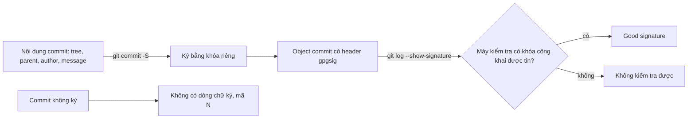
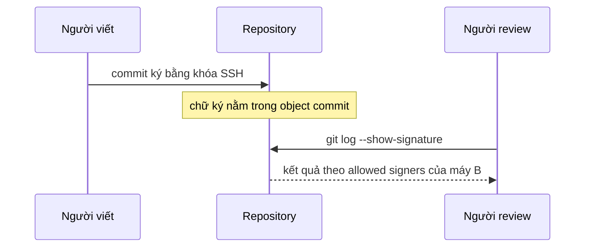

## Bạn sẽ học được gì

- Hiểu vì sao tên và email trong commit không chứng minh ai đã tạo commit.
- Ký commit bằng khóa SSH hoặc GPG, và bật ký mặc định cho một repository.
- Hiển thị và kiểm tra chữ ký trong lịch sử, đọc mã trạng thái chữ ký.
- Biết kết quả kiểm tra phụ thuộc vào thiết lập khóa ở máy chạy lệnh.

## Khái niệm

Mở một commit bất kỳ, bạn thấy dòng `Author: Lan QA <lan@example.com>`. Dòng đó đến từ đâu? Từ cấu hình `user.name` và `user.email` ở máy người tạo commit. Git không hỏi mật khẩu, không gọi server nào. Bất kỳ ai cũng có thể chạy `git -c user.name="Trưởng nhóm" -c user.email=lead@example.com commit` và tạo ra một commit trông như của trưởng nhóm. Khi push lên hosting, dịch vụ xác thực **người push** chứ không xác thực tác giả ghi trong từng commit.

**Chữ ký commit** lấp chỗ trống đó. Khi bạn commit với `-S` (hoặc bật `commit.gpgSign`), Git nhờ chương trình ký (`gpg` cho OpenPGP, `ssh-keygen` cho khóa SSH) ký nội dung commit bằng khóa riêng của bạn, rồi lưu chữ ký vào header `gpgsig` của chính object commit. Vì chữ ký nằm trong object, nó là một phần của object ID: sửa bất kỳ thứ gì (nội dung, tác giả, thông điệp) đều làm chữ ký không còn khớp.

Giống ký tag ở bài trước, chữ ký chứng minh **người nắm khóa riêng** đã tạo đúng nội dung này. Nó không tự nói khóa đó của ai. Việc gắn khóa với một người do keyring GPG đã xác minh, tệp allowed signers cho SSH, hoặc hosting lưu khóa của tài khoản đảm nhận. Và lại giống ký tag: **cùng một commit, máy khác nhau có thể cho kết quả kiểm tra khác nhau** tùy có khóa công khai và có tin khóa đó không.

Để xem chữ ký trong lịch sử, `git log --show-signature` chạy kiểm tra cho từng commit và in kết quả ngay dưới dòng `commit`. Muốn kiểm tra một commit cụ thể và lấy mã thoát cho script, dùng `git verify-commit`. Muốn gọn trong một dòng, placeholder `%G?` của `--format` in một chữ cái trạng thái:

| `%G?` | Ý nghĩa |
| --- | --- |
| `G` | Chữ ký hợp lệ, khóa tin cậy |
| `U` | Chữ ký hợp lệ nhưng độ tin cậy của khóa chưa rõ |
| `B` | Chữ ký sai |
| `E` | Không kiểm tra được, ví dụ thiếu khóa công khai |
| `X`, `Y`, `R` | Chữ ký hết hạn, khóa hết hạn, khóa đã bị thu hồi |
| `N` | Không có chữ ký |

Một vài lưu ý thực tế. Rebase, amend, cherry-pick đều tạo commit mới, nên chữ ký cũ không đi theo; commit mới chỉ được ký nếu máy bạn đang bật ký. Commit do hosting tạo khi merge trên giao diện web được ký bằng khóa của hosting (nếu họ hỗ trợ), không phải khóa của bạn. Và chữ ký không thay được review: nó chứng minh nguồn gốc, không chứng minh code đúng.

> **Lưu ý** Trong ứng dụng luyện tập, bài này được **mô phỏng**: đây là bài câu hỏi, không tạo hay dùng khóa thật. Ví dụ dưới đây chạy bằng khóa dùng một lần trong `/tmp` để bạn thấy đầu ra thật.

## Hình dung bằng sơ đồ





## Lệnh cần biết

```bash
git commit -S -m "..."                 # ký commit này
git config commit.gpgSign true         # ký mọi commit trong repository
git config user.signingKey <key>       # GPG key ID hoặc đường dẫn khóa SSH công khai
git config gpg.format ssh              # dùng khóa SSH để ký
git config gpg.ssh.allowedSignersFile <tệp>   # danh sách khóa SSH được tin khi kiểm tra
git log --show-signature               # hiện kết quả kiểm tra chữ ký từng commit
git log --format='%h %G? %an %s'       # trạng thái chữ ký dạng một chữ cái
git verify-commit <commit>             # kiểm tra một commit, mã thoát khác 0 nếu không đạt
git cat-file -p <commit>               # xem header gpgsig thô
```

## Ví dụ từng bước

Chuẩn bị môi trường tạm, không đụng `~/.ssh`, `~/.gnupg` hay `~/.gitconfig` thật:

```bash
export GIT_CONFIG_GLOBAL=/tmp/rx-gitconfig
ssh-keygen -q -t ed25519 -N '' -C "lan@example.com" -f /tmp/rx-ssh-key
echo "lan@example.com $(cat /tmp/rx-ssh-key.pub)" > /tmp/rx-allowed-signers
git config gpg.format ssh
git config user.signingKey /tmp/rx-ssh-key.pub
git config gpg.ssh.allowedSignersFile /tmp/rx-allowed-signers
```

Một commit có ký, rồi một commit "mạo danh" chỉ bằng cách đổi tên và email (object ID và dấu vân tay ở máy bạn sẽ khác):

```bash
git commit -qS -am "Thêm kiểm tra hạn mức"
git -c user.name="Trưởng nhóm" -c user.email=lead@example.com commit -qam "Commit mạo danh"
git log --show-signature -2
```

```text
commit 68bac1f1ec33259a28137b986091b20fdbcfb7cf
Author: Trưởng nhóm <lead@example.com>
Date:   Fri Oct 16 00:35:31 2026 +0700

    Commit mạo danh

commit 977b7a0221b804c02d1f8873f6f43ecd946ba64e
Good "git" signature for lan@example.com with ED25519 key SHA256:JHZEkXBT+f6I4e9Jyw/fTEZ94AHobqHwjOTxTFhae4w
Author: Lan QA <lan@example.com>
Date:   Fri Oct 16 00:35:31 2026 +0700

    Thêm kiểm tra hạn mức
```

Commit mạo danh trông hoàn toàn bình thường, chỉ khác là không có dòng chữ ký. Dạng một dòng:

```bash
git log --format='%h %G? %an %s'
git verify-commit HEAD~1; echo "exit $?"
git verify-commit HEAD; echo "exit $?"
```

```text
68bac1f N Trưởng nhóm Commit mạo danh
977b7a0 G Lan QA Thêm kiểm tra hạn mức
54cba83 N Lan QA Khởi tạo
Good "git" signature for lan@example.com with ED25519 key SHA256:JHZEkXBT+f6I4e9Jyw/fTEZ94AHobqHwjOTxTFhae4w
exit 0
exit 1
```

Chữ ký nằm ngay trong object commit (đã lược):

```bash
git cat-file -p HEAD~1
```

```text
tree a38e8ab7e857af7a7ac6f49fa3d3821f26fedca8
parent 54cba8396d18f318a5fb7c0e8714f10aae1a1b0b
author Lan QA <lan@example.com> 1792085731 +0700
committer Lan QA <lan@example.com> 1792085731 +0700
gpgsig -----BEGIN SSH SIGNATURE-----
 U1NIU0lHAAAAAQAAADMAAAALc3NoLWVkMjU1MTkAAAAg+IgZUEmlfe7PbudsnijV/MA2Af
 ...
```

Với GPG, cách làm tương tự: bỏ `gpg.format ssh`, đặt `user.signingKey` là key ID của khóa tạm trong `GNUPGHOME=/tmp/...` (xem bài ký tag), và bật `commit.gpgSign true`. Trên máy có khóa:

```text
gpg: Signature made Fri Oct 16 00:35:35 2026 +07
gpg:                using EDDSA key 56114CE12742BEF5B8BDBC1893A0E043482C8D29
gpg: Good signature from "Lan QA <lan@example.com>" [ultimate]
```

Cùng commit đó, kiểm tra với một keyring trống:

```text
gpg: Can't check signature: No public key
```

và `%G?` in ra `E`. Đây chính là điều cần nhớ: kết quả phụ thuộc vào khóa có trên máy chạy lệnh, không chỉ vào commit.

## Lỗi thường gặp

**Tin vào dòng `Author`.** Như ví dụ trên, đổi tên và email là đủ để giả. Khi nguồn gốc quan trọng, kiểm tra chữ ký, không đọc tên.

**Bật `commit.gpgSign` mà khóa không dùng được.** Commit thất bại với lỗi từ `gpg` hoặc `ssh-keygen`. Kiểm tra `user.signingKey` trỏ đúng, khóa còn hạn, agent đang chạy nếu khóa có passphrase.

> **Cẩn thận** Khi thử nghiệm, sinh khóa tạm trong `/tmp` và dùng `GIT_CONFIG_GLOBAL`, `GNUPGHOME` tạm. Đừng đặt `commit.gpgSign` vào `~/.gitconfig` thật với một khóa thử, vì mọi repository khác sẽ bị ảnh hưởng.

**Thấy "No public key" hoặc lỗi allowed signers và nghĩ commit bị giả.** Đó là máy kiểm tra thiếu thiết lập. Thêm khóa công khai của đồng nghiệp từ nguồn tin cậy, hoặc cấu hình `gpg.ssh.allowedSignersFile`, rồi kiểm tra lại.

**Rebase xong chữ ký biến mất.** Commit mới là commit khác. Bật ký mặc định để commit phát lại cũng được ký bằng khóa của bạn.

> **Mẹo** Trong CI, `git log --format='%h %G?' <phạm vi>` cộng một dòng `grep -v ' G$'` là cách đơn giản để phát hiện commit không ký hoặc ký bằng khóa lạ, với điều kiện máy CI có đúng danh sách khóa tin cậy.

## Áp dụng trong công việc

Repository chứa cấu hình hạn mức giao dịch được kiểm toán định kỳ. Nhóm quyết định mọi commit vào branch phát hành phải ký bằng khóa SSH đã đăng ký. Pipeline kiểm tra trước khi build: chạy `git log --format='%h %G? %an %s'` trên các commit mới với tệp allowed signers do nhóm quản lý; dòng nào không phải `G` thì dừng và báo người phụ trách. Khi kiểm toán hỏi "ai đã đổi hạn mức ngày 12", câu trả lời dựa trên chữ ký, không chỉ dựa trên dòng `Author`.

## Chuẩn bị làm bài

Bài này là bài câu hỏi được mô phỏng: không cần tạo khóa hay ký commit thật. Câu hỏi hỏi lệnh `git log` nào hiển thị kết quả kiểm tra chữ ký của commit. Ôn lại phần lệnh cần biết, phân biệt cách xem chữ ký trong log, cách kiểm tra một commit riêng lẻ, và cách in mã trạng thái gọn. Nếu muốn tự thử, làm theo ví dụ với khóa tạm trong `/tmp`.

## Tóm tắt

- Tên và email trong commit chỉ là cấu hình, ai cũng đặt được.
- Chữ ký nằm trong object commit và chứng minh người nắm khóa riêng đã tạo commit.
- `git commit -S` hoặc `commit.gpgSign` để ký; `gpg.format ssh` để dùng khóa SSH.
- `git log --show-signature`, `git verify-commit` và `%G?` để kiểm tra.
- Kết quả kiểm tra phụ thuộc vào khóa công khai và allowed signers ở máy chạy lệnh.
