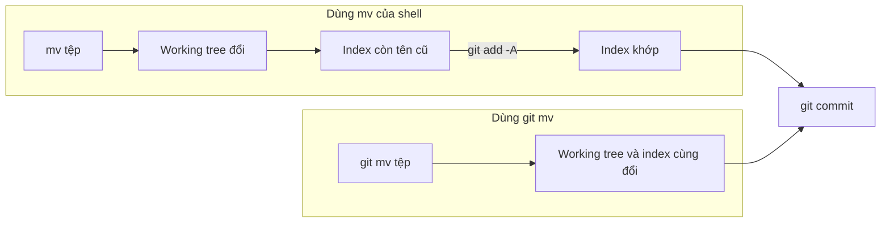

## Bạn sẽ học được gì

- Hiểu vì sao đổi tên hay xóa tệp bằng lệnh của hệ điều hành chỉ làm "một nửa" việc với Git.
- Dùng `git mv` để đổi tên hoặc di chuyển tệp và stage kết quả trong một bước.
- Phân biệt `git rm` (xóa khỏi ổ đĩa và index) với `git rm --cached` (chỉ ngừng theo dõi).
- Biết Git nhận ra một lần đổi tên như thế nào và cách xem lịch sử của tệp đã đổi tên.

## Khái niệm

Git theo dõi tệp qua ba nơi: working tree (thư mục trên ổ đĩa), index (bản chụp sẽ đi vào commit kế tiếp) và HEAD (commit gần nhất). Khi bạn đổi tên tệp bằng `mv` của shell hay bằng trình quản lý tệp, chỉ working tree thay đổi. Với Git, lúc đó có một tệp cũ "biến mất" và một tệp mới "chưa được theo dõi". Bạn phải tự `git add` tệp mới và ghi nhận việc xóa tệp cũ thì index mới khớp.

`git mv` gói hai việc đó làm một: đổi tên trên ổ đĩa **và** cập nhật index cùng lúc. Sau lệnh, `git status --short` hiện ngay một dòng `R` (renamed), sẵn sàng để commit. Tương tự, `git rm` xóa tệp khỏi ổ đĩa và ghi việc xóa vào index trong một bước.

Một điều nhiều người không để ý: Git **không lưu thao tác đổi tên** như một sự kiện riêng. Commit chỉ chứa một cây thư mục đầy đủ. Khi bạn xem `git status`, `git diff` hay `git log`, Git so hai cây, thấy một đường dẫn mất đi và một đường dẫn mới xuất hiện với nội dung giống hệt (hoặc gần giống), rồi suy ra đó là đổi tên. Vì thế `git mv` và cách "mv rồi add" cho ra commit giống nhau; khác biệt nằm ở sự tiện lợi và ít sót bước. Hệ quả thực tế: nếu bạn vừa đổi tên vừa sửa gần hết nội dung trong cùng một commit, Git có thể không nhận ra đó là đổi tên nữa. Nên tách đổi tên và sửa nội dung thành hai commit.

Với xóa tệp, có hai ý định khác nhau:

- Bỏ hẳn tệp khỏi dự án: `git rm <tệp>`. Tệp mất khỏi ổ đĩa và commit kế tiếp không còn nó.
- Giữ tệp ở máy nhưng ngừng đưa vào Git, ví dụ tệp cấu hình cục bộ lỡ commit: `git rm --cached <tệp>`. Tệp còn trên ổ đĩa, trở thành untracked. Thường bạn thêm nó vào `.gitignore` ngay sau đó.

`git rm` có một lớp bảo vệ: nếu tệp đang có thay đổi chưa commit, Git từ chối xóa để bạn không mất công sức, trừ khi bạn chủ động thêm `-f`.

Cuối cùng, nhớ rằng mọi thao tác này chỉ đổi index và working tree. Lịch sử cũ vẫn chứa tệp với tên cũ. Xóa một tệp chứa bí mật bằng `git rm` không xóa nó khỏi các commit trước; việc đó cần công cụ viết lại lịch sử, có bài riêng trong track forensics.

## Hình dung bằng sơ đồ




## Lệnh cần biết

```bash
git mv <cũ> <mới>              # đổi tên và stage
git mv <tệp> <thư-mục>/        # di chuyển vào thư mục khác
git mv -n <cũ> <mới>           # chạy thử, chỉ in ra sẽ làm gì
git rm <tệp>                   # xóa khỏi ổ đĩa và index
git rm --cached <tệp>          # ngừng theo dõi, giữ tệp trên ổ đĩa
git rm -r <thư-mục>            # xóa cả thư mục
git add -A                     # ghi nhận mọi thêm, xóa, đổi tên đã làm bằng tay
git log --follow -- <tệp>      # lịch sử của một tệp qua các lần đổi tên
git ls-files                   # xem index đang theo dõi những tệp nào
```

| Lệnh | Working tree | Index |
| --- | --- | --- |
| `mv a b` | Đổi | Không đổi |
| `git mv a b` | Đổi | Đổi, hiện là rename |
| `rm a` | Xóa | Không đổi |
| `git rm a` | Xóa | Ghi nhận xóa |
| `git rm --cached a` | Giữ | Ghi nhận xóa |

## Ví dụ từng bước

Một repository tài liệu test có ba tệp đã commit: `testplan.md`, `run.log`, `local.env`. Mình đổi tên kế hoạch test, xóa log và ngừng theo dõi tệp cấu hình cục bộ (object ID ở máy bạn sẽ khác):

```bash
git mv testplan.md ke-hoach-test.md
git status --short
git rm run.log
git rm --cached local.env
git status --short
ls
```

```text
R  testplan.md -> ke-hoach-test.md
rm 'run.log'
rm 'local.env'
R  testplan.md -> ke-hoach-test.md
D  local.env
D  run.log
?? local.env
ke-hoach-test.md
local.env
```

`local.env` vẫn nằm trên ổ đĩa nhưng đã thành untracked. Thêm vào `.gitignore` rồi commit:

```bash
echo local.env > .gitignore
git add .gitignore
git commit -qm "Đổi tên kế hoạch test, dọn log, bỏ theo dõi local.env"
git show --stat --oneline HEAD
```

```text
88162ae Đổi tên kế hoạch test, dọn log, bỏ theo dõi local.env
 .gitignore                      | 1 +
 testplan.md => ke-hoach-test.md | 0
 local.env                       | 1 -
 run.log                         | 1 -
 4 files changed, 1 insertion(+), 2 deletions(-)
```

So sánh với cách dùng `mv` thường để chuyển tệp vào thư mục `docs`:

```bash
mkdir docs
mv ke-hoach-test.md docs/
git status --short
git add -A
git status --short
```

```text
 D ke-hoach-test.md
?? docs/
R  ke-hoach-test.md -> docs/ke-hoach-test.md
```

Trước `git add -A`, Git chỉ thấy một tệp bị xóa và một thư mục lạ. Sau khi stage, nó nhận ra đây là đổi tên. Sau khi commit, `--follow` lần được lịch sử qua cả hai lần đổi tên:

```bash
git commit -qm "Chuyển kế hoạch test vào docs"
git log --oneline --follow -- docs/ke-hoach-test.md
```

```text
def531e Chuyển kế hoạch test vào docs
88162ae Đổi tên kế hoạch test, dọn log, bỏ theo dõi local.env
d41caf1 Thêm tài liệu test
```

## Lỗi thường gặp

**`git rm` từ chối vì tệp đang sửa.** Thông báo là:

```text
error: the following file has local modifications:
    docs/ke-hoach-test.md
(use --cached to keep the file, or -f to force removal)
```

Hãy commit hoặc bỏ thay đổi trước, hoặc dùng `--cached` nếu chỉ muốn ngừng theo dõi. Chỉ dùng `-f` khi chắc chắn không cần nội dung đó.

**Gõ sai đường dẫn nguồn.** `git mv` báo `fatal: bad source` khi tệp nguồn không được theo dõi hoặc không tồn tại. Kiểm tra bằng `git ls-files`.

> **Cẩn thận** Sau `git rm --cached`, nếu bạn chưa thêm tệp vào `.gitignore` mà lại chạy `git add -A` hay `git add .`, tệp sẽ bị stage trở lại. Thêm vào `.gitignore` ngay.

**Đổi tên và sửa nhiều nội dung cùng lúc.** Git có thể hiện là một tệp xóa và một tệp mới, khó review và `--follow` không nối được lịch sử. Tách thành hai commit.

**Nghĩ rằng `git rm` xóa bí mật khỏi lịch sử.** Nó chỉ xóa khỏi commit kế tiếp. Các commit cũ vẫn giữ nội dung; nếu đó là khóa thật, hãy thu hồi khóa.

> **Mẹo** Trên Windows và macOS, đổi tên chỉ khác chữ hoa chữ thường (ví dụ `readme.md` thành `README.md`) bằng trình quản lý tệp thường không được Git ghi nhận. `git mv` xử lý trường hợp này đúng.

## Áp dụng trong công việc

Dự án test automation của bạn đổi quy ước đặt tên: mọi tệp kịch bản phải nằm dưới `tests/e2e/` với tiền tố module. Bạn dùng `git mv` cho từng tệp, commit riêng phần đổi tên trước, rồi mới sửa import ở commit sau. Reviewer thấy commit đầu toàn dòng `R` với 0 dòng thay đổi, xác nhận nhanh không có logic nào bị động vào. Sau này ai cần truy lịch sử một kịch bản vẫn dùng `git log --follow` được.

## Chuẩn bị làm bài

Bài thực hành có một tệp đã commit. Bạn cần đổi tên nó theo tên mới mà đề bài nêu, giữ nguyên nội dung, rồi commit sao cho HEAD có tệp mới, không còn tệp cũ và working tree sạch. Câu hỏi kiến thức hỏi về lệnh làm được cả đổi tên lẫn stage trong một bước. Hãy:

- Xem `git status --short` ngay sau khi đổi tên để chắc chắn thấy dòng rename đã staged.
- Kiểm tra lại bằng `git show --stat HEAD` sau khi commit.
- Đảm bảo không còn thay đổi nào chưa commit.

## Tóm tắt

- Đổi tên bằng shell chỉ đổi working tree; index phải được cập nhật riêng.
- `git mv` đổi tên và stage cùng lúc; `git rm` xóa và stage cùng lúc.
- `git rm --cached` ngừng theo dõi nhưng giữ tệp, thường đi kèm `.gitignore`.
- Git suy ra đổi tên bằng cách so nội dung, không lưu sự kiện đổi tên.
- `git log --follow` xem lịch sử tệp qua các lần đổi tên.
