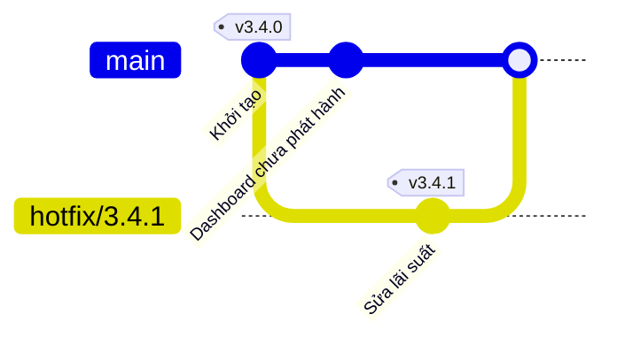
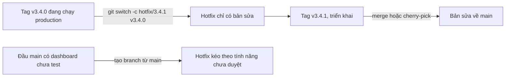

## Bạn sẽ học được gì

- Hiểu vì sao bản sửa khẩn cho production phải xuất phát từ bản đang chạy, không phải từ `main`.
- Tạo hotfix branch từ tag phát hành và đặt tên theo quy ước.
- Kiểm tra hotfix chỉ chứa bản sửa, không kéo theo tính năng chưa phát hành.
- Hoàn tất hotfix: gắn tag bản vá và đưa bản sửa về nhánh phát triển.

## Khái niệm

Bản 3.4.0 đang chạy trên production. Trong lúc đó `main` đã nhận thêm một dashboard mới cho bản 3.5, chưa qua QA. Chiều thứ sáu, bộ phận vận hành báo lãi suất hiển thị bị làm tròn sai. Phải sửa ngay. Câu hỏi đầu tiên: sửa trên nền nào?

Nếu sửa trên `main` rồi phát hành, bạn đẩy luôn dashboard chưa test lên production. Một sự cố nhỏ có thể thành sự cố lớn. Vì vậy bản sửa khẩn cần xuất phát từ **chính commit đang chạy trên production**. Nếu nhóm gắn tag cho mỗi bản phát hành (như các bài trước), commit đó có tên rõ ràng: tag `v3.4.0`.

**Hotfix branch** là branch tạo từ tag phát hành để chứa đúng bản sửa khẩn và không gì khác. Quy ước tên phổ biến là tiền tố `hotfix/` kèm số phiên bản vá sẽ phát hành, ví dụ `hotfix/3.4.1`. Theo semver, bản vá lỗi tương thích chỉ tăng PATCH, nên từ `3.4.0` ta có `3.4.1`.

Lệnh `git switch -c <branch> <điểm-xuất-phát>` nhận điểm xuất phát là bất kỳ commit nào, kể cả tag. Git bóc tag, lấy commit bên trong và tạo branch mới trỏ vào commit đó. Lưu ý `git switch <tag>` không kèm `-c` sẽ bị từ chối, vì `switch` chỉ chuyển sang branch; muốn đứng tại tag mà không tạo branch thì phải thêm `--detach`. Với hotfix, bạn cần branch để commit, nên luôn dùng `-c`.

Sau khi tạo, hãy tự xác nhận hai điều:

1. Tag phát hành là tổ tiên của hotfix: `git merge-base --is-ancestor v3.4.0 HEAD` thành công.
2. Hotfix không chứa commit chưa phát hành: các commit trên `main` sau tag không nằm trong lịch sử hotfix.

Khi bản sửa đã commit và test xong, phần kết thúc gồm ba việc:

- Gắn annotated tag cho bản vá (`v3.4.1`) trên commit cuối của hotfix. Đây là thứ được triển khai.
- **Đưa bản sửa ngược về nhánh phát triển** (`main`, và release branch đang mở nếu có), bằng merge hoặc cherry-pick. Nếu bỏ bước này, bản 3.5 sẽ mang lại lỗi vừa sửa.
- Xóa hotfix branch khi đã về đủ nơi; tag giữ lại dấu vết.

Hotfix khác release branch ở chỗ: release branch tách ra từ `main` để chuẩn bị bản **sắp** phát hành, còn hotfix tách ra từ tag để vá bản **đã** phát hành. Cả hai đều là branch bình thường về kỹ thuật; khác nhau ở điểm xuất phát và vòng đời.

## Hình dung bằng sơ đồ



Gốc của branch quyết định nó mang theo những gì. Ở sơ đồ trên, hotfix được tách ra từ tag `v3.4.0` nên không có dashboard. Hai lựa chọn điểm xuất phát:



## Lệnh cần biết

```bash
git tag --sort=-v:refname | head -1           # tag phát hành mới nhất
git switch -c hotfix/3.4.1 v3.4.0             # tạo hotfix từ tag và chuyển sang
git merge-base --is-ancestor v3.4.0 HEAD && echo "tag là tổ tiên"
git merge-base --is-ancestor main HEAD || echo "main không nằm trong hotfix"
git log --oneline --graph --all --decorate    # nhìn toàn cảnh
git tag -a v3.4.1 -m "Hotfix 3.4.1"           # gắn tag bản vá
git merge --no-ff hotfix/3.4.1                # đưa bản sửa về main (đứng ở main)
git tag --merged main                         # các tag đã nằm trong main
git branch -d hotfix/3.4.1                    # dọn branch
```

| | Release branch | Hotfix branch |
| --- | --- | --- |
| Xuất phát từ | `main` tại thời điểm freeze | Tag bản đang chạy production |
| Mục đích | Ổn định bản sắp phát hành | Vá khẩn bản đã phát hành |
| Phiên bản kết quả | MINOR hoặc MAJOR mới | Tăng PATCH |
| Tiền tố phổ biến | `release/` | `hotfix/` |

## Ví dụ từng bước

`v3.4.0` đang trên production, `main` đã có thêm dashboard chưa phát hành (object ID ở máy bạn sẽ khác). Thử chuyển thẳng sang tag:

```bash
git switch v3.4.0
```

```text
fatal: a branch is expected, got tag 'v3.4.0'
hint: If you want to detach HEAD at the commit, try again with the --detach option.
```

Tạo hotfix branch từ tag:

```bash
git switch -c hotfix/3.4.1 v3.4.0
git log --oneline -1
ls
```

```text
Switched to a new branch 'hotfix/3.4.1'
de0c7d1 Khởi tạo
config.ini
```

Không có `next.txt` của dashboard: đúng nền production. Sửa và commit, rồi xác nhận gốc của branch:

```bash
printf 'lai_suat=0.055\n' > config.ini
git commit -qam "Sửa lãi suất làm tròn sai"
git merge-base --is-ancestor v3.4.0 HEAD && echo "v3.4.0 là tổ tiên của HEAD"
git merge-base --is-ancestor main HEAD || echo "main không nằm trong hotfix"
git log --oneline --graph --all --decorate
```

```text
v3.4.0 là tổ tiên của HEAD
main không nằm trong hotfix
* c2b69db (HEAD -> hotfix/3.4.1) Sửa lãi suất làm tròn sai
| * 7e6f593 (main) Dashboard mới chưa phát hành
|/
* de0c7d1 (tag: v3.4.0) Khởi tạo
```

Gắn tag bản vá, đưa bản sửa về `main`:

```bash
git tag -a v3.4.1 -m "Hotfix 3.4.1"
git switch -q main
git merge --no-ff -q hotfix/3.4.1 -m "Merge hotfix/3.4.1 về main"
git log --oneline --graph --decorate
cat config.ini
git tag --merged main
```

```text
*   6a34826 (HEAD -> main) Merge hotfix/3.4.1 về main
|\
| * c2b69db (tag: v3.4.1, hotfix/3.4.1) Sửa lãi suất làm tròn sai
* | 7e6f593 Dashboard mới chưa phát hành
|/
* de0c7d1 (tag: v3.4.0) Khởi tạo
lai_suat=0.055
v3.4.0
v3.4.1
```

Để so sánh: nếu tạo branch từ `main` thay vì từ tag, `git ls-tree --name-only HEAD` trên branch đó liệt kê cả `config.ini` lẫn `next.txt`, tức dashboard chưa duyệt đã nằm trong "bản vá".

## Lỗi thường gặp

**Tạo hotfix từ `main`.** Lỗi phổ biến nhất, vì `git switch -c hotfix/...` không kèm điểm xuất phát sẽ lấy HEAD hiện tại. Luôn truyền tag phát hành vào lệnh và kiểm tra bằng `merge-base --is-ancestor`. Nếu đã lỡ, tạo lại branch từ tag và cherry-pick riêng commit sửa sang.

**Quên đưa bản sửa về `main`.** Production ổn, nhưng hai tuần sau bản 3.5 phát hành và lỗi quay lại. Merge hoặc cherry-pick về `main` là bước bắt buộc, không phải tùy chọn.

> **Cẩn thận** Đừng commit lên detached HEAD sau khi checkout tag rồi định "tạo branch sau". Commit đó dễ bị bỏ lại khi bạn chuyển đi. Tạo branch ngay từ đầu.

**Nhồi thêm việc vào hotfix.** "Tiện thì sửa luôn cái này" làm bản vá to ra, cần test nhiều hơn và tăng rủi ro. Hotfix chỉ chứa đúng bản sửa khẩn.

**Chọn nhầm tag.** Nếu production đang chạy `v3.3.2` chứ không phải bản mới nhất, hotfix phải xuất phát từ `v3.3.2`. Hỏi lại môi trường thực tế trước khi tạo branch.

> **Mẹo** `git tag --merged main` cho biết các bản vá đã thật sự về `main` chưa; tag hotfix nào không có trong danh sách là dấu hiệu bạn quên một bước.

## Áp dụng trong công việc

Sự cố production lúc 17 giờ: phí chuyển khoản liên ngân hàng tính sai cho một nhóm tài khoản. Bạn xác nhận với đội vận hành production đang chạy `v3.4.0`, tạo `hotfix/3.4.1` từ tag đó, viết một test tái hiện lỗi trước, rồi mới sửa. QA chỉ cần chạy bộ smoke test cộng test tái hiện, vì nền mã giống hệt bản đang chạy. Sau khi gắn `v3.4.1` và triển khai, bạn merge hotfix về `main` để bản 3.5 không mang lại lỗi.

## Chuẩn bị làm bài

Bài thực hành có một tag phát hành cũ, và `main` đã tiến thêm một commit chưa phát hành. Bạn cần tạo hotfix branch với tên mà đề bài nêu, xuất phát từ tag đó, rồi commit một tệp sửa lỗi trên branch này. Trình kiểm tra so **chính xác** tên branch, tên tệp và nội dung tệp, xác nhận tag là tổ tiên của HEAD, `main` không có tệp sửa và working tree sạch. Câu hỏi kiến thức hỏi về tiền tố tên branch phù hợp cho sửa lỗi production. Hãy:

- Đọc kỹ đề bài bằng `git-training status` (hoặc trong bảng học) và chép đúng tên tệp và nội dung yêu cầu, kể cả dấu tiếng Việt.
- Xem `git tag` và `git log --oneline --graph --all --decorate` để biết tag nằm ở đâu.
- Sau khi commit, dùng `git merge-base --is-ancestor` để tự kiểm tra gốc của branch.

## Tóm tắt

- Hotfix vá bản đã phát hành, nên phải xuất phát từ tag của bản đang chạy production.
- `git switch -c <hotfix> <tag>` tạo branch từ tag; thiếu điểm xuất phát sẽ lấy HEAD.
- Tiền tố `hotfix/` kèm số phiên bản vá giúp nhận diện; bản vá thường chỉ tăng PATCH.
- Kiểm tra gốc bằng `git merge-base --is-ancestor`.
- Gắn tag bản vá và luôn đưa bản sửa ngược về nhánh phát triển.
