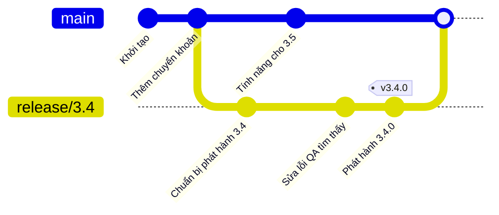
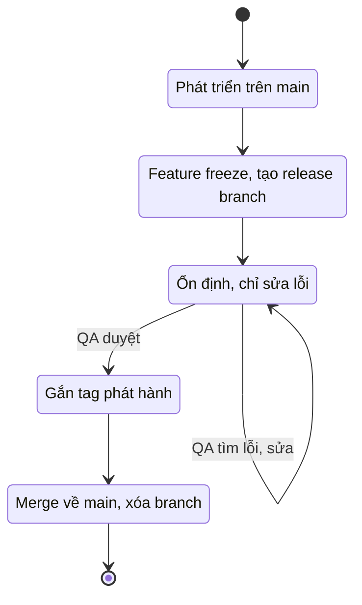

## Bạn sẽ học được gì

- Hiểu vì sao nhóm tách một release branch thay vì phát hành thẳng từ `main`.
- Tạo release branch từ đúng điểm xuất phát và đặt tên theo quy ước.
- Biết những gì được và không được commit vào release branch trong giai đoạn ổn định.
- Kết thúc release branch: gắn tag, đưa bản sửa về nhánh phát triển, dọn branch.

## Khái niệm

Hãy hình dung tuần cuối trước khi phát hành bản 3.4. Đội phát triển muốn tiếp tục đưa tính năng cho bản 3.5 vào `main`. Đội QA thì cần một bản mã **đứng yên** để chạy regression: nếu `main` thay đổi mỗi giờ, kết quả test sáng nay không còn ý nghĩa vào chiều. Hai nhu cầu này xung đột nếu mọi người cùng làm trên một branch.

**Release branch** tách hai luồng ra. Đến thời điểm "đóng băng tính năng" (feature freeze), nhóm tạo một branch từ `main`, ví dụ `release/3.4`. Từ lúc đó:

- `main` tiếp tục nhận tính năng mới cho bản sau.
- `release/3.4` chỉ nhận những thứ phục vụ việc phát hành: sửa lỗi QA tìm thấy, cập nhật số phiên bản, ghi chú phát hành, chỉnh cấu hình. Không thêm tính năng mới.

Về kỹ thuật, release branch chẳng có gì đặc biệt: nó là một branch bình thường. Cái làm nên nó là **quy ước** của nhóm: tên có tiền tố thống nhất, điểm xuất phát rõ ràng, luật commit chặt hơn và vòng đời có kết thúc. Tiền tố `release/` theo sau là số phiên bản (ví dụ `release/3.4`) là quy ước phổ biến, giúp người và công cụ nhận ra ngay vai trò của branch; nhiều hệ thống CI hay quy tắc bảo vệ branch còn khớp theo mẫu `release/*`. Dấu `/` trong tên branch hoàn toàn hợp lệ; Git lưu nó như thư mục con trong `refs/heads/`.

Điểm xuất phát rất quan trọng. Bạn tạo release branch từ commit mà nhóm đã đồng ý là đủ tính năng cho bản phát hành, thường là đầu `main` tại thời điểm freeze. Nếu đang đứng ở `main` thì `git switch -c release/3.4` là đủ; ghi rõ điểm xuất phát (`git switch -c release/3.4 main`) giúp tránh nhầm khi bạn đang ở branch khác.

Trong giai đoạn ổn định, mỗi bản sửa trên release branch cũng cần về lại `main`, nếu không bản 3.5 sẽ mang lại lỗi đã sửa ở 3.4. Có hai cách phổ biến: merge release branch về `main` định kỳ hoặc lúc kết thúc, hoặc sửa trên `main` trước rồi cherry-pick sang release branch. Nhóm chọn một cách và giữ nhất quán.

Khi QA ký duyệt, commit cuối của release branch được gắn annotated tag (ví dụ `v3.4.0`), đó chính là bản được triển khai. Sau khi các thay đổi đã về `main`, branch có thể xóa; tag giữ lại dấu vết vĩnh viễn. Một số nhóm giữ release branch lâu hơn để làm bản vá cho phiên bản đó, nhưng cách xử lý sự cố khẩn trên bản đã phát hành có bài riêng ngay sau bài này.

## Hình dung bằng sơ đồ





## Lệnh cần biết

```bash
git switch -c release/3.4 main          # tạo release branch từ main và chuyển sang
git branch --show-current               # chắc chắn đang ở đâu
git branch --list 'release/*'           # liệt kê các release branch
git log --oneline main..release/3.4     # commit chỉ có trên release branch
git ls-tree --name-only <branch>        # tệp có trong commit đầu của một branch
git cat-file -e main:<tệp>              # thành công nếu main có tệp đó
git tag -a v3.4.0 -m "Phát hành 3.4.0"  # đánh dấu bản phát hành
git merge --no-ff release/3.4           # đưa bản sửa về main (đứng ở main)
git branch -d release/3.4               # xóa branch đã merge
```

| Được commit vào release branch | Không nên |
| --- | --- |
| Sửa lỗi do QA tìm thấy | Tính năng mới |
| Số phiên bản, ghi chú phát hành | Refactor lớn |
| Cấu hình phát hành | Nâng cấp thư viện không cần thiết |

## Ví dụ từng bước

Repository có hai commit trên `main`. Đến lúc freeze bản 3.4 (object ID ở máy bạn sẽ khác):

```bash
git switch -c release/3.4
git branch --show-current
echo "3.4.0-rc.1" > VERSION
git add VERSION
git commit -qm "Chuẩn bị phát hành 3.4"
```

```text
Switched to a new branch 'release/3.4'
release/3.4
```

Đội phát triển tiếp tục trên `main`, còn QA tìm ra một lỗi trên bản 3.4 và được sửa trên release branch:

```bash
git switch -q main
echo "tinh nang moi" > next.txt; git add .; git commit -qm "Bắt đầu tính năng cho 3.5"
git switch -q release/3.4
echo "sua loi hien thi" >> app.txt; git commit -qam "Sửa lỗi hiển thị số dư trên bản 3.4"
git log --oneline --graph --all
```

```text
* c76256e Bắt đầu tính năng cho 3.5
| * f58cc39 Sửa lỗi hiển thị số dư trên bản 3.4
| * 366e462 Chuẩn bị phát hành 3.4
|/
* 7da9aab Thêm chuyển khoản
* 9261644 Khởi tạo
```

Kiểm tra hai luồng thật sự tách biệt: tệp `VERSION` chỉ có trên release branch.

```bash
git cat-file -e main:VERSION 2>/dev/null || echo "main chưa có VERSION"
git ls-tree --name-only release/3.4
git log --oneline main..release/3.4
```

```text
main chưa có VERSION
VERSION
app.txt
f58cc39 Sửa lỗi hiển thị số dư trên bản 3.4
366e462 Chuẩn bị phát hành 3.4
```

QA duyệt. Chốt số phiên bản, gắn tag, đưa thay đổi về `main` và dọn branch:

```bash
echo 3.4.0 > VERSION; git commit -qam "Phát hành 3.4.0"
git tag -a v3.4.0 -m "Phát hành 3.4.0"
git switch -q main
git merge --no-ff -q release/3.4 -m "Merge release/3.4 về main"
git log --oneline --graph | head -8
git branch -d release/3.4
```

```text
*   9d7919b Merge release/3.4 về main
|\
| * d26f33b Phát hành 3.4.0
| * f58cc39 Sửa lỗi hiển thị số dư trên bản 3.4
| * 366e462 Chuẩn bị phát hành 3.4
* | c76256e Bắt đầu tính năng cho 3.5
|/
* 7da9aab Thêm chuyển khoản
Deleted branch release/3.4 (was d26f33b).
```

Trong dự án thật, merge này có thể gặp conflict (ví dụ cả hai bên cùng sửa tệp phiên bản); xử lý như conflict merge bình thường.

## Lỗi thường gặp

**Tạo release branch từ sai chỗ.** Đang đứng ở một feature branch rồi chạy `git switch -c release/...` sẽ kéo cả tính năng dở vào bản phát hành. Ghi rõ điểm xuất phát trong lệnh và xem lại bằng `git log --oneline -3`.

**Commit nhầm lên `main` thay vì release branch, hoặc ngược lại.** Luôn kiểm tra `git branch --show-current` trước khi commit. Nếu commit nhầm và chưa push, cherry-pick sang đúng branch rồi bỏ commit ở branch sai.

> **Cẩn thận** Quên đưa bản sửa của release branch về `main` là lỗi kinh điển: bản phát hành sau mang lại đúng lỗi đã sửa. Đặt việc merge về `main` thành một bước bắt buộc trong checklist phát hành.

**Để tính năng mới lọt vào release branch.** Mỗi thay đổi thêm vào giai đoạn ổn định là thêm rủi ro và thêm vòng test. Tính năng trễ hẹn chờ bản sau.

**Tên branch không theo quy ước.** `rel-3.4`, `release3.4`, `Release/3.4` làm vỡ các quy tắc CI và bảo vệ branch khớp theo mẫu. Thống nhất một tiền tố cho cả nhóm.

> **Mẹo** `git branch --list 'release/*'` liệt kê nhanh mọi release branch còn mở; nếu có quá nhiều, có thể nhóm đang quên dọn.

## Áp dụng trong công việc

Ứng dụng ngân hàng di động phát hành hai tuần một lần. Thứ hai tuần thứ hai, trưởng nhóm tạo `release/3.4` từ `main`; pipeline tự build bản `rc` từ mọi branch khớp `release/*` và đẩy lên môi trường UAT. QA chạy regression trên bản đó, ghi bug kèm tên branch. Lập trình viên sửa trên release branch, mỗi bản sửa sinh build `rc` mới. Khi QA duyệt, tag `v3.4.0` được gắn và release branch merge về `main`, trong khi đội còn lại vẫn đưa tính năng 3.5 vào `main` suốt hai tuần mà không làm xáo trộn đợt test.

## Chuẩn bị làm bài

Bài thực hành cho bạn một repository chỉ có `main`. Bạn cần tạo release branch cho phiên bản mà đề bài nêu, theo đúng quy ước tiền tố, rồi commit một tệp ghi chú phát hành trên branch đó. Trình kiểm tra so **chính xác** tên branch, tên tệp và nội dung tệp, đồng thời xác nhận `main` không có tệp đó và working tree sạch. Câu hỏi kiến thức hỏi về tiền tố tên branch phù hợp. Hãy:

- Đọc kỹ đề bài bằng `git-training status` (hoặc trong bảng học) và chép đúng tên tệp và nội dung yêu cầu, kể cả dấu tiếng Việt.
- Kiểm tra mình đang ở branch mới bằng `git branch --show-current` trước khi commit.
- Sau khi commit, xác nhận `main` chưa có tệp đó (như ví dụ `git cat-file -e` ở trên) và `git status --short` trống.

## Tóm tắt

- Release branch tách phần mã đã freeze để ổn định, trong khi `main` tiếp tục nhận tính năng.
- Tạo từ đúng điểm freeze, đặt tên theo quy ước như `release/<phiên bản>`.
- Trong giai đoạn ổn định chỉ commit sửa lỗi và việc phục vụ phát hành.
- Kết thúc bằng annotated tag cho bản phát hành và đưa bản sửa về `main`.
- Về kỹ thuật đây là branch bình thường; giá trị nằm ở quy ước của nhóm.
