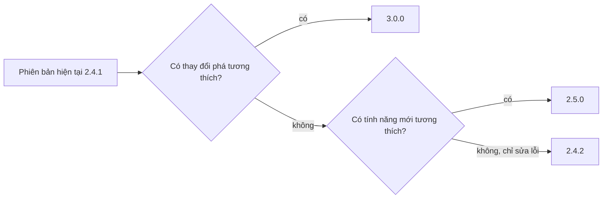
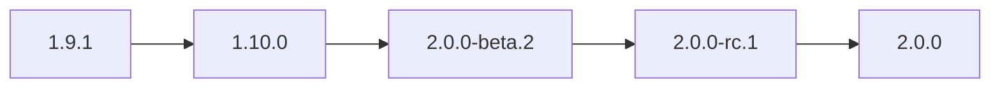

## Bạn sẽ học được gì

- Đọc được một số phiên bản dạng `MAJOR.MINOR.PATCH` và biết mỗi phần hứa hẹn điều gì.
- Quyết định nên tăng phần nào khi phát hành, và phần nào phải đặt lại về 0.
- Hiểu nhãn pre-release như `-rc.1` và metadata build dạng `+...`.
- Sắp xếp tag phiên bản đúng thứ tự trong Git thay vì theo chữ cái.

## Khái niệm

Số phiên bản không chỉ để đếm. Với một thư viện, một API hay một ứng dụng mà người khác phụ thuộc vào, số phiên bản là **lời hứa** về mức độ an toàn khi nâng cấp. Semantic Versioning (gọi tắt semver) chuẩn hóa lời hứa đó bằng ba con số `MAJOR.MINOR.PATCH`:

- **PATCH** tăng khi bạn chỉ sửa lỗi, không đổi cách dùng. Người dùng nâng cấp mà không phải sửa gì.
- **MINOR** tăng khi bạn thêm tính năng mới nhưng vẫn tương thích ngược: mọi cách dùng cũ vẫn chạy.
- **MAJOR** tăng khi có thay đổi phá tương thích: xóa hay đổi tên API, đổi định dạng dữ liệu, đổi hành vi mà người dùng cũ dựa vào.

Có một quy tắc đi kèm hay bị quên: khi tăng một phần, **mọi phần bên phải đặt lại về 0**. Từ `2.4.1`, sửa lỗi cho ra `2.4.2`; thêm tính năng tương thích cho ra `2.5.0` (PATCH về 0); phá tương thích cho ra `3.0.0` (MINOR và PATCH về 0). Một bản phát hành gộp cả sửa lỗi lẫn tính năng mới thì tính theo thay đổi "nặng" nhất: có tính năng tương thích thì tăng MINOR; có thay đổi phá tương thích thì tăng MAJOR.

Mỗi phần là số nguyên, so sánh theo giá trị số chứ không phải chữ. `1.10.0` mới hơn `1.9.1`, dù khi sắp xếp như chuỗi ký tự thì `1.10` đứng trước `1.9`. Đây là chỗ Git cần được nhắc, như phần lệnh bên dưới.

Thêm hai phần mở rộng:

- **Pre-release**: hậu tố sau dấu gạch ngang, ví dụ `3.0.0-beta.2` hay `3.0.0-rc.1`. Bản pre-release luôn đứng **trước** bản chính thức cùng số, và không hứa hẹn ổn định. Đội QA thường test trên các bản `rc` (release candidate).
- **Build metadata**: hậu tố sau dấu cộng, ví dụ `3.0.0+build.57`. Phần này chỉ để thông tin và không ảnh hưởng thứ tự.

Giai đoạn `0.y.z` là đặc biệt: theo semver, khi MAJOR còn là 0 thì dự án đang phát triển ban đầu và API có thể đổi bất kỳ lúc nào. Phiên bản `1.0.0` là lúc bạn tuyên bố API công khai đã ổn định.

Còn Git liên quan gì? Git không hiểu semver; nó chỉ lưu tag. Quy ước phổ biến là đặt tag `v` cộng số phiên bản, ví dụ `v2.5.0`. Chữ `v` là quy ước đặt tên tag, không phải một phần của số semver. Git có chế độ sắp xếp theo phiên bản giúp danh sách tag hiện đúng thứ tự, và commit message có cấu trúc (như Conventional Commits với `feat:`, `fix:`, dấu `!` cho thay đổi phá tương thích) giúp công cụ tự đề xuất bước tăng tiếp theo.

Điều quan trọng nhất: semver chỉ có giá trị khi nhóm thật sự giữ lời hứa. Đổi hành vi API trong một bản PATCH là phá vỡ lòng tin của người dùng, dù về kỹ thuật chỉ là "sửa lỗi".

## Hình dung bằng sơ đồ



Thứ tự trước sau của một chuỗi phát hành, kể cả pre-release:



## Lệnh cần biết

```bash
git tag -l                                  # sắp theo chữ cái, dễ sai thứ tự
git tag --sort=v:refname                    # sắp theo phiên bản
git tag --sort=-v:refname                   # mới nhất lên đầu
git -c versionsort.suffix=- tag --sort=v:refname   # coi hậu tố sau dấu gạch là pre-release
git describe --tags --abbrev=0              # tag gần nhất của HEAD
git log --oneline <tag>..HEAD               # các commit kể từ bản trước
```

| Loại thay đổi | Phần tăng | Phần đặt về 0 | Ví dụ từ 2.4.1 |
| --- | --- | --- | --- |
| Sửa lỗi tương thích | PATCH | Không có | 2.4.2 |
| Tính năng mới tương thích | MINOR | PATCH | 2.5.0 |
| Phá tương thích | MAJOR | MINOR, PATCH | 3.0.0 |
| Bản thử trước khi phát hành | Thêm hậu tố | Không có | 3.0.0-rc.1 |

Thay vì gõ `-c` mỗi lần, bạn có thể đặt `versionsort.suffix` và `tag.sort` trong config của repository.

## Ví dụ từng bước

Một repository có các tag sau. Liệt kê mặc định sắp theo chữ cái:

```bash
git tag -l
```

```text
v1.10.0
v1.2.0
v1.9.1
v2.0.0
v2.0.0-beta.2
v2.0.0-rc.1
```

`v1.10.0` đứng trước `v1.2.0` và bản chính thức đứng trước bản beta: sai với semver. Sắp theo phiên bản:

```bash
git tag --sort=v:refname
```

```text
v1.2.0
v1.9.1
v1.10.0
v2.0.0
v2.0.0-beta.2
v2.0.0-rc.1
```

Phần số đã đúng, nhưng Git vẫn coi `-beta.2` là "đuôi thêm" nên đặt sau `v2.0.0`. Báo cho Git biết hậu tố sau dấu gạch là pre-release:

```bash
git -c versionsort.suffix=- tag --sort=v:refname
git -c versionsort.suffix=- tag --sort=-v:refname | head -1
```

```text
v1.2.0
v1.9.1
v1.10.0
v2.0.0-beta.2
v2.0.0-rc.1
v2.0.0
v2.0.0
```

Dòng cuối là bản mới nhất khi sắp giảm dần. Giờ thứ tự khớp semver. Từ đây, quyết định số tiếp theo là việc của bạn: xem các commit kể từ tag cuối, xếp loại từng thay đổi, rồi áp quy tắc tăng và đặt về 0.

## Lỗi thường gặp

**Quên đặt lại phần bên phải.** Từ `2.4.1` thêm tính năng mà ghi `2.5.1` là sai; PATCH phải về 0. Tương tự, lên MAJOR thì MINOR và PATCH đều về 0.

**Giấu thay đổi phá tương thích trong bản MINOR hay PATCH.** Ví dụ đổi tên một trường JSON trong response API rồi gọi là "sửa lỗi". Hệ thống đối tác tự nâng cấp và gãy. Nếu người dùng phải sửa code để chạy tiếp, đó là MAJOR.

> **Cẩn thận** Một khi đã phát hành và gắn tag một số phiên bản, đừng phát hành lại nội dung khác dưới cùng số đó. Có lỗi thì ra số mới.

**Sắp xếp tag như chuỗi ký tự.** Script lấy "tag mới nhất" bằng `git tag | tail -1` sẽ sai khi có `v1.10.0` và `v1.9.1`. Dùng `--sort=-v:refname` hoặc `git describe`.

**Coi `0.y.z` như bản ổn định.** Ở giai đoạn này semver cho phép thay đổi bất kỳ; nếu đã có người dùng thật phụ thuộc vào API, hãy cân nhắc lên `1.0.0`.

> **Mẹo** Nếu nhóm dùng Conventional Commits, `feat:` gợi ý tăng MINOR, `fix:` gợi ý tăng PATCH, còn `!` sau type hoặc footer `BREAKING CHANGE:` gợi ý tăng MAJOR.

## Áp dụng trong công việc

Đội bạn duy trì một thư viện client gọi API tài khoản, dùng chung cho ba ứng dụng. Bản sắp phát hành có một bản sửa timeout và một hàm mới để lấy lịch sử giao dịch theo trang, không đổi hàm nào cũ. Khi review release, bạn đối chiếu danh sách commit từ tag trước: không có thay đổi phá tương thích, có tính năng mới, nên tăng MINOR và đặt PATCH về 0. Các ứng dụng khác nâng cấp yên tâm vì lời hứa của semver được giữ. Trước bản chính thức, QA chạy regression trên bản `-rc.1`.

## Chuẩn bị làm bài

Đây là bài câu hỏi, không có thao tác bắt buộc trên repository. Câu hỏi cho một phiên bản hiện tại và mô tả loại thay đổi, bạn cần đưa ra số phiên bản tiếp theo. Hãy:

- Xác định thay đổi thuộc loại nào: sửa lỗi, tính năng tương thích hay phá tương thích.
- Tăng đúng phần tương ứng và nhớ đặt các phần bên phải về 0.
- Trả lời bằng số phiên bản; tiền tố `v` theo quy ước tag cũng được chấp nhận.

## Tóm tắt

- Semver dùng `MAJOR.MINOR.PATCH` như lời hứa về độ an toàn khi nâng cấp.
- PATCH cho sửa lỗi, MINOR cho tính năng tương thích, MAJOR cho thay đổi phá tương thích.
- Tăng một phần thì đặt mọi phần bên phải về 0.
- Pre-release như `-rc.1` đứng trước bản chính thức; metadata `+...` không ảnh hưởng thứ tự.
- Trong Git, dùng `--sort=v:refname` và `versionsort.suffix` để sắp tag đúng thứ tự phiên bản.
