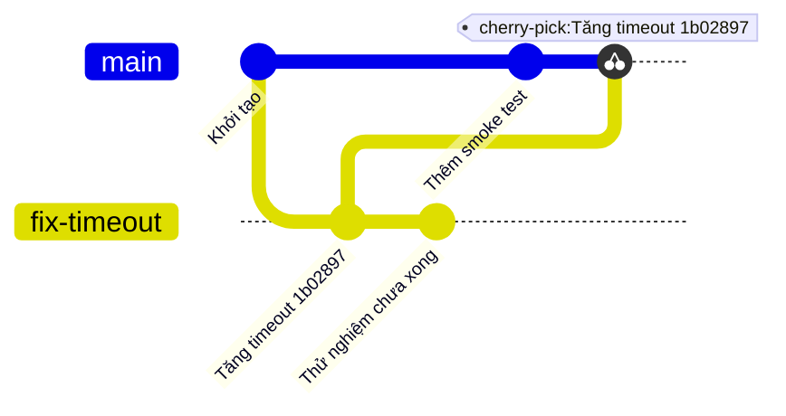
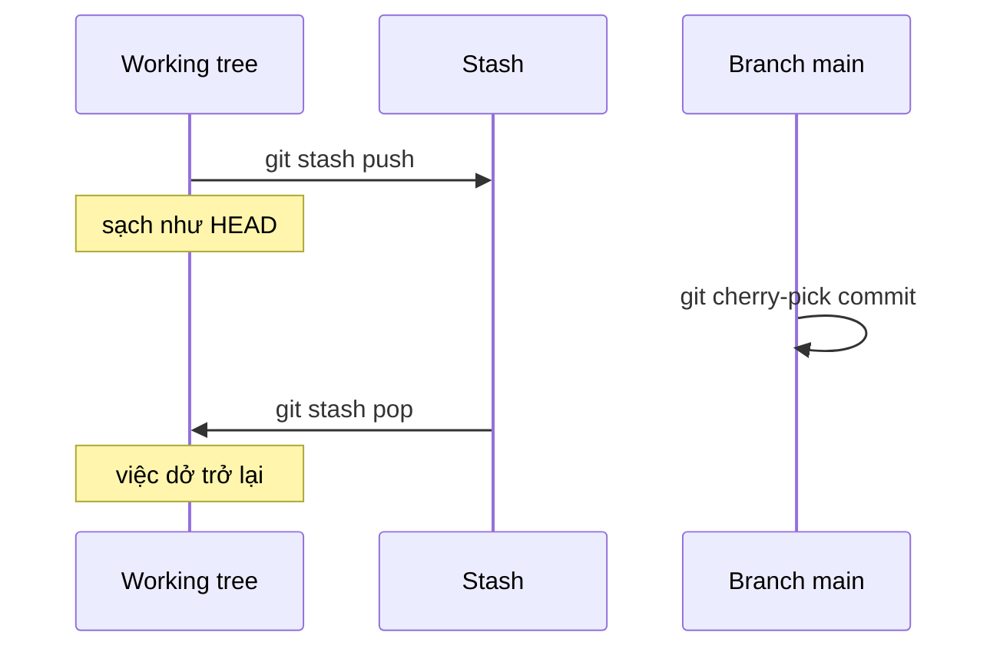

## Bạn sẽ học được gì

- Dùng stash để cất tạm việc đang dở và lấy lại sau, không cần commit nháp.
- Hiểu cherry-pick làm gì: chép thay đổi của một commit thành commit mới trên branch hiện tại.
- Kết hợp hai lệnh khi cần nhặt một bản sửa giữa lúc working tree đang bẩn.
- Xử lý khi cherry-pick dừng vì conflict và khi stash không cất tệp mới.

## Khái niệm

Hai lệnh trong bài này hay đi cùng nhau trong ngày phát hành, dù chúng giải quyết hai việc khác nhau.

**Stash** là một cái kệ tạm. Bạn đang sửa dở vài tệp, chưa đến lúc commit, nhưng cần working tree sạch để làm việc khác. `git stash push` lấy các thay đổi của tệp đang được theo dõi (cả phần đã stage lẫn chưa stage), cất vào một ngăn xếp riêng, rồi đưa working tree và index về đúng như HEAD. Khi xong việc kia, `git stash pop` áp thay đổi trở lại và bỏ mục đó khỏi ngăn xếp. Nếu muốn áp mà vẫn giữ mục trong ngăn xếp, dùng `git stash apply`.

Bên trong, mỗi mục stash thực chất là vài commit đặc biệt mà ref `refs/stash` trỏ tới, không nằm trên branch nào. Vì vậy stash là của riêng repository bạn, không được push, và danh sách xem bằng `git stash list` với tên dạng `stash@{0}`, `stash@{1}`, số nhỏ nhất là mới nhất.

Hai điều cần nhớ về stash. Thứ nhất, mặc định nó **không cất tệp untracked** (tệp mới chưa từng add); muốn cất cả chúng, thêm `-u`. Thứ hai, stash không gắn với branch: bạn cất ở `main` rồi pop ở branch khác cũng được, miễn không đụng nhau.

**Cherry-pick** trả lời câu hỏi "tôi chỉ muốn đúng một bản sửa đó, không muốn cả branch". Khi bạn đứng trên một branch và chạy `git cherry-pick <commit>`, Git tính thay đổi mà commit đó mang so với parent của nó, áp thay đổi ấy lên HEAD hiện tại, rồi tạo một **commit mới** với cùng thông điệp và tác giả. Commit mới có parent khác nên object ID khác commit gốc. Branch nguồn không bị ảnh hưởng gì.

Tùy chọn `-x` thêm dòng `(cherry picked from commit ...)` vào thông điệp, giúp sau này lần ra nguồn gốc. Nhiều nhóm bắt buộc `-x` khi chép bản sửa sang branch phát hành.

Vì sao hai lệnh hay đi chung? Cherry-pick cần working tree đủ sạch để áp thay đổi an toàn. Nếu bạn đang dở tay, Git có thể từ chối hoặc conflict sẽ lẫn với việc dở của bạn. Quy trình gọn là: cất việc dở, nhặt commit, lấy việc dở ra lại.

Khi thay đổi được chép đụng vào chỗ mà branch hiện tại cũng đã sửa khác đi, cherry-pick dừng với conflict, giống merge. Bạn sửa tệp, `git add`, rồi `git cherry-pick --continue`; hoặc `git cherry-pick --abort` để trở về như trước.

## Hình dung bằng sơ đồ

Cherry-pick chép commit "Tăng timeout" sang `main` dưới dạng commit mới, bỏ lại commit thử nghiệm:



Trình tự cất, nhặt, lấy lại:



## Lệnh cần biết

```bash
git stash push -m "mô tả"     # cất thay đổi của tệp đã theo dõi
git stash push -u             # cất cả tệp untracked
git stash list                # xem các mục đã cất
git stash show -p stash@{0}   # xem nội dung một mục
git stash pop                 # áp mục mới nhất và bỏ khỏi danh sách
git stash apply stash@{1}     # áp nhưng giữ lại mục
git stash drop stash@{0}      # bỏ một mục
git cherry-pick <commit>      # chép một commit lên HEAD
git cherry-pick -x <commit>   # chép và ghi nguồn vào thông điệp
git cherry-pick --continue    # tiếp tục sau khi sửa conflict
git cherry-pick --abort       # hủy, về trạng thái trước
```

| Lệnh | Giữ mục trong stash | Dùng khi |
| --- | --- | --- |
| `git stash pop` | Không | Lấy lại việc dở, xong là xong |
| `git stash apply` | Có | Muốn áp thử ở nhiều nơi hoặc còn phân vân |
| `git stash drop` | Không áp, chỉ bỏ | Mục không còn cần |

## Ví dụ từng bước

Branch `fix-timeout` có một commit sửa cần phát hành và một commit thử nghiệm chưa xong. Bạn đang ở `main`, sửa dở `README.md` (object ID ở máy bạn sẽ khác):

```bash
git status --short
git log --oneline fix-timeout
```

```text
 M README.md
dfff375 Thử nghiệm chưa xong
1b02897 Tăng timeout API lên 30 giây
95ee437 Khởi tạo
```

Cất việc dở:

```bash
git stash push -m "README dở"
git status --short
git stash list
```

```text
Saved working directory and index state On main: README dở
stash@{0}: On main: README dở
```

`git status --short` không in gì: working tree đã sạch. Nhặt đúng commit sửa timeout (commit thứ hai từ đầu branch, tức `fix-timeout~1`), có ghi nguồn:

```bash
git cherry-pick -x fix-timeout~1
git log --oneline
git log -1 --format=%B
```

```text
[main 9866e1e] Tăng timeout API lên 30 giây
 Date: Fri Oct 16 00:33:57 2026 +0700
 1 file changed, 1 insertion(+)
 create mode 100644 config.ini
9866e1e Tăng timeout API lên 30 giây
94be5c8 Thêm smoke test
95ee437 Khởi tạo
Tăng timeout API lên 30 giây

(cherry picked from commit 1b02897cf76464023f8f89643e8a2f6da7170f50)
```

Commit mới `9866e1e` khác `1b02897` vì parent khác. Lấy việc dở trở lại:

```bash
git stash pop
git status --short
git stash list
```

```text
Dropped refs/stash@{0} (a1c8194b601b3d6e37610e0ab4972b7bedbc2b4e)
 M README.md
```

(Đầu ra của `git stash pop` còn có phần `git status` dài, mình đã lược.) `git stash list` trống: mục đã được dùng và bỏ đi.

Khi thay đổi cần chép đụng vào chỗ branch hiện tại cũng đã sửa khác, Git dừng lại (đã lược phần hint):

```text
Auto-merging config.ini
CONFLICT (add/add): Merge conflict in config.ini
error: could not apply 9866e1e... Tăng timeout API lên 30 giây
```

## Lỗi thường gặp

**Tưởng stash cất cả tệp mới.** Nếu chỉ có tệp untracked, `git stash push` báo `No local changes to save` và không làm gì. Dùng `git stash push -u` để cất cả chúng.

**`git stash pop` bị conflict.** Khi thay đổi cất đụng với thay đổi mới trên HEAD, pop dừng với conflict và **giữ lại** mục trong danh sách. Sửa conflict, `git add`, rồi `git stash drop` khi chắc đã ổn.

> **Cẩn thận** Đổi branch khi đang dở tay đôi khi vẫn thành công: Git mang thay đổi chưa commit sang branch mới nếu không đụng nhau. Bạn có thể vô tình commit việc dở lên nhầm branch. Cất vào stash trước khi đổi branch là thói quen an toàn.

**Cherry-pick nhầm commit hoặc chép cả commit thử nghiệm.** Xem kỹ `git log --oneline <branch>` và dùng đúng object ID hay biểu thức như `<branch>~1`. Nếu đã chép nhầm và chưa push, `git reset --hard HEAD~1` bỏ commit vừa tạo (chỉ khi working tree không có gì cần giữ).

**Cherry-pick bừa bãi giữa hai branch còn sẽ merge.** Cùng một thay đổi xuất hiện hai lần dưới hai object ID khác nhau, dễ sinh conflict khó hiểu về sau. Dùng cherry-pick cho bản sửa nhỏ, có chủ đích, và ghi `-x`.

> **Mẹo** Đặt tên cho stash bằng `-m`. Một tuần sau nhìn `stash@{3}: WIP on main` bạn sẽ không nhớ nó là gì.

## Áp dụng trong công việc

Bạn đang viết dở bộ test cho màn hình sao kê thì trưởng nhóm báo: bản sửa timeout trên `fix-timeout` phải vào build tối nay, nhưng commit thử nghiệm phía sau chưa được duyệt. Bạn cất bộ test dở, cherry-pick đúng commit sửa với `-x`, chạy smoke test, rồi lấy bộ test dở ra làm tiếp. Không có commit nháp nào lọt vào lịch sử, và bản sửa có dấu vết về commit gốc.

## Chuẩn bị làm bài

Trong bài thực hành, bạn đứng ở `main` với một tệp đang sửa dở, và có một branch khác chứa commit cần lấy. Bạn phải đưa thay đổi của commit đó vào HEAD hiện tại, đồng thời giữ nguyên việc dở: cuối bài, tệp đang sửa vẫn ở trạng thái modified chưa stage và danh sách stash phải trống. Câu hỏi kiến thức hỏi về lệnh chép commit từ branch khác. Hãy:

- Xem `git status --short` và `git log --oneline --all` trước khi bắt đầu.
- Nghĩ xem lệnh nào lấy lại việc dở **và** dọn mục khỏi danh sách stash.
- Kết thúc bằng `git stash list` và `git status --short` để tự kiểm tra.

## Tóm tắt

- Stash cất thay đổi chưa commit vào ngăn xếp riêng và làm sạch working tree.
- `pop` áp và bỏ mục; `apply` áp nhưng giữ; `-u` cất cả tệp untracked.
- Cherry-pick chép thay đổi của một commit thành commit mới trên branch hiện tại.
- `-x` ghi nguồn gốc vào thông điệp, hữu ích khi chép bản sửa sang branch phát hành.
- Conflict khi cherry-pick xử lý bằng sửa, `git add`, `--continue` hoặc `--abort`.
