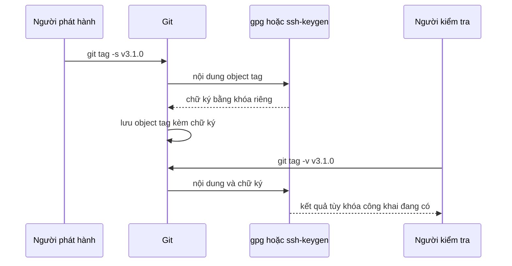
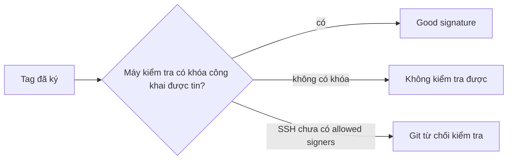

## Bạn sẽ học được gì

- Hiểu chữ ký trên tag chứng minh điều gì và không chứng minh điều gì.
- Ký một annotated tag bằng khóa GPG hoặc khóa SSH và kiểm tra lại chữ ký.
- Biết vì sao cùng một tag lại "Good signature" ở máy này nhưng không kiểm được ở máy khác.
- Thử nghiệm an toàn với khóa dùng một lần, không đụng tới khóa và cấu hình thật.

## Khái niệm

Tên người gắn tag trong object tag chỉ là chữ do cấu hình `user.name` và `user.email` sinh ra. Ai cũng có thể đặt tên mình là trưởng nhóm phát hành rồi gắn tag `v4.0.0`. Khi tag là căn cứ để triển khai lên production, nhóm cần một bằng chứng mạnh hơn: **chữ ký số**.

Ký tag dựa trên cặp khóa. Bạn giữ khóa riêng (private key) và công bố khóa công khai (public key). Khi chạy `git tag -s`, Git tạo một annotated tag như bình thường, rồi nhờ chương trình ký (mặc định là `gpg`, hoặc `ssh-keygen` nếu bạn chọn định dạng SSH) tính chữ ký trên nội dung object tag bằng khóa riêng. Chữ ký được nối vào cuối thông điệp của object tag. Vì object tag chứa ID của commit đích, mà ID commit lại phụ thuộc vào toàn bộ cây tệp và lịch sử phía sau, nên một chữ ký hợp lệ ràng buộc cả bản mã được phát hành.

Khi kiểm tra bằng `git tag -v`, Git đưa nội dung và chữ ký cho chương trình kiểm tra. Kết quả chỉ có ý nghĩa nếu máy kiểm tra **có khóa công khai và tin khóa đó** thuộc về đúng người. Đây là chỗ hay gây nhầm lẫn:

- Chữ ký hợp lệ chứng minh: nội dung tag không bị sửa từ lúc ký, và người ký nắm khóa riêng tương ứng.
- Nó không tự chứng minh khóa đó là của ai. Việc gắn khóa với một con người là chuyện của quy trình: keyring GPG được xác minh, danh sách allowed signers cho SSH, hoặc nền tảng hosting lưu khóa của tài khoản.

Vì vậy, đầu ra của lệnh kiểm tra **phụ thuộc hoàn toàn vào thiết lập khóa ở máy chạy lệnh**. Cùng một tag, máy có khóa công khai thì báo chữ ký tốt; máy không có thì báo không kiểm tra được; nếu là SSH mà chưa cấu hình tệp allowed signers thì Git từ chối kiểm tra.

Một số điểm cấu hình:

- `user.signingKey` chọn khóa: với GPG là key ID, với SSH là đường dẫn tệp khóa công khai.
- `gpg.format` là `openpgp` (mặc định) hoặc `ssh`.
- `gpg.ssh.allowedSignersFile` trỏ tới tệp liệt kê email và khóa SSH công khai được tin.
- `tag.gpgSign = true` khiến mọi annotated tag đều được ký.
- `git tag -u <key>` ký bằng một khóa cụ thể thay vì khóa cấu hình.

> **Lưu ý** Trong ứng dụng luyện tập, bài này được **mô phỏng**: đây là bài câu hỏi, trình kiểm tra không tạo khóa thật, không gọi `gpg` hay dịch vụ nào. Các ví dụ dưới đây được chạy bằng khóa dùng một lần trong thư mục `/tmp`, để bạn thấy đầu ra thật nếu muốn tự thử.

## Hình dung bằng sơ đồ





## Lệnh cần biết

```bash
git tag -s <tên> -m "Thông điệp"      # tạo annotated tag có chữ ký
git tag -u <key> <tên> -m "..."       # ký bằng một khóa cụ thể
git tag -v <tên>                      # kiểm tra chữ ký của tag
git cat-file -p <tên>                 # xem object tag, chữ ký nằm cuối
git config user.signingKey <key>      # chọn khóa ký
git config gpg.format ssh             # dùng khóa SSH thay vì GPG
git config gpg.ssh.allowedSignersFile <tệp>   # danh sách khóa SSH được tin
git config tag.gpgSign true           # luôn ký annotated tag
```

| Tùy chọn của `git tag` | Ý nghĩa |
| --- | --- |
| `-a` | Annotated tag, không ký |
| `-s` | Annotated tag có chữ ký bằng khóa mặc định |
| `-u <key>` | Annotated tag có chữ ký bằng khóa chỉ định |
| `-v` | Kiểm tra chữ ký của tag có sẵn |

## Ví dụ từng bước

Mọi thứ dưới đây dùng khóa và cấu hình tạm, không chạm vào `~/.gnupg`, `~/.ssh` hay `~/.gitconfig` thật:

```bash
export GIT_CONFIG_GLOBAL=/tmp/rx-gitconfig     # config global tạm
export GNUPGHOME=/tmp/rx-gnupg                 # keyring GPG tạm
mkdir -m 700 "$GNUPGHOME"
gpg --batch --passphrase '' --quick-generate-key "Lan QA <lan@example.com>" ed25519 sign 1d
gpg --list-secret-keys --keyid-format=long
```

```text
sec   ed25519/93A0E043482C8D29 2026-10-15 [SC] [expires: 2026-10-16]
      56114CE12742BEF5B8BDBC1893A0E043482C8D29
uid                 [ultimate] Lan QA <lan@example.com>
```

Khóa không có passphrase và hết hạn sau một ngày, chỉ để thử. Ngày tạo hiển thị theo giờ UTC. Ký tag bằng khóa này rồi xem object tag (đã lược phần giữa chữ ký):

```bash
git config user.signingKey 93A0E043482C8D29
git tag -s v3.1.0 -m "Phát hành 3.1.0"
git cat-file -p v3.1.0
```

```text
object b576b6629172f41d775bfd78033dc415884223ba
type commit
tag v3.1.0
tagger Lan QA <lan@example.com> 1792085711 +0700

Phát hành 3.1.0
-----BEGIN PGP SIGNATURE-----
...
-----END PGP SIGNATURE-----
```

Kiểm tra ở chính máy có khóa (phần nội dung tag in kèm đã lược):

```bash
git tag -v v3.1.0
```

```text
gpg: Signature made Fri Oct 16 00:35:11 2026 +07
gpg:                using EDDSA key 56114CE12742BEF5B8BDBC1893A0E043482C8D29
gpg: Good signature from "Lan QA <lan@example.com>" [ultimate]
```

Chữ `[ultimate]` xuất hiện vì đây là khóa do chính keyring này tạo. Giờ giả lập một máy khác chưa có khóa công khai, bằng một `GNUPGHOME` trống:

```bash
GNUPGHOME=/tmp/rx-gnupg-empty git tag -v v3.1.0
```

```text
gpg: Signature made Fri Oct 16 00:35:11 2026 +07
gpg:                using EDDSA key 56114CE12742BEF5B8BDBC1893A0E043482C8D29
gpg: Can't check signature: No public key
```

Lệnh thoát với mã 1. Tag vẫn y nguyên; chỉ máy kiểm tra thiếu khóa. Một annotated tag không ký thì báo `error: no signature found`.

Cách làm với khóa SSH tạm:

```bash
ssh-keygen -q -t ed25519 -N '' -C "lan@example.com" -f /tmp/rx-ssh-key
echo "lan@example.com $(cat /tmp/rx-ssh-key.pub)" > /tmp/rx-allowed-signers
git config gpg.format ssh
git config user.signingKey /tmp/rx-ssh-key.pub
git tag -s v3.2.0 -m "Phát hành 3.2.0"
git tag -v v3.2.0
```

Nếu chưa đặt `gpg.ssh.allowedSignersFile`, Git từ chối:

```text
error: gpg.ssh.allowedSignersFile needs to be configured and exist for ssh signature verification
```

Sau khi chạy `git config gpg.ssh.allowedSignersFile /tmp/rx-allowed-signers`, kết quả là (dòng đầu, phần nội dung tag đã lược):

```text
Good "git" signature for lan@example.com with ED25519 key SHA256:JHZEkXBT+f6I4e9Jyw/fTEZ94AHobqHwjOTxTFhae4w
```

Dấu vân tay khóa ở máy bạn sẽ khác. Thử xong, xóa `/tmp/rx-gnupg`, `/tmp/rx-ssh-key*` và tệp config tạm.

## Lỗi thường gặp

**Kết luận tag giả vì máy mình báo "No public key".** Đó là thiếu khóa ở máy kiểm tra, không phải chữ ký sai. Lấy khóa công khai từ nguồn tin cậy của nhóm rồi kiểm tra lại.

**Tin vào "Good signature" mà không hỏi khóa của ai.** Kẻ xấu có thể ký bằng khóa riêng của họ với tên giả. Chỉ tin khi khóa nằm trong danh sách đã được nhóm xác minh.

> **Cẩn thận** Khi thử nghiệm, đừng sinh khóa vào `~/.gnupg` hay `~/.ssh` thật và đừng sửa `~/.gitconfig`. Dùng `GNUPGHOME`, `GIT_CONFIG_GLOBAL` và đường dẫn trong `/tmp` như ví dụ.

**Ký bằng `-s` mà Git báo không tìm thấy khóa bí mật.** `user.signingKey` trỏ sai, hoặc email trên khóa không khớp `user.email` khi không đặt `signingKey`. Kiểm tra bằng `gpg --list-secret-keys --keyid-format=long`.

**Nghĩ chữ ký bảo vệ được tag khỏi bị xóa hay dời.** Chữ ký chỉ chứng minh nội dung; ai có quyền push vẫn có thể xóa tag trên remote. Bảo vệ tag là việc của quyền truy cập trên server.

> **Mẹo** Thêm `-u <key>` khi bạn có nhiều khóa và muốn chắc chắn tag được ký bằng khóa phát hành, không phải khóa cá nhân.

## Áp dụng trong công việc

Pipeline triển khai của một hệ thống nội bộ chỉ cho phép đưa lên production những tag do nhóm phát hành ký. Bước đầu của pipeline chạy `git tag -v` với keyring chỉ chứa khóa công khai của ba người được ủy quyền; tag không ký hoặc ký bằng khóa lạ sẽ bị dừng. Với QA, điều này có nghĩa build bạn test trên UAT và build lên production có thể được đối chiếu bằng chữ ký và commit đích, không chỉ bằng tên tag.

## Chuẩn bị làm bài

Bài này là bài câu hỏi được mô phỏng: không cần tạo khóa, không cần chạy `gpg`. Câu hỏi hỏi về tùy chọn của `git tag` để tạo tag có chữ ký bằng khóa đã cấu hình. Hãy ôn lại bảng tùy chọn ở trên và phân biệt tùy chọn tạo annotated tag thường, tùy chọn ký bằng khóa mặc định, và tùy chọn ký bằng khóa chỉ định. Nếu muốn tự thử, làm theo phần ví dụ với khóa tạm trong `/tmp`.

## Tóm tắt

- Chữ ký tag chứng minh nội dung không đổi và người ký nắm khóa riêng.
- Ai sở hữu khóa là chuyện của quy trình tin cậy, không phải của chữ ký.
- `git tag -s` ký, `-u` chọn khóa, `git tag -v` kiểm tra.
- Kết quả kiểm tra phụ thuộc vào khóa công khai và allowed signers ở máy chạy lệnh.
- Thử nghiệm bằng khóa tạm trong `/tmp`; trong ứng dụng, bài này được mô phỏng.
