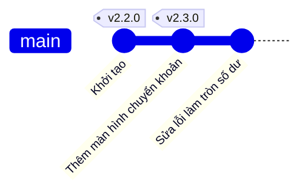
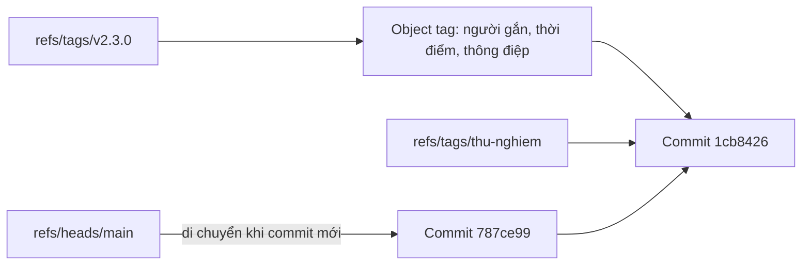

## Bạn sẽ học được gì

- Hiểu tag là gì và vì sao nó khác branch: tag đứng yên, branch di chuyển.
- Tạo, liệt kê, xem và xóa tag ở máy mình.
- Gắn tag vào HEAD hoặc vào một commit cũ hơn.
- Dùng tag để quay lại đúng mã đã phát hành và so sánh hai bản phát hành.

## Khái niệm

Mỗi commit đã có một object ID dài 40 ký tự, nhưng không ai muốn nói với đồng nghiệp "bản đang chạy trên UAT là `1cb8426f8d...`". Thứ mình cần là một cái tên dễ nhớ, gắn chặt vào đúng commit đó và không tự đổi theo thời gian. Đó là việc của **tag**.

Hãy so sánh với branch. Branch cũng là một cái tên trỏ tới commit, nhưng mỗi lần bạn commit trên branch, cái tên đó dời lên commit mới. Branch giống như dấu trang trong cuốn sổ bạn đang viết dở: nó luôn đi theo trang mới nhất. Tag thì giống cái nhãn dán lên một trang cụ thể: viết thêm bao nhiêu trang nữa, nhãn vẫn nằm ở đó. Vì vậy tag hợp để đánh dấu những thời điểm quan trọng: bản phát hành, bản giao cho đội test, mốc trước một đợt refactor lớn.

Về mặt lưu trữ, tag nằm trong không gian tên `refs/tags/`, tách biệt với branch ở `refs/heads/`. Git có hai kiểu tag:

- **Annotated tag**: Git tạo hẳn một object loại `tag` chứa người gắn tag, thời điểm và thông điệp, rồi ref `refs/tags/<tên>` trỏ tới object đó. Bạn tạo nó bằng `git tag -a <tên> -m "<thông điệp>"`.
- **Lightweight tag**: chỉ là một ref trỏ thẳng vào commit, không có thông tin gì thêm. Tạo bằng `git tag <tên>` không kèm tùy chọn.

Với bản phát hành, quy ước phổ biến là dùng annotated tag, vì nó ghi lại ai đánh dấu, lúc nào và tại sao. Bài sau trong track sẽ đào sâu sự khác nhau giữa hai kiểu này; ở bài này bạn chỉ cần nhớ: muốn tag có thông điệp và thông tin người gắn, hãy dùng `-a`.

Nếu không truyền commit, tag được gắn vào HEAD, tức commit bạn đang đứng. Muốn gắn vào commit khác, thêm tên commit hoặc ref vào cuối lệnh, ví dụ `HEAD~1` hoặc một object ID.

Một điểm quan trọng: tag mặc định **chỉ ở máy bạn**. `git push` thông thường không đẩy tag. Việc chia sẻ tag lên remote có bài riêng trong track remote; ở đây mình làm mọi thứ tại chỗ.

Cuối cùng, tag được coi là bất biến theo quy ước của nhóm. Git cho phép xóa và gắn lại (`git tag -d`, `git tag -f`), nhưng khi tag đã được người khác lấy về, đổi tag là gây rối. Nếu phát hành nhầm, hãy ra bản mới với số phiên bản mới thay vì dời tag cũ.

## Hình dung bằng sơ đồ

Tag đứng yên trong khi `main` tiến lên:



Annotated tag có thêm một object ở giữa ref và commit:



## Lệnh cần biết

```bash
git tag                          # liệt kê tag theo thứ tự chữ cái
git tag -l "v2.*"                # lọc tag theo mẫu
git tag -n                       # liệt kê kèm dòng đầu của thông điệp
git tag -a v2.3.0 -m "Thông điệp"   # annotated tag tại HEAD
git tag -a v2.2.0 -m "..." HEAD~1   # annotated tag tại một commit khác
git tag thu-nghiem               # lightweight tag tại HEAD
git show v2.3.0                  # xem object tag và commit đích
git rev-parse v2.3.0^{}          # lấy commit mà tag trỏ tới
git describe                     # mô tả HEAD dựa trên annotated tag gần nhất
git tag -d v2.3.0                # xóa tag ở máy mình
```

| Tùy chọn | Ý nghĩa |
| --- | --- |
| `-a` | Tạo annotated tag (object tag riêng) |
| `-m "<msg>"` | Thông điệp của tag, không mở editor |
| `-l "<mẫu>"` | Liệt kê tag khớp mẫu |
| `-n` | Hiện dòng thông điệp khi liệt kê |
| `-d` | Xóa tag cục bộ |
| `-f` | Ghi đè tag đã có (tránh dùng với tag đã chia sẻ) |

## Ví dụ từng bước

Repository có hai commit. Mình gắn annotated tag cho commit mới nhất và cho commit trước nó (object ID ở máy bạn sẽ khác):

```bash
git tag -a v2.3.0 -m "Phát hành 2.3.0 cho UAT"
git tag -a v2.2.0 -m "Phát hành 2.2.0" HEAD~1
git tag -n
git log --oneline --decorate
```

```text
v2.2.0          Phát hành 2.2.0
v2.3.0          Phát hành 2.3.0 cho UAT
1cb8426 (HEAD -> main, tag: v2.3.0) Thêm màn hình chuyển khoản
4a365fe (tag: v2.2.0) Khởi tạo
```

Kiểm tra tag thật sự trỏ về HEAD. Cú pháp `^{}` "bóc" object tag để lấy commit bên trong:

```bash
git rev-parse v2.3.0^{} HEAD
```

```text
1cb8426f8defc7f334c4a4e9016ada3cae3ff134
1cb8426f8defc7f334c4a4e9016ada3cae3ff134
```

Commit thêm một bản sửa. Branch `main` dời đi, tag thì không:

```bash
git commit -qam "Sửa lỗi làm tròn số dư"
git log --oneline --decorate -3
git describe
```

```text
787ce99 (HEAD -> main) Sửa lỗi làm tròn số dư
1cb8426 (tag: v2.3.0) Thêm màn hình chuyển khoản
4a365fe (tag: v2.2.0) Khởi tạo
v2.3.0-1-g787ce99
```

`git describe` đọc là: cách tag `v2.3.0` một commit, commit hiện tại là `787ce99`. Thử tạo lại tag trùng tên thì Git từ chối:

```text
fatal: tag 'v2.3.0' already exists
```

Muốn xem lại mã của bản cũ, checkout tag. HEAD sẽ ở trạng thái detached, vì tag không phải branch:

```bash
git checkout v2.2.0
git status | head -1
git switch main
git diff --stat v2.2.0 v2.3.0
```

```text
HEAD is now at 4a365fe Khởi tạo
HEAD detached at v2.2.0
 app.txt | 1 +
 1 file changed, 1 insertion(+)
```

## Lỗi thường gặp

**Quên `-a` và `-m`, tạo ra lightweight tag.** `git tag v2.3.0` chạy êm, nhưng tag không có thông điệp hay người gắn. Kiểm tra bằng `git cat-file -t v2.3.0`: kết quả `commit` nghĩa là lightweight, `tag` nghĩa là annotated. Sửa bằng cách xóa (`git tag -d`) rồi tạo lại với `-a`, khi tag chưa được chia sẻ.

**Gắn tag nhầm commit.** Bạn đang đứng sai branch hoặc chưa commit bản sửa cuối. Luôn xem `git log --oneline --decorate -3` trước khi gắn tag. Nếu nhầm và chưa push, xóa rồi gắn lại vào đúng commit.

> **Cẩn thận** Đừng dời hay xóa tag đã đẩy lên remote mà người khác đã lấy về. Máy họ vẫn giữ tag cũ và Git không tự cập nhật tag đã có. Hãy phát hành số phiên bản mới.

**Tưởng `git push` đã mang tag lên server.** Mặc định không. Tag cần được đẩy riêng; xem bài về đẩy tag trong track remote.

**Commit trên tag đã checkout.** Ở trạng thái detached HEAD, commit mới không thuộc branch nào và dễ thất lạc. Nếu cần sửa từ một bản cũ, tạo branch từ tag (track này có bài hotfix).

> **Mẹo** `git tag -n` cho bạn xem nhanh thông điệp của mọi tag, rất tiện khi cần trả lời "bản UAT tuần trước là bản nào".

## Áp dụng trong công việc

Đội QA nhận build mới cho UAT mỗi thứ năm. Trước khi bàn giao, bạn gắn annotated tag kiểu `v2.3.0` với thông điệp ghi rõ môi trường và phạm vi test. Khi có bug report từ UAT, người sửa checkout đúng tag đó để tái hiện, thay vì đoán xem lúc đó `main` đang ở commit nào. Hai tuần sau, `git diff --stat v2.2.0 v2.3.0` cho bạn danh sách tệp thay đổi giữa hai đợt test để khoanh vùng regression.

## Chuẩn bị làm bài

Bài thực hành cho bạn một repository có sẵn commit. Bạn cần gắn một annotated tag với tên phiên bản mà đề bài nêu, trỏ đúng vào HEAD, kèm thông điệp. Trình kiểm tra sẽ xác nhận tag là object loại tag (không phải lightweight) và đích của nó trùng HEAD. Câu hỏi kiến thức hỏi về lệnh tạo kiểu tag này. Trước khi làm:

- Chạy `git log --oneline --decorate` để biết HEAD đang ở đâu.
- Sau khi tạo, tự kiểm tra bằng `git cat-file -t <tên tag>` và `git rev-parse <tên tag>^{}`.
- Nhớ rằng thiếu thông điệp thì Git sẽ mở editor; dùng `-m` để tránh.

## Tóm tắt

- Tag là tên cố định cho một commit, không di chuyển khi branch tiến lên.
- Annotated tag (`git tag -a ... -m ...`) có object riêng với người gắn, thời điểm và thông điệp.
- Không ghi commit đích thì tag gắn vào HEAD.
- `git tag -n`, `git show`, `git describe` giúp đọc và dùng tag.
- Tag chỉ ở máy bạn cho tới khi đẩy riêng; đừng dời tag đã chia sẻ.
