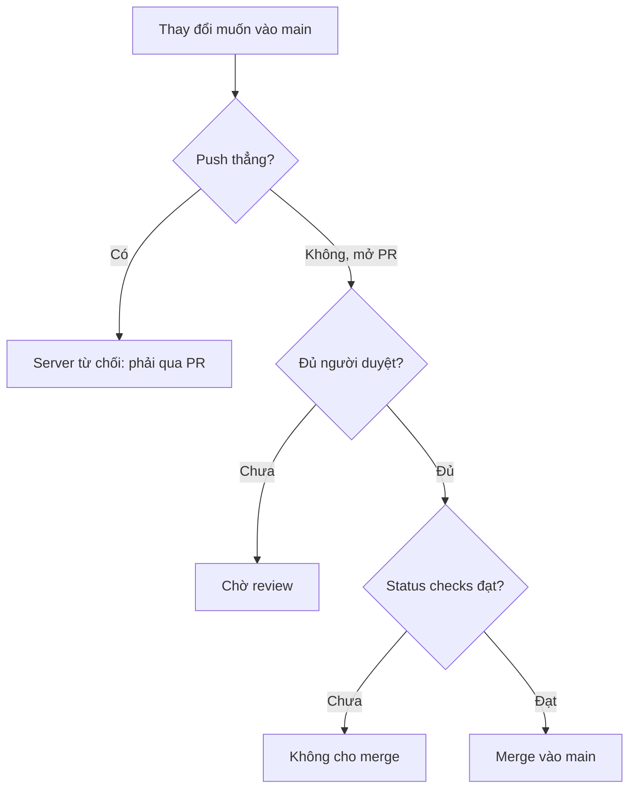
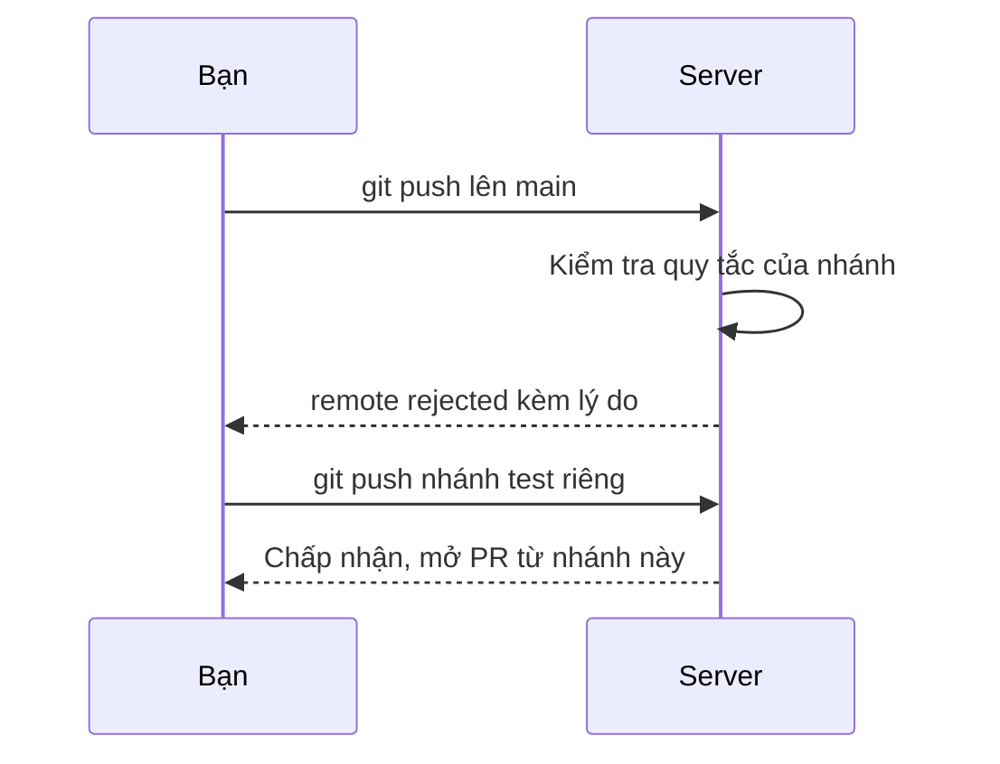

## Bạn sẽ học được gì

- Hiểu branch protection là gì và nó được thực thi ở đâu.
- Biết các loại quy tắc phổ biến: bắt buộc PR, số người duyệt, kiểm tra CI, cấm force push.
- Nhận ra dấu hiệu push bị server từ chối và đọc thông báo `remote rejected`.
- Biết phần nào được mô phỏng trong bài và phần nào mình chạy thật bằng Git.

## Khái niệm

Trong một đội, nhánh `main` thường là nguồn để build và phát hành. Một lần push nhầm, một lần force push vội, hay một commit làm hỏng build đều ảnh hưởng tới mọi người. **Branch protection** là tập quy tắc mà **server** áp lên một hoặc nhiều nhánh để ngăn những chuyện đó.

Điểm cốt lõi: quy tắc được thực thi **phía server**, lúc server nhận push hoặc lúc có yêu cầu merge PR. Cấu hình Git trên máy bạn không bật hay tắt được chúng. Khi bị chặn, bạn thấy push bị từ chối với dòng `! [remote rejected]` kèm lý do.

Trên các nền tảng như GitHub, quy tắc được cấu hình trong phần cài đặt repository (branch protection rules hoặc rulesets). Các quy tắc hay gặp:

- **Bắt buộc qua pull request**: không ai push thẳng vào `main`; mọi thay đổi phải đi qua PR.
- **Số lượt phê duyệt tối thiểu**: PR cần ít nhất N người review đồng ý. Có thể yêu cầu duyệt lại khi có commit mới.
- **Required status checks**: PR chỉ được merge khi các kiểm tra tự động được chỉ định (build, test, quét bảo mật) đều đạt. Đây là quy tắc ngăn merge khi test chưa qua. Có thể yêu cầu thêm nhánh phải cập nhật với `main` trước khi merge.
- **Cấm force push và cấm xóa nhánh**.
- **Lịch sử tuyến tính**: chỉ cho phép squash hoặc rebase merge, không có merge commit.
- **Yêu cầu commit có chữ ký** (xem bài ký commit).

Bản thân Git cũng có công cụ phía server, tuy đơn giản hơn: cấu hình `receive.denyNonFastForwards` và `receive.denyDeletes` trên repository server, và hook `pre-receive` có thể từ chối push theo bất kỳ quy tắc nào bạn viết. Các nền tảng hosting xây những tính năng phong phú hơn trên ý tưởng tương tự.

**Phần mô phỏng trong ứng dụng.** Ứng dụng không kết nối GitHub, nên phần quy tắc của nền tảng (PR, phê duyệt, status checks) chỉ được mô tả. Để bạn thấy cảm giác "bị server từ chối", ví dụ bên dưới dùng cấu hình `receive.*` và một hook `pre-receive` thật trên bare repository local. Đây là cơ chế của Git, **không phải** cách GitHub hiển thị lỗi; thông báo trên GitHub sẽ khác.

## Hình dung bằng sơ đồ





## Lệnh cần biết

Phía bạn, chỉ là các lệnh push bình thường; điều quan trọng là đọc đúng thông báo:

```bash
git push                                   # có thể bị remote rejected
git push -u origin <nhánh-riêng>           # cách đúng: đẩy nhánh riêng rồi mở PR
```

Phía server (chỉ minh họa cơ chế của Git, trên bare repository local):

```bash
git --git-dir=<server.git> config receive.denyNonFastForwards true
git --git-dir=<server.git> config receive.denyDeletes true
# hook: <server.git>/hooks/pre-receive, thoát mã khác 0 để từ chối
```

| Quy tắc của nền tảng | Ngăn điều gì |
| --- | --- |
| Bắt buộc PR | Push thẳng vào nhánh |
| Số lượt duyệt | Merge khi chưa có người xem |
| Required status checks | Merge khi build hoặc test chưa đạt |
| Cấm force push, cấm xóa | Viết lại hoặc xóa lịch sử chung |

## Ví dụ từng bước

Trên bare repository, mình bật hai cấu hình chặn rồi thử force push và xóa `main` (các dòng `remote:` đã bỏ khoảng trắng thừa ở cuối):

```bash
git push --force
git push origin --delete main
```

```text
remote: error: denying non-fast-forward refs/heads/main (you should pull first)
To /tmp/gt/r12/s.git
 ! [remote rejected] main -> main (non-fast-forward)
error: failed to push some refs to '/tmp/gt/r12/s.git'
remote: error: denying ref deletion for refs/heads/main
To /tmp/gt/r12/s.git
 ! [remote rejected] main (deletion prohibited)
error: failed to push some refs to '/tmp/gt/r12/s.git'
```

Thêm một hook `pre-receive` ngắn từ chối mọi cập nhật vào `refs/heads/main` (hook in ra một thông điệp không dấu), rồi thử push một commit thường:

```bash
git push
```

```text
remote: Nhanh main duoc bao ve: hay mo pull request.
To /tmp/gt/r12/s.git
 ! [remote rejected] main -> main (pre-receive hook declined)
error: failed to push some refs to '/tmp/gt/r12/s.git'
```

Cách đúng: đưa thay đổi lên một nhánh riêng, nhánh này không bị chặn:

```bash
git switch -c test/QA-50
git push -u origin test/QA-50
```

```text
To /tmp/gt/r12/s.git
 * [new branch]      test/QA-50 -> test/QA-50
branch 'test/QA-50' set up to track 'origin/test/QA-50'.
```

## Lỗi thường gặp

**Nhầm `remote rejected` với `rejected`.** `! [rejected]` (không có chữ remote) thường là Git phía bạn thấy push không phải fast-forward. `! [remote rejected]` nghĩa là server đã nhận yêu cầu và **chủ động từ chối** theo quy tắc. Fetch hay pull không giải quyết được loại sau.

**Tìm cách vượt quy tắc.** Xin quyền admin để push thẳng hay tắt tạm quy tắc là phá mục đích của nó. Đi qua PR.

> **Lưu ý** Quy tắc required status checks chỉ có ý nghĩa khi đúng tên kiểm tra được chọn. Nếu pipeline đổi tên job, PR có thể bị treo chờ một kiểm tra không bao giờ chạy.

**Commit cục bộ trên `main` rồi mới phát hiện không push được.** Tạo nhánh từ vị trí hiện tại, push nhánh đó, rồi đưa `main` local về khớp với remote.

> **Mẹo** Tạo nhánh riêng ngay từ đầu cho mọi thay đổi, kể cả sửa một dòng. Bạn sẽ không bao giờ phải gỡ commit khỏi `main` local.

## Áp dụng trong công việc

Repository kịch bản kiểm thử của nhóm QA ngân hàng giả định có `main` được bảo vệ: cần một người duyệt từ nhóm, job chạy test khói phải đạt, và cấm force push. Một lần bạn sửa nhanh một ca kiểm thử bị lỗi chính tả và push thẳng; server từ chối. Bạn chuyển commit sang nhánh riêng, mở PR, và nhờ status check, phát hiện chính lần sửa đó làm một test khác hỏng.

## Chuẩn bị làm bài

Đây là bài câu hỏi và được mô phỏng. Câu hỏi hỏi về điều kiện ngăn merge khi test chưa đạt. Hãy ôn lại danh sách quy tắc trong bài và phân biệt quy tắc nào liên quan tới con người (review) với quy tắc nào liên quan tới kết quả kiểm tra tự động.

## Tóm tắt

- Branch protection là quy tắc phía server áp lên nhánh, máy bạn không tắt được.
- Quy tắc phổ biến: bắt buộc PR, số lượt duyệt, kiểm tra CI phải đạt, cấm force push và xóa.
- Bị chặn thì thấy `! [remote rejected]` kèm lý do.
- Git có `receive.*` và hook `pre-receive` cho cơ chế tương tự ở mức đơn giản.
- Cách làm đúng là đẩy nhánh riêng và đi qua PR.
