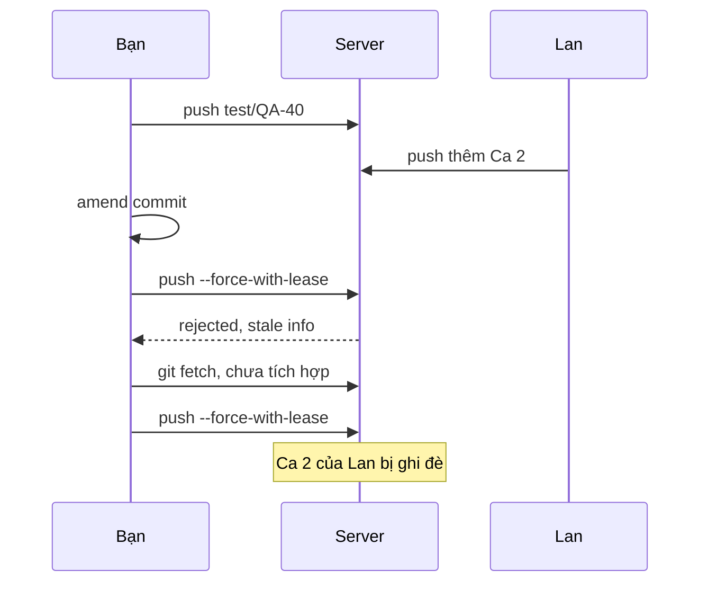
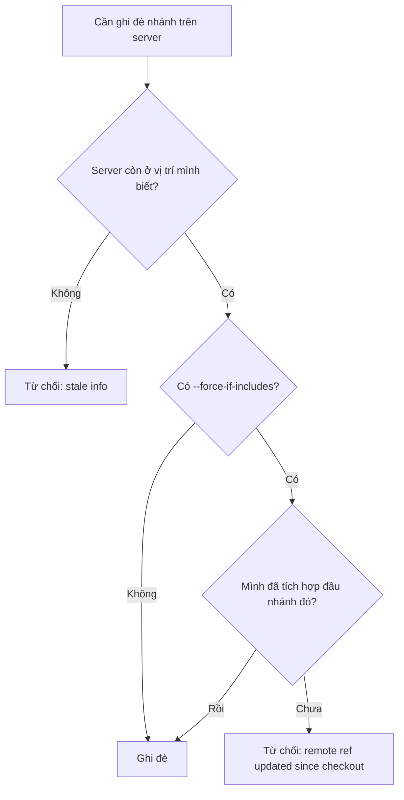

## Bạn sẽ học được gì

- Hiểu khi nào cần force push và vì sao `--force` trần trụi nguy hiểm.
- Nắm cách `--force-with-lease` kiểm tra trước khi ghi đè.
- Thấy được lỗ hổng của nó khi fetch mà chưa tích hợp, và cách `--force-if-includes` vá lại.
- Áp dụng quy tắc an toàn khi viết lại lịch sử trên nhánh đã push.

## Khái niệm

Bình thường remote chỉ nhận push fast-forward. Nhưng sau khi bạn amend, rebase hay squash một nhánh đã push, lịch sử local không còn nối tiếp lịch sử trên server; push thường bị từ chối với `non-fast-forward`. Lúc đó bạn cần **force push**: yêu cầu server bỏ qua kiểm tra và đặt nhánh về đúng commit của bạn.

`git push --force` làm đúng như vậy, **vô điều kiện**. Nếu trong lúc bạn rebase, một đồng nghiệp đã push thêm commit vào cùng nhánh, `--force` xóa commit đó khỏi server mà không hề báo.

`--force-with-lease` thêm một điều kiện: "chỉ ghi đè nếu nhánh trên server **vẫn đang ở vị trí mà mình nghĩ**". Vị trí "mình nghĩ" mặc định là nhánh remote-tracking của bạn, tức `origin/<nhánh>` ở lần fetch gần nhất. Nếu server đã đổi (ai đó push thêm), lease không khớp và push bị từ chối với `stale info`. Bạn có thể ghi rõ giá trị kỳ vọng: `--force-with-lease=<nhánh>:<hash>`.

**Lỗ hổng.** Vì kỳ vọng lấy từ `origin/<nhánh>`, bất cứ thứ gì cập nhật nó đều "gia hạn" lease. Nếu bạn (hoặc IDE tự động) chạy `git fetch` mà **chưa tích hợp** commit mới, `origin/<nhánh>` đã khớp với server, và `--force-with-lease` sẽ vui vẻ ghi đè commit của đồng nghiệp mà bạn chưa từng nhìn thấy. Ví dụ bên dưới cho thấy đúng điều này.

**`--force-if-includes`** (có từ Git 2.30) vá lỗ hổng đó: ngoài lease, Git kiểm tra rằng đầu nhánh remote-tracking đã từng có mặt trong lịch sử local của bạn (qua reflog). Fetch thôi chưa đủ; bạn phải thật sự tích hợp commit đó. Dùng cả hai cùng lúc.

Quy tắc an toàn:

- Chỉ viết lại lịch sử trên nhánh mà bạn là người duy nhất dùng, hoặc đã thống nhất với người cùng làm.
- **Không bao giờ** force push lên nhánh chung như `main`; nhiều đội cấm hẳn bằng branch protection.
- Luôn dùng `--force-with-lease --force-if-includes` thay cho `--force`.

## Hình dung bằng sơ đồ





## Lệnh cần biết

```bash
git push --force-with-lease                      # ghi đè nếu server khớp origin/<nhánh>
git push --force-with-lease --force-if-includes  # thêm kiểm tra đã tích hợp
git push --force-with-lease=<nhánh>:<hash>       # ghi rõ vị trí kỳ vọng
git log --oneline HEAD..origin/<nhánh>           # commit trên server mình chưa có
git config push.useForceIfIncludes true          # bật --force-if-includes mặc định
```

| Tùy chọn | Kiểm tra trước khi ghi đè |
| --- | --- |
| `--force` | Không kiểm tra gì |
| `--force-with-lease` | Server vẫn ở vị trí ghi trong `origin/<nhánh>` |
| Thêm `--force-if-includes` | Và vị trí đó đã nằm trong lịch sử local |

## Ví dụ từng bước

Mình đã push nhánh `test/QA-40`, sau đó amend commit. Push thường bị từ chối:

```text
 ! [rejected]        test/QA-40 -> test/QA-40 (non-fast-forward)
```

Lúc này chưa ai khác push, nên lease khớp:

```bash
git push --force-with-lease
```

```text
To /tmp/gt/r10/s.git
 + 3fc2c0e...95815c2 test/QA-40 -> test/QA-40 (forced update)
```

Lan push thêm "Ca 2 của Lan". Mình amend lần nữa và thử lại:

```bash
git push --force-with-lease
```

```text
To /tmp/gt/r10/s.git
 ! [rejected]        test/QA-40 -> test/QA-40 (stale info)
error: failed to push some refs to '/tmp/gt/r10/s.git'
```

Lease đã bảo vệ commit của Lan. Nhưng giờ mình fetch rồi push ngay, **không tích hợp**:

```bash
git fetch
git push --force-with-lease
git log --oneline origin/test/QA-40 -3
```

```text
From /tmp/gt/r10/s
   95815c2..5d78e8f  test/QA-40 -> origin/test/QA-40
To /tmp/gt/r10/s.git
 + 5d78e8f...d54aeaf test/QA-40 -> test/QA-40 (forced update)
d54aeaf Ca 1 sửa lần hai
321a168 Khởi tạo
```

Commit của Lan đã biến khỏi server. Lặp lại tình huống với "Ca 3 của Lan", lần này thêm `--force-if-includes`:

```bash
git fetch
git push --force-with-lease --force-if-includes
```

```text
 ! [rejected]        test/QA-40 -> test/QA-40 (remote ref updated since checkout)
error: failed to push some refs to '/tmp/gt/r10/s.git'
hint: Updates were rejected because the tip of the remote-tracking branch has
hint: been updated since the last checkout. If you want to integrate the
hint: remote changes, use 'git pull' before pushing again.
```

Git từ chối vì mình chưa tích hợp commit mới. Lúc này cần xem `git log HEAD..origin/test/QA-40`, rebase hoặc merge cho đủ, rồi mới push.

Dạng ghi rõ kỳ vọng: sai hash thì bị từ chối, đúng thì được ghi đè:

```text
$ git push --force-with-lease=test/QA-40:d54aeaf
 ! [rejected]        test/QA-40 -> test/QA-40 (stale info)
$ git push --force-with-lease=test/QA-40:98928aa
 + 98928aa...3cd4b29 test/QA-40 -> test/QA-40 (forced update)
```

## Lỗi thường gặp

**Dùng `--force` theo thói quen.** Một lần sai là mất công việc của người khác. Đặt alias cho dạng an toàn và quên `--force` đi.

> **Cẩn thận** `--force-with-lease` một mình không an toàn nếu có gì đó fetch ngầm (nhiều IDE tự fetch định kỳ). Luôn thêm `--force-if-includes`, hoặc bật `push.useForceIfIncludes`.

**Force push lên nhánh chung.** Mọi người đã kéo lịch sử cũ sẽ bị phân kỳ. Với nhánh chung, dùng revert hoặc commit sửa.

**Thấy `stale info` rồi chỉ fetch và thử lại.** Đó chính là kịch bản làm mất commit. Đọc commit mới trước, tích hợp, rồi mới push.

> **Mẹo** Trước khi force push, chạy `git log --oneline HEAD..origin/<nhánh>`. Danh sách không rỗng nghĩa là có commit trên server sẽ bị mất.

## Áp dụng trong công việc

Bạn và một đồng nghiệp cùng viết bộ test cho luồng mở thẻ tín dụng trên một nhánh. Bạn rebase để gọn lịch sử trước khi mở PR. Nhờ thói quen push với `--force-with-lease --force-if-includes`, khi đồng nghiệp vừa đẩy thêm ca kiểm thử thẻ phụ, Git từ chối, bạn tích hợp commit đó rồi mới đẩy lại. Không ai mất việc.

## Chuẩn bị làm bài

Đây là bài câu hỏi. Câu hỏi hỏi về tùy chọn bảo vệ commit mới của đồng đội khi bạn buộc phải ghi đè nhánh trên server. Hãy ôn lại sự khác nhau giữa các cách force push trong bài và điều kiện mà mỗi cách kiểm tra.

## Tóm tắt

- Force push cần khi viết lại lịch sử nhánh đã push; `--force` không kiểm tra gì.
- `--force-with-lease` chỉ ghi đè khi server còn ở vị trí ghi trong nhánh remote-tracking.
- Fetch mà không tích hợp làm lease mất tác dụng.
- `--force-if-includes` đòi bạn đã thật sự tích hợp đầu nhánh remote.
- Không force push lên nhánh chung.
