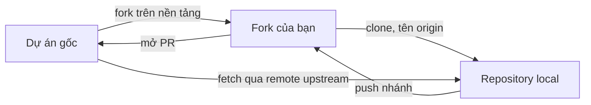
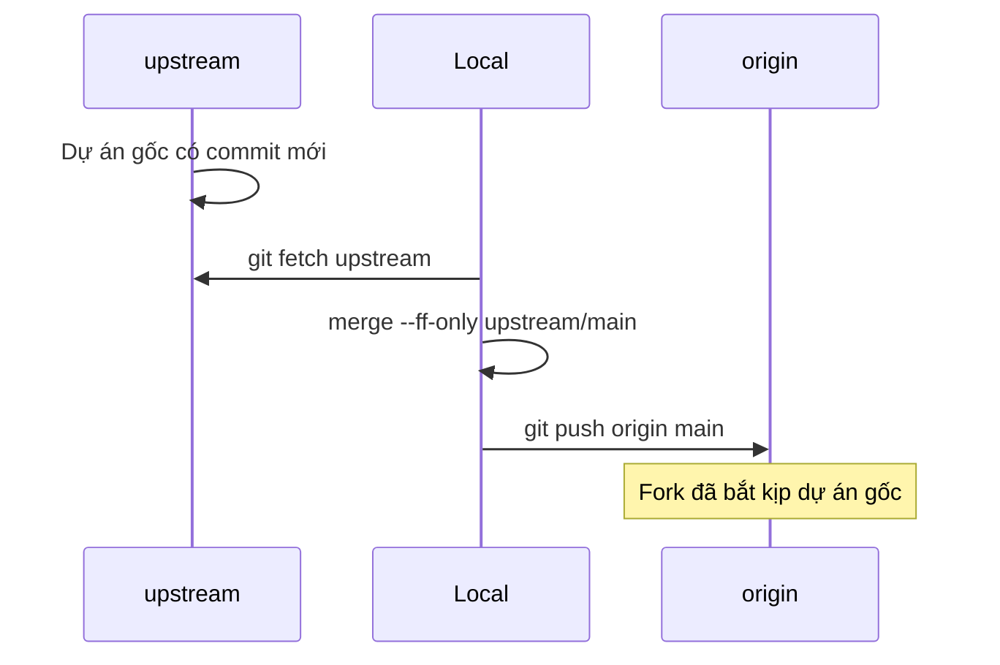

## Bạn sẽ học được gì

- Hiểu fork là gì và nó khác clone ở chỗ nào.
- Biết vai trò của hai remote `origin` và `upstream` trong mô hình fork.
- Đồng bộ fork với dự án gốc khi dự án gốc có commit mới.
- Biết phần nào được mô phỏng trong bài tập offline.

## Khái niệm

Bạn muốn đóng góp vào một dự án mà mình không có quyền push, ví dụ thư viện mã nguồn mở hay repository của một nhóm khác trong công ty. Bạn không thể tạo nhánh trực tiếp trên đó. Giải pháp phổ biến là **fork**.

**Fork** là một bản sao của repository **trên server**, thuộc tài khoản của bạn. Fork là tính năng của nền tảng (GitHub, GitLab...), không phải lệnh Git: bạn bấm nút trên giao diện, nền tảng sao chép repository sang không gian của bạn và ghi nhớ quan hệ "bản này được fork từ bản kia". Nhờ quan hệ đó, bạn có thể mở PR từ fork về dự án gốc.

So sánh nhanh: **clone** tạo bản sao trên **máy bạn**; **fork** tạo bản sao trên **server**, và sau đó bạn vẫn clone fork về máy để làm việc.

Từ đây, repository local của bạn có quan hệ với **hai** repository trên server:

- **`origin`**: fork của bạn. Bạn có quyền push. Khi clone fork về, Git tự đặt tên này.
- **`upstream`**: dự án gốc. Bạn thường chỉ fetch từ đây. Git không tự thêm; bạn phải `git remote add upstream <địa chỉ>`. Tên `upstream` chỉ là quy ước rất phổ biến, Git không bắt buộc.

Lưu ý thuật ngữ: chữ "upstream" ở đây là **tên một remote**, khác với "upstream của một nhánh" (nhánh remote-tracking mà nhánh local theo dõi) ở track branching. Hai nghĩa dùng chung chữ nhưng không liên quan trực tiếp.

Quy trình đóng góp:

1. Fork trên giao diện, clone fork về, thêm remote `upstream`.
2. Trước khi bắt đầu, **đồng bộ**: fetch `upstream`, cập nhật `main` local từ `upstream/main`, push lên `origin` để fork không bị lạc hậu.
3. Tạo nhánh từ `main` đã đồng bộ, commit, push nhánh lên `origin`.
4. Mở PR từ nhánh trên fork vào `main` của dự án gốc.

Fork **không tự cập nhật**. Dự án gốc có commit mới thì fork vẫn đứng yên cho tới khi bạn đồng bộ (bằng Git như trên, hoặc nút "Sync fork" mà một số nền tảng cung cấp).

**Phần mô phỏng trong ứng dụng.** Bài tập không tạo fork thật. Hai bare repository trong thư mục bài tập đóng vai fork (`origin`) và dự án gốc. Việc thêm remote là thao tác Git thật.

## Hình dung bằng sơ đồ





## Lệnh cần biết

```bash
git clone <địa-chỉ-fork>                  # origin tự trỏ về fork
git remote add upstream <địa-chỉ-gốc>     # thêm dự án gốc
git remote -v                             # kiểm tra cả hai remote
git fetch upstream                        # lấy commit mới của dự án gốc
git merge --ff-only upstream/main         # cập nhật main local, không tạo merge commit
git push origin main                      # đưa bản đồng bộ lên fork
git remote show upstream                  # thông tin chi tiết về remote
```

| Remote | Trỏ tới | Bạn làm gì với nó |
| --- | --- | --- |
| `origin` | Fork của bạn | Fetch và push |
| `upstream` | Dự án gốc | Chủ yếu fetch, PR qua nền tảng |

## Ví dụ từng bước

Mình mô phỏng bằng hai bare repository: `goc.git` là dự án gốc, `fork-cua-toi.git` là bản sao của nó. Clone fork về:

```bash
git clone fork-cua-toi.git lam-viec
cd lam-viec
git remote -v
```

```text
Cloning into 'lam-viec'...
done.
origin	/tmp/gt/r3/fork-cua-toi.git (fetch)
origin	/tmp/gt/r3/fork-cua-toi.git (push)
```

Chỉ có `origin`. Thêm dự án gốc:

```bash
git remote add upstream ../goc.git
git remote -v
```

```text
origin	/tmp/gt/r3/fork-cua-toi.git (fetch)
origin	/tmp/gt/r3/fork-cua-toi.git (push)
upstream	../goc.git (fetch)
upstream	../goc.git (push)
```

Dự án gốc có thêm commit. Fetch và xem các nhánh:

```bash
git fetch upstream
git branch -a
```

```text
From ../goc
 * [new branch]      main       -> upstream/main
* main
  remotes/origin/HEAD -> origin/main
  remotes/origin/main
  remotes/upstream/main
```

Đồng bộ `main` local rồi đẩy lên fork:

```bash
git merge --ff-only upstream/main
git push origin main
```

```text
Updating 44b89d2..ea25560
Fast-forward
 lib.txt | 1 +
 1 file changed, 1 insertion(+)
To /tmp/gt/r3/fork-cua-toi.git
   44b89d2..ea25560  main -> main
```

Cấu hình đằng sau mỗi remote chỉ là vài dòng trong `.git/config`:

```bash
git config --get-regexp "^remote\."
```

```text
remote.origin.url /tmp/gt/r3/fork-cua-toi.git
remote.origin.fetch +refs/heads/*:refs/remotes/origin/*
remote.upstream.url ../goc.git
remote.upstream.fetch +refs/heads/*:refs/remotes/upstream/*
```

## Lỗi thường gặp

**Quên thêm `upstream`.** Fork lạc hậu dần, và PR của bạn đầy conflict vì dựa trên bản cũ.

**Commit thẳng lên `main` của fork.** Khi đồng bộ, `main` local và `upstream/main` phân kỳ, `--ff-only` thất bại. Giữ `main` sạch, làm việc trên nhánh riêng.

> **Lưu ý** Nếu `merge --ff-only` báo không thể fast-forward, nghĩa là `main` local có commit riêng. Chuyển các commit đó sang một nhánh, rồi đưa `main` về `upstream/main`.

**Nhầm hai nghĩa của "upstream".** `git push -u` đặt upstream của **nhánh**; `git remote add upstream` thêm **remote** tên upstream. Đọc kỹ ngữ cảnh.

> **Mẹo** Muốn tránh lỡ tay push vào dự án gốc khi bạn có quyền, xem bài Nhiều remote về cách đặt push URL riêng.

## Áp dụng trong công việc

Nhóm hạ tầng duy trì thư viện kiểm thử dùng chung cho các ứng dụng thẻ và tài khoản, nhưng không cấp quyền push cho từng tester. Bạn fork thư viện, thêm hàm tiện ích sinh số thẻ giả lập hợp lệ, mở PR về repository gốc. Mỗi sáng bạn đồng bộ fork để nhánh làm việc luôn dựa trên bản mới nhất của nhóm hạ tầng.

## Chuẩn bị làm bài

Bài này được mô phỏng: repository bài tập đã có `origin`, và một bare repository khác trong thư mục bài tập đóng vai dự án gốc. Bạn cần thêm remote cho dự án gốc với tên quy ước, giữ nguyên `origin`. Kiểm tra bằng `git remote -v` để chắc có đủ hai remote và đường dẫn đúng.

## Tóm tắt

- Fork là bản sao trên server do nền tảng tạo; clone là bản sao trên máy.
- `origin` là fork của bạn, `upstream` là tên quy ước cho dự án gốc.
- Git không tự thêm `upstream`; bạn thêm bằng `git remote add`.
- Đồng bộ fork: fetch upstream, fast-forward main, push lên origin.
- Trong ứng dụng, fork được mô phỏng bằng bare repository local.
