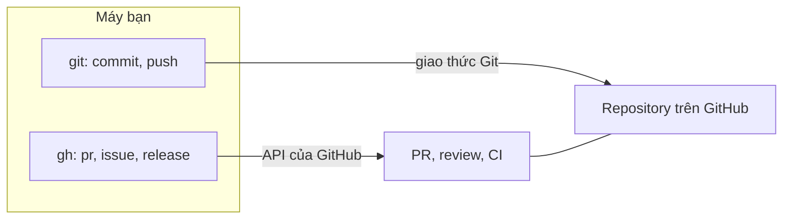
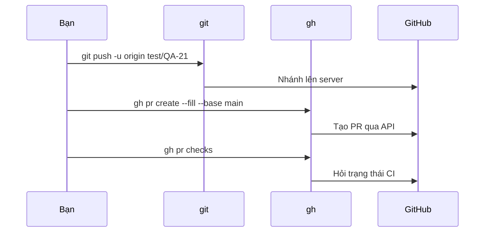

## Bạn sẽ học được gì

- Hiểu `gh` là gì và nó khác `git` ở chỗ nào.
- Biết nhóm lệnh `gh pr` để tạo, xem, review và merge pull request từ terminal.
- Đọc help của `gh` để tự tìm tùy chọn cần thiết.
- Biết bài này được mô phỏng offline và không gọi tới GitHub.

## Khái niệm

`git` chỉ biết về repository: commit, nhánh, remote. Những thứ như pull request, issue, review, kết quả CI là của **GitHub**, và bình thường bạn thao tác chúng trên trình duyệt. **GitHub CLI**, chạy bằng lệnh `gh`, đưa các thao tác đó ra terminal.

Hai công cụ bổ sung cho nhau chứ không thay thế:

- `git` lo phần Git: commit, push nhánh, fetch.
- `gh` gọi API của GitHub: tạo PR từ nhánh đã push, xem trạng thái CI, gửi review, merge PR, tạo release.

`gh` đọc remote trong repository hiện tại để đoán bạn đang làm việc với repository nào trên GitHub, và dùng thông tin đăng nhập riêng của nó (thiết lập bằng `gh auth login`, hoặc biến môi trường `GH_TOKEN` trong CI). Chưa đăng nhập thì các lệnh gọi API sẽ dừng và nhắc bạn đăng nhập.

Lệnh `gh` có cấu trúc `gh <nhóm> <hành-động> [tùy chọn]`. Nhóm `pr` là nhóm bạn dùng nhiều nhất:

- `gh pr create`: tạo PR từ nhánh hiện tại. Nếu nhánh chưa được push đầy đủ, `gh` sẽ hỏi nơi push. Có thể truyền `--title`, `--body`, `--base`, `--reviewer`, `--draft`, hoặc `--fill` để lấy tiêu đề và nội dung từ commit.
- `gh pr list`, `gh pr status`, `gh pr view`: xem danh sách và chi tiết.
- `gh pr checkout <số>`: lấy nhánh của một PR về máy để thử.
- `gh pr checks`: xem trạng thái CI.
- `gh pr review`, `gh pr merge`: review và merge.

Viết "Fixes #123" hay "Closes #123" trong nội dung PR sẽ tự đóng issue tương ứng khi PR được merge (theo tài liệu help của chính `gh`).

**Phần mô phỏng trong ứng dụng.** Bài tập chạy offline và không gọi GitHub; bạn chỉ cần nắm cú pháp. Khi viết bài này, mình chỉ chạy các lệnh **không cần mạng** (`gh --version`, `gh pr --help`, và một lệnh để thấy thông báo khi chưa đăng nhập), với thư mục cấu hình tạm và không đăng nhập. Các lệnh tạo hay merge PR bên dưới chỉ để tham khảo, không có output vì không được chạy thật.

## Hình dung bằng sơ đồ





## Lệnh cần biết

```bash
gh auth login                      # đăng nhập, một lần trên mỗi máy
gh pr create --base main --title "..." --body "..."
gh pr create --fill --draft        # lấy nội dung từ commit, mở dạng nháp
gh pr list                         # PR đang mở của repository
gh pr status                       # PR liên quan tới bạn
gh pr view <số> --web              # mở PR trên trình duyệt
gh pr checkout <số>                # lấy nhánh của PR về máy
gh pr checks <số>                  # trạng thái CI
gh pr merge <số> --squash          # merge kiểu squash
gh <lệnh> --help                   # help chi tiết, không cần mạng
```

| Việc cần làm | Công cụ |
| --- | --- |
| Commit, push nhánh | `git` |
| Mở PR, gán reviewer | `gh pr create` |
| Xem CI của PR | `gh pr checks` |
| Merge PR trên GitHub | `gh pr merge` |

## Ví dụ từng bước

Phiên bản đang có trong môi trường thử:

```bash
gh --version
```

```text
gh version 2.46.0 (2025-01-13 Debian 2.46.0-3)
https://github.com/cli/cli/releases/tag/v2.46.0
```

Xem các hành động trong nhóm `pr` (trích một phần):

```bash
gh pr --help
```

```text
GENERAL COMMANDS
  create:      Create a pull request
  list:        List pull requests in a repository
  status:      Show status of relevant pull requests

TARGETED COMMANDS
  checkout:    Check out a pull request in git
  checks:      Show CI status for a single pull request
  merge:       Merge a pull request
  review:      Add a review to a pull request
  view:        View a pull request
```

Tùy chọn của lệnh tạo PR (trích):

```text
  -B, --base branch          The branch into which you want your code merged
  -b, --body string          Body for the pull request
  -d, --draft                Mark pull request as a draft
      --dry-run              Print details instead of creating the PR. May still push git changes.
  -f, --fill                 Use commit info for title and body
  -r, --reviewer handle      Request reviews from people or teams by their handle
  -t, --title string         Title for the pull request
```

Chạy một lệnh cần API khi chưa đăng nhập, `gh` dừng ngay:

```text
To get started with GitHub CLI, please run:  gh auth login
Alternatively, populate the GH_TOKEN environment variable with a GitHub API authentication token.
```

## Lỗi thường gặp

**Nghĩ `gh` thay thế `git`.** `gh` không commit hay quản lý index. Bạn vẫn dùng `git` cho công việc với repository.

**Tạo PR khi nhánh chưa push.** `gh pr create` sẽ hỏi nơi push; trong script không có người trả lời, lệnh có thể treo hoặc lỗi. Push trước bằng `git push -u`.

> **Lưu ý** Help ghi rõ `--dry-run` "may still push git changes": chạy thử vẫn có thể push nhánh. Đừng coi nó là hoàn toàn vô hại.

**Dùng token cá nhân cho `gh` trong CI.** Hãy dùng token riêng có quyền tối thiểu, lưu trong secret của CI và đưa vào qua `GH_TOKEN`.

> **Mẹo** Không nhớ tùy chọn? `gh <nhóm> <hành-động> --help` chạy offline và có phần EXAMPLES rất sát thực tế.

## Áp dụng trong công việc

Cuối mỗi ngày, bạn push nhánh test và mở PR nháp bằng `gh pr create --fill --draft` để trưởng nhóm QA xem tiến độ bộ kiểm thử chuyển tiền nhanh. Sáng hôm sau, `gh pr checks` cho biết pipeline đêm có đạt không. Khi đủ ca, bạn chuyển PR sang trạng thái sẵn sàng review mà không cần mở trình duyệt.

## Chuẩn bị làm bài

Đây là bài câu hỏi, được mô phỏng và không gọi GitHub. Câu hỏi hỏi lệnh `gh` dùng để tạo pull request. Hãy ôn lại cấu trúc `gh <nhóm> <hành-động>` và các hành động chính trong nhóm `pr`.

## Tóm tắt

- `gh` đưa các tính năng của GitHub như PR, CI, release ra terminal; `git` vẫn lo repository.
- Lệnh có dạng `gh <nhóm> <hành-động>`, nhóm `pr` là hay dùng nhất.
- `gh pr create` tạo PR từ nhánh hiện tại; nên push nhánh trước.
- Đăng nhập bằng `gh auth login`, hoặc `GH_TOKEN` trong CI.
- Trong ứng dụng, bài này chỉ yêu cầu nắm cú pháp, không gọi GitHub.
