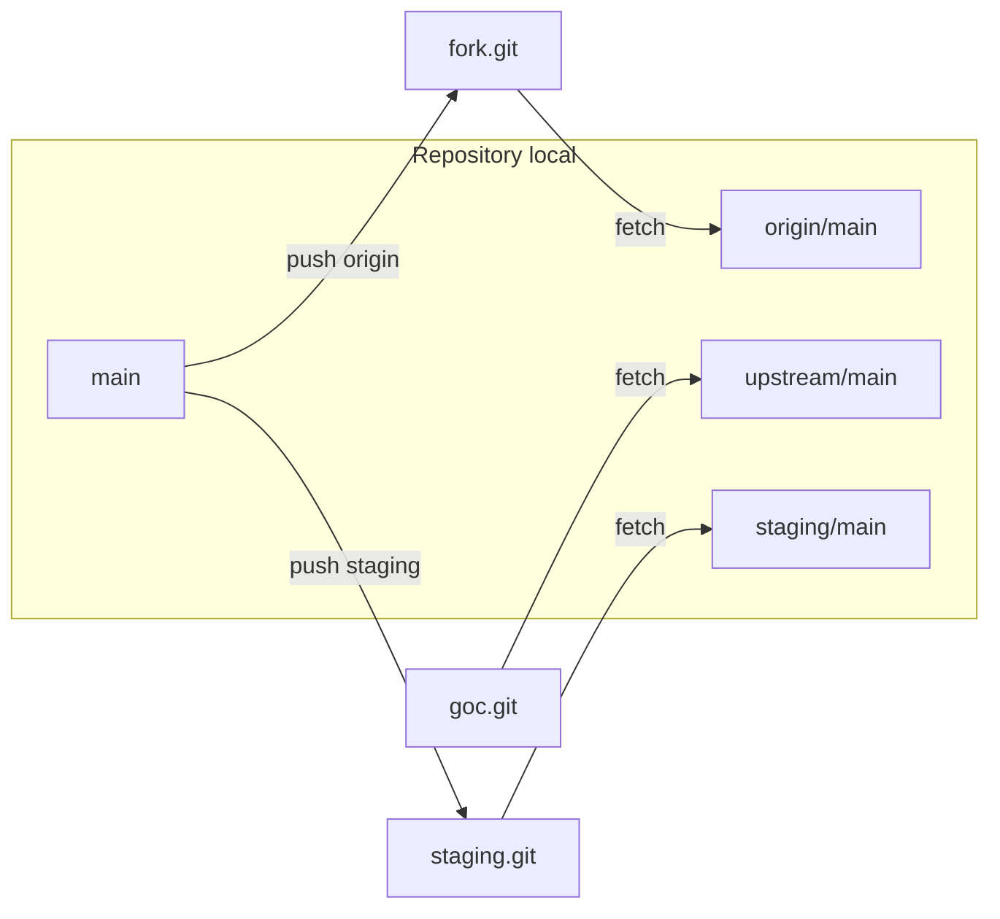
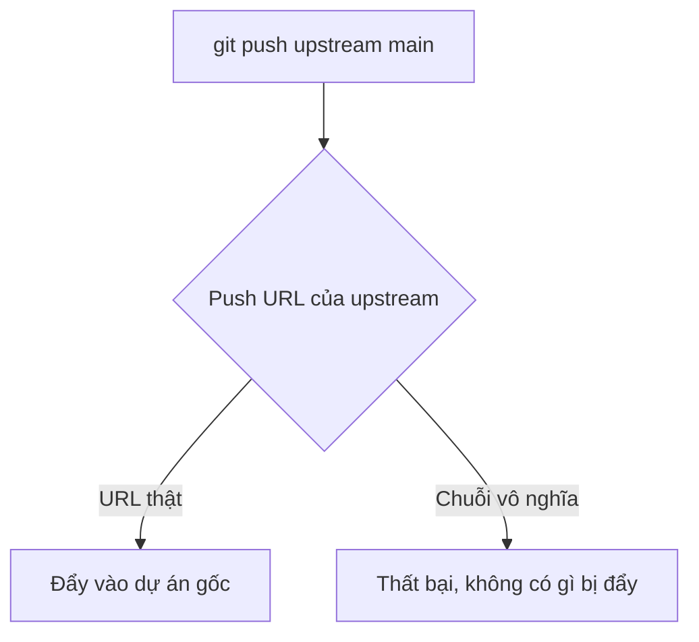

## Bạn sẽ học được gì

- Làm việc với một repository có nhiều remote cùng lúc.
- Liệt kê, kiểm tra và fetch từ mọi remote.
- Chọn remote đích khi push, và tách URL fetch với URL push.
- Đọc nhánh remote-tracking khi có nhiều remote.

## Khái niệm

Bài fork đã cho thấy một repository có thể có hai remote. Thực tế con số này không giới hạn. Các tình huống hay gặp:

- `origin` là fork hoặc repository chính của đội, `upstream` là dự án gốc.
- `staging` là một server riêng nhận bản để triển khai thử.
- Một remote tạm trỏ tới máy đồng nghiệp hay một bản sao lưu để lấy một nhánh cụ thể.

Mỗi remote là một mục độc lập trong `.git/config`, gồm ít nhất URL và quy tắc fetch (refspec). Quy tắc fetch mặc định `+refs/heads/*:refs/remotes/<tên>/*` nghĩa là: mọi nhánh trên remote đó được chép về thành `<tên>/<nhánh>` ở local. Vì vậy với ba remote, bạn có `origin/main`, `upstream/main` và `staging/main` cùng tồn tại, mỗi cái là bản chụp của một server.

Một vài nguyên tắc khi có nhiều remote:

- **Push luôn cần đích rõ ràng**. `git push` không tham số đẩy tới upstream của nhánh hiện tại (hoặc `remote.pushDefault` nếu bạn cấu hình, cho nhánh đã có upstream). Khi đẩy nơi khác, ghi tên remote: `git push staging main`.
- **Fetch có thể gom**. `git fetch --all` lần lượt fetch từng remote; `git fetch <tên>` chỉ một.
- **URL fetch và push có thể khác nhau**. `git remote set-url --push` đặt URL riêng cho push. Một mẹo phổ biến là đặt push URL của `upstream` thành một chuỗi vô nghĩa, để lỡ tay `git push upstream` sẽ thất bại thay vì đẩy vào dự án gốc.
- **Nhánh local không tự gắn với remote nào**. Upstream của từng nhánh quyết định `git pull` và `git push` dùng remote nào.

## Hình dung bằng sơ đồ





## Lệnh cần biết

```bash
git remote                          # chỉ tên
git remote -v                       # tên kèm URL fetch và push
git remote add <tên> <địa chỉ>
git remote get-url [--push] <tên>   # in URL của một remote
git remote set-url --push <tên> <URL>   # URL riêng cho push
git remote show <tên>               # chi tiết nhánh, upstream, trạng thái
git fetch --all                     # fetch mọi remote
git push <remote> <nhánh>           # đẩy tới remote chỉ định
git branch -r                       # nhánh remote-tracking của mọi remote
git config remote.pushDefault <tên> # remote mặc định khi push
```

| Mục đích | Lệnh |
| --- | --- |
| Xem có những remote nào và URL | `git remote -v` |
| Lấy dữ liệu từ tất cả | `git fetch --all` |
| Chặn push nhầm vào một remote | `git remote set-url --push <tên> <chuỗi vô nghĩa>` |

## Ví dụ từng bước

Repository đã có `origin`. Thêm dự án gốc và một server staging:

```bash
git remote add upstream ../goc.git
git remote add staging ../staging.git
git remote
git remote -v
```

```text
origin
staging
upstream
origin	../fork.git (fetch)
origin	../fork.git (push)
staging	../staging.git (fetch)
staging	../staging.git (push)
upstream	../goc.git (fetch)
upstream	../goc.git (push)
```

Fetch từ tất cả:

```bash
git fetch --all
```

```text
Fetching origin
Fetching upstream
From ../goc
 * [new branch]      main       -> upstream/main
Fetching staging
```

Staging còn trống nên chưa có gì để tải. Đẩy `main` sang staging:

```bash
git push staging main
git branch -r
```

```text
To ../staging.git
 * [new branch]      main -> main
  origin/main
  staging/main
  upstream/main
```

`staging/main` xuất hiện ngay sau push, vì push thành công cũng cập nhật nhánh remote-tracking tương ứng.

Giờ chặn push nhầm vào dự án gốc:

```bash
git remote set-url --push upstream KHONG_PUSH
git remote -v
git push upstream main
```

```text
origin	../fork.git (fetch)
origin	../fork.git (push)
staging	../staging.git (fetch)
staging	../staging.git (push)
upstream	../goc.git (fetch)
upstream	KHONG_PUSH (push)
fatal: 'KHONG_PUSH' does not appear to be a git repository
fatal: Could not read from remote repository.
```

Fetch từ `upstream` vẫn hoạt động bình thường, vì URL fetch không đổi.

## Lỗi thường gặp

**Push lên nhầm remote.** Thói quen gõ `git push origin` có thể sai khi upstream của nhánh là remote khác. Đọc dòng `To ...` trong output, hoặc kiểm tra `git branch -vv` trước.

**Nghĩ `origin/main` và `upstream/main` là một.** Chúng là bản chụp của hai server khác nhau và có thể lệch nhau nhiều commit.

> **Lưu ý** `git remote` chỉ in tên. Muốn thấy địa chỉ để chắc remote trỏ đúng chỗ, thêm `-v`.

**Nhánh mới chưa có upstream.** `git push` không tham số báo `fatal: The current branch test/x has no upstream branch.` dù đã cấu hình `remote.pushDefault` là `origin`. Với `push.default=simple`, khi bạn push vào chính remote mà nhánh sẽ pull từ đó (ở đây là `origin`), Git đòi nhánh phải có upstream. Lần đầu hãy push kèm `-u` và tên remote.

> **Mẹo** Đặt tên remote theo vai trò (`upstream`, `staging`, `backup`) thay vì theo tên người hay tên máy, để lệnh tự giải thích.

## Áp dụng trong công việc

Nhóm QA của bạn có repository kịch bản kiểm thử là fork của repository chung của khối ngân hàng số, và có thêm một server nội bộ mà hệ thống chạy test đêm lấy mã từ đó. Bạn đặt ba remote: `origin` cho fork, `upstream` cho repository chung (đã chặn push), `nightly` cho server chạy đêm. Mỗi chiều bạn đẩy nhánh ổn định lên `nightly` để test chạy qua đêm.

## Chuẩn bị làm bài

Repository bài tập đã có một remote, và cạnh đó có một bare repository khác. Bạn cần thêm remote thứ hai với tên quy ước cho dự án gốc mà không làm mất remote cũ. Sau khi làm, xác nhận rằng cả hai remote đều có mặt và địa chỉ của remote mới đúng là thư mục được chỉ định.

## Tóm tắt

- Một repository có thể có bao nhiêu remote tùy ý; mỗi cái có nhánh remote-tracking riêng.
- `git remote -v` liệt kê tên kèm URL fetch và push.
- `git fetch --all` lấy từ mọi remote; push luôn nên ghi rõ đích.
- `set-url --push` tách URL push, dùng để chặn push nhầm.
- Upstream của từng nhánh quyết định `git pull` và `git push` mặc định đi đâu.
