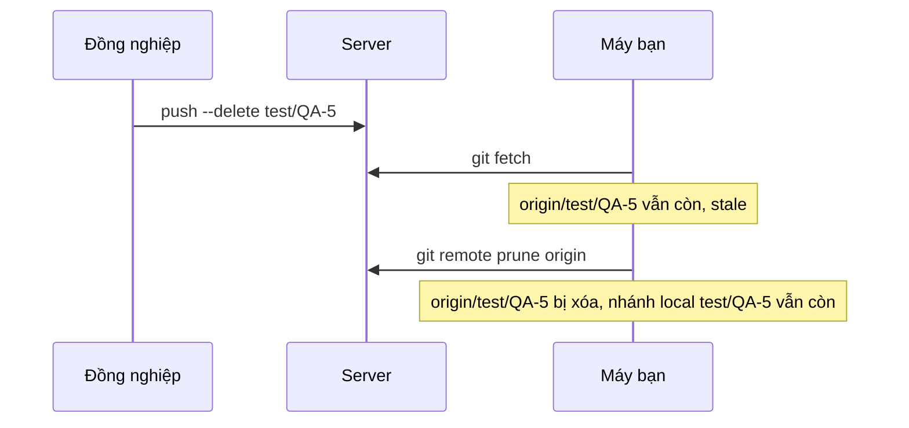
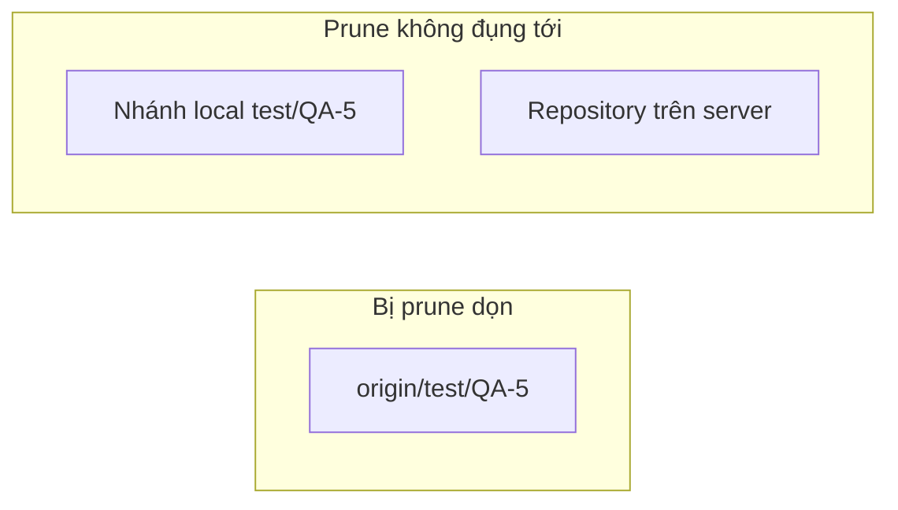

## Bạn sẽ học được gì

- Hiểu vì sao nhánh remote-tracking vẫn còn sau khi nhánh trên server đã bị xóa.
- Nhận diện các ref "stale" và xem trước những gì sẽ bị dọn.
- Dọn chúng bằng prune, hoặc để fetch tự dọn.
- Phân biệt dọn nhánh remote-tracking với xóa nhánh local.

## Khái niệm

Sau khi PR được merge, nhánh tính năng thường bị xóa trên server, có khi do nền tảng tự xóa, có khi do đồng nghiệp. Nhưng trên máy bạn, `git branch -r` vẫn hiện `origin/test/QA-5` như chưa có gì xảy ra. Vì sao?

Nhánh remote-tracking là **bản chụp local** của nhánh trên server. Mặc định, `git fetch` chỉ **thêm và cập nhật**: nó tải nhánh mới, dời nhánh đã có, nhưng **không xóa** bản chụp của nhánh đã biến mất trên server. Git thận trọng như vậy để không tự ý xóa ref của bạn. Hậu quả là theo thời gian, danh sách `git branch -r` đầy những nhánh đã chết, gọi là **stale**.

**Prune** là thao tác dọn những ref stale đó: so danh sách nhánh trên server với các ref `refs/remotes/<remote>/*` ở local, xóa những ref không còn tương ứng. Có ba cách:

- `git remote prune <remote>`: chỉ dọn, không tải gì mới. Có `--dry-run` để xem trước.
- `git fetch --prune` (`-p`): fetch như bình thường và dọn trong cùng lần.
- Cấu hình `fetch.prune=true` để mọi lần fetch đều tự dọn.

Điều quan trọng nhất: prune **chỉ xóa nhánh remote-tracking**. Nhánh local cùng tên, ví dụ `test/QA-5` mà bạn đã tạo để theo dõi, **vẫn còn nguyên** cùng với mọi commit của nó. Sau prune, `git branch -vv` đánh dấu nhánh local đó là `[origin/test/QA-5: gone]`: upstream của nó không còn. Xóa nhánh local là quyết định riêng của bạn, bằng `git branch -d`.

Prune cũng không đụng gì tới server: nó chỉ đọc danh sách nhánh trên server và sửa ref ở local.

Ref stale không chỉ làm danh sách rối mắt. Chúng còn gây nhầm lẫn thật: bạn có thể `git switch test/QA-5` và Git vui vẻ tạo nhánh local từ bản chụp cũ, hoặc so sánh với một nhánh mà thật ra không còn ai dùng. Với công cụ tự động liệt kê nhánh, như script dọn dẹp hay trình chọn nhánh của IDE, ref stale làm kết quả sai lệch so với server.

## Hình dung bằng sơ đồ





## Lệnh cần biết

```bash
git remote show <remote>             # đánh dấu nhánh "stale"
git remote prune <remote> --dry-run  # xem trước
git remote prune <remote>            # dọn ref remote-tracking stale
git fetch --prune                    # fetch và dọn cùng lúc
git config fetch.prune true          # luôn dọn khi fetch
git branch -vv                       # nhánh local có upstream ": gone"
git for-each-ref --format='%(refname:short) %(upstream:track)' refs/heads
```

| Lệnh | Tải dữ liệu mới | Dọn ref stale | Xóa nhánh local |
| --- | --- | --- | --- |
| `git fetch` | Có | Không | Không |
| `git fetch --prune` | Có | Có | Không |
| `git remote prune` | Không | Có | Không |

## Ví dụ từng bước

Hai nhánh test đã bị đồng nghiệp xóa trên server. Fetch thường không thay đổi gì:

```bash
git fetch
git branch -r
```

```text
  origin/main
  origin/test/QA-5
  origin/test/QA-6
```

`git remote show` chỉ ra chúng đã stale (output rút gọn):

```text
  Remote branches:
    main                          tracked
    refs/remotes/origin/test/QA-5 stale (use 'git remote prune' to remove)
    refs/remotes/origin/test/QA-6 stale (use 'git remote prune' to remove)
```

Xem trước rồi dọn:

```bash
git remote prune origin --dry-run
git remote prune origin
```

```text
Pruning origin
URL: /tmp/gt/r8/s.git
 * [would prune] origin/test/QA-5
 * [would prune] origin/test/QA-6
Pruning origin
URL: /tmp/gt/r8/s.git
 * [pruned] origin/test/QA-5
 * [pruned] origin/test/QA-6
```

Nhánh remote-tracking đã đi, nhánh local vẫn ở lại và được đánh dấu:

```bash
git branch -r
git branch -vv
```

```text
  origin/main
* main      321a168 [origin/main] Khởi tạo
  test/QA-5 321a168 [origin/test/QA-5: gone] Khởi tạo
  test/QA-6 321a168 [origin/test/QA-6: gone] Khởi tạo
```

Lần sau, một nhánh khác bị xóa trên server; `fetch --prune` vừa fetch vừa dọn:

```text
From /tmp/gt/r8/s
 - [deleted]         (none)     -> origin/test/QA-7
```

## Lỗi thường gặp

**Tưởng prune xóa luôn nhánh local.** Không. Nhánh local còn nguyên; bạn tự quyết định có xóa hay không.

**Tưởng prune xóa nhánh trên server.** Prune chỉ sửa local. Muốn xóa nhánh trên server, dùng `git push <remote> --delete <nhánh>`.

> **Lưu ý** Trước khi xóa các nhánh local có upstream `gone`, kiểm tra chúng không còn commit chưa merge: `git branch -d` sẽ từ chối nếu còn, đó là lớp bảo vệ hữu ích.

**Dùng `git branch -d origin/test/QA-5` để dọn.** Lệnh này tìm nhánh **local** tên `origin/test/QA-5` và báo không thấy. Nhánh remote-tracking cần `git branch -dr` hoặc, tốt hơn, prune.

> **Mẹo** Bật `fetch.prune=true` ở cấu hình global; danh sách nhánh remote luôn phản ánh đúng server mà bạn không phải nhớ dọn.

## Áp dụng trong công việc

Sau một quý, repository kiểm thử của nhóm có hàng trăm nhánh test theo ticket đã merge và bị xóa trên server. Danh sách gợi ý nhánh trong IDE của bạn dài vô tận. Bạn chạy prune với `--dry-run` để xem, dọn hết, bật `fetch.prune`, rồi dùng `git branch -vv` để tìm các nhánh local `gone` và xóa những nhánh đã merge.

## Chuẩn bị làm bài

Repository bài tập có một nhánh remote-tracking trỏ tới nhánh đã bị xóa trên remote, và một nhánh local cùng tên. Bạn cần dọn ref remote-tracking đó nhưng giữ nhánh local. Hãy xem trước bằng chế độ chạy thử, rồi kiểm tra lại `git branch -r` và `git branch` sau khi làm.

## Tóm tắt

- Fetch mặc định không xóa ref của nhánh đã bị xóa trên server; chúng thành stale.
- `git remote prune` dọn ref stale; `--dry-run` để xem trước.
- `git fetch --prune` hoặc `fetch.prune=true` dọn tự động mỗi lần fetch.
- Prune không xóa nhánh local và không đụng tới server.
- Nhánh local có upstream `gone` cần bạn tự xem xét rồi xóa.
