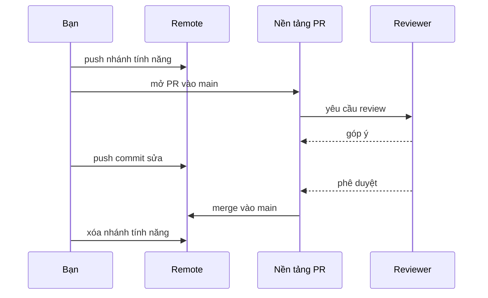
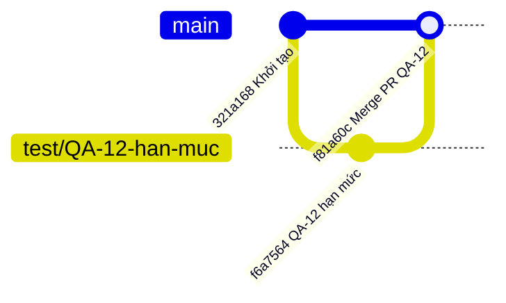

## Bạn sẽ học được gì

- Hiểu pull request (PR) là gì và nó nằm ở đâu: trong Git hay trên nền tảng hosting.
- Nắm vòng đời của một PR: nhánh, push, mở PR, review, merge, dọn dẹp.
- Thấy được những phần Git làm thật bên dưới một PR.
- Biết phần nào của bài này được mô phỏng offline trong ứng dụng.

## Khái niệm

**Pull request** (GitLab gọi là merge request) là một yêu cầu: "hãy xem xét và tích hợp các commit trên nhánh này vào nhánh kia". Điều quan trọng cần biết ngay: **PR không phải khái niệm của Git**. Git không có lệnh tạo PR, không lưu bình luận hay phê duyệt. Đó là tính năng của nền tảng như GitHub, GitLab, Bitbucket, xây trên các thao tác Git thông thường.

Những gì Git thật sự làm trong một PR:

1. **Nhánh tính năng** được tạo từ nhánh chính, chứa các commit đề xuất.
2. **Push** nhánh đó lên remote. Không push thì nền tảng không có gì để so sánh. Đây là bước bắt buộc trước khi mở PR.
3. Nền tảng hiển thị **diff** giữa nhánh tính năng và nhánh đích, tương tự `git diff main...feature` (ba chấm: so với merge base, tức chỉ những gì nhánh tính năng thêm vào).
4. Người review bình luận; bạn sửa bằng cách **commit thêm và push tiếp** lên cùng nhánh. PR tự cập nhật.
5. Khi được duyệt và CI đạt, PR được **merge**. Nền tảng thường cho chọn: merge commit (`--no-ff`), squash, hoặc rebase.
6. Nhánh tính năng được **xóa** trên remote, và bạn dọn bản local.

Phần do nền tảng quản lý: tiêu đề và mô tả PR, danh sách reviewer, bình luận, trạng thái phê duyệt, kết quả CI, quy tắc bảo vệ nhánh. Trên GitHub, mỗi PR còn có ref ẩn `refs/pull/<số>/head` trên remote để bạn fetch về thử.

**Phần mô phỏng trong ứng dụng.** Bài tập không kết nối GitHub. Remote là một bare repository trong thư mục bài tập, và "phê duyệt" được mô phỏng bằng một **ref tùy chỉnh** do bạn ghi, trỏ tới commit được duyệt. Push, merge và push lại là thao tác Git thật; chỉ phần review và phê duyệt là giả lập.

Ref tùy chỉnh là ref nằm ngoài `refs/heads` và `refs/tags`, ví dụ `refs/demo/da-duyet`. Git cho phép tạo bằng `git update-ref`; nó không phải nhánh, không hiện trong `git branch`, nhưng giữ một hash giống mọi ref khác.

## Hình dung bằng sơ đồ





## Lệnh cần biết

```bash
git switch -c <nhánh-tính-năng>          # bắt đầu từ main mới nhất
git push -u origin <nhánh-tính-năng>     # đưa nhánh lên để mở PR
git log --oneline main..<nhánh>          # các commit sẽ vào PR
git diff --stat main...<nhánh>           # diff mà PR sẽ hiển thị
git update-ref refs/<khu>/<tên> <commit> # tạo ref tùy chỉnh (dùng để mô phỏng)
git show-ref refs/<khu>/<tên>            # đọc ref tùy chỉnh
git merge --no-ff <nhánh>                # merge kiểu "merge commit"
git push origin --delete <nhánh>         # xóa nhánh trên remote sau khi merge
```

| Bước PR | Thật hay mô phỏng trong bài |
| --- | --- |
| Push nhánh, merge, push main | Git thật, remote là bare repository local |
| Mở PR, bình luận | Không có trong bài |
| Phê duyệt | Mô phỏng bằng một ref tùy chỉnh |

## Ví dụ từng bước

Mình tạo nhánh cho ticket QA-12, commit và push lên:

```bash
git switch -c test/QA-12-han-muc
git push -u origin test/QA-12-han-muc
```

```text
Switched to a new branch 'test/QA-12-han-muc'
To /tmp/gt/r2/server.git
 * [new branch]      test/QA-12-han-muc -> test/QA-12-han-muc
branch 'test/QA-12-han-muc' set up to track 'origin/test/QA-12-han-muc'.
```

Xem trước nội dung mà PR sẽ hiển thị:

```bash
git log --oneline main..test/QA-12-han-muc
git diff --stat main...test/QA-12-han-muc
```

```text
f6a7564 QA-12: Kiểm thử hạn mức chuyển khoản
 han-muc.txt | 1 +
 1 file changed, 1 insertion(+)
```

Ghi lại "phê duyệt" bằng một ref tùy chỉnh, theo cách bài tập mô phỏng (tên ref ở đây chỉ là ví dụ):

```bash
git update-ref refs/demo/da-duyet test/QA-12-han-muc
git show-ref refs/demo/da-duyet
```

```text
f6a7564ae543c25db2bf0fd3fe3cdcf094e82572 refs/demo/da-duyet
```

Merge bằng merge commit và push nhánh chính:

```bash
git switch main
git merge --no-ff -m "Merge PR QA-12" test/QA-12-han-muc
git push
```

```text
Merge made by the 'ort' strategy.
 han-muc.txt | 1 +
 1 file changed, 1 insertion(+)
 create mode 100644 han-muc.txt
To /tmp/gt/r2/server.git
   321a168..f81a60c  main -> main
```

Cuối cùng xóa nhánh trên remote:

```text
To /tmp/gt/r2/server.git
 - [deleted]         test/QA-12-han-muc
```

## Lỗi thường gặp

**Mở PR mà quên push commit mới nhất.** PR chỉ thấy những gì có trên remote. `git status -sb` báo `ahead` nghĩa là còn commit chưa lên.

**PR quá lớn.** Gộp nhiều việc vào một nhánh làm review chậm và dễ sót lỗi. Một PR một mục đích.

> **Lưu ý** Ref tùy chỉnh như `refs/demo/...` không được push theo mặc định và không có nghĩa gì với GitHub. Nó chỉ là công cụ của bài mô phỏng.

**Merge nhánh local chưa cập nhật.** Nếu tự merge (như trong bài), hãy fetch và đảm bảo `main` local khớp với remote trước, nếu không push sẽ bị từ chối.

> **Mẹo** Đặt mã ticket vào tên nhánh và subject commit. Nhiều nền tảng tự liên kết PR với ticket nhờ đó.

## Áp dụng trong công việc

Đội QA của một ngân hàng giả định quy định mọi thay đổi kịch bản kiểm thử tự động phải qua PR có ít nhất một người duyệt. Bạn tạo nhánh theo ticket, push, mở PR mô tả các ca kiểm thử thêm mới và cách chạy. Reviewer góp ý đặt lại tên ca; bạn sửa, push thêm commit. Khi được duyệt và pipeline xanh, PR được merge và nhánh bị xóa.

## Chuẩn bị làm bài

Đây là bài mô phỏng: remote là bare repository trong thư mục bài tập, còn phê duyệt được thể hiện bằng một ref có tên đề bài chỉ định. Bạn cần đưa nhánh tính năng lên remote, ghi dấu phê duyệt đúng commit đó, tích hợp vào nhánh chính bằng một merge commit thật, rồi đưa nhánh chính lên. Kiểm tra bằng `git ls-remote` và `git log --graph` khi xong.

## Tóm tắt

- PR là tính năng của nền tảng hosting, xây trên nhánh, push và merge của Git.
- Phải push nhánh tính năng trước khi mở PR.
- Review được xử lý bằng cách commit thêm và push tiếp trên cùng nhánh.
- Trong ứng dụng, phê duyệt được mô phỏng bằng ref tùy chỉnh; phần Git là thật.
- Sau khi merge, xóa nhánh trên remote và dọn bản local.
