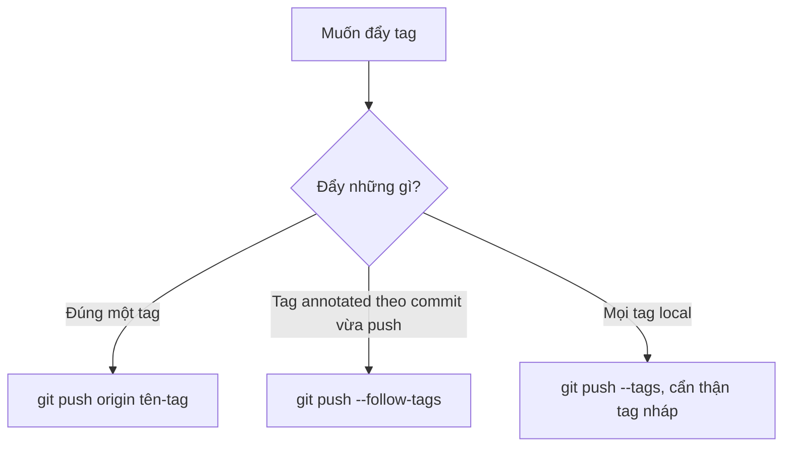
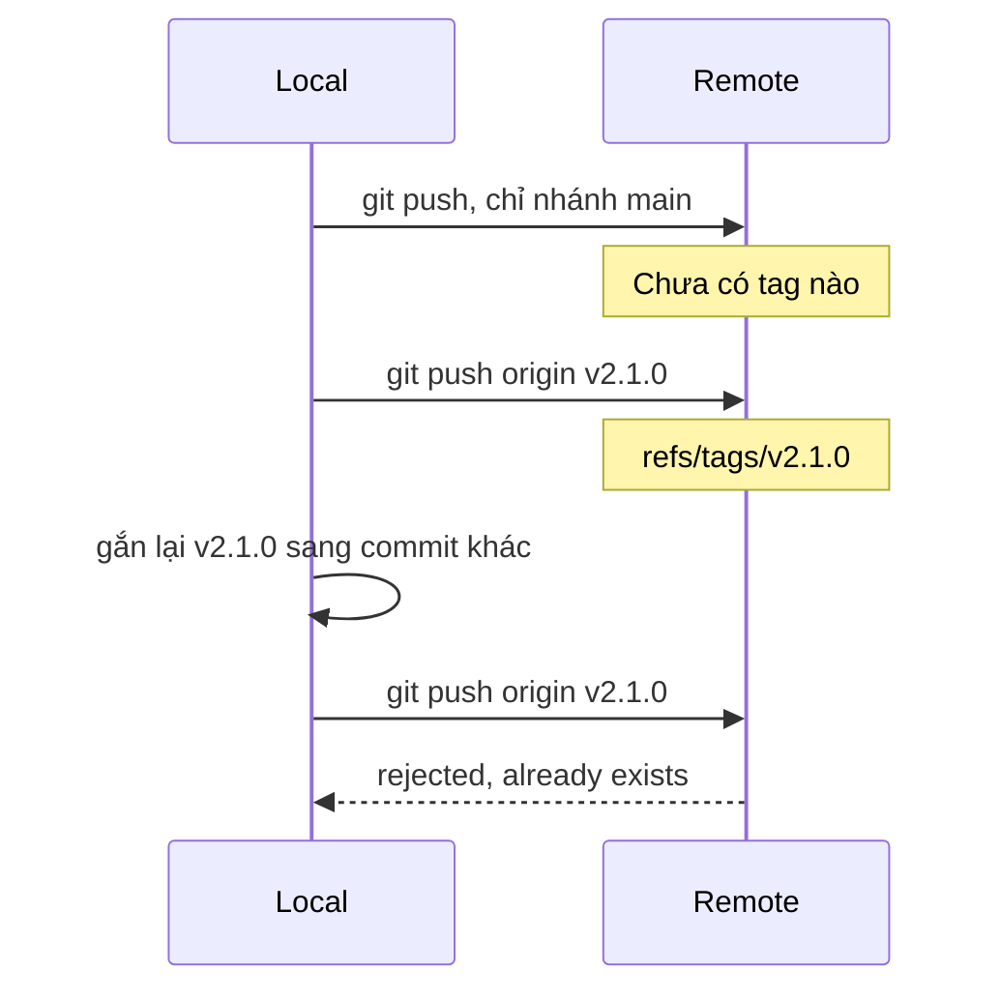

## Bạn sẽ học được gì

- Hiểu vì sao push nhánh không mang theo tag.
- Đẩy một tag cụ thể, đẩy mọi tag, hoặc chỉ đẩy tag annotated đi kèm commit.
- Xóa tag trên remote và đọc danh sách tag trên remote.
- Biết vì sao không nên di chuyển một tag đã đẩy lên.

## Khái niệm

Tag là ref trong `refs/tags/`, gắn tên cố định cho một commit, thường là một bản phát hành (các bài trong track release-ops sẽ nói kỹ về cách tạo tag). Ở bài này, câu hỏi là: làm sao để người khác thấy tag của bạn?

Điều nhiều người không ngờ: **`git push` không gửi tag**. Push nhánh chỉ đẩy nhánh và các commit cần thiết. Tag bạn tạo ở local vẫn chỉ nằm ở local, kể cả khi commit mà nó trỏ tới đã lên server. Git thiết kế như vậy vì tag thường được tạo thử, tạo nhầm, hay dùng làm dấu riêng; tự động đẩy hết sẽ làm bẩn repository chung.

Có ba cách đẩy tag:

- **`git push <remote> <tag>`**: đẩy đúng một tag. Cách rõ ràng và an toàn nhất.
- **`git push --tags`**: đẩy **mọi** tag ở local mà remote chưa có, kể cả tag thử nghiệm. Tiện nhưng dễ đẩy nhầm.
- **`git push --follow-tags`**: đẩy nhánh như bình thường, kèm theo các tag **annotated** trỏ tới commit đang được đẩy. Tag lightweight bị bỏ qua. Đây là sự cân bằng tốt: tag phát hành (thường là annotated) đi theo, tag nháp ở lại. Có thể bật mặc định bằng `push.followTags=true`.

Xóa tag trên remote: `git push <remote> --delete <tag>`, hoặc ghi đầy đủ `refs/tags/<tag>` khi có nhánh trùng tên.

Một quy tắc quan trọng: **tag đã đẩy lên thì đừng di chuyển**. Người khác có thể đã fetch tag đó, hệ thống build có thể đã đóng gói bản phát hành từ nó. Nếu bạn gắn lại tag ở local rồi push, remote **từ chối** vì tag đã tồn tại. Muốn ép phải dùng force, và những ai đã có tag cũ sẽ không tự cập nhật. Nếu bản phát hành có lỗi, hãy tạo phiên bản mới thay vì sửa tag cũ.

Khi đọc tag trên remote bằng `git ls-remote --tags`, tag annotated hiện hai dòng: một là object tag, một có hậu tố `^{}` là commit mà tag trỏ tới.

## Hình dung bằng sơ đồ





## Lệnh cần biết

```bash
git push <remote> <tag>              # đẩy một tag
git push --follow-tags               # đẩy nhánh kèm tag annotated liên quan
git push --tags                      # đẩy mọi tag
git push <remote> --delete <tag>     # xóa tag trên remote
git ls-remote --tags <remote>        # liệt kê tag trên remote
git config push.followTags true      # luôn --follow-tags
git fetch --tags                     # lấy mọi tag từ remote
```

| Cách | Tag annotated | Tag lightweight |
| --- | --- | --- |
| `git push` | Không | Không |
| `git push --follow-tags` | Có, nếu trỏ tới commit được đẩy | Không |
| `git push --tags` | Có | Có |
| `git push origin <tag>` | Chỉ tag được nêu | Chỉ tag được nêu |

## Ví dụ từng bước

Mình tạo một tag annotated phát hành và một tag lightweight thử nghiệm, rồi push nhánh:

```bash
git tag -a v2.1.0 -m "Phát hành 2.1.0"
git tag thu-nghiem
git push
git ls-remote --tags origin
```

```text
To /tmp/gt/r9/s.git
   321a168..56bb847  main -> main
```

`ls-remote` không in gì: remote chưa có tag nào. Đẩy riêng tag phát hành:

```bash
git push origin v2.1.0
git ls-remote --tags origin
```

```text
To /tmp/gt/r9/s.git
 * [new tag]         v2.1.0 -> v2.1.0
7a0e7c719df9c736a81af0e601c207aaba5f182c	refs/tags/v2.1.0
56bb847d3f55a57e058545fd0e1f7ecf24b608d0	refs/tags/v2.1.0^{}
```

Bản kế tiếp: commit mới có tag annotated `v2.2.0` và tag lightweight `nhap-2.2`. Dùng `--follow-tags`:

```bash
git push --follow-tags
```

```text
To /tmp/gt/r9/s.git
   56bb847..14941a3  main -> main
 * [new tag]         v2.2.0 -> v2.2.0
```

Chỉ `v2.2.0` đi theo. Còn `--tags` thì đẩy hết, kể cả hai tag nháp:

```text
 * [new tag]         nhap-2.2 -> nhap-2.2
 * [new tag]         thu-nghiem -> thu-nghiem
```

Xóa tag đẩy nhầm, và thử di chuyển một tag đã đẩy:

```bash
git push origin --delete thu-nghiem
git tag -f -a v2.1.0 -m "Gắn lại" HEAD
git push origin v2.1.0
```

```text
To /tmp/gt/r9/s.git
 - [deleted]         thu-nghiem
Updated tag 'v2.1.0' (was 7a0e7c7)
 ! [rejected]        v2.1.0 -> v2.1.0 (already exists)
error: failed to push some refs to '/tmp/gt/r9/s.git'
hint: Updates were rejected because the tag already exists in the remote.
```

## Lỗi thường gặp

**Tạo tag xong chỉ `git push`.** Tag không lên. Kiểm tra bằng `git ls-remote --tags`.

**`--tags` đẩy cả tag nháp.** Những tag thử nghiệm của bạn trở thành của cả đội. Ưu tiên đẩy từng tag hoặc `--follow-tags`.

> **Cẩn thận** Đừng force push để di chuyển tag phát hành. Đồng nghiệp đã có tag cũ sẽ giữ bản cũ, và hai người nói "v2.1.0" nhưng là hai commit khác nhau.

**Xóa tag ở local, tưởng remote cũng mất.** `git tag -d` chỉ xóa local; trên remote cần `git push <remote> --delete <tag>`.

> **Mẹo** Bật `push.followTags=true` và quen tạo tag phát hành dạng annotated. Tag phát hành sẽ tự đi theo, tag nháp lightweight thì không.

## Áp dụng trong công việc

Nhóm QA gắn tag cho mỗi phiên bản bộ test hồi quy đã được ký duyệt trước đợt phát hành ứng dụng ngân hàng di động, ví dụ `regression-2026.10`. Bạn tạo tag annotated ghi rõ phạm vi, đẩy riêng tag đó lên, rồi báo cho đội phát hành. Các tag thử nghiệm bạn đặt lúc dò lỗi thì ở yên trên máy.

## Chuẩn bị làm bài

Repository bài tập đã có một tag ở local và một remote chưa có tag đó. Bạn cần đưa đúng tag đó lên remote. Tránh dùng cách đẩy mọi tag; sau khi làm, kiểm tra danh sách tag trên remote và so hash với tag ở local.

## Tóm tắt

- `git push` thường không đẩy tag.
- `git push <remote> <tag>` đẩy đúng một tag; `--tags` đẩy tất cả.
- `--follow-tags` chỉ đẩy tag annotated trỏ tới commit đang được đẩy.
- Xóa tag trên remote bằng `git push <remote> --delete <tag>`.
- Tag đã chia sẻ thì không di chuyển; phát hành phiên bản mới thay thế.
