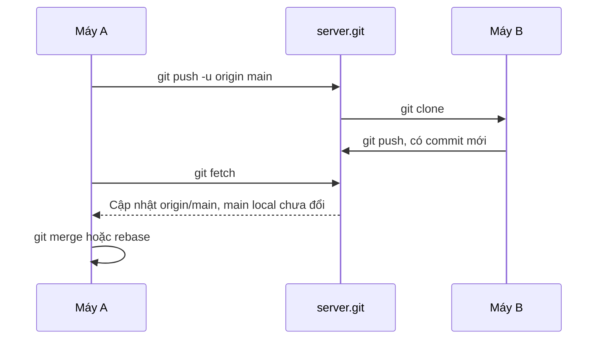
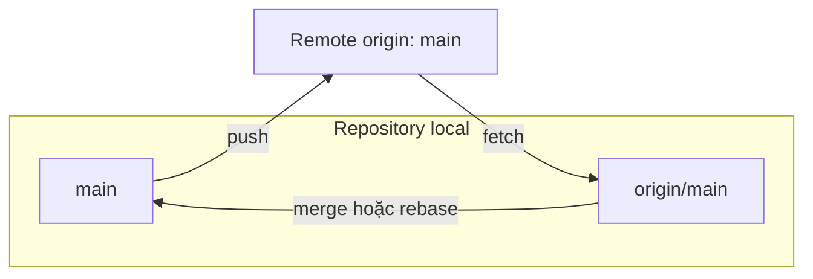

## Bạn sẽ học được gì

- Hiểu remote là gì: một cái tên gắn với địa chỉ của repository khác.
- Gửi nhánh lên remote bằng push và hiểu khi nào push bị từ chối.
- Phân biệt fetch với pull, và biết pull thực ra gồm hai bước.
- Xử lý tình huống hai người cùng push vào một nhánh.

## Khái niệm

Mọi repository Git đều đầy đủ và độc lập: lịch sử, nhánh, tag đều nằm trong `.git` trên máy bạn. Để làm việc nhóm, các repository cần trao đổi commit với nhau. **Remote** là một cái tên ngắn (thường là `origin`) mà bạn gắn với địa chỉ của repository khác. Địa chỉ đó có thể là URL HTTPS, SSH, hoặc chỉ là đường dẫn thư mục trên máy, như các bài tập trong ứng dụng này dùng.

Khi clone, Git tự tạo remote `origin` trỏ về nơi bạn clone. Khi `git init` một repository mới, chưa có remote nào; bạn tự thêm bằng `git remote add <tên> <địa chỉ>`. Cấu hình remote nằm trong `.git/config` của riêng repository bạn.

Ba lệnh trao đổi dữ liệu:

- **`git fetch`** tải commit và ref mới từ remote về, rồi cập nhật các **nhánh remote-tracking** như `origin/main`. Nó **không** đụng tới nhánh local hay working tree của bạn. Đây là thao tác an toàn, có thể chạy bất cứ lúc nào.
- **`git pull`** là fetch **cộng với** một bước tích hợp: merge (hoặc rebase, nếu cấu hình) nhánh upstream vào nhánh hiện tại.
- **`git push <remote> <nhánh>`** gửi commit của nhánh local lên remote và yêu cầu remote dời nhánh cùng tên tới đó.

Remote chỉ chấp nhận push nếu nó là **fast-forward**: commit mới phải nối tiếp lên commit mà nhánh trên server đang trỏ. Nếu ai đó đã push trước bạn, server có commit mà bạn chưa có; nhận push của bạn sẽ làm mất commit đó, nên server từ chối. Cách xử lý đúng là tích hợp trước (fetch rồi merge, hoặc `pull --rebase`), rồi mới push lại.

Push lần đầu thường kèm `-u` để đặt upstream (bài upstream ở track branching đã nói chi tiết). Sau đó, `git push` và `git pull` không cần ghi tên remote và nhánh nữa.

## Hình dung bằng sơ đồ





## Lệnh cần biết

```bash
git remote add <tên> <địa chỉ>    # gắn tên cho repository khác
git remote -v                     # liệt kê remote và URL
git push -u <remote> <nhánh>      # push lần đầu, đặt upstream
git push                          # push nhánh hiện tại lên upstream
git fetch [<remote>]              # tải về, chỉ cập nhật remote-tracking
git pull                          # fetch rồi tích hợp
git pull --rebase                 # fetch rồi rebase commit local lên trên
git log --oneline main..origin/main   # commit trên remote mà local chưa có
```

| Lệnh | Mạng | Đổi nhánh local | Đổi working tree |
| --- | --- | --- | --- |
| `fetch` | Tải về | Không | Không |
| `pull` | Tải về | Có | Có |
| `push` | Gửi lên | Không | Không |

## Ví dụ từng bước

Repository mới tạo chưa có remote, nên push báo lỗi:

```text
fatal: 'origin' does not appear to be a git repository
fatal: Could not read from remote repository.
```

Thêm remote (ở đây là một bare repository cạnh bên) và push lần đầu:

```bash
git remote add origin ../server.git
git remote -v
git push -u origin main
```

```text
origin	../server.git (fetch)
origin	../server.git (push)
To ../server.git
 * [new branch]      main -> main
branch 'main' set up to track 'origin/main'.
```

Một đồng nghiệp clone và push thêm commit. Ở máy A, `fetch` cho thấy nhánh remote đã đi trước:

```bash
git fetch
git status -sb
git log --oneline main..origin/main
```

```text
From ../server
   c1dc3ec..a74e9e2  main       -> origin/main
## main...origin/main [behind 1]
a74e9e2 Thêm ca kiểm thử
```

`git pull` lúc này chỉ là fast-forward:

```text
Updating c1dc3ec..a74e9e2
Fast-forward
 ca.txt | 1 +
```

Giờ cả hai cùng commit. Đồng nghiệp push trước, nên push của mình bị từ chối (hint rút gọn):

```text
 ! [rejected]        main -> main (fetch first)
error: failed to push some refs to '../server.git'
hint: Updates were rejected because the remote contains work that you do not
hint: have locally.
```

`git pull` không tùy chọn cũng dừng, vì hai nhánh đã phân kỳ và chưa cấu hình cách tích hợp:

```text
fatal: Need to specify how to reconcile divergent branches.
```

Mình chọn rebase, rồi push lại:

```bash
git pull --rebase
git push
git log --oneline --graph -4
```

```text
Successfully rebased and updated refs/heads/main.
To ../server.git
   4a85dfb..deba360  main -> main
* deba360 Sửa README trên máy A
* 4a85dfb Thêm y
* a74e9e2 Thêm ca kiểm thử
* c1dc3ec Khởi tạo
```

## Lỗi thường gặp

**Push khi chưa có remote, hoặc gõ sai tên remote.** Kiểm tra bằng `git remote -v`.

**Nghĩ fetch đã cập nhật code.** Fetch chỉ cập nhật `origin/main`; nhánh `main` của bạn đứng yên cho tới khi merge hoặc rebase.

> **Cẩn thận** Khi push bị từ chối, đừng thêm `--force` cho "qua". Force push sẽ xóa commit của đồng nghiệp trên server. Tích hợp trước, rồi push.

**Pull khi working tree đang dở dang.** Pull có thể dừng vì sửa đổi local sẽ bị ghi đè. Commit hoặc stash trước.

> **Mẹo** Thói quen `git fetch` rồi `git status -sb` trước mỗi lần bắt đầu làm việc cho bạn biết ngay mình đang ahead hay behind bao nhiêu commit.

## Áp dụng trong công việc

Nhóm QA có repository chung chứa kịch bản kiểm thử cho ứng dụng ví điện tử. Buổi sáng bạn fetch để xem đồng nghiệp đã đẩy thêm những ca nào, pull khi nhánh của mình sạch, và cuối ngày push các ca mới. Khi push bị từ chối vì ai đó vừa đẩy, bạn `pull --rebase` để lịch sử thẳng, chạy lại test nhanh rồi push.

## Chuẩn bị làm bài

Bài tập có một repository chưa có remote và một bare repository nằm trong thư mục bài tập. Bạn cần gắn bare repository đó làm remote với tên được yêu cầu, rồi đưa nhánh chính lên. Sau khi làm, so sánh hash nhánh local với nhánh trên remote (ví dụ bằng `git ls-remote`) để chắc chúng trùng.

## Tóm tắt

- Remote là tên ngắn trỏ tới repository khác; `origin` là tên mặc định khi clone.
- Fetch chỉ cập nhật nhánh remote-tracking; pull là fetch cộng merge hoặc rebase.
- Push chỉ được chấp nhận khi là fast-forward trên server.
- Push bị từ chối thì tích hợp trước, không force.
- `-u` ở lần push đầu giúp các lần sau chỉ cần `git push` và `git pull`.
