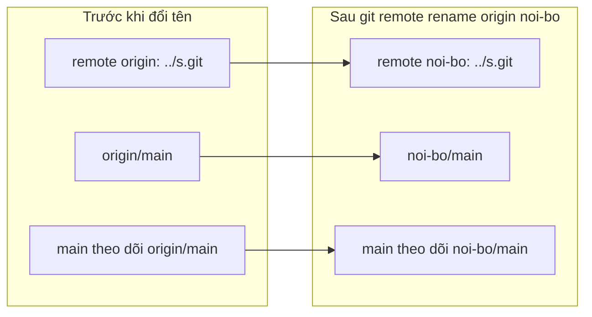
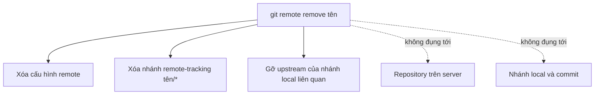

## Bạn sẽ học được gì

- Đổi tên một remote mà vẫn giữ URL và các thiết lập theo dõi.
- Xóa một remote không còn dùng và hiểu những gì bị dọn theo.
- Biết đổi tên và xóa remote không ảnh hưởng gì tới server.
- Xử lý các lỗi thường gặp: trùng tên, tên không tồn tại, nhánh mất upstream.

## Khái niệm

Tên remote chỉ là **nhãn local** cho một địa chỉ. Bạn có thể muốn đổi nhãn vì nhiều lý do: dự án chuyển từ fork sang repository chính và bạn muốn `origin` trỏ về bản mới, quy ước của đội dùng tên khác, hoặc bạn clone từ một bản sao lưu và muốn đặt tên phản ánh đúng vai trò.

`git remote rename <cũ> <mới>` làm nhiều việc hơn bạn tưởng, và đó là lý do nên dùng nó thay vì tự sửa `.git/config`:

- Đổi tên mục cấu hình `remote.<cũ>` thành `remote.<mới>`, **giữ nguyên URL**.
- Đổi tên mọi nhánh remote-tracking: `<cũ>/main` thành `<mới>/main`, và cập nhật refspec fetch tương ứng.
- Cập nhật cấu hình upstream của các nhánh local đang theo dõi remote đó (`branch.<nhánh>.remote`).

`git remote remove <tên>` (hoặc `rm`) thì ngược lại, xóa sạch dấu vết của remote **ở local**:

- Xóa mục cấu hình của remote.
- Xóa mọi nhánh remote-tracking `<tên>/*`.
- Gỡ thiết lập upstream của những nhánh local đang theo dõi remote đó. Sau đó `git pull` không tham số sẽ không biết lấy từ đâu.

Điểm quan trọng: **cả hai thao tác chỉ thay đổi repository của bạn**. Không có gì được gửi tới server; repository trên server, các nhánh trên đó và các clone của người khác giữ nguyên. Xóa remote chỉ có nghĩa là "mình không còn ghi nhớ địa chỉ này nữa"; muốn dùng lại, chỉ cần `git remote add`.

Các nhánh local và commit của bạn cũng không bị đụng tới. Chỉ những ref dưới `refs/remotes/<tên>/` biến mất, và chúng tái tạo được bằng một lần fetch nếu thêm lại remote.

## Hình dung bằng sơ đồ





## Lệnh cần biết

```bash
git remote rename <cũ> <mới>     # đổi tên, giữ URL và tracking
git remote remove <tên>          # xóa remote ở local (rm cũng được)
git remote -v                    # kiểm tra tên và URL
git branch -r                    # xem nhánh remote-tracking
git branch -vv                   # xem upstream của từng nhánh local
git config --get branch.<nhánh>.remote   # remote mà nhánh đang theo dõi
git remote set-url <tên> <URL>   # đổi URL mà không đổi tên
```

| Muốn làm gì | Lệnh |
| --- | --- |
| Đổi nhãn, giữ địa chỉ | `git remote rename` |
| Đổi địa chỉ, giữ nhãn | `git remote set-url` |
| Quên hẳn remote ở local | `git remote remove` |

## Ví dụ từng bước

Repository có hai remote, `main` theo dõi `origin/main`:

```bash
git branch -vv
git branch -r
```

```text
* main 321a168 [origin/main] Khởi tạo
  cu/main
  origin/main
```

Đổi tên `origin` thành `noi-bo`:

```bash
git remote rename origin noi-bo
git remote -v
git branch -vv
git branch -r
```

```text
cu	../old.git (fetch)
cu	../old.git (push)
noi-bo	../s.git (fetch)
noi-bo	../s.git (push)
* main 321a168 [noi-bo/main] Khởi tạo
  cu/main
  noi-bo/main
```

URL giữ nguyên, nhánh remote-tracking và upstream của `main` đã được đổi theo. Đổi sang một tên đã có thì bị từ chối:

```text
error: remote cu already exists.
```

Xóa remote `cu` không còn dùng:

```bash
git remote remove cu
git branch -r
```

```text
  noi-bo/main
```

Còn nếu xóa chính remote mà `main` đang theo dõi, nhánh mất upstream:

```bash
git remote remove noi-bo
git branch -vv
git pull
```

```text
* main 321a168 Khởi tạo
There is no tracking information for the current branch.
Please specify which branch you want to merge with.
```

Repository `s.git` trên "server" vẫn còn nguyên nhánh `main`.

## Lỗi thường gặp

**Tự sửa `.git/config` để đổi tên.** Bạn đổi được mục cấu hình nhưng các nhánh remote-tracking và upstream vẫn mang tên cũ, gây lỗi khó hiểu. Dùng `git remote rename`.

**Gõ sai tên khi xóa.** Git báo `error: No such remote: 'khong-co'` và không làm gì. Kiểm tra bằng `git remote` trước.

> **Lưu ý** Xóa remote không xóa gì trên server. Nếu mục tiêu là xóa một nhánh trên server, đó là việc của `git push <remote> --delete <nhánh>`.

**Quên đặt lại upstream sau khi xóa và thêm lại remote.** Thêm lại remote cùng tên không tự khôi phục upstream. Fetch, rồi `git branch --set-upstream-to=<remote>/<nhánh>`.

> **Mẹo** Khi chỉ đổi giao thức (HTTPS sang SSH) hay server đổi địa chỉ, dùng `set-url` thay vì xóa rồi thêm lại; cấu hình tracking không bị gỡ.

## Áp dụng trong công việc

Repository kịch bản kiểm thử của nhóm vừa được chuyển từ fork cá nhân của trưởng nhóm sang tổ chức chung của khối ngân hàng bán lẻ. Bạn đổi tên remote cũ thành `fork-cu` để còn tham khảo, thêm `origin` trỏ về địa chỉ mới, fetch và đặt upstream cho `main`. Một tuần sau, khi chắc không cần nữa, bạn xóa `fork-cu`.

## Chuẩn bị làm bài

Repository bài tập có một remote mang tên mặc định. Bạn cần đổi nó sang tên đề bài yêu cầu, đồng thời giữ nguyên địa chỉ. Kiểm tra bằng `git remote -v`: tên cũ phải biến mất, tên mới phải trỏ đúng địa chỉ ban đầu.

## Tóm tắt

- Tên remote là nhãn local; đổi hay xóa không ảnh hưởng server.
- `git remote rename` giữ URL và đổi theo nhánh remote-tracking, upstream.
- `git remote remove` xóa cấu hình, nhánh remote-tracking và upstream liên quan.
- Đổi địa chỉ mà giữ tên thì dùng `set-url`.
- Đừng sửa tay `.git/config` để đổi tên remote.
