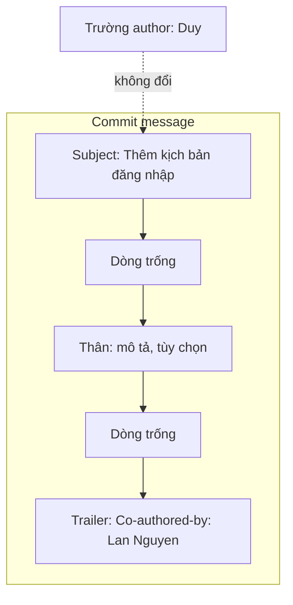

## Bạn sẽ học được gì

- Hiểu trailer là gì và vị trí đúng của nó trong commit message.
- Ghi đồng tác giả bằng trailer `Co-authored-by:` mà không thay đổi author chính.
- Tạo trailer bằng nhiều `-m` hoặc bằng `git commit --trailer`.
- Đọc và thống kê trailer bằng `git log --format` và `git shortlog`.

## Khái niệm

Mỗi commit chỉ có một author (và một committer). Nhưng thực tế nhiều thay đổi được viết chung: hai người cùng ngồi một máy, hoặc một người viết khung còn người kia hoàn thiện. Để ghi công đầy đủ, cộng đồng dùng **trailer**: các dòng dạng `Khóa: giá trị` đặt ở **đoạn cuối cùng** của commit message, cách phần trên bằng một dòng trống.

```text
Thêm kịch bản đăng nhập

Mô tả chi tiết (tùy chọn).

Co-authored-by: Lan Nguyen <lan@example.invalid>
```

Một số điểm cần nắm:

- `Co-authored-by:` là quy ước được nhiều nền tảng hosting nhận ra để hiển thị nhiều tác giả. Bản thân Git coi nó như mọi trailer khác: không đổi trường author, không đổi object ID theo cách đặc biệt nào.
- Trailer phải nằm ở đoạn cuối, mỗi trailer một dòng, đúng dạng `Khóa: giá trị`. Viết lẫn vào subject hoặc giữa đoạn văn thì Git không coi là trailer.
- Định dạng giá trị theo kiểu `Tên <email>`. Nền tảng hosting thường dựa vào email để liên kết với tài khoản, nên hãy dùng email mà người đó dùng cho Git.
- Có thể có nhiều trailer `Co-authored-by:`, mỗi người một dòng.

Cách tạo:

- `git commit -m "Subject" -m "Co-authored-by: ..."`: mỗi `-m` là một đoạn, Git tự chèn dòng trống giữa các đoạn.
- `git commit --trailer "Co-authored-by: ..."`: Git tự đặt trailer vào đúng chỗ, kể cả khi message nhiều đoạn.
- Viết trong editor, nhớ dòng trống trước khối trailer.

## Hình dung bằng sơ đồ



## Lệnh cần biết

```bash
# Hai đoạn: subject và trailer
git commit -m "Thêm kịch bản đăng nhập" -m "Co-authored-by: Lan Nguyen <lan@example.invalid>"

# Để Git tự đặt trailer
git commit -m "Thêm kịch bản đăng xuất" --trailer "Co-authored-by: Minh Tran <minh@example.invalid>"

# Đọc message đầy đủ
git log -1 --format=%B

# Chỉ đọc trailer
git log -1 --format='%(trailers)'
git log -1 --format='%(trailers:key=Co-authored-by,valueonly)'

# Thống kê theo author và đồng tác giả
git shortlog -s -n --group=author --group=trailer:co-authored-by
```

## Ví dụ từng bước

Repository có commit "Khởi tạo"; bạn (Duy) và Lan cùng viết kịch bản đăng nhập (ID trên máy bạn sẽ khác):

```bash
git add login.txt
git commit -m "Thêm kịch bản đăng nhập" -m "Co-authored-by: Lan Nguyen <lan@example.invalid>"
git log -1 --format=%B
git log -1 --format='%(trailers:key=Co-authored-by,valueonly)'
```

```text
[main 739f159] Thêm kịch bản đăng nhập
 1 file changed, 1 insertion(+)
 create mode 100644 login.txt
Thêm kịch bản đăng nhập

Co-authored-by: Lan Nguyen <lan@example.invalid>

Lan Nguyen <lan@example.invalid>
```

Git nhận đúng đoạn cuối là trailer. Commit tiếp theo có hai đồng tác giả, dùng `--trailer`:

```bash
git commit -m "Thêm kịch bản đăng xuất" \
  --trailer "Co-authored-by: Minh Tran <minh@example.invalid>" \
  --trailer "Co-authored-by: Lan Nguyen <lan@example.invalid>"
git log -1 --format='%an | %(trailers:key=Co-authored-by,valueonly,separator=%x2C )'
```

```text
[main 20e586d] Thêm kịch bản đăng xuất
 1 file changed, 1 insertion(+)
 create mode 100644 logout.txt
Duy | Minh Tran <minh@example.invalid>, Lan Nguyen <lan@example.invalid>
```

Author vẫn là Duy; hai đồng tác giả nằm trong trailer. Giờ xem điều gì xảy ra nếu viết sai chỗ, nhét trailer vào subject:

```bash
git commit -m "Thêm bad Co-authored-by: Lan Nguyen <lan@example.invalid>"
git log -1 --format='[%(trailers)]'
```

```text
[main 3890168] Thêm bad Co-authored-by: Lan Nguyen <lan@example.invalid>
[]
```

Không có trailer nào: Git chỉ thấy một subject dài. Đây là lý do cần đoạn riêng.

Thống kê đóng góp, gộp cả author và đồng tác giả (chạy trên lịch sử có hai commit hợp lệ ở trên và commit "Khởi tạo"):

```bash
git shortlog -s -n --group=author --group=trailer:co-authored-by HEAD
```

```text
     3	Duy
     2	Lan Nguyen
     1	Minh Tran
```

> **Mẹo** Khi thiếu trailer ở commit vừa tạo, thêm bằng `git commit --amend --no-edit --trailer "Co-authored-by: ..."`. Chỉ làm với commit chưa push, vì amend đổi object ID.

## Lỗi thường gặp

**Viết trailer trong subject.** Như ví dụ trên, Git không nhận.

**Quên dòng trống trước trailer.** Khi viết trong editor, nếu trailer dính vào đoạn mô tả, Git có thể không coi đó là khối trailer.

**Sai chính tả khóa.** `Co-Author:` hay `Coauthored-by:` không phải quy ước; nền tảng hosting sẽ không nhận ra.

**Đổi author thay vì thêm trailer.** `--author` thay hẳn người viết chính, mất ghi công của bạn.

> **Lưu ý** Trailer chỉ là văn bản; Git không xác minh người được ghi có thật sự tham gia. Hãy hỏi trước khi ghi tên ai đó, và dùng đúng email người đó muốn công khai.

## Áp dụng trong công việc

Bạn và một QA mới cùng viết bộ kịch bản kiểm thử đăng nhập ngân hàng số trong buổi kèm cặp. Bạn commit với trailer `Co-authored-by:` ghi tên đồng nghiệp. Cuối quý, khi tổng hợp đóng góp, `git shortlog --group=trailer:co-authored-by` cho thấy công sức của người mới, dù họ chưa tự commit lần nào.

## Chuẩn bị làm bài

Bài thực hành có sẵn một tệp chưa commit. Bạn cần commit tệp đó với subject và một trailer đồng tác giả đúng như đề bài ghi, đặt ở đoạn riêng. Kiểm tra lại bằng `git log -1 --format=%B` trước khi nộp. Câu hỏi kiến thức hỏi chuỗi mở đầu của trailer chuẩn để ghi đồng tác giả.

## Tóm tắt

- Trailer là dòng `Khóa: giá trị` ở đoạn cuối của commit message.
- `Co-authored-by: Tên <email>` ghi đồng tác giả, không đổi author chính.
- Tạo bằng nhiều `-m` hoặc `git commit --trailer`.
- Đọc bằng `%(trailers)`, thống kê bằng `git shortlog --group=trailer:...`.
- Trailer viết sai chỗ hoặc sai khóa sẽ không được nhận.
