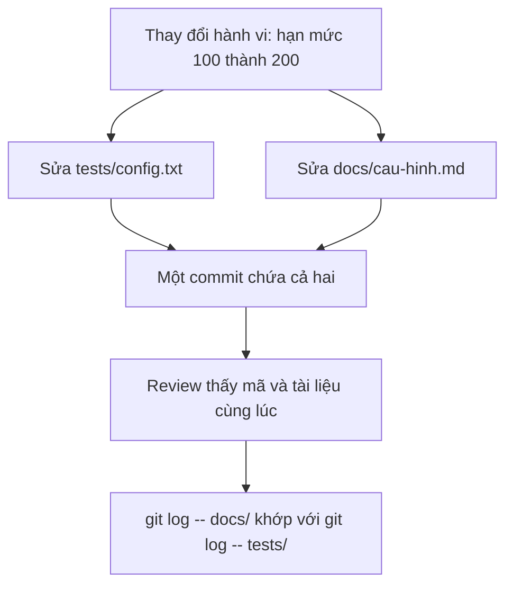

## Bạn sẽ học được gì

- Hiểu nguyên tắc "tài liệu đi cùng mã" (docs as code) và vì sao nó giữ tài liệu không lệch hành vi.
- Biết vai trò của các tệp tài liệu quy ước: `README.md`, `CONTRIBUTING.md`, thư mục `docs/`.
- Commit thay đổi hành vi cùng thay đổi tài liệu trong một commit.
- Dùng `git log -- <đường dẫn>` để kiểm tra tài liệu có được cập nhật cùng mã hay không.

## Khái niệm

Tài liệu lệch khỏi thực tế là chuyện thường gặp: wiki ghi hạn mức là 100 trong khi cấu hình đã đổi thành 200 từ ba tháng trước. Nguyên nhân thường là tài liệu sống ở một nơi, mã sống ở nơi khác, và không có gì buộc hai thứ đổi cùng nhau.

"Tài liệu đi cùng mã" giải quyết bằng cách đặt tài liệu ngay trong repository, viết bằng văn bản thuần (thường là Markdown), và đối xử với nó như mã:

- Thay đổi hành vi nào cần cập nhật tài liệu thì cập nhật **trong cùng commit** (hoặc ít nhất cùng PR). Người review thấy cả hai, và lịch sử ghi lại chúng cùng lúc.
- Tài liệu đi qua review như mọi thay đổi khác.
- Lịch sử Git trả lời được "tài liệu này đổi khi nào, vì sao, ai đổi".

Các tệp quy ước thường gặp:

| Tệp | Dành cho | Nội dung |
| --- | --- | --- |
| `README.md` | Mọi người, nhất là người mới | Dự án là gì, cài đặt, chạy, kiểm thử |
| `CONTRIBUTING.md` | Người muốn đóng góp | Quy ước nhánh, quy trình review, yêu cầu kiểm thử trước khi mở PR |
| `docs/` | Người cần chi tiết | Kiến trúc, cấu hình, hướng dẫn chuyên sâu |
| `CHANGELOG.md` | Người dùng bản phát hành | Thay đổi theo từng phiên bản |

`CONTRIBUTING.md` là nơi ghi "luật chơi" của nhóm: nhánh đặt tên ra sao, commit message theo chuẩn nào, ai cần duyệt, test nào phải chạy. Nhiều nền tảng hosting tự hiển thị đường dẫn tới tệp này khi ai đó mở PR hay issue mới.

## Hình dung bằng sơ đồ



## Lệnh cần biết

```bash
# Xem đã stage những gì, chắc chắn có cả mã và tài liệu
git diff --cached --stat

# Commit cả hai
git commit -m "Tăng hạn mức test lên 200, cập nhật tài liệu"

# Lịch sử của tài liệu và của mã
git log --oneline -- docs/
git log --oneline -- tests/config.txt

# Commit kèm danh sách tệp
git log --stat --format='%h %s' -1

# Mọi tệp Markdown trong repository
git ls-files '*.md'
```

## Ví dụ từng bước

Repository có `tests/config.txt` (cấu hình hạn mức test), `docs/cau-hinh.md` (mô tả cấu hình) và `CONTRIBUTING.md` của nhóm. Phần quy ước trong đó trông như sau:

```markdown
## Đặt tên nhánh
Dùng dạng qa/<mã-ticket>-<mô-tả-ngắn>.

## Trước khi mở PR
Chạy toàn bộ test và cập nhật docs/ nếu hành vi thay đổi.

## Người duyệt
Ít nhất một QA lead duyệt mỗi PR.
```

Bạn đổi hạn mức từ 100 lên 200. Sau khi sửa cấu hình:

```bash
git diff --stat
```

```text
 tests/config.txt | 2 +-
 1 file changed, 1 insertion(+), 1 deletion(-)
```

Chỉ có mã. Theo quy ước, bạn cập nhật luôn `docs/cau-hinh.md`, stage cả hai và kiểm tra (ID trên máy bạn sẽ khác):

```bash
git add tests/config.txt docs/cau-hinh.md
git diff --cached --stat
git commit -m "Tăng hạn mức test lên 200, cập nhật tài liệu"
```

```text
 docs/cau-hinh.md | 2 +-
 tests/config.txt | 2 +-
 2 files changed, 2 insertions(+), 2 deletions(-)
[main d5b9800] Tăng hạn mức test lên 200, cập nhật tài liệu
 2 files changed, 2 insertions(+), 2 deletions(-)
```

Lịch sử của tài liệu và của cấu hình đi song song:

```bash
git log --oneline -- docs/
git log --oneline -- tests/config.txt
```

```text
d5b9800 Tăng hạn mức test lên 200, cập nhật tài liệu
333b4a9 Thêm cấu hình test và quy ước đóng góp
d5b9800 Tăng hạn mức test lên 200, cập nhật tài liệu
333b4a9 Thêm cấu hình test và quy ước đóng góp
```

Nếu một ngày `git log -- tests/config.txt` có commit mới mà `git log -- docs/` thì không, đó là tín hiệu tài liệu có thể đã lệch.

> **Mẹo** Thêm một dòng vào mẫu mô tả PR của nhóm: "Tài liệu đã cập nhật chưa?". Câu hỏi nhỏ này nhắc cả tác giả lẫn người review.

## Lỗi thường gặp

**Để tài liệu "làm sau".** "Sau" thường là không bao giờ. Cập nhật trong cùng commit hoặc cùng PR.

**Tài liệu nằm ngoài repository.** Không có review, không có lịch sử đi kèm mã, dễ lệch.

**`CONTRIBUTING.md` quá chung chung.** "Hãy viết code tốt" không giúp ai. Ghi quy ước cụ thể: tên nhánh, ai duyệt, lệnh test nào.

**Gộp mọi thứ vào README.** README phình to, người mới bị ngợp. Tách quy ước đóng góp sang `CONTRIBUTING.md`, chi tiết sang `docs/`.

> **Lưu ý** Commit tách riêng "chỉ sửa tài liệu" vẫn hợp lệ khi sửa lỗi chính tả hay bổ sung giải thích. Quy tắc "cùng commit" áp dụng cho trường hợp hành vi thay đổi.

## Áp dụng trong công việc

Kiểm toán nội bộ hỏi: "Hạn mức trong môi trường test được đổi từ khi nào, có ai duyệt không?". Vì cấu hình và tài liệu đổi cùng commit, đi qua PR có người duyệt, bạn trả lời bằng một lệnh `git log --stat -- docs/cau-hinh.md`, kèm commit ID và tên người duyệt trong lịch sử PR.

## Chuẩn bị làm bài

Bài thực hành có repository với một commit ban đầu. Bạn cần tạo tệp mô tả quy ước đóng góp ở gốc repository, có đủ các mục mà đề bài liệt kê (đọc kỹ tên mục), kiểm tra diff rồi commit để working tree sạch. Câu hỏi kiến thức hỏi tệp nào mô tả quy ước đóng góp cho repository; ôn lại bảng các tệp quy ước ở trên.

## Tóm tắt

- Tài liệu nằm cùng mã, viết bằng văn bản thuần và đi qua review.
- Thay đổi hành vi thì cập nhật tài liệu trong cùng commit hoặc PR.
- `README.md` cho người mới, `CONTRIBUTING.md` cho quy ước đóng góp, `docs/` cho chi tiết.
- `git log -- <đường dẫn>` giúp phát hiện tài liệu bị lệch.
- Quy ước càng cụ thể càng hữu ích.
