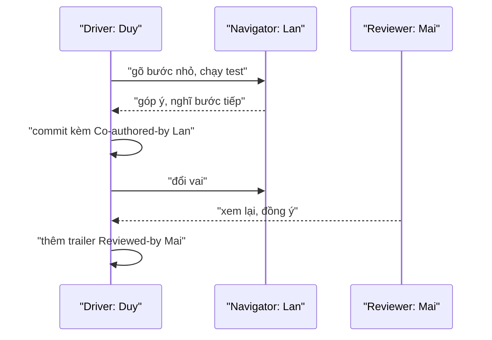

## Bạn sẽ học được gì

- Hiểu mô hình làm việc cặp (pair programming): người gõ (driver) và người quan sát (navigator).
- Tổ chức commit trong buổi làm cặp: nhỏ, message rõ, đổi vai đều đặn.
- Ghi nhận đóng góp bằng nhiều trailer: `Co-authored-by:` và `Reviewed-by:`.
- Tìm lại commit theo trailer khi cần truy vết.

## Khái niệm

Trong làm việc cặp, hai người cùng giải một vấn đề. **Driver** cầm bàn phím, gõ code. **Navigator** đọc theo, nghĩ trước một bước, phát hiện lỗi, đặt câu hỏi. Sau một khoảng thời gian (nhiều nhóm dùng 15 đến 30 phút) hai người đổi vai. Một biến thể là "mob": cả nhóm nhỏ cùng một màn hình, xoay vòng driver.

Git không biết gì về làm việc cặp, nhưng vài thói quen giúp lịch sử phản ánh đúng thực tế:

- **Commit nhỏ, thường xuyên**: mỗi lần hoàn thành một bước nhỏ có test, commit. Khi đổi vai trên hai máy, người kia chỉ cần pull.
- **Message rõ ràng**: hai người cùng thống nhất subject. Đây cũng là lúc tự review message.
- **Ghi công**: người không commit được ghi bằng `Co-authored-by:`.
- **Ghi người review**: nếu có người thứ ba (hoặc navigator, theo quy ước của nhóm) xem lại trước khi commit, ghi bằng `Reviewed-by:`. Đây cũng là một trailer quen thuộc trong nhiều dự án.

Một commit có thể có nhiều trailer, mỗi trailer một dòng trong cùng khối cuối message. Thứ tự thường không quan trọng với Git, nhưng nhóm nên thống nhất một thứ tự cho dễ đọc.

Khi đổi vai giữa hai máy, cách đơn giản là đẩy nhánh làm việc lên remote rồi người kia kéo về. Một số nhóm dùng nhánh tạm với các commit "WIP" để chuyển giao, rồi gộp lại trước khi mở PR. Nếu làm vậy, hãy đảm bảo trailer được giữ trong commit cuối cùng.

## Hình dung bằng sơ đồ



## Lệnh cần biết

```bash
# Commit kèm hai trailer bằng nhiều -m
git commit -m "Subject" \
  -m "Co-authored-by: Lan Nguyen <lan@example.invalid>" \
  -m "Reviewed-by: Mai Tran <mai@example.invalid>"

# Hoặc bằng --trailer
git commit -m "Subject" --trailer "Co-authored-by: ..." --trailer "Reviewed-by: ..."

# Thêm trailer vào commit vừa tạo (chưa push)
git commit --amend --no-edit --trailer "Reviewed-by: Mai Tran <mai@example.invalid>"

# Thử trailer trên một message bất kỳ mà không commit
printf 'Sửa lỗi\n\nMô tả.\n' | git interpret-trailers --trailer 'Reviewed-by: Mai Tran <mai@example.invalid>'

# Tìm commit có người review
git log --format='%h %s' --grep='^Reviewed-by:'
```

> **Lưu ý** Mỗi `-m` tạo một đoạn mới, nên ba `-m` ở trên sinh ra hai trailer nằm ở hai đoạn, cách nhau một dòng trống. Git chỉ coi đoạn cuối là khối trailer. Nếu cần cả hai được nhận là trailer, hãy dùng `--trailer` hoặc viết hai dòng liền nhau trong editor.

## Ví dụ từng bước

Thử `interpret-trailers` để thấy Git đặt trailer ở đâu, không cần commit:

```bash
printf 'Sửa lỗi\n\nMô tả.\n' | git interpret-trailers --trailer 'Reviewed-by: Mai Tran <mai@example.invalid>'
```

```text
Sửa lỗi

Mô tả.

Reviewed-by: Mai Tran <mai@example.invalid>
```

Trong buổi làm cặp, Duy gõ, Lan và Minh cùng góp ý. Commit với hai đồng tác giả (ID trên máy bạn sẽ khác):

```bash
git commit -m "Thêm kịch bản đăng xuất" \
  --trailer "Co-authored-by: Minh Tran <minh@example.invalid>" \
  --trailer "Co-authored-by: Lan Nguyen <lan@example.invalid>"
```

```text
[main 20e586d] Thêm kịch bản đăng xuất
 1 file changed, 1 insertion(+)
 create mode 100644 logout.txt
```

Mai review xong và đồng ý. Commit chưa push, nên bổ sung trailer bằng amend:

```bash
git commit --amend --no-edit --trailer "Reviewed-by: Mai Tran <mai@example.invalid>"
git log -1 --format=%B
```

```text
[main 95aab61] Thêm kịch bản đăng xuất
 Date: Fri Oct 16 00:18:59 2026 +0700
 1 file changed, 1 insertion(+)
 create mode 100644 logout.txt
Thêm kịch bản đăng xuất

Co-authored-by: Minh Tran <minh@example.invalid>
Co-authored-by: Lan Nguyen <lan@example.invalid>
Reviewed-by: Mai Tran <mai@example.invalid>
```

Ba trailer nằm chung một khối. Để ý ID đổi từ `20e586d` sang `95aab61` vì amend tạo commit mới. Tìm commit đã qua review:

```bash
git log --format='%h %s' --grep='^Reviewed-by:'
```

```text
95aab61 Thêm kịch bản đăng xuất
```

Để kiểm chứng phần lưu ý về nhiều `-m`, thử trên một repository nháp:

```bash
git commit -m "Làm việc cặp" \
  -m "Co-authored-by: Lan Nguyen <lan@example.invalid>" \
  -m "Reviewed-by: Mai Tran <mai@example.invalid>"
git log -1 --format='[%(trailers)]'
```

```text
[Reviewed-by: Mai Tran <mai@example.invalid>
]
```

Hai dòng vẫn có trong message, nhưng Git chỉ nhận dòng ở đoạn cuối là trailer.

> **Mẹo** Tạo một commit template cho nhóm (`git config commit.template .gitmessage`) có sẵn dòng `Co-authored-by:` để điền tên, giảm việc quên ghi công khi làm cặp.

## Lỗi thường gặp

**Một người giữ bàn phím cả buổi.** Navigator mất tập trung, lợi ích của làm cặp giảm. Đổi vai đều đặn.

**Commit một cục lớn cuối buổi.** Khó review, khó quay lại khi một bước sai. Commit sau mỗi bước nhỏ có test.

**Ghi `Reviewed-by:` cho người chưa thật sự xem.** Trailer này là một lời xác nhận; ghi sai làm mất giá trị của nó.

**Amend thêm trailer sau khi đã push.** Phải force-push, ảnh hưởng người khác. Thêm trailer trước khi push.

> **Cẩn thận** Nếu nhóm gộp các commit WIP trước khi mở PR, kiểm tra commit cuối vẫn còn đủ trailer. Khi squash, Git ghép message của các commit, và trailer có thể nằm lẫn giữa message thay vì ở đoạn cuối.

## Áp dụng trong công việc

Nhóm QA làm cặp để viết bộ test hồi quy cho tính năng chuyển khoản định kỳ. Mỗi 25 phút đổi driver, mỗi bước test xanh là một commit có `Co-authored-by:`. Trước khi push, trưởng nhóm review nhanh và được ghi `Reviewed-by:`. Khi kiểm toán nội bộ hỏi "thay đổi này ai viết, ai xem?", lịch sử Git trả lời được ngay.

## Chuẩn bị làm bài

Bài thực hành có sẵn một tệp chưa commit. Bạn cần commit tệp đó với hai trailer theo đề: một ghi người cùng viết, một ghi người review, đúng tên và email được cho. Hãy tự chọn cách tạo trailer, rồi kiểm tra bằng `git log -1 --format=%B`. Câu hỏi kiến thức hỏi trailer ghi nhận người cùng lập trình.

## Tóm tắt

- Làm việc cặp gồm driver và navigator, đổi vai đều đặn.
- Commit nhỏ, message thống nhất, đẩy nhánh lên remote khi đổi máy.
- `Co-authored-by:` ghi người cùng viết, `Reviewed-by:` ghi người xem lại.
- Nhiều trailer nằm chung khối cuối message; `--trailer` giúp đặt đúng chỗ.
- Thêm trailer trước khi push; amend sau khi push đòi hỏi force-push.
