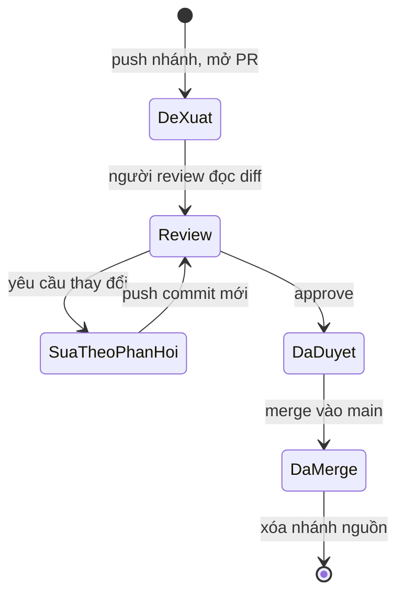
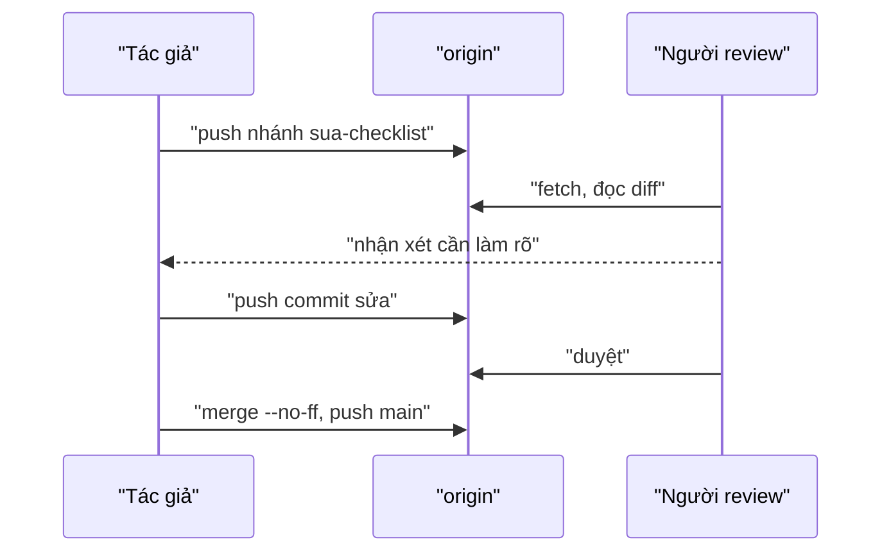

## Bạn sẽ học được gì

- Nắm các giai đoạn của một pull request (PR): đề xuất, review, sửa theo phản hồi, duyệt, merge, dọn dẹp.
- Hiểu PR là tính năng của nền tảng hosting, còn bên dưới chỉ là nhánh, push và merge của Git.
- Mô phỏng toàn bộ vòng đời PR hoàn toàn offline bằng một bare repository làm origin.
- Biết vì sao nhóm thường merge PR bằng `--no-ff` hoặc squash.

## Khái niệm

Pull request (GitLab gọi là merge request) không phải là khái niệm của Git. Đó là một trang trên nền tảng hosting như GitHub, GitLab, Bitbucket, gom lại: một nhánh nguồn, một nhánh đích, mô tả, các bình luận review, kết quả CI và nút merge. Bên dưới, mọi thứ vẫn là thao tác Git quen thuộc.

> **Lưu ý** Bài này là mô phỏng. Ứng dụng luyện tập chạy offline, không có GitHub hay trang PR thật. Bạn sẽ dùng một bare repository trên máy làm origin, và một ref tùy chỉnh để đánh dấu "đã được duyệt" thay cho nút Approve trên web.

Vòng đời điển hình:

1. **Đề xuất**: tạo nhánh từ main mới nhất, commit, push nhánh lên origin, mở PR với mô tả rõ mục tiêu và cách kiểm thử.
2. **Review**: đồng nghiệp đọc diff (thường là diff ba chấm so với nhánh đích), chạy thử, để lại nhận xét. Nhiều nhóm đặt quy tắc bảo vệ nhánh: phải có ít nhất một người duyệt và CI phải xanh trước khi merge.
3. **Sửa theo phản hồi**: tác giả thêm commit lên cùng nhánh rồi push. PR tự cập nhật vì nó trỏ tới nhánh, không trỏ tới một commit cố định.
4. **Duyệt**: người review xác nhận. Lần duyệt gắn với trạng thái nhánh tại thời điểm đó; nếu tác giả push tiếp, nhiều nhóm yêu cầu duyệt lại.
5. **Merge**: nền tảng thực hiện một trong ba kiểu: merge commit (`--no-ff`), squash (gom thành một commit), hoặc rebase rồi fast-forward.
6. **Dọn dẹp**: xóa nhánh nguồn trên remote và local, cập nhật main local.

Merge `--no-ff` giữ lại một merge commit đánh dấu rõ "đây là lúc PR được đưa vào", kể cả khi có thể fast-forward. Lịch sử nhìn bằng `git log --first-parent main` sẽ chỉ còn các merge commit, mỗi cái tương ứng một PR.

## Hình dung bằng sơ đồ





## Lệnh cần biết

```bash
# Tạo origin offline để mô phỏng
git init --bare -b main ../origin.git
git remote add origin ../origin.git

# Đề xuất
git switch -c sua-checklist
git push -u origin sua-checklist

# Cập nhật PR sau phản hồi
git push

# Mô phỏng dấu "đã duyệt" bằng ref tùy chỉnh
git update-ref refs/review/sua-checklist-ok sua-checklist

# Merge và đẩy lên
git switch main
git merge --no-ff sua-checklist
git push origin main

# Dọn dẹp
git push origin --delete sua-checklist
git branch -d sua-checklist
```

## Ví dụ từng bước

Repository có commit "Khởi tạo"; origin là bare repository `../origin.git` (ID trên máy bạn sẽ khác). Đẩy main lên trước:

```bash
git remote add origin ../origin.git
git push -u origin main
```

```text
To ../origin.git
 * [new branch]      main -> main
branch 'main' set up to track 'origin/main'.
```

Đề xuất: tạo nhánh, commit "Thêm checklist phí", push.

```bash
git switch -c sua-checklist
git push -u origin sua-checklist
```

```text
Switched to a new branch 'sua-checklist'
To ../origin.git
 * [new branch]      sua-checklist -> sua-checklist
branch 'sua-checklist' set up to track 'origin/sua-checklist'.
```

Người review đề nghị ghi rõ loại phí. Tác giả commit "Làm rõ checklist theo review" và push; nhánh trên origin tiến lên:

```bash
git push
```

```text
To ../origin.git
   ae32d58..279d44d  sua-checklist -> sua-checklist
```

Người review đồng ý. Trong bản mô phỏng, mình ghi dấu duyệt bằng một ref trỏ tới đúng commit đã được xem:

```bash
git update-ref refs/review/sua-checklist-ok sua-checklist
```

Merge và push:

```bash
git switch main
git merge --no-ff sua-checklist -m "Merge sua-checklist"
git log --oneline --graph
git push origin main
```

```text
Merge made by the 'ort' strategy.
 checklist.txt | 1 +
 1 file changed, 1 insertion(+)
 create mode 100644 checklist.txt
*   9260043 Merge sua-checklist
|\  
| * 279d44d Làm rõ checklist theo review
| * ae32d58 Thêm checklist phí
|/  
* 732a9e7 Khởi tạo
To ../origin.git
   732a9e7..9260043  main -> main
```

Dọn dẹp nhánh nguồn và kiểm tra origin:

```bash
git push origin --delete sua-checklist
git branch -d sua-checklist
git ls-remote origin
```

```text
To ../origin.git
 - [deleted]         sua-checklist
Deleted branch sua-checklist (was 279d44d).
9260043955507259af735bf4c35b4c7df477aac3	HEAD
9260043955507259af735bf4c35b4c7df477aac3	refs/heads/main
```

> **Mẹo** So sánh ref duyệt với đầu nhánh trước khi merge: `git rev-parse refs/review/sua-checklist-ok sua-checklist`. Hai ID khác nhau nghĩa là có commit được push sau khi duyệt, chưa ai xem.

## Lỗi thường gặp

**Merge khi chưa có review.** Quy tắc nhóm yêu cầu người khác xem trước; bỏ qua là mất lớp bảo vệ quan trọng nhất.

**Push thêm commit sau khi đã được duyệt mà không báo.** Người review đã duyệt phiên bản cũ, không phải phiên bản đang được merge.

**PR quá lớn.** Diff hàng nghìn dòng khó review kỹ. Tách thành nhiều PR nhỏ theo từng mục tiêu.

**Quên dọn nhánh.** Remote đầy nhánh cũ, khó biết nhánh nào còn sống.

> **Cẩn thận** Trên nền tảng thật, đừng force-push lên nhánh PR khi người khác đang review mà không báo trước; bình luận gắn với commit cũ có thể bị lạc.

## Áp dụng trong công việc

Nhóm kiểm thử của một ngân hàng giả định quy định: mọi thay đổi checklist kiểm thử thanh toán phải có một QA lead duyệt. Khi bạn mở PR, mô tả ghi rõ: mục tiêu, tệp đổi, cách đã kiểm tra lại. Người duyệt dùng diff ba chấm để chỉ đọc thay đổi của bạn, rồi duyệt. Merge `--no-ff` giúp sau này tra `git log --first-parent` là thấy mỗi đợt thay đổi checklist.

## Chuẩn bị làm bài

Bài thực hành là bản mô phỏng offline: repository đã có origin local và một nhánh tính năng có sẵn commit. Bạn sẽ đi qua các bước đẩy nhánh lên origin, ghi một ref đánh dấu đã duyệt dưới `refs/lesson/` trỏ tới nhánh tính năng, merge vào main sao cho có merge commit, rồi đẩy main. Đọc kỹ đề để lấy đúng tên ref; trình kiểm tra so ref duyệt với nhánh tính năng trên origin, nên đừng xóa nhánh đó trong bài. Câu hỏi kiến thức hỏi bước bắt buộc trước khi merge khi nhóm yêu cầu người khác xem mã.

## Tóm tắt

- PR là tính năng của nền tảng hosting, bên dưới là nhánh, push và merge.
- Vòng đời: đề xuất, review, sửa theo phản hồi, duyệt, merge, dọn dẹp.
- Commit mới trên nhánh tự cập nhật PR; duyệt gắn với trạng thái tại thời điểm duyệt.
- `--no-ff` giữ merge commit đánh dấu mỗi PR.
- Bài này mô phỏng offline bằng bare repository và ref đánh dấu duyệt.
